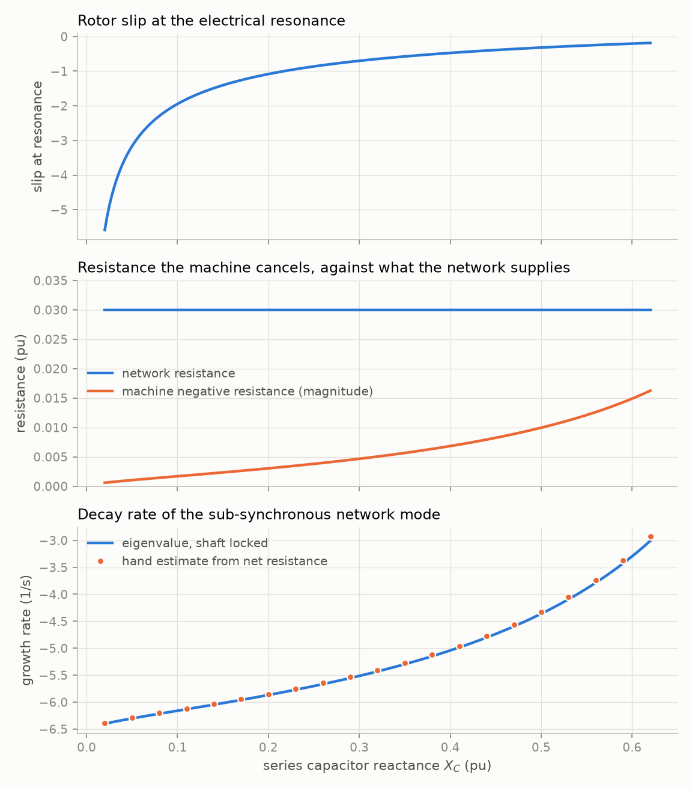
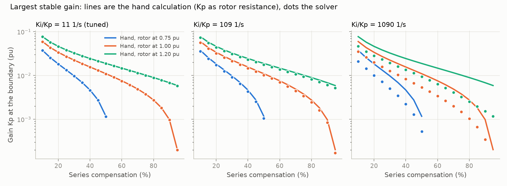
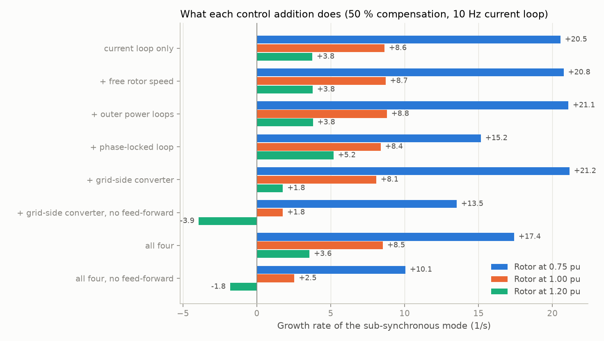
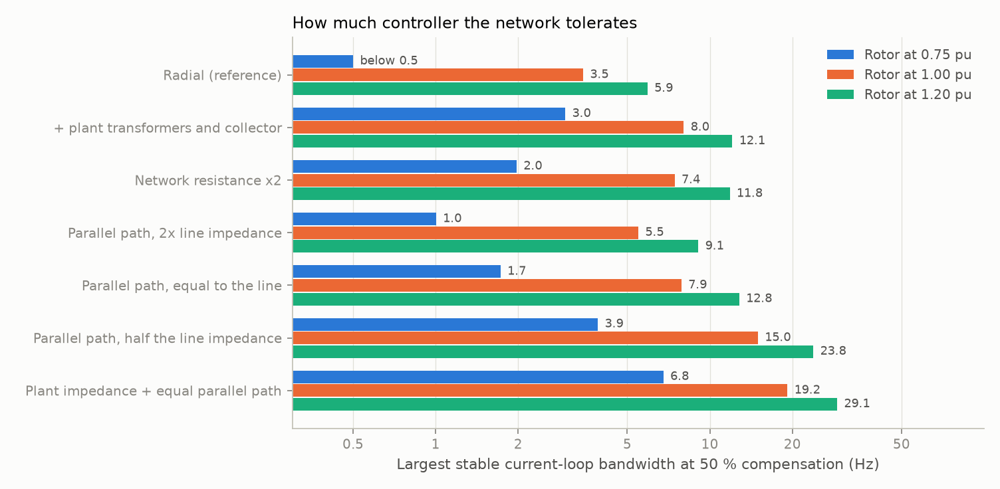

# sso-sciml

Scientific machine learning for sub-synchronous oscillation (SSO) screening in series-compensated and inverter-rich power grids.

The question it keeps asking: will this machine, at this operating point, on this network, see negative slip at the electrical resonance and feed an oscillation, and how fast will it grow?

The project pairs a first-principles reference solver (network electromagnetic transients kept) with hand calculations of the mechanism and with several kinds of learned model: gradient-boosted trees, Gaussian processes, MLP ensembles, physics-informed networks, DeepONet, Fourier neural operators, neural ODEs and sequence models. Its central experiment compares where the physics goes: in the loss, in the input features, in the architecture, or nowhere.

**Status:** Phases 0 and 1 complete; Phase 2 under way. The solver core is validated on the IEEE First Benchmark Model, the induction generator case (self-excitation boundary, energy accounting) is done, and the doubly-fed machine is modelled with its full control structure on radial and meshed networks, in two independent formulations. No learned models yet.

| Document | What it is |
|---|---|
| [docs/PLAN.md](docs/PLAN.md) | Scope, physics, learning tasks, phases, exit checks, risks |
| [docs/steps/](docs/steps/) | Step log: what was run, the numbers, what disagreed |
| [docs/EQUATIONS.md](docs/EQUATIONS.md) | Model equations and sign conventions |
| [docs/ASSUMPTIONS.md](docs/ASSUMPTIONS.md) | Each modelling assumption, how it was tested, and the result |
| [docs/VALIDATION.md](docs/VALIDATION.md) | What has been checked against what, and what is still open |

## Phase 1 in one figure



On the benchmark, the rotor always sees negative slip at the electrical resonance and always presents negative resistance, but never enough to cancel the network's 0.03 pu. The hand estimate of the decay rate matches the full model within 2.6 %. What destabilises this system is the shaft: at the benchmark compensation the second torsional mode grows at +0.36 1/s. Details in [docs/steps/01-solver-core-fbm.md](docs/steps/01-solver-core-fbm.md).

## Phase 2 so far: where slip alone wins


For an induction generator on the same line, the hand calculation (net resistance at resonance equal to zero) and the solver agree on the self-excitation boundary within 0.9 points of compensation, and exactly when the rotor speed is held. A typical single-cage machine just above synchronous speed is safe up to 96.5 % compensation. The boundary falls quickly with more rotor resistance or a slower rotor, which is what a doubly-fed machine and its current controller bring. Energy taken from the simulated waveform matches the negative resistance of the slip calculation within 1.4 % for a sustained oscillation. Details in [docs/steps/02-induction-generator.md](docs/steps/02-induction-generator.md).

### Adding the converter



In a doubly-fed machine the rotor current controller's proportional gain behaves as added rotor resistance. The hand calculation built on that predicts the largest stable gain within 2 % of the solver at standard tuning, and fails as integral action is made stronger (right panel). The energy budget of the simulated oscillation shows the converter absorbing energy and the shaft supplying all of it. This stage has no phase-locked loop, outer loops or grid-side converter yet, and is less stable than plants in service; see [docs/steps/03-dfig-current-control.md](docs/steps/03-dfig-current-control.md).

### Full controls



Adding the phase-locked loop, outer loops, grid-side converter and free rotor speed changes the sub-synchronous growth rate at rated speed by 0.1 1/s, provided the grid-side converter feeds the terminal voltage forward. Without that feed-forward its current controller acts as a resistor across the terminals and removes 5 to 10 1/s. The hand calculation stays within 4 points of compensation of the full solver in the first case and is up to 32 points pessimistic in the second. Details in [docs/steps/04-dfig-full-controls.md](docs/steps/04-dfig-full-controls.md).

### The network



A second formulation, loop impedance as polynomials with no state vector, reproduces the state-space modes to 2e-8. Varying the network with it shows that the radial connection studied so far is the worst case. Plant transformers and one parallel path as strong as the line raise the largest stable current-loop bandwidth at rated speed from 3.5 to 19.2 Hz. A partly loaded plant is worse than a full one. The time-domain model with full controls confirms the network results (20.3 Hz on that network). Details in [docs/steps/05-network-and-impedance.md](docs/steps/05-network-and-impedance.md).

## Setup

Requires [uv](https://docs.astral.sh/uv/) and, for training, an NVIDIA GPU with a current driver. Developed on Windows 11 with an RTX 3070 (8 GB).

```powershell
git clone git@github.com:TimThacker/sso-sciml.git
cd sso-sciml
uv sync
uv run scripts/check_gpu.py
uv run pytest
```

`uv sync` installs the CUDA 13.0 build of PyTorch on Windows and the CPU build elsewhere.

## Everyday commands

| Task | Command |
|---|---|
| Sync environment to lockfile | `uv sync` |
| Run tests | `uv run pytest` |
| Run tests without a GPU | `uv run pytest -m "not gpu"` |
| Lint | `uv run ruff check` |
| Add a dependency | `uv add <package>` |
| GPU report and benchmark | `uv run scripts/check_gpu.py` |
| Reproduce Phase 1 numbers and figures | `uv run scripts/phase1_validate.py` |
| Reproduce the induction generator study | `uv run scripts/phase2_induction.py` |
| Reproduce the doubly-fed machine study | `uv run scripts/phase2_dfig.py` |
| Reproduce the full-control study | `uv run scripts/phase2_dfig_full.py` |
| Reproduce the network study | `uv run scripts/phase2_network.py` |
| Reproduce its time-domain confirmation | `uv run scripts/phase2_meshed.py` |

## Licence

MIT. See [LICENSE](LICENSE).
