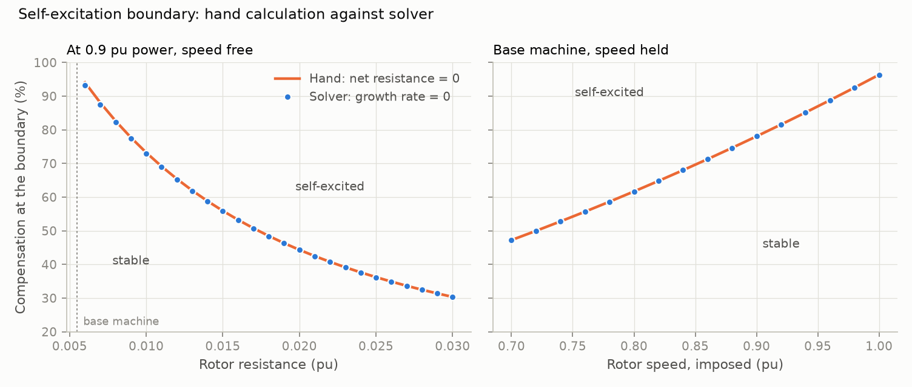
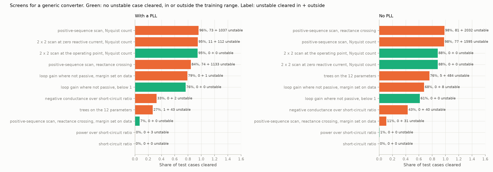
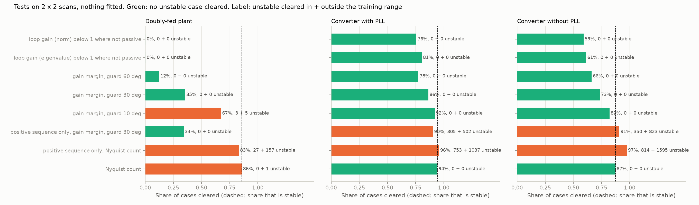
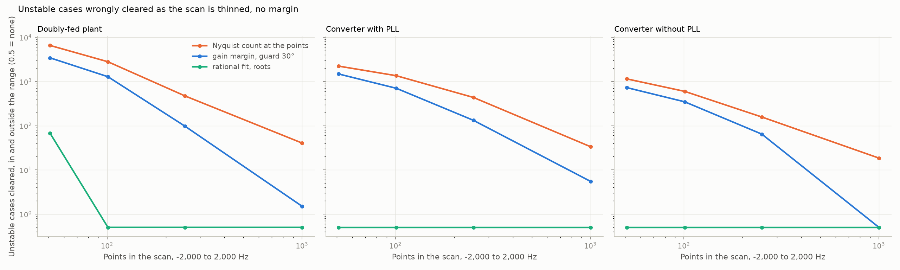
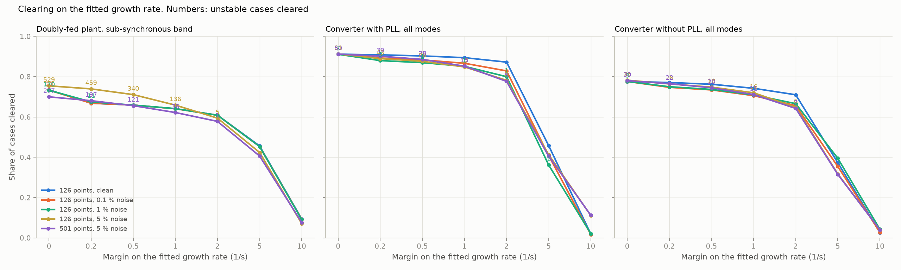
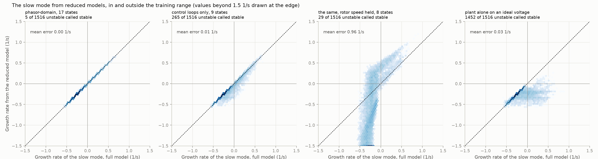
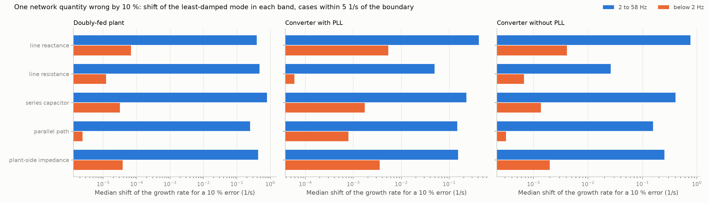
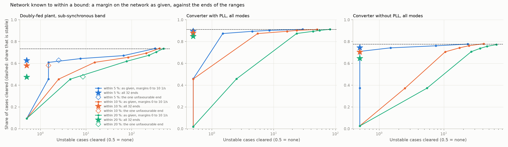
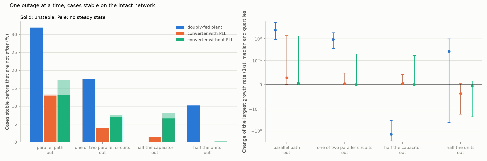
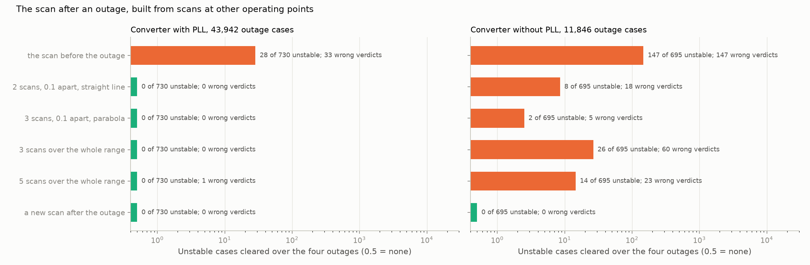

# sso-sciml

Scientific machine learning for sub-synchronous oscillation (SSO) screening in series-compensated and inverter-rich power grids.

The question it keeps asking: will this machine, at this operating point, on this network, see negative slip at the electrical resonance and feed an oscillation, and how fast will it grow?

The project pairs a first-principles reference solver (network electromagnetic transients kept) with hand calculations of the mechanism and with several kinds of learned model: gradient-boosted trees, Gaussian processes, MLP ensembles, physics-informed networks, DeepONet, Fourier neural operators, neural ODEs and sequence models. Its central experiment compares where the physics goes: in the loss, in the input features, in the architecture, or nowhere.

**Status:** Phases 0 and 1 complete; Phase 2 under way. The solver core is validated on the IEEE First Benchmark Model, the induction generator case (self-excitation boundary, energy accounting) is done, and the doubly-fed machine is modelled with its full control structure on radial and meshed networks, in two independent formulations. No learned models yet.

| Document | What it is |
|---|---|
| [docs/PLAN.md](docs/PLAN.md) | Scope, physics, learning tasks, phases, exit checks, risks |
| [docs/steps/](docs/steps/) | Step log: what was run, the numbers, what disagreed |
| [docs/EQUATIONS.md](docs/EQUATIONS.md) | Model equations and sign conventions |
| [docs/ASSUMPTIONS.md](docs/ASSUMPTIONS.md) | Each modelling assumption, how it was tested, and the result |
| [docs/VALIDATION.md](docs/VALIDATION.md) | What has been checked against what, and what is still open |

## Phase 1 in one figure


On the benchmark, the rotor always sees negative slip at the electrical resonance and always presents negative resistance, but never enough to cancel the network's 0.03 pu. The hand estimate of the decay rate matches the full model within 2.6 %. What destabilises this system is the shaft: at the benchmark compensation the second torsional mode grows at +0.36 1/s. Details in [docs/steps/01-solver-core-fbm.md](docs/steps/01-solver-core-fbm.md).

## Phase 2 so far: where slip alone wins



For an induction generator on the same line, the hand calculation (net resistance at resonance equal to zero) and the solver agree on the self-excitation boundary within 0.9 points of compensation, and exactly when the rotor speed is held. A typical single-cage machine just above synchronous speed is safe up to 96.5 % compensation. The boundary falls quickly with more rotor resistance or a slower rotor, which is what a doubly-fed machine and its current controller bring. Energy taken from the simulated waveform matches the negative resistance of the slip calculation within 1.4 % for a sustained oscillation. Details in [docs/steps/02-induction-generator.md](docs/steps/02-induction-generator.md).

### Adding the converter


In a doubly-fed machine the rotor current controller's proportional gain behaves as added rotor resistance. The hand calculation built on that predicts the largest stable gain within 2 % of the solver at standard tuning, and fails as integral action is made stronger (right panel). The energy budget of the simulated oscillation shows the converter absorbing energy and the shaft supplying all of it. This stage has no phase-locked loop, outer loops or grid-side converter yet, and is less stable than plants in service; see [docs/steps/03-dfig-current-control.md](docs/steps/03-dfig-current-control.md).

### Full controls


Adding the phase-locked loop, outer loops, grid-side converter and free rotor speed changes the sub-synchronous growth rate at rated speed by 0.1 1/s, provided the grid-side converter feeds the terminal voltage forward. Without that feed-forward its current controller acts as a resistor across the terminals and removes 5 to 10 1/s. The hand calculation stays within 4 points of compensation of the full solver in the first case and is up to 32 points pessimistic in the second. Details in [docs/steps/04-dfig-full-controls.md](docs/steps/04-dfig-full-controls.md).

### The network


A second formulation, loop impedance as polynomials with no state vector, reproduces the state-space modes to 2e-8. Varying the network with it shows that the radial connection studied so far is the worst case. Plant transformers and one parallel path as strong as the line raise the largest stable current-loop bandwidth at rated speed from 3.5 to 19.2 Hz. A partly loaded plant is worse than a full one. The time-domain model with full controls confirms the network results (20.3 Hz on that network). Details in [docs/steps/05-network-and-impedance.md](docs/steps/05-network-and-impedance.md).

With stator and network transients dropped, as in a positive-sequence stability tool, the sub-synchronous mode does not exist in the model: of 54 cases, 28 are unstable and all 28 are reported stable, with growth rates up to 28 1/s missed. Keeping the inductances dynamic but fixing the capacitor at its 60 Hz reactance gives a mode 9 to 14 Hz off. Details in [docs/steps/06-assumption-studies.md](docs/steps/06-assumption-studies.md).

A second time-domain implementation, in phase a, b, c quantities with the trapezoidal rule and no shared equations, gives the same growth rates within 0.00014 1/s and shows the oscillation at 60 Hz minus its rotating-frame frequency, as it should. Details in [docs/steps/07-phase-coordinates.md](docs/steps/07-phase-coordinates.md).

The first dataset holds 131,072 cases over 12 plant, network and controller parameters, each with the full-solver growth rate and the hand calculation side by side. The hand calculation is off by 1.3 1/s on average and has the sign right in 95.2 % of cases, but only 50.0 % of the time near the stability boundary. Details in [docs/steps/08-t1-dataset.md](docs/steps/08-t1-dataset.md).

The first learned models predict that growth rate from the 12 parameters. A multilayer perceptron trained on 100,000 cases is off by 0.10 1/s on held-out cases; one that learns the correction to the hand calculation instead is off by 0.08 1/s, and by 1.4 to 3 times less than the plain one on the five extrapolation sets. Cases close to the stability boundary remain hard: the best model still calls 21.7 % of the unstable ones stable. Details in [docs/steps/09-t1-arms.md](docs/steps/09-t1-arms.md).

Learning the correction has a price. Give the hand calculation a random error of 1 1/s and the correcting model is off by 0.85 1/s, while a model that takes the hand calculation as an input learns to distrust it and stays at 0.11 1/s. Details in [docs/steps/10-t1-feature-studies.md](docs/steps/10-t1-feature-studies.md).

Error bars calibrated on held-out cases cover 90 % inside the training range and between 36 and 94 % outside it. Used as a screen, they send about 1 % of cases to the full solver and cut the unstable cases called stable from 2.0 % to 0.15 %. In batches the plain network is about 7,500 times faster than the solver. Details in [docs/steps/11-t1-uncertainty.md](docs/steps/11-t1-uncertainty.md).

A network trained on the equations alone, with no solver data, was tried on one case of the induction generator. Over a 0.5 s window it settles onto the steady state, which satisfies the equations as well as the true response does. Scaling each state and marching through time in windows of 0.05 s fix that: 4 % error after 365 s of training, against 4.7 s for the solver. Details in [docs/steps/12-forward-pinn.md](docs/steps/12-forward-pinn.md).

Putting the model's equations into the training loss did not pay for the growth-rate task. With no solver labels the network finds an eigenvalue of the right matrix, but a slow, well-damped one, not the one that matters. With 100 labels the penalty helps at one weight (0.83 to 0.59 1/s) and hurts at ten times that. And the state matrix the penalty needs costs 96 % of a full solve, so the labels might as well be computed. Details in [docs/steps/13-eigen-residual.md](docs/steps/13-eigen-residual.md).

### How little information decides stability

Deterministic screens were lined up by the data they need and scored on how many cases each clears without clearing an unstable one.

- **A positive-sequence (phasor-domain) dynamic model is blind to the problem.** It reports every unstable case as stable. Its network data, scaled in frequency, is all the screen below needs.
- **A frequency scan of the network, with resistance, clears a quarter of cases with no plant data.** Without resistance it clears none.
- **The root of the loop impedance (network, machine, current loop) with a safety margin clears 80 % of cases, none of them unstable.** The margin is 1 1/s where the PLL is slower than the mode and 5 1/s where it is faster. Outside the tested range it wrongly clears 5 unstable cases of 8,673.
- **Trees trained on 20,000 solved cases clear 50 % on the same terms.** Learned models win on average error and lose in the tail, and a screen is judged by its tail.
- **One controller number matters most: the current-loop bandwidth.** Outer loops, rotor resistance and exact PLL tuning hardly matter.

Details in [docs/steps/14-screening-ladder.md](docs/steps/14-screening-ladder.md).

- **The waveform needs no time-domain run either.** For a capacitor-voltage disturbance of 0.2 pu the oscillation computed from the eigenvalues differs from the time-domain run by 0.44 %. A growing oscillation departs from it only when it has reached about 1 pu. What a time-domain run adds is the effect of converter limits, which the model does not yet have.

Details in [docs/steps/15-linear-vs-time-domain.md](docs/steps/15-linear-vs-time-domain.md).

- **The first limit a growing oscillation meets is the DC link, and the eigenvalues say roughly when.** With the rotor-side converter voltage limited to 0.4 pu, the DC-link voltage leaves a 0.2 pu band first in 96 % of cases. The time to that point follows from the modes to within 8 %, erring late. After it the model loses control; it has no chopper, crowbar or trip logic, so what follows is not to be trusted.

Details in [docs/steps/16-converter-limit.md](docs/steps/16-converter-limit.md).

### Any converter, source or load



The same question was put to a plant with no machine: one converter model that can be a source or a load (wind, solar, storage, drive, UPS, power supply), with a phase-locked loop or without one.

- **The rule found for the doubly-fed plant does not carry over; the method does.** A current loop alone cannot feed an oscillation here. The negative conductance comes from whichever loop holds power constant: the phase-locked loop for a source, the DC voltage loop for a load. Slowing the PLL tenfold cures 81 % of unstable sources and 23 % of unstable loads.
- **One screen clears no unstable case in 60,124, with nothing fitted to data.** A case is cleared if the loop gain of converter admittance and network impedance is below 1 at every frequency where the converter's conductance is negative. It clears 76 % of cases with a phase-locked loop and 61 % without. It needs a 2 × 2 admittance scan of the converter, which a black-box model can supply, and the network's R, X and C.
- **A Nyquist count on the same scans is exact,** if the scan is taken at the operating point from a power-flow solution.
- **Positive-sequence scans alone miss 40 % of unstable cases, and the short-circuit ratio alone clears nothing safely.**

Details in [docs/steps/17-generic-converter.md](docs/steps/17-generic-converter.md).

### One screen for both plant types



The doubly-fed plant was then scanned the same way, as a 2 × 2 admittance against the impedance of its network.

- **The loop-gain test of the converter clears 0.2 % of doubly-fed cases.** Sub-synchronous resonance is a series resonance: where the reactances cancel the loop gain is near 1 in every case, stable or not, and the resistance left over decides.
- **A gain margin with a 30° guard clears no unstable case in 98,635, with nothing fitted.** Every eigenvalue of the loop matrix within 30° of the negative real axis must be below 1 in size. It clears 36 % of doubly-fed cases, 86 % of converters with a phase-locked loop and 74 % of those without.
- **A Nyquist count on the same scans settles the rest.** It agrees with the eigenvalues in all but 1 of 93,704 cases, and has no margin.
- **The scan has to be fine.** A thin scan clears unstable cases. Points 2.5 % apart in frequency are enough for a guarded test; the count needs 0.6 %.
- **The hand formula of the doubly-fed plant was blind to a second mode.** It clears 478 test cases that are unstable in a slow mode of the outer loops. The scan sees them.

Details in [docs/steps/18-one-screen-two-plants.md](docs/steps/18-one-screen-two-plants.md).

### Fewer points: a rational fit to the scan



- **A rational function fitted to a clean scan of 251 points gives the right verdict in all 98,635 cases** and the growth rate to within 0.01 1/s in 99.9 % of them. The tests at the scan points needed 4,001 points and still erred on the boundary.
- **The number of points is set by the order of the system (13 to 23 terms), not by how sharp its resonances are.** At 101 points the fit is wrong twice, on the safe side. At 51 it fails on the doubly-fed plant.
- **With 5 % noise the fit is useless,** because it passes through its points. The pointwise gain margin degrades gently. Scans from a model suit the fit; noisy scans need the guarded test on a dense grid.
- **A margin in 1/s is cheap for the converters and not for the doubly-fed plant,** whose slow mode decays at 0.2 to 0.4 1/s in every case.

Details in [docs/steps/19-rational-fit.md](docs/steps/19-rational-fit.md).

### Noisy scans: a least-squares fit and a margin for each mode



- **The fit through the points holds only for exact scans.** Noise of one part in a million makes it flag most stable cases.
- **A least-squares fit of the admittance, closed on the known network, tolerates noise.** In the sub-synchronous band the growth rate is uncertain by about 0.06 1/s per percent of scan error in the median.
- **A margin sized to the scan error makes it safe.** With 1 % noise a margin of 0.5 1/s clears no unstable case and costs 4 to 8 points of cleared cases. With 5 % noise the margin has to be 5 1/s and about 40 % of cases are cleared.
- **Accuracy matters more than density.** 126 points at 1 % decide more cases than 501 points at 5 %.
- **Modes are sorted by frequency, so each gets its own margin.** The slow mode of the doubly-fed plant no longer sets the margin for the resonance. That slow mode is too weakly seen at the terminals to screen from a noisy scan; it has to be checked on the plant alone.

Details in [docs/steps/20-noise-and-modes.md](docs/steps/20-noise-and-modes.md).

### The slow mode, and what the phasor-domain model is for



- **The doubly-fed plant has a slow mode near 0.5 Hz in every case,** made of the rotor current controller integrators, the outer loops and rotor speed. It is unstable in 3.6 % of test cases: slow current loop (below about 8 Hz), fast outer loops, high rotor speed. The series capacitor plays no part.
- **The phasor-domain model reproduces it to 0.006 1/s.** The same model sees none of the 1,376 cases unstable in the sub-synchronous band. It is exact below 2 Hz and blind above.
- **The plant alone on an ideal voltage misses 96 % of the unstable cases.** The network's 60 Hz reactance is what tips the mode.
- **Two models with no scan cover both bands.** The hand formula for the resonance and the phasor-domain model for the slow mode together clear 75.6 % of test cases and no unstable one.

Details in [docs/steps/21-slow-mode.md](docs/steps/21-slow-mode.md).

### Error in the network data



- **A perfect plant model on a wrong network is not safe.** The growth rate of the resonance is off by about 0.08 1/s per percent of error in the network data, the same size as the effect of scan noise. With 5 % error and no margin, one unstable doubly-fed case in seven is cleared.
- **Which number matters depends on the plant.** For the doubly-fed plant: the series capacitor (0.8 1/s for a 10 % error), then line resistance. For a converter: line reactance, and resistance not at all.
- **Margins of several 1/s are needed,** and for 10 % error only a margin of 10 1/s clears no unstable case.
- **The slow band is immune.** A 10 % error moves the slow mode by less than 0.001 1/s, so the phasor-domain screen stays safe.

Details in [docs/steps/22-network-error.md](docs/steps/22-network-error.md).

### Uncertain network data: the ends of the ranges, not a wider margin



- **If each network number is known to within a bound, run the screen at the ends of the ranges.** Five quantities give 32 ends; the largest growth rate among them decides, with no margin.
- **It clears no unstable case** on any plant type with the network known to within 5 %, 10 % or 20 %.
- **It clears far more than a margin of the same safety.** Within 10 %: 56 % of doubly-fed cases, 97 % and 77 % of converters, against 10 %, 2 % and 3 % for the 10 1/s margin that is as safe.
- **A margin is one number for every case; the ends give each case its own.** Most converter cases hardly depend on the network and a few depend on it strongly.

Details in [docs/steps/23-network-corners.md](docs/steps/23-network-corners.md).

### Scan noise and uncertain network data together

- **The complete screen:** a 2 × 2 scan of the plant at about a hundred frequencies, a least-squares fit, and the fitted plant closed on the network at the 32 ends of the ranges of its data. The largest growth rate decides.
- **With a scan good to 1 % and a network known to within 10 % it needs no margin** and clears no unstable case in 24,526. It clears 56 % of doubly-fed cases (72 % are stable in the band), 96.4 % of converters with a phase-locked loop (97.6 %) and 76.8 % of those without (82.7 %).
- **Allowances do not stack.** The spread over the ends already covers 1 % of scan noise. With 5 % noise a margin of 1 1/s on top is enough.

Details in [docs/steps/24-noise-and-ranges.md](docs/steps/24-noise-and-ranges.md).

### One outage at a time



- **Losing the parallel path is the worst outage for every plant type.** A third of doubly-fed cases that are stable with it are unstable without it, and 13 % and 17 % of converters.
- **A margin on the intact network does not cover an outage.** About one case in ten that decays at 10 1/s intact is insecure after losing the parallel path.
- **Half the units out hurts the machine and helps a converter;** half the capacitor out does the reverse.
- **One scan serves every outage for the doubly-fed plant** (growth rate right to 0.01 1/s) **and not for a converter,** whose admittance moves with the operating point: 203 and 465 insecure cases are cleared if the scan is reused.

Details in [docs/steps/25-outages.md](docs/steps/25-outages.md).

### A converter across outages: two or three scans, not one per outage



- **At a given power the converter's admittance depends on one more number:** its reactive current if it has a phase-locked loop, its terminal voltage if it has not. A scan retaken at that number after an outage is exact.
- **With a phase-locked loop two scans 0.1 pu apart and a straight line are enough:** no wrong verdict in 43,942 outage cases, where reusing one scan clears 28 unstable ones.
- **Without one, three scans and a parabola clear 2 unstable cases of 695,** against 147 for one scan.
- **The power flow after each outage supplies the one number.** Nothing else has to be recomputed on the plant side.

Details in [docs/steps/26-operating-point.md](docs/steps/26-operating-point.md).

## Setup

Requires [uv](https://docs.astral.sh/uv/) and, for training, an NVIDIA GPU with a current driver. Developed on Windows 11 with an RTX 3070 (8 GB).

```powershell
git clone git@github.com:TimThacker/sso-sciml.git
cd sso-sciml
uv sync
uv run scripts/check_gpu.py
uv run pytest
```

`uv sync` installs the CUDA 13.0 build of PyTorch on Windows and the CPU build elsewhere.

## Everyday commands

| Task | Command |
|---|---|
| Sync environment to lockfile | `uv sync` |
| Run tests | `uv run pytest` |
| Run tests without a GPU | `uv run pytest -m "not gpu"` |
| Lint | `uv run ruff check` |
| Add a dependency | `uv add <package>` |
| GPU report and benchmark | `uv run scripts/check_gpu.py` |
| Reproduce Phase 1 numbers and figures | `uv run scripts/phase1_validate.py` |
| Reproduce the induction generator study | `uv run scripts/phase2_induction.py` |
| Reproduce the doubly-fed machine study | `uv run scripts/phase2_dfig.py` |
| Reproduce the full-control study | `uv run scripts/phase2_dfig_full.py` |
| Reproduce the network study | `uv run scripts/phase2_network.py` |
| Reproduce its time-domain confirmation | `uv run scripts/phase2_meshed.py` |
| Reproduce the assumption studies | `uv run scripts/phase2_assumptions.py` |
| Reproduce the phase-coordinate cross-check | `uv run scripts/phase2_abc.py` |
| Generate the T1 dataset (about 7 minutes) | `uv run scripts/phase3_generate_t1.py` |
| Generate the converter dataset C1 (about 10 minutes) | `uv run scripts/phase3_generate_c1.py` |
| Reproduce the converter screens | `uv run scripts/converter_screens.py` |
| Scan the doubly-fed plant of dataset T1 (about 6 minutes) | `uv run scripts/phase3_scan_t1.py` |
| Reproduce the screens on scans of both plant types | `uv run scripts/scan_screens.py` |
| Fit rational functions to the scans (about 30 minutes) | `uv run scripts/phase3_fit_scans.py` |
| Reproduce the rational-fit screen | `uv run scripts/fit_screens.py` |
| Fit noisy scans by least squares (about 37 minutes) | `uv run scripts/phase3_noise_fits.py` |
| Reproduce the noise study | `uv run scripts/noise_screens.py` |
| Reproduce the slow-mode study (about 10 minutes) | `uv run scripts/slow_mode.py` |
| Reproduce the network-error study (about 25 minutes) | `uv run scripts/network_error.py` |
| Reproduce the screen at the ends of the network ranges | `uv run scripts/network_corners.py` |
| Reproduce scan noise and network ranges together (about 25 minutes) | `uv run scripts/noise_and_ranges.py` |
| Reproduce the outage study (about 20 minutes) | `uv run scripts/outages.py` |
| Reproduce the operating-point study (about 20 minutes) | `uv run scripts/operating_point.py` |

## Licence

MIT. See [LICENSE](LICENSE).
