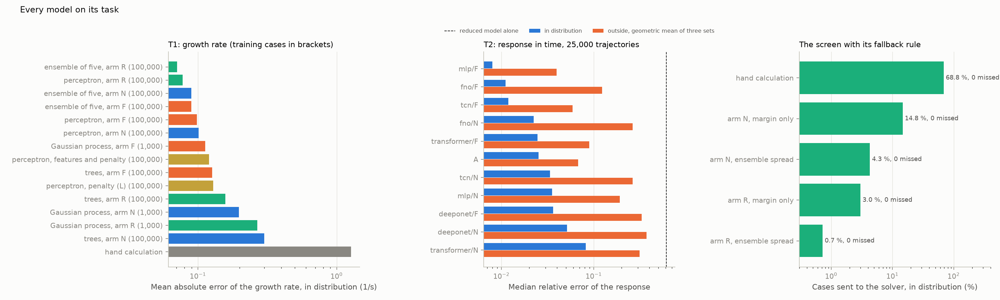

# Final report

Date: 2026-11-14 · Plan phase: 12

This report sets the whole project side by side: what was built, how every model did on its task, what was checked against what, where things fail, the verdicts on the hypotheses written before any training, and what would be done differently. The numbers of sections 2 and 3 are gathered by `scripts/phase12_report.py` into `docs/results/phase12/summary.json`. Every other number is quoted from the step named beside it, and that step names the script that produces it.

## 1. What was built

The question throughout: will this machine, at this operating point, on this network, see negative slip at the electrical resonance and feed an oscillation, and how fast will it grow?

| Phase | What | Steps |
|---|---|---|
| 1 | Solver core on the First Benchmark Model: steady state, linearisation, modes, time integration | 01 |
| 2 | Induction generator, then the doubly-fed plant with its full controls on radial and meshed networks, in two formulations and a second time-domain code | 02 to 07 |
| 3 | Datasets: T1 (growth rate, 12 parameters, 131,072 cases), T2 (response in time, 4 parameters, 32,768 trajectories), a generic converter, protection | 08, 15 to 17, 33, 35 |
| 4 | First learned models on T1, feature studies, uncertainty | 09 to 11 |
| 5 | Physics-informed networks: a forward one, and the eigenvalue residual as a loss | 12, 13 |
| — | Deterministic screens: how little information decides stability, for both plant types, with noise, uncertain network data, outages, several plants, delay and shunt capacitance | 14, 17 to 32 |
| 6 | Where the physics goes: features, baseline, loss, architecture, on T1 and T2 | 34, 36, 37 |
| 7 | Operators and sequence models on T2 | 38 |
| 8 | From a measured current back to the mode and the parameters | 39 |
| 9 | Outside the training range, and when to call the solver | 40 |
| 10 | Design search for damping | 41 |
| 11 | Model registry, screening service, model card | 42 |

The screening work between Phases 5 and 6 was not in the plan. It grew out of step 14 and became the larger half of the project.

## 2. The findings that matter

1. **The mechanism is what the plan said it was, and a hand calculation carries most of it.** A doubly-fed plant's current controller acts as rotor resistance; at the network resonance the slip is negative and so is the machine's resistance. The root of the loop impedance of network, machine and current loop is within 1.3 1/s of the full solver on average (step 08).
2. **A positive-sequence stability model cannot see the problem at all.** It reports every unstable case as stable (steps 06, 14). It is exact for the slow mode below 2 Hz and blind above (step 21).
3. **The safest screen is deterministic and needs no training data.** A 2 × 2 admittance scan of the plant at about a hundred frequencies, a least-squares fit, and the fitted plant closed on the network at the 32 ends of the ranges of its data. With a scan good to 1 % and a network known to within 10 % it clears no unstable case in 24,659 and clears 58 % of doubly-fed cases and 71 % to 88 % of converters (step 24). It holds with outages (25, 26), several plants on a bus (27, 32), control delay (29) and shunt capacitance (30).
4. **A learned screen is cheaper and narrower.** Inside its training range, the hand calculation plus a learned correction, as an ensemble of five, needs the solver for 0.7 % of cases and calls no unstable case stable (step 40). Outside the range no detector makes it safe.
5. **Physics belongs in the inputs or the baseline, not in the loss.** A physics penalty in training was the worst use of the physics on both tasks, at five to eight times the cost (step 37).
6. **Architecture matters less than inputs.** No operator or sequence model beat a plain perceptron that is given the reduced model's response (step 38).
7. **From a measurement, the series compensation can be read and the phase-locked loop cannot** (step 39).
8. **There is no limit cycle.** An unstable case grows until the plant trips; protection decides how it ends and not whether (step 33).

## 3. Every model on its task

### T1: growth rate of the sub-synchronous mode from 12 parameters

Mean absolute error in 1/s. Trained on 100,000 cases unless stated.

| Model | In distribution | Boundary | High compensation | Low speed | Fast current loop | Weak parallel path | Other machine |
|---|---|---|---|---|---|---|---|
| Hand calculation (no training) | 1.27 | 1.98 | 2.01 | 2.81 | 1.90 | 1.98 | 1.26 |
| Trees, N | 0.301 | 0.477 | 1.47 | 0.875 | 2.64 | 0.889 | 0.433 |
| Trees, F | 0.127 | 0.176 | 0.557 | 0.627 | 0.570 | 0.245 | 0.139 |
| Trees, R | 0.158 | 0.182 | 0.559 | 0.838 | 0.499 | 0.252 | 0.161 |
| Perceptron, N: no physics | 0.101 | 0.162 | 0.414 | 0.433 | 0.545 | 0.358 | 0.136 |
| Perceptron, F: physics as features | 0.098 | 0.129 | 0.390 | 0.400 | 0.374 | 0.222 | 0.116 |
| Perceptron, R: physics as baseline | 0.078 | 0.064 | 0.250 | 0.315 | 0.199 | 0.175 | 0.075 |
| Perceptron, L: physics as penalty | 0.129 | | | | | | |
| Perceptron, F and penalty | 0.120 | | | | | | |
| Ensemble of five, N | 0.090 | 0.148 | 0.378 | 0.392 | 0.532 | 0.342 | 0.114 |
| Ensemble of five, F | 0.090 | 0.119 | 0.376 | 0.375 | 0.361 | 0.202 | 0.104 |
| Ensemble of five, R | **0.071** | **0.059** | **0.246** | **0.272** | **0.183** | **0.166** | **0.066** |
| Gaussian process, N, 1,000 cases | 0.197 | | | | | | |
| Gaussian process, F, 1,000 cases | 0.113 | | | | | | |
| Gaussian process, R, 1,000 cases | 0.268 | | | | | | |

Single perceptrons and trees are means of five seeds (step 34); the ensembles are one each (step 40); the Gaussian processes are means of three seeds (step 11). The outside sets of the penalty arms are in step 34.

- **The baseline wins.** The correction to the hand calculation is the best form in distribution and on every outside set, as one network or as five.
- **Trees are no match for a perceptron here** unless they are given the hand calculation, and then they are within 30 % of it.
- **A Gaussian process at 1,000 cases is as good as a perceptron at 1,000** (0.20 against 0.21 1/s, steps 11 and 34) and cannot be trained on more.
- **The penalty arms are worse than no physics.**
- **Speed:** the solver takes 10 ms a case and the hand calculation 1.7 ms. A perceptron takes 1.4 µs a case in a batch and 0.2 ms alone (step 11).

### T2: the response over 0.3 s from 4 parameters

Median relative error of the response, models trained on 25,000 trajectories (step 38). The reduced model alone is at 0.61 in distribution.

| Model | In distribution | High compensation | Low speed | Fast current loop | Training (s) |
|---|---|---|---|---|---|
| Perceptron, no physics | 0.036 | 0.345 | 0.109 | 0.189 | 83 |
| Perceptron, reduced response as inputs | **0.008** | **0.023** | **0.046** | **0.058** | 92 |
| DeepONet, with inputs | 0.036 | 1.035 | 0.122 | 0.287 | 47 |
| Fourier neural operator, with inputs | 0.011 | 0.242 | 0.057 | 0.136 | 84 |
| Temporal convolutional network, with inputs | 0.012 | 0.059 | 0.048 | 0.073 | 83 |
| Transformer, with inputs | 0.025 | 0.076 | 0.079 | 0.118 | 198 |
| Arm A: linear system with learned matrices | 0.025 | 0.047 | 0.053 | 0.127 | 237 |

- **The reduced model as inputs is worth more than any architecture.** It cuts the error of every architecture by 29 % to 77 %.
- **Only the perceptron with those inputs stays under 10 % error over the whole window on all three outside sets.**

### T3: the mode from 0.3 s of phase current

Median error of the growth rate in 1/s (step 39).

| Method | 40 dB | 20 dB | 0 dB |
|---|---|---|---|
| Matrix pencil, fault recorder | 0.047 | 0.42 | 1.99 |
| Prony, fault recorder | 2.36 | 2.56 | 14.8 |
| Matrix pencil, phasors at 120 /s | 0.11 | 0.74 | 1.95 |
| Phasors at 60 /s | 0.57 | 1.39 | 2.16 |
| Phasors at 30 /s | 2.14 | 2.28 | 4.07 |
| Convolutional network, fault recorder | 0.057 | 0.12 | 0.42 |

- **Matrix pencil on a clean record, a trained network on a noisy one.** They cross near 40 dB.
- **Of the plant's parameters, the waveform is 12 to 190 times more sensitive to the series compensation than to any other.** The phase-locked loop is lost once the noise passes about 20 dB.

### The screen with a fallback

Share of in-distribution test cases sent to the solver under a rule that called no unstable case stable on validation (step 40).

| Screen | Sent to the solver | Unstable called stable, of 1,376 |
|---|---|---|
| Hand calculation with a margin | 68.8 % | 0 |
| Perceptrons, no physics, margin only | 14.8 % | 0 |
| Perceptrons, no physics, with ensemble spread | 4.3 % | 0 |
| Baseline arm, margin only | 3.0 % | 0 |
| Baseline arm, with ensemble spread | **0.7 %** | 0 |

Outside the training range the last row calls 16 of 1,476 unstable cases stable at high compensation and 8 of 920 at low speed. The hand calculation with its margin calls none stable on any set, at 64 % to 81 % of cases sent to the solver. Cheap and narrow against dear and wide: the service of step 42 uses the first inside the range and the solver outside.

### Design search

Worst-case growth rate over 12 scenarios, with all five capacitor segments in service (step 41). The best design found is at +0.49 1/s.

| Method | Score at the end (1/s) | Solver calls to within 1 1/s of the best |
|---|---|---|
| Random search | +2.76 ± 0.55 | never in 2,880 |
| CMA-ES | +0.52 ± 0.05 | 408 to 1,308 |
| Bayesian optimisation | +0.50 ± 0.03 | 216 to 312 |
| Surrogate, 20,000 training calls, solver-confirmed | +2.76 ± 0.72 | never |

- **The surrogate promised −0.7 1/s and the solver found +2.8.** Its average error on fresh cases was 0.05 1/s.
- **A damping controller is worth 3 to 11 1/s** and lets four of five segments stay in service (−4.5 1/s). The nonlinear model agrees with the eigenvalues to 0.16 1/s.

### The service

`t1-screen 1.0.0` (step 42, card in `docs/model_cards/t1-screen.md`): growth-rate error 0.069 1/s in distribution, 0.9 % of cases to the solver, 0 of 1,376 unstable cases called stable. Through the service, 500 test cases all came back with the right sign; an answer from the model takes 3.2 ms and one from the solver 15 ms.

## 4. Validation record

The full record is `docs/VALIDATION.md`. In short:

| Rung | Status |
|---|---|
| 1. Hand calculations | Done. The slip estimate matches the benchmark's locked-shaft mode within 2.6 %; the induction generator's self-excitation boundary within 0.9 points of compensation; the doubly-fed plant's largest stable gain within 1.9 % at standard tuning |
| 2. Internal consistency | Done. Steady states to 1e-13; time-domain growth against eigenvalue to 1e-7 1/s on every system; RK4 of order 4.00; CPU against GPU to 1e-11 |
| 3. Published results | Partly. Torsional frequencies of the First Benchmark Model within 0.005 Hz. **Open:** the benchmark's generator data against the 1977 tables, and any published eigenvalue table for a doubly-fed plant |
| 4. Independent formulation | Done for the current-loop model: polynomial roots of the loop impedance against state-space modes to 2e-8; a second time-domain code in phase coordinates to 0.00014 1/s. Three more routes to the modes agree: the Nyquist count on scans (step 18), a rational fit (19), a fitted plant closed on the network (20). **Open:** a second implementation of the full controls, or an electromagnetic-transient tool |
| 5. Recorded events | **Open.** No recorded waveform was compared. Step 39 ran on simulated records |

What the learned models were checked against is the solver, on test folds they never saw and on sets outside the training range. The solver is checked as above. No number in this repository has been compared with a measurement on a real plant.

## 5. Failure catalogue

Where each thing fails, how it shows, and what catches it.

| What | Where it fails | Seen how | What catches it | Step |
|---|---|---|---|---|
| Positive-sequence dynamic model | Every sub-synchronous case: all unstable cases reported stable | No warning of any kind | Nothing in the model. Use it only below 2 Hz | 06, 14, 21 |
| Hand formula for the resonance | Near the boundary the sign is right half the time; blind to the slow mode of the outer loops (478 unstable cases cleared) | Silent | A margin of 1 to 5 1/s; the phasor-domain model for the slow mode | 08, 14, 18, 21 |
| Hand calculation without voltage feed-forward | Up to 32 points of compensation pessimistic | On the safe side | | 04 |
| Loop-gain (passivity) screen | Series resonance: clears 0.2 % of doubly-fed cases; with a control delay clears a third of what it did | Safe, and useless there | The guarded gain margin or the Nyquist count | 18, 29 |
| Pointwise tests on a thin scan | Clears unstable cases when points are more than 2.5 % apart | Silent | A fit, or a finer scan | 18, 19 |
| Rational fit through the points | Any noise: one part in a million flags most stable cases | Loud | The least-squares fit | 19, 20 |
| A margin in 1/s for wrong network data | 10 % error needs 10 1/s and clears almost nothing | Loud | Evaluate at the ends of the ranges | 22, 23 |
| A margin on the intact network | One case in ten at −10 1/s is insecure after losing the parallel path | Silent | Screen each outage | 25 |
| One scan reused across outages or loadings, converter | 203 and 465 insecure cases cleared; wrong verdict in 7 % to 17 % of loadings | Silent | Two or three scans and interpolation at the operating point | 25, 26, 31 |
| Judging converters on a bus one at a time | Misses 6 % to 25 % of unstable pairs | Silent | Scan each at the joint operating point and add | 27 |
| Network model without shunt capacitance | Misses 75 % to 85 % of the unstable cases above 58 Hz | Silent | Include it, at both ends of its range | 30 |
| A stride through a Sobol dataset as a sample | Biased subset; four steps had to be rerun | Silent | A random subset | 29 |
| Learned model as a screen, no margin | Calls 21.7 % of near-boundary unstable cases stable | Silent | Margin set on validation; then the rule of step 40 | 09, 34, 40 |
| Learned model outside its range | Error doubles within 0.06 of a range in compensation or speed; unstable cases cleared | Spread rises in 29 % to 58 % of cases, not enough | A range check on the inputs | 40 |
| Arm R with a wrong baseline | Hand calculation off by 1 1/s gives a model off by 0.85 1/s; on T2 worse than no physics at high compensation | Silent | Arm F, which learns to discount the feature | 10, 36 |
| Physics penalty in the loss | Worse than no physics from 1,000 labels on, at any weight | Loud (validation error) | Do not use it | 13, 34, 36 |
| Label-free eigenvalue residual | Finds an eigenvalue, the wrong one | Loud | Labels | 13 |
| Forward PINN on a long window | Settles on the steady state, which satisfies the equations | Loud | Scale each state; march in short windows | 12 |
| Arm A at the shared learning rate | Loss overflows; a non-finite loss into the backward pass of the matrix exponential on the GPU never returns | A run that hangs for 8 hours | A quarter of the rate; skip non-finite steps; a watchdog on every run | 36 |
| Operators and sequence models without physics inputs | High compensation: errors of 0.67 to 1.32 of the response | Silent | The reduced response as inputs | 38 |
| Prony on a short record | 2 1/s off with no noise | Silent | Matrix pencil | 39 |
| Matrix pencil in noise | Breaks between 20 and 10 dB | Silent | A trained network | 39 |
| Phasor unit at 60 or 30 frames per second | Frequency folded, 8 Hz and 30 Hz off | Silent | Unfold with a second source, or a recorder | 39 |
| Parameter fit through the model from a poor start | Converges to the wrong minimum in over 90 % of cases | Misfit stays above the noise | Start from a network's answer | 39 |
| Ensemble spread or conformal interval outside the range | Covers 36 % to 94 %, not 90 % | Silent | The range check | 11, 40 |

## 6. Verdicts

### The five hypotheses (step 37)

| | Hypothesis, written before training | Verdict |
|---|---|---|
| 1 | With little data, F and R beat N by a wide margin | Holds for F on both tasks. For R only at 100 cases on T1, and only from 1,000 on T2 |
| 2 | F and R degrade where the hand calculation is invalid, R more than F | Rejected on T1, where R degrades least. Holds for R on T2. It turns on how wrong the physics is |
| 3 | L extrapolates better than N, at several times the cost | Rejected on both tasks. The cost is five to eight times |
| 4 | L is harder to make work on the time-domain task | Holds |
| 5 | With abundant data the arms converge in distribution | Half right on T1; rejected on T2 |

### The plan's targets

| Target | Result |
|---|---|
| No missed unstable case in distribution with the solver called on under 10 % of cases (Phase 9) | Met: 0 of 1,376 at 0.7 % |
| A table and a figure per task from which an arm can be chosen (Phase 6) | Met (step 37) |
| The horizon beyond which each model should not be trusted (Phase 7) | Met within the 0.3 s window; no rollout beyond it |
| A list of parameters that cannot be identified (Phase 8) | Met on simulated records |
| Table of best design, solver calls and wall time per method (Phase 10) | Met (step 41) |
| Fresh clone, `uv sync`, one command starts the service and the suite passes (Phase 11) | Met, with a smaller model on a fresh clone: weights and datasets are not committed (step 42) |
| Validation against recorded events (rung 5) | Not met |

## 7. What would be done differently

1. **Start with the screens.** The plan put learned models at the centre and treated the impedance scan as a cross-check. Step 14 showed that the question an engineer asks, whether a case can be cleared without a full study, is answered better by a deterministic test with a stated margin than by a model with a small average error. Sixteen steps followed from that. They should have been the plan.
2. **Judge every screen by its tail from the first day.** Mean error ranked the models one way and the count of unstable cases cleared ranked them another (step 14). The count is the one that matters.
3. **Fix the training length before comparing data budgets.** On T2 no arm improved from 1,000 to 25,000 trajectories at 4,000 steps, and four times the steps cut the error by 63 % to 75 % (step 36). Budgets were being compared at a length that hid them.
4. **Take random subsets of quasi-random datasets.** A stride through a Sobol set is a corner of it (step 29). Four steps had to be rerun.
5. **Put a watchdog beside every long run from the start.** One hung run cost 8 hours (step 36).
6. **Write the inverse problem's data first.** Phase 8 was planned around recorded waveforms that were never obtained. The measurement models and the bound could have been built in Phase 3, next to the datasets, and would have told earlier which parameters are worth carrying as unknowns.
7. **Tie the plant to a published one.** Every absolute number here belongs to a plant assembled from representative values. The method transfers; the limits do not (`docs/VALIDATION.md`, last section).
8. **Drop the penalty arms sooner.** Step 13 already showed the state matrix costs 96 % of a solve. Steps 34 and 36 confirmed at length what that implied.

## 8. Not done

- Rungs 3 and 5 of the validation ladder in part or whole: published eigenvalue tables for a doubly-fed plant, and recorded events. Phase 13 takes these up; rung 3 is partly met (step 43), rung 5 stays open.
- A second implementation of the full controls, or a comparison with an electromagnetic-transient tool. The second implementation is done (step 44); the EMT comparison stays open.
- An inverse PINN and a parametric PINN (Phase 5 built the forward form and the eigenvalue residual). Done (step 47): the parametric PINN settles on the steady state (error 0.99); the inverse PINN does not improve on its start and loses the PLL bandwidth, where Gauss-Newton through the solver reaches the bound.
- A neural ODE with a nonlinear correction for arm A. Done (step 46): 11 % to 34 % less error than arm A, still more than twice the error of the perceptron with physics inputs in distribution.
- Three disturbances on T2; the dataset has one. Done (step 45): with the reduced model's response as inputs, error 2.6 to 3.5 times lower in distribution and 6 to 13 times lower at high compensation for a compensation step and a voltage dip; no gain for a power ramp, which the reduced model does not see.
- The out-of-distribution study on T2, and a physics-residual detector. Done (step 48): neither residual beats the ensemble spread on T1; on T2 arm F's error grows slowly outside the range and its spread flags every response with more than 10 % error.
- The stretch goals: System C in full as a learned task (done, step 49: the learned screen with the scan as inputs clears 80 % in distribution with none missed, and does not beat the deterministic scan screen), a network of many plants with a graph network, active learning.
