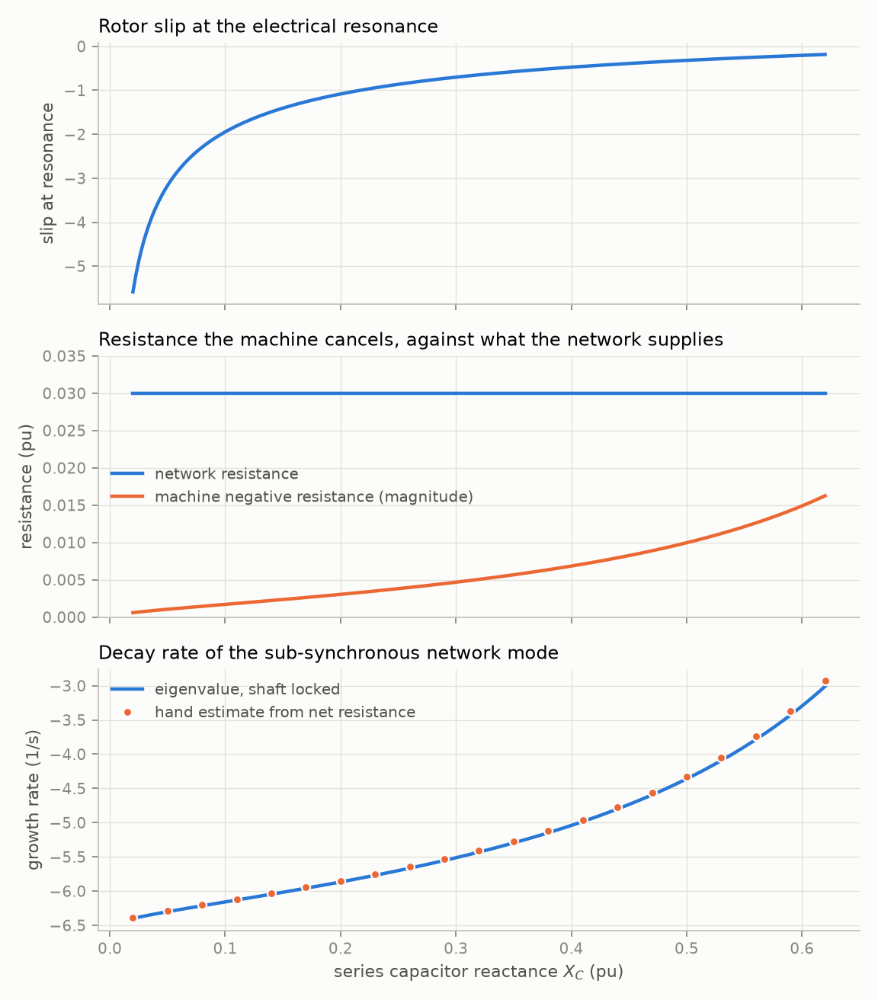
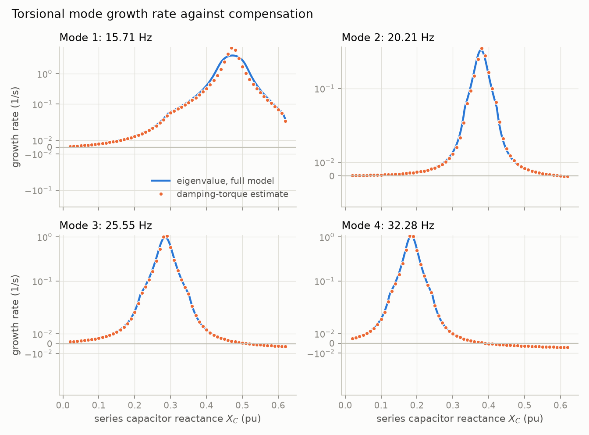
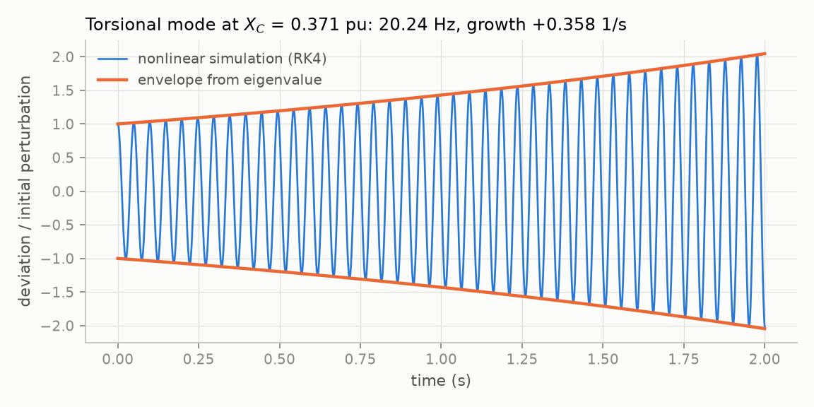

# 01: Solver core and the First Benchmark Model

Date: 2026-11-11 · Plan phase: 1

## Goal

Build the solver core (model interface, steady state, linearisation, time integration) and prove it on a system with published answers. Then answer the physical question directly: does the generator see negative slip at the electrical resonance, how much negative resistance does that produce, and is it enough to feed an oscillation?

## What was done

- `src/sso_sciml/physics/machine.py`: synchronous machine equivalent circuits and operational reactance.
- `src/sso_sciml/physics/shaft.py`: torsional modes of the spring-mass chain.
- `src/sso_sciml/physics/fbm.py`: the 20-state benchmark model in PyTorch (float64, batched), analytical steady state.
- `src/sso_sciml/physics/slip.py`: slip at resonance, negative resistance, net resistance, growth-rate estimate. Uses the equivalent circuit only.
- `src/sso_sciml/physics/torsional.py`: electrical damping torque and the torsional growth rate it implies.
- `src/sso_sciml/solver/`: autodiff Jacobian, Newton equilibrium, eigenvalues with participation factors, batched RK4, SciPy reference integrators, matrix pencil.
- `scripts/phase1_validate.py`: produces every number and figure below.
- `tests/test_fbm.py`: 20 tests that pin the numbers.
- `docs/EQUATIONS.md`, `docs/ASSUMPTIONS.md`.

## Commands

```powershell
uv run scripts/phase1_validate.py     # writes docs/results/phase1/
uv run pytest
uv run ruff check
```

## Results

All numbers are in `docs/results/phase1/results.json`.

### Shaft against published values

| Mode | Published (Hz) | Computed (Hz) |
|---|---|---|
| 1 | 15.71 | 15.712 |
| 2 | 20.21 | 20.211 |
| 3 | 25.55 | 25.547 |
| 4 | 32.28 | 32.285 |
| 5 | 47.46 | 47.456 |

Largest error 0.005 Hz. Mode 5 moves the generator mass by 0.45 % of its largest displacement, which is why it is never excited from the electrical side. The model reproduces that: its growth rate is zero to four decimals at the benchmark compensation.

### Steady state

The analytical steady state satisfies `dx/dt = 0` to 3e-13 across the compensation range.

### The slip mechanism



Over `X_C` = 0.02 to 0.62 pu:

- The rotor always sees negative slip at the electrical resonance, from −5.6 at low compensation to −0.19 at high compensation.
- The machine therefore always presents negative resistance, between −0.0006 and −0.016 pu.
- The network supplies 0.03 pu. The net resistance never drops below 0.014 pu, so **the benchmark generator does not self-excite through slip alone.**
- The hand estimate of the decay rate, from net resistance and reactance slope, matches the eigenvalue of the full electrical model (shaft locked) within 2.6 %. Resonant frequency matches within 0.09 Hz.

To find where slip alone would win, the network resistance was lowered at `X_C` = 0.371 pu. The hand calculation puts the threshold at 0.00613 pu; the eigenvalue crosses zero at 0.00606 pu, a difference of 1.2 %. The benchmark has five times that resistance.

So the answer to "does the generator see negative slip and feed the oscillation" is: it always sees negative slip, and it always feeds some energy in. Whether the oscillation grows depends on whether the negative resistance exceeds the network's. For a large synchronous machine with low rotor resistance it does not. The cases where it does are machines with higher rotor resistance at slip frequency and low network resistance, which is the induction and doubly-fed machine case that Phase 2 takes up.

### Torsional interaction



What does destabilise the benchmark is the shaft. Each torsional mode grows when `f0 − f_er` lands on its frequency.

| Mode | `f_n` (Hz) | `X_C` at peak, eigenvalue | `X_C` where `f0 − f_er = f_n` | Peak growth, eigenvalue (1/s) | Peak growth, damping-torque estimate (1/s) |
|---|---|---|---|---|---|
| 1 | 15.71 | 0.4725 | 0.4725 | 3.95 | 7.34 |
| 2 | 20.21 | 0.3775 | 0.3825 | 0.42 | 0.44 |
| 3 | 25.55 | 0.2850 | 0.2850 | 0.97 | 1.14 |
| 4 | 32.28 | 0.1850 | 0.1850 | 1.03 | 1.21 |

At the benchmark compensation of 0.371 pu, mode 2 grows at +0.358 1/s. That the benchmark compensation excites the second torsional mode is the textbook result for this system.

### Time domain against eigenvalues



Ten cases (five compensation levels, network mode and least-damped torsional mode each). The nonlinear model was perturbed by 1e-6 along one eigenvector, run for 2 s at 0.1 ms, and fitted with the matrix pencil method.

- Largest growth-rate error: 6e-7 relative.
- Frequency error: below 1e-4 Hz.

### Integrator

1 % generator speed step at `X_C` = 0.371 pu, 0.5 s.

| RK4 step (ms) | Max error against DOP853 |
|---|---|
| 0.5 | 3.7e-6 |
| 0.25 | 2.3e-7 |
| 0.125 | 1.5e-8 |
| 0.0625 | 9.1e-10 |

Observed order 4.00. Radau and DOP853 agree with each other to 1.3e-11.

### Batched integration, CPU against GPU

500 RK4 steps, float64, RTX 3070 against the i7-10700K.

| Trajectories | CPU (s) | GPU (s) | GPU speed-up |
|---|---|---|---|
| 256 | 0.94 | 3.86 | 0.24 |
| 4,096 | 3.22 | 4.00 | 0.81 |
| 32,768 | 16.30 | 4.07 | 4.0 |

CPU and GPU results agree to 5e-15. GPU time is flat at about 4 s, which is Python and kernel-launch overhead for 2,000 right-hand-side calls; the card is idle most of the time.

## Disagreements

1. **Damping-torque estimate overshoots the mode 1 peak by 86 %** (7.34 against 3.95 1/s). The estimate is first-order in the coupling. Near the mode 1 peak (checked at `X_C` = 0.45 pu) the network mode and the torsional mode are 0.5 Hz apart with shaft participation split 72 / 28, so they are no longer two separate modes and perturbation theory does not apply. The estimate still finds the peak location exactly and matches within 0.04 1/s wherever growth is below 0.2 1/s. Recorded as assumption A6. No change to the model; the estimate is kept as a mechanism check and as a candidate physics feature, with its range of validity known.
2. **Mode 2 peak location differs by 0.005 pu** between the eigenvalue (0.3775) and the resonance-alignment rule (0.3825). One or two grid steps of the sweep (0.0025 pu); the mode 2 peak is narrow and the generator's small participation makes it sensitive. Not pursued.
3. **A test was wrong before the model was.** The first version of the network test expected the machine to look like `X_d` when rotor fluxes are frozen. Frozen rotor flux gives the subtransient reactance. The test was corrected; the model was right.
4. **Benchmark data are not verified against the source.** The values were entered from memory of secondary literature. A web search did not turn up an open copy of the tables. The shaft data reproduce all five published frequencies, which is strong joint confirmation of eleven numbers. The generator reactances and the split of network resistance (0.01 transformer + 0.02 line) have no equivalent check. Recorded as A11. **Needs a look at Table I to III of the 1977 paper.**
5. **GPU integration is slower than expected below about 5,000 trajectories.** Per-step overhead dominates. Not a correctness issue. Options for Phase 3: larger batches (already 4× at 32,768), or `torch.jit` / a fused step to cut launches.

## Decisions

- The slip calculation and the damping-torque calculation become first-class outputs, not just checks. They are the "physics as a feature" inputs for the later comparison with physics-in-the-loss models.
- Model parameters are passed as a dictionary of tensors with precomputed inverse inductances, so the right-hand side is differentiable with respect to parameters and uses no linear solves.
- RK4 at 0.1 to 0.2 ms is the default time step for this system.
- Batched time-domain generation uses the GPU only above about 5,000 trajectories per batch.

## Next

Phase 2, step 1: fixed-speed induction generator on the same series-compensated line, where the slip mechanism alone is expected to cross into self-excitation, then the doubly-fed machine and its converter controls.
