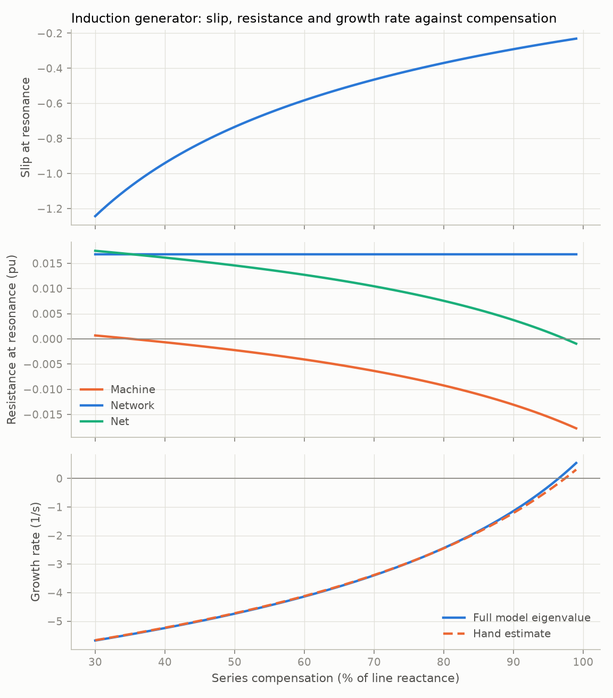
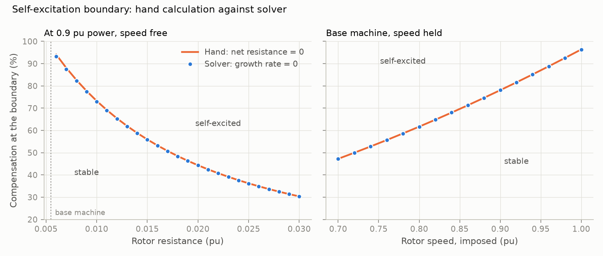
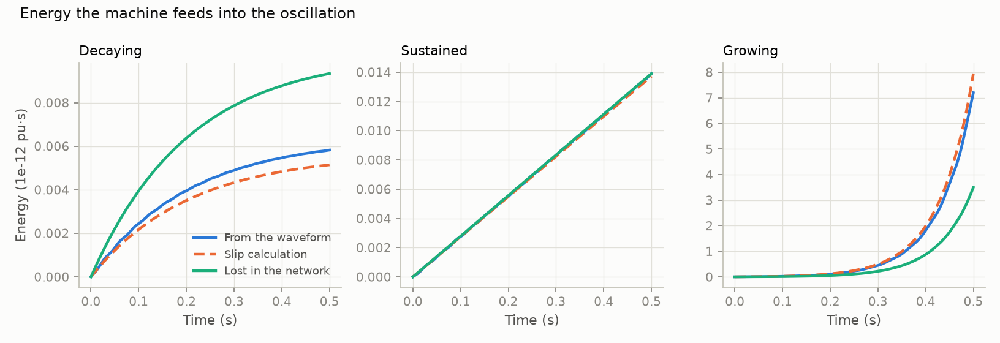

# 02: Induction generator and the self-excitation boundary

Date: 2026-11-11 · Plan phase: 2 (items 1 and 2)

## Goal

Phase 1 showed that a large synchronous machine sees negative slip but never enough negative resistance to self-excite. This step takes the machine where slip alone should win, a fixed-speed induction generator on the same series-compensated line, and asks three things. Where is the self-excitation boundary? Does the hand calculation put it in the same place as the solver? Does the energy in the simulated waveform match the negative resistance the slip calculation predicts?

## What was done

- `src/sso_sciml/physics/induction.py`: 7-state induction generator model (System B1) in the synchronous frame, stator and network transients kept. Every machine and network value is an entry of the parameter dictionary, so the model is batched and differentiable over all of them.
- `src/sso_sciml/physics/slip.py`: the slip analysis now takes any machine impedance. Added the exact round-rotor impedance of the induction machine.
- `src/sso_sciml/physics/energy.py`: energy delivered by the machine through an oscillation, computed from the simulated current and terminal voltage.
- `scripts/phase2_induction.py`: produces every number and figure below.
- `tests/test_induction.py`: 18 tests that pin the numbers.
- `docs/EQUATIONS.md` sections 12 and 13, `docs/ASSUMPTIONS.md` A12 to A16.

## Commands

```powershell
uv run scripts/phase2_induction.py     # writes docs/results/phase2/
uv run pytest
uv run ruff check
```

## Setup of the case

- Machine: single-cage, 2 MW class data in per unit (`R_s` 0.00488, `X_ls` 0.0924, `X_m` 3.953, `R_r` 0.00549, `X_lr` 0.0996, `H` 3.5 s).
- Network: the First Benchmark Model line (0.03 + j0.70 pu on 892.4 MVA) seen from a 500 MVA plant, which is `R_E` 0.0168, `X_E` 0.392 pu on the plant base.
- Operating point: 0.9 pu delivered to the infinite bus. Rotor speed follows from that (1.005 to 1.009 pu).
- Compensation level `k = X_C / X_E`, swept from 30 % to 99 %.

## Results

All numbers are in `docs/results/phase2/induction.json`.

### Steady state

`dx/dt = 0` to 4e-13 across the sweep. Shaft power equals bus power plus the three copper losses to 1e-12 (`test_steady_state_power_balance`).

### The slip mechanism



- Slip at resonance runs from −1.24 at 30 % compensation to −0.23 at 99 %.
- Machine resistance at resonance runs from +0.0007 to −0.0178 pu. It is positive below 35 % compensation: there the slip is so far from zero that the reflected rotor resistance is smaller than the stator's own 0.0049 pu.
- Net resistance reaches zero at 97.4 % compensation.
- With the rotor speed held, the root of the equivalent circuit and the eigenvalue of the electrical model are the same number: they differ by 3e-14 1/s and 5e-14 Hz. For a round rotor the equivalent circuit is exact, where for the synchronous machine in Phase 1 it was an approximation (2.6 %).
- The quick estimate from net resistance and reactance slope is within 0.007 1/s (1.7 %) of that eigenvalue.
- Letting the rotor speed move shifts the growth rate by at most 0.24 1/s, at the top of the range.
- The only mode that goes unstable anywhere in the sweep is the sub-synchronous network mode.

### The boundary: hand calculation against solver



Left panel, operating point at 0.9 pu and speed free, rotor resistance varied:

| Rotor resistance (pu) | Boundary, hand (%) | Boundary, solver (%) |
|---|---|---|
| 0.00549 (base) | 97.4 | 96.5 |
| 0.010 | 73.2 | 73.0 |
| 0.020 | 44.3 | 44.3 |
| 0.030 | 30.4 | 30.3 |

Largest gap over 25 values of rotor resistance: 0.76 points of compensation. With the speed held, hand and solver agree to 2e-11, so the whole gap is rotor motion.

Right panel, base machine with the rotor speed imposed (no operating point, electrical model only):

| Rotor speed (pu) | Boundary (%) |
|---|---|
| 0.70 | 47.2 |
| 0.80 | 61.7 |
| 0.90 | 78.1 |
| 1.00 | 96.4 |
| 1.02 and above | none below 99 |

Hand and solver agree to 2e-12 here. A slower rotor sits closer to the resonance, slip at resonance moves toward zero, and `R_r / s` grows.

### Time domain against eigenvalues

Five cases, three stable and two self-excited. Perturbation of 1e-6 along the network mode, 1 s at 0.1 ms, matrix pencil fit.

- Largest growth-rate error: 1.1e-7 1/s.
- Largest frequency error: 1.6e-8 Hz.

### Energy accounting



From the simulated waveform, the energy the machine delivers through the oscillation is the integral of `Re(Δv · conj(Δi))` at its terminals. Dividing by the integral of `|Δi|²` gives the resistance the waveform implies.

| Case | Growth rate (1/s) | `R_machine`, slip calculation (pu) | `R_machine`, from waveform (pu) | Energy from machine / energy lost in network |
|---|---|---|---|---|
| Decaying (80 %, base) | −2.44 | −0.00926 | −0.01048 | 0.62 |
| Sustained (80 %, `R_E` lowered to 0.00938) | 0.00 | −0.00926 | −0.00938 | 1.0005 |
| Growing (95 %, `R_r` = 0.012) | +6.90 | −0.03820 | −0.03459 | 2.06 |

The machine feeds energy into the oscillation in all three cases. It decays when the network loses more than the machine supplies, holds when the two are equal, and grows when the machine supplies more.

The waveform and the slip calculation agree to 1.4 % for the sustained oscillation, and to 13 % and 9.5 % for the decaying and growing ones. See disagreement 2.

## Disagreements

1. **The base machine does not self-excite at realistic compensation.** The plan expected it to. The solver puts the boundary at 96.5 %. The slip mechanism is strong enough only with more rotor resistance (73 % at 0.010 pu, 44 % at 0.020 pu) or a slower rotor (47 % at 0.70 pu speed). The model and the hand calculation agree, so this is a property of a single-cage machine with low rotor resistance running just above synchronous speed, and the plan's expectation was wrong. No change to the model. It sharpens the case for the doubly-fed machine: that machine runs down to 0.7 pu speed, and its current controller adds to the effective rotor resistance. Both effects move the boundary the same way, as the two panels of the figure show.
2. **Energy balance misses the 5 % exit check when the oscillation is not steady.** Against the slip calculation at the real frequency `jω`, the waveform resistance is off by 13 % (decaying) and 9.5 % (growing). Cause, in two parts:
   - A growing or decaying oscillation has a complex frequency. Evaluating the same machine impedance at `σ + jω` cuts the gap to 1.2 %, 0.25 % and 2.1 %.
   - The remainder is rotor speed motion, which the equivalent circuit leaves out. Repeating the three runs with the speed held (inertia 1e9 s) gives agreement to 2e-9.

   So the waveform and the circuit agree exactly once both effects are included. The exit check is restated: within 5 % at the real frequency for a sustained oscillation (measured 1.4 %), and within 5 % at the complex frequency otherwise (measured at most 2.1 %).
3. **Hand boundary is 0.9 points above the solver for the base machine** (97.4 against 96.5 %). Inside the 2 % exit check. Cause is rotor motion, as in the boundary section. The hand calculation is slightly optimistic: the free rotor destabilises a little.
4. **The uncompensated line cannot carry the plant.** At 20 % compensation the pull-out power is 0.869 pu, below the 0.9 pu operating point, and the steady-state solver refuses the case. The sweep starts at 30 %. A real plant has shunt capacitors at the terminals, which this model leaves out (A14).
5. **A 2 s run left the linear range.** The first time-domain check of the fastest case (+6.9 1/s) gave a growth-rate error of 0.008 1/s, because a 1e-6 perturbation grows by a factor of a million in 2 s. Window shortened to 1 s; error 8e-9 1/s.
6. **Machine data are from memory** of secondary sources (A12). The network is the Phase 1 line, with the same open check (A11).

## Decisions

- Compensation is quoted as `k = X_C / X_E` for Systems B1 and B2.
- All machine and network values live in the parameter dictionary and the flux map is inverted in closed form. System B2 will follow the same pattern, because the learned models need gradients with respect to those values.
- Mechanism quantities for the feature set now come from `slip.analyse_loop`, which takes any machine impedance.
- The growth-rate term matters for energy accounting. The energy feature for the learned models will be the waveform resistance, with the complex-frequency value as its check.
- The boundary in the plane of compensation against rotor speed, with speed imposed, is exact for the electrical subsystem. It becomes the reference curve that the doubly-fed machine is compared against when its controls are added.

## Next

Phase 2, step 2: doubly-fed machine. Rotor-side converter with current control first (rotor voltage as a control output), then the outer loops, PLL, grid-side converter and DC link. First check: with the current-loop gain set to zero and rotor voltage zero, the model must reproduce the right panel of the boundary figure.
