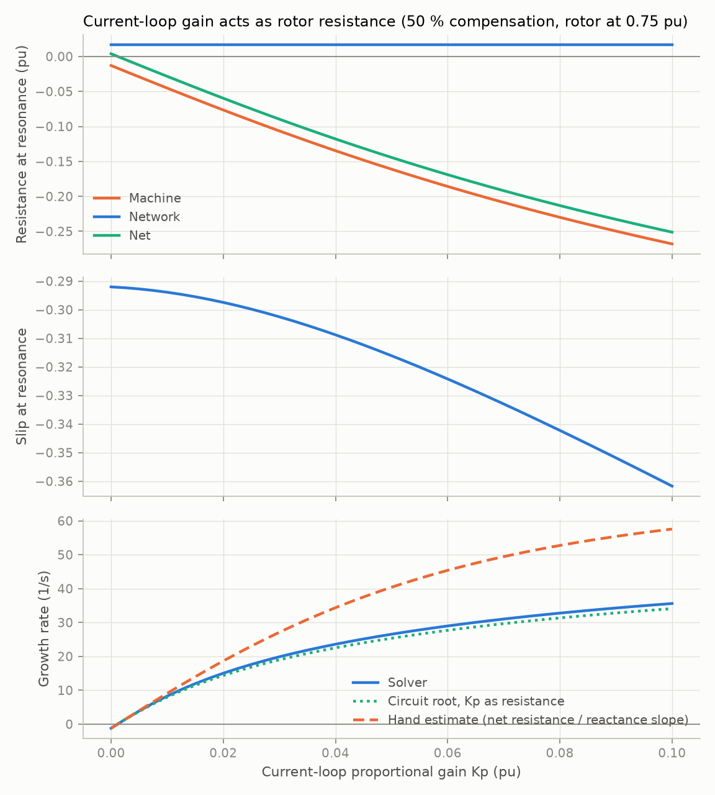
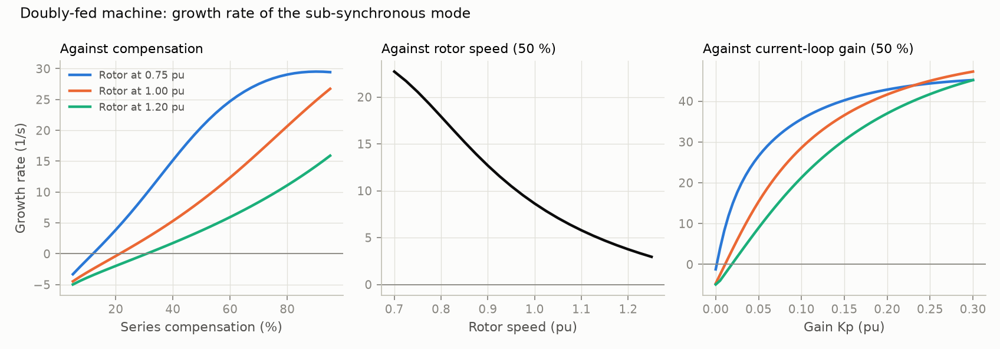
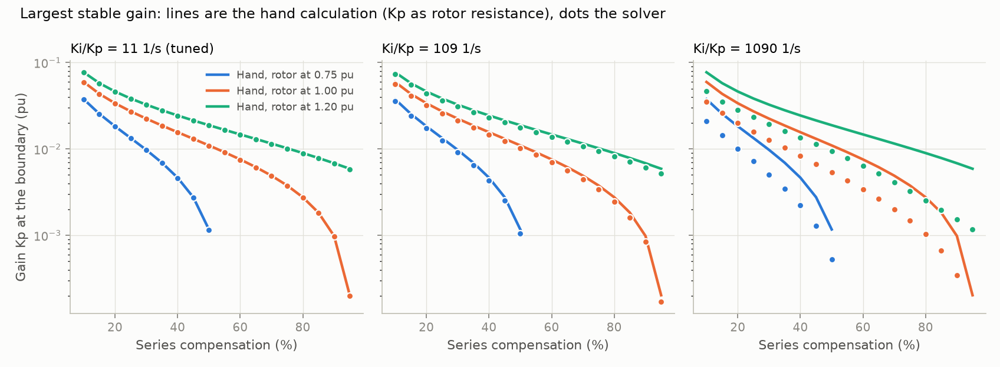

# 03: Doubly-fed machine with rotor current control

Date: 2026-11-11 · Plan phase: 2 (item 3, first stage)

## Goal

Step 02 showed that slip alone destabilises an induction machine only with more rotor resistance or a slower rotor. A doubly-fed machine brings both. This step adds the rotor-side converter with its current controller and asks: does the controller gain act as rotor resistance, as the hand argument says? How far does that picture hold? Where does the energy of the oscillation come from once a converter is in the rotor circuit?

## What was done

- `src/sso_sciml/physics/dfig.py`: 8-state model. The induction machine and line of step 02, plus a proportional-integral controller on rotor current that sets the rotor voltage. Standard bandwidth tuning in `gains_from_bandwidth`.
- `src/sso_sciml/physics/slip.py`: machine impedance with the controller in the rotor circuit (`dfig_impedance`). The resonance search now takes the lowest crossing from capacitive to inductive, because integral action adds crossings near synchronous frequency.
- `src/sso_sciml/physics/energy.py`: full energy budget of an oscillation (`flows`): network, shaft, converter, copper, stored.
- `scripts/phase2_dfig.py`: produces every number and figure below.
- `tests/test_dfig.py`: 15 tests that pin the numbers.
- `docs/EQUATIONS.md` section 14, `docs/ASSUMPTIONS.md` A18 to A22.

What this stage leaves out, on purpose: phase-locked loop, outer power and voltage loops, grid-side converter, DC link. Rotor speed is a parameter. With those choices the model is linear, so its eigenvalues do not depend on the operating point.

## Commands

```powershell
uv run scripts/phase2_dfig.py     # writes docs/results/phase2/dfig.json and fig4 to fig6
uv run pytest
uv run ruff check
```

## Setup of the case

- Machine and network as in step 02 (500 MVA plant on the benchmark line).
- Rotor speeds 0.75, 1.00 and 1.20 pu stand for low, medium and high wind.
- Controller gains are tied by pole-cancellation tuning, `Ki / Kp` = 10.9 1/s. A current-loop bandwidth of 10 Hz gives `Kp` = 0.0316 pu, `Ki` = 0.345 pu/s. 30 Hz gives `Kp` = 0.095; 100 Hz gives 0.316.

## Results

All numbers are in `docs/results/phase2/dfig.json`.

### Zero gain gives back the induction machine

With `Kp = Ki = 0` the eigenvalues equal those of the step 02 model with the speed held, to 1e-12 1/s. The boundary against rotor speed comes out at 47.2, 61.7, 78.1 and 96.4 % compensation for 0.7, 0.8, 0.9 and 1.0 pu, the same as step 02.

### The controller is rotor resistance, exactly

A controller acting on rotor current in the synchronous frame puts `Kp + Ki / S` in series with the rotor resistance, where `S` is the synchronous-frame frequency. Every eigenvalue of the model is a root of the loop impedance built that way: the residual is below 5e-11 pu over 81 combinations of compensation, speed, `Kp` and `Ki`.

### What the gain does



At 50 % compensation with the rotor at 0.75 pu:

- Machine resistance at resonance goes from −0.013 pu with no controller to −0.161 pu at `Kp` = 0.05 and −0.268 pu at `Kp` = 0.10. That is about −2.6 pu of machine resistance per pu of gain, against a network resistance of 0.017 pu.
- Slip at resonance barely moves (−0.29 to −0.36). The gain works by multiplying the numerator of `R / slip`.
- Treating `Kp` as plain resistance and ignoring `Ki` gives a growth rate of 34.1 1/s at `Kp` = 0.10, against 35.6 1/s from the solver.
- The quick estimate from net resistance and reactance slope is good only for slow growth: 9.1 against 8.3 1/s at `Kp` = 0.01, but 57.6 against 35.6 1/s at `Kp` = 0.10.

### Trends



At the 10 Hz tuning:

| Rotor speed (pu) | Growth rate at 50 % compensation (1/s) | Lowest unstable compensation on the grid (%) |
|---|---|---|
| 0.75 | +20.5 | 12.5 |
| 1.00 | +8.6 | 22.5 |
| 1.20 | +3.8 | 32.5 |

- Growth rate rises with compensation at 1.00 and 1.20 pu speed over the whole range.
- Growth rate falls as rotor speed rises, at every point from 0.70 to 1.25 pu.
- Growth rate rises with gain at all three speeds.

These are the three trends the plan asked the solver to reproduce.

### The boundary: largest stable gain



Largest stable `Kp`, hand calculation (`Kp` as resistance, net resistance zero) against solver (with `Ki` at the tuned ratio):

| Compensation (%) | Rotor 0.75 pu, hand / solver | Rotor 1.00 pu | Rotor 1.20 pu |
|---|---|---|---|
| 10 | 0.0377 / 0.0375 | 0.0597 / 0.0593 | 0.0773 / 0.0769 |
| 25 | 0.0134 / 0.0133 | 0.0273 / 0.0271 | 0.0384 / 0.0382 |
| 40 | 0.0046 / 0.0046 | 0.0156 / 0.0155 | 0.0244 / 0.0243 |
| 55 | unstable at any gain | 0.0092 / 0.0091 | 0.0166 / 0.0166 |
| 70 | unstable at any gain | 0.0049 / 0.0049 | 0.0115 / 0.0115 |
| 85 | unstable at any gain | 0.0018 / 0.0018 | 0.0079 / 0.0078 |

How far the resistance picture holds as integral action grows:

| `Ki / Kp` (1/s) | Largest gap, hand against solver | Median gap |
|---|---|---|
| 10.9 (tuned) | 1.9 % | 0.7 % |
| 109 | 19 % | 7 % |
| 1090 | 400 % | 100 % |

The hand value is always the larger one, so it is optimistic.

### Time domain and energy budget

Four cases, equilibrium residual below 4e-14, perturbation 1e-6 along the sub-synchronous mode.

- Growth rate from the waveform against the eigenvalue: largest error 7e-8 1/s.
- Machine resistance from the waveform against the impedance at the mode's complex frequency: largest error 1.2e-9 relative.
- Energy budget (shaft + converter = network + copper + stored): closes to 7e-7 of the energy sent to the network.

| Case (compensation, speed, bandwidth) | Growth rate (1/s) | From shaft | From converter | Copper | Stored |
|---|---|---|---|---|---|
| 50 %, 0.75 pu, 10 Hz | +20.5 | 1.69 | −0.41 | 0.14 | 0.15 |
| 30 %, 1.00 pu, 10 Hz | +2.3 | 2.81 | −1.32 | 0.44 | 0.05 |
| 50 %, 1.20 pu, 3 Hz | −2.7 | 2.80 | −0.92 | 1.03 | −0.14 |
| 70 %, 1.00 pu, 30 Hz | +36.9 | 1.98 | −0.73 | 0.08 | 0.17 |

Each entry is a multiple of the energy the machine sends into the network through the oscillation.

**The converter does not feed the oscillation. It absorbs energy, as a resistor would. All the energy comes from the shaft**, through the same negative-slip conversion as in the plain induction machine. The controller makes the rotor circuit look more resistive, and a more resistive rotor at negative slip converts more shaft power into sub-synchronous current.

## Disagreements

1. **The model is far less stable than plants in service.** A 10 Hz current loop is unstable above about 20 % compensation at rated speed, and the largest stable gain at 50 % compensation corresponds to a bandwidth of a few hertz. Real controllers are faster than that and plants do run next to compensated lines. Likely causes, none tested yet: the plant is connected radially through the compensated line with nothing else on the bus, which is the worst case; network resistance on the plant base is only 0.017 pu, with no collector system or transformers; there is no grid-side converter; the controller has no filtering or damping function. This is the main item for the next stage, and the model's absolute stability limits should not be quoted until it is resolved. The trends and the mechanism do not depend on it.
2. **Growth rate against compensation is not monotonic at 0.75 pu speed.** It peaks at 29.5 1/s at 90 % and is 29.4 1/s at 95 %. The resonance is then pinned just below rotor speed and cannot move closer. The plan's stated trend holds at 1.00 and 1.20 pu.
3. **The quick growth-rate estimate fails for fast growth** (57.6 against 35.6 1/s). It is first order in net resistance. The circuit root does not have this problem. For features, the circuit root or the net resistance itself is the better quantity; the quick estimate is kept with its range known (A20).
4. **The resistance picture fails when integral action is strong.** Covered in the boundary section: fine at the tuned ratio, 19 % off at ten times, useless at a hundred times. The full circuit with `Ki` remains exact.
5. **The resonance search picked the wrong crossing** on the first run with integral action: the `Ki` term creates a second zero of loop reactance near synchronous frequency. Fixed by taking the lowest capacitive-to-inductive crossing. Step 01 and 02 results are unchanged (their tests pass).
6. **A doubt about step 02 was checked and cleared.** At low rotor speed the resonance approaches rotor speed as compensation rises, which raised the question of whether the machine restabilises above the plotted boundary. It does not: the resonance stays just below rotor speed and the machine stays self-excited up to the top of the range. The step 02 figure stands.

## Decisions

- The DFIG model inherits from the induction model, and the controller enters only through the rotor voltage. Later stages add states the same way.
- `Kp` as added rotor resistance is adopted as a physics feature, with `Ki / Kp` as the quantity that says when to distrust it.
- Energy budget terms (shaft, converter, copper, stored) are computed from second-order products of deviations, so they are free of the first-order ripple. They become candidate targets for the time-domain learning task.
- Stability limits from this stage are relative. Absolute limits wait for the full control structure.

## Next

Phase 2, step 3: phase-locked loop, outer power and voltage loops, grid-side converter and DC link, with rotor speed freed. First check: with the new loops made very slow, the model must reproduce this step's boundary. Then look for published parameter sets and eigenvalue tables to compare against, and revisit disagreement 1.
