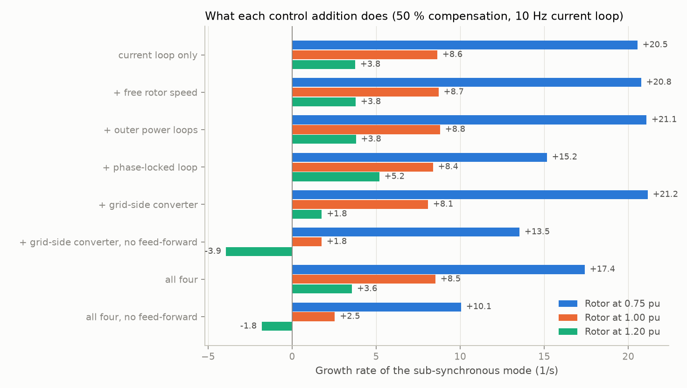
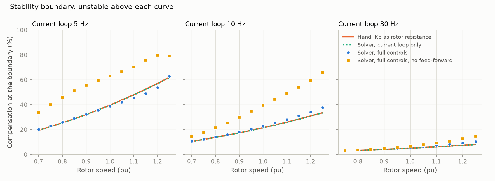
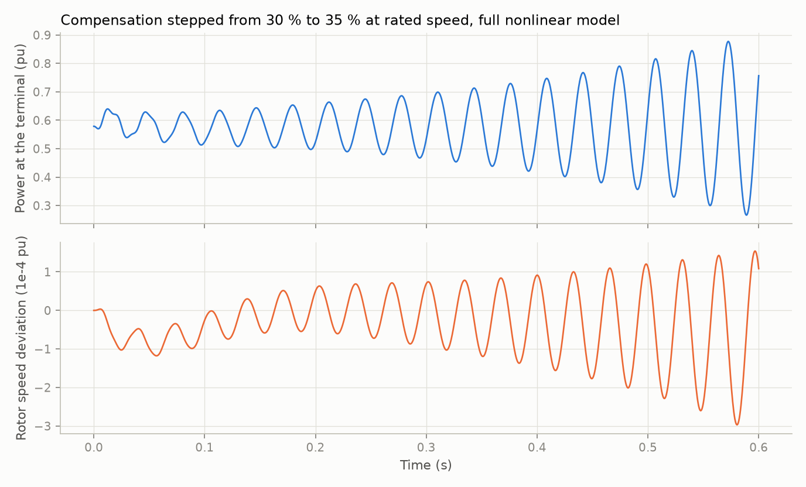

# 04: Doubly-fed machine with full controls

Date: 2026-11-11 · Plan phase: 2 (item 3, second stage)

## Goal

Step 03 had only the rotor current loop and was far less stable than plants in service. This step adds the rest of the control structure and asks which addition changes the sub-synchronous mode, by how much, and whether the hand calculation from step 03 still locates the boundary.

## What was done

- `src/sso_sciml/physics/dfig_full.py`: 23-state model. Adds a phase-locked loop, outer active and reactive power loops with a speed-cubed power reference, a grid-side converter behind a filter reactor with current control and terminal-voltage feed-forward, a DC link, and rotor speed as a state. Controller gains come from bandwidths (`Controls`).
- `scripts/phase2_dfig_full.py`: produces every number and figure below.
- `tests/test_dfig_full.py`: 12 tests that pin the numbers.
- `docs/EQUATIONS.md` section 15, `docs/ASSUMPTIONS.md` A23 to A26 and updates to A18, A19, A22.
- A search for published parameter sets and eigenvalue tables. The two open copies of the 2010 reference paper were not retrievable (one empty response, one 403). DOIs of the three main references are confirmed and listed under Disagreements.

## Commands

```powershell
uv run scripts/phase2_dfig_full.py     # writes docs/results/phase2/dfig_full.json and fig7 to fig9
uv run pytest
uv run ruff check
```

## Setup of the case

Machine and network as before (500 MVA plant on the benchmark line). Default controls:

| Loop | Setting | Gains |
|---|---|---|
| Rotor current | 10 Hz | `Kp` 0.0316 pu, `Ki` 0.345 pu/s |
| Phase-locked loop | 10 Hz, damping 0.7 | 88.0 and 3948 rad/s per pu |
| Outer power loops | 1 Hz, 20 ms measurement filter | 0.126 pu, 6.28 pu/s |
| Grid-side current | 100 Hz on a 0.30 pu filter | 0.50 pu, 1.88 pu/s |
| Feed-forward of terminal voltage | on, 2 ms filter | |
| DC voltage | 10 Hz, 0.02 pu·s capacitor | 1.76, 79.0 |

Power follows rotor speed cubed, 1 pu at 1.20 pu speed: 0.244 pu at 0.75, 0.579 pu at 1.00. Reactive power at the terminal is held at zero.

## Results

All numbers are in `docs/results/phase2/dfig_full.json`.

### Steady state

- `dx/dt = 0` to 2e-13 over nine operating points. Mechanical power equals terminal power plus the three copper losses to 1e-15.
- Rotor power flows into the rotor at 0.75 pu speed (0.083 pu) and out of it at 1.20 pu (0.164 pu). At 1.00 pu the converter supplies the rotor copper loss, 0.002 pu.

### With every addition switched off, step 03 comes back

Loops slowed to 0.001 Hz, grid-side converter disconnected, rotor held: the sub-synchronous growth rate matches the step 03 model within 0.0007 1/s on nine cases.

### What each addition does



Growth rate of the sub-synchronous mode at 50 % compensation, in 1/s:

| Configuration | Rotor 0.75 pu | Rotor 1.00 pu | Rotor 1.20 pu |
|---|---|---|---|
| Current loop only (step 03) | +20.5 | +8.6 | +3.8 |
| + free rotor speed | +20.8 | +8.7 | +3.8 |
| + outer power loops | +21.1 | +8.8 | +3.8 |
| + phase-locked loop | +15.2 | +8.4 | +5.2 |
| + grid-side converter | +21.2 | +8.1 | +1.8 |
| + grid-side converter, no feed-forward | +13.5 | +1.8 | −3.9 |
| All four | +17.4 | +8.5 | +3.6 |
| All four, no feed-forward | +10.1 | +2.5 | −1.8 |

- **Rotor speed and the outer loops barely matter** at their default settings: at most +0.5 1/s.
- **The phase-locked loop helps at low speed and hurts at high speed**: −5.4 1/s at 0.75 pu, +1.4 1/s at 1.20 pu.
- **The grid-side converter does little when it feeds the terminal voltage forward**, which is the usual design: +0.6, −0.6 and −2.0 1/s.
- **Without feed-forward the grid-side converter is the largest single effect**: −7.0, −6.9 and −7.7 1/s. Its current controller then looks like a 0.5 pu resistor behind the filter reactor, connected across the terminals, and it absorbs sub-synchronous current.
- With all four on, the result at rated speed is within 0.1 1/s of step 03.

### Sensitivity of the full model

At 50 % compensation, growth rate in 1/s at 0.75 / 1.00 / 1.20 pu speed:

| Setting | Low value | High value |
|---|---|---|
| Rotor current loop, 2 to 100 Hz (1.00 pu only) | −1.3 | +42.5 |
| Phase-locked loop, 1 to 60 Hz | 21.4 / 8.3 / 2.0 | 24.9 / 8.9 / 3.3 |
| Outer loops, 0.1 to 20 Hz | 16.9 / 8.4 / 3.5 | 30.6 / 13.7 / 4.3 |
| Grid-side filter reactance, 0.1 to 3.0 pu | 16.8 / 8.8 / 4.2 | 17.9 / 8.4 / 3.4 |
| Feed-forward filter, 0.5 to 50 ms | 17.9 / 8.6 / 3.4 | 10.6 / 3.1 / −1.3 |

The rotor current loop dominates. The feed-forward filter is second: slowing it from 2 ms to 50 ms removes 5 to 7 1/s, because a slow feed-forward lets the grid-side converter act as a resistor again. The outer loops are harmless at 1 Hz but not when made fast: at 20 Hz they add 13 1/s at 0.75 pu speed. The phase-locked loop is not monotonic at 0.75 pu (minimum 15.8 1/s near 15 Hz).

### The boundary



Compensation at the stability boundary, in percent:

| Current loop | Rotor speed (pu) | Hand | Solver, current loop only | Solver, full controls | Full, no feed-forward |
|---|---|---|---|---|---|
| 5 Hz | 0.75 | 22.3 | 22.2 | 23.1 | 39.9 |
| 5 Hz | 1.00 | 39.7 | 39.5 | 38.7 | 63.1 |
| 5 Hz | 1.20 | 57.1 | 56.8 | 53.7 | 79.9 |
| 10 Hz | 0.75 | 12.1 | 12.0 | 12.3 | 17.5 |
| 10 Hz | 1.00 | 21.5 | 21.4 | 22.8 | 39.6 |
| 10 Hz | 1.20 | 30.9 | 30.8 | 34.1 | 59.4 |
| 30 Hz | 1.00 | 5.1 | 5.1 | 5.7 | 6.7 |
| 30 Hz | 1.20 | 7.3 | 7.3 | 9.2 | 12.5 |

- With feed-forward, the hand calculation (`Kp` as rotor resistance, net resistance zero) is within −3.4 to +4.0 points of the full solver across speeds from 0.70 to 1.25 pu and the three bandwidths.
- Without feed-forward, the full model is 0.3 to 32 points more stable than the hand calculation.

### Other modes

No mode other than the sub-synchronous network mode is unstable anywhere on a grid of 19 compensation levels and 3 speeds. At 50 % and rated speed the network mode sits at 24.9 Hz in the rotating frame, and 85 % of its participation is line flux and capacitor voltage. The least damped other mode is at −0.26 1/s.

### Time domain

- Small signal, four cases: growth rate from the waveform against the eigenvalue, largest error 7e-8 1/s.
- Large signal: compensation stepped from 30 % to 35 % at rated speed, full nonlinear model.



The power swing grows from 0.13 pu in the first 0.1 s to 0.61 pu in the last 0.1 s of a 0.6 s run. Fitted to the power waveform: 3.479 1/s at 30.52 Hz. Eigenvalue at the new operating point: 3.474 1/s at 30.52 Hz.

## Disagreements

1. **Step 03's gap to practice is not closed by the missing controls.** That step listed the missing phase-locked loop, outer loops and grid-side converter as likely reasons for the model being unstable at realistic gains. With all of them in, and a standard feed-forward, the growth rate at rated speed moves by 0.1 1/s. The cause is elsewhere. Candidates still untested: the radial connection with only 0.017 pu of network resistance and no collector system (A14, A22), aggregation (A16), and controller details that plants add specifically against this problem. The mechanism and the boundary shape stand; absolute limits still should not be quoted.
2. **Whether the grid-side converter damps the mode depends on one design choice.** Without terminal-voltage feed-forward it moves the boundary by up to 32 points of compensation; with it, by a few. The plan and the earlier step logs treated the grid-side converter as secondary. It is secondary only with fast feed-forward. This is now a model parameter (`ff`, `t_ff`) and an explicit assumption (A23).
3. **Published values could not be compared.** The open copies of Fan, Kavasseri, Miao and Zhu (2010) were not retrievable, so the "published trends" rung of the validation ladder rests on direction only: growth rises with compensation and with current-loop gain and falls with rotor speed, and a search result summarising a 2025 workshop paper reports that the proportional gain "is functionally equivalent to rotor resistance" while the integral gain has "negligible influence", which matches step 03. No number has been checked. References with confirmed DOIs: 10.1109/TPWRD.2010.2050912 (modelling, 2010), 10.1109/TEC.2011.2160995 (modal analysis, 2011), 10.1109/TEC.2012.2211019 (impedance model, 2012). The 2010 paper uses an 892.4 MVA aggregate on the benchmark line; this project uses 500 MVA.
4. **The first version of the "all off" check missed by a few percent.** Disconnecting the grid-side converter through a large reactance left its DC voltage loop active, and its current controller still injected current. Slowing the DC loop as well brought the difference to 0.0007 1/s.
5. **The large-signal growth rate is 0.005 1/s above the eigenvalue** (3.479 against 3.474). The step excites other modes and the fit window is short. A trial with a larger step and a longer run grew to a power swing of many times rated: the model has no current or voltage limits, so it is valid only while the oscillation is small (A26).
6. **A test was wrong before the model was.** It expected rotor power to be exactly zero-crossing at synchronous speed. The converter supplies the rotor copper loss there. Test corrected.

## Decisions

- Default controls include terminal-voltage feed-forward with a 2 ms filter. The no-feed-forward variant is kept as a second configuration for data generation, because it changes the answer more than any other setting except the current-loop gain.
- The parameter space for the learned models gains two dimensions: feed-forward on or off, and its filter time constant. Outer-loop bandwidth and filter reactance are kept but expected to rank low.
- The hand calculation from step 03 is the baseline for the residual-learning arm. Its error against the full model is a few points of compensation with feed-forward and up to 32 points without, so the residual to be learned is small in one regime and large in the other.
- The sub-synchronous mode is identified by capacitor-voltage participation, not by frequency band alone.

## Next

Phase 2, remaining items: an independent formulation (second implementation in the abc frame, or an open electromagnetic-transient tool), the impedance-scan cross-check, the assumption studies (time step, dropping stator transients, aggregation, network resistance and a collector system), and `docs/VALIDATION.md`. The network resistance study comes first, because it is the leading candidate for disagreement 1.
