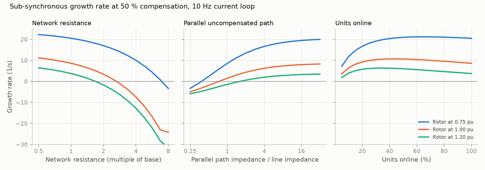
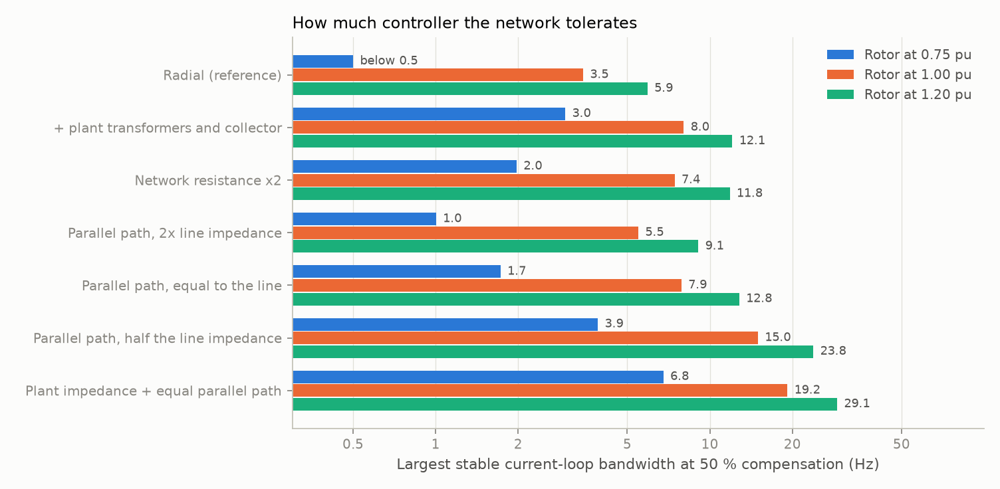
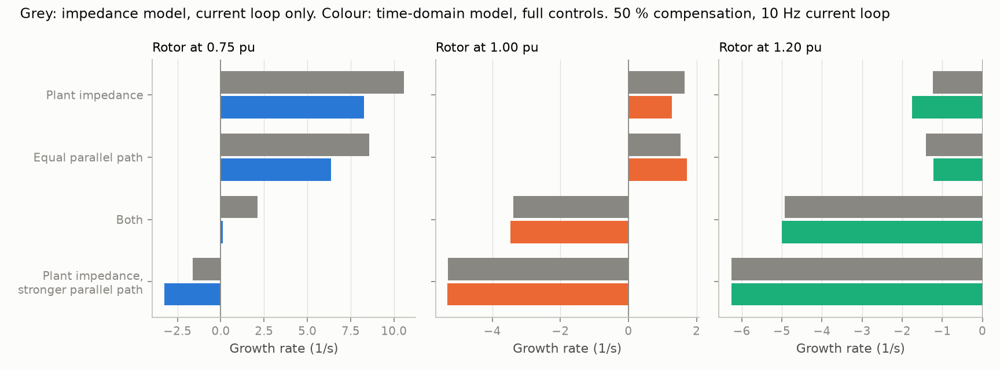

# 05: Impedance formulation and the effect of the network

Date: 2026-11-11 · Plan phase: 2 (items 4 and 5, in part)

## Goal

Two open items from steps 03 and 04. First, the model was unstable at controller gains well below those used in practice, and the added controls did not explain it; the network was the leading suspect. Second, the validation ladder asks for an independent formulation. This step builds one, an impedance model with no states, checks it against the state-space model, and uses it to vary the network.

## What was done

- `src/sso_sciml/physics/circuit.py`: loop impedance as a ratio of polynomials in complex frequency, with series and parallel combination. Modes are the zeros of the total impedance. Common factors of numerator and denominator are removed by matching poles to zeros.
- `scripts/phase2_network.py`: produces every number and figure below.
- `src/sso_sciml/physics/dfig_meshed.py`: the full-control model on a network with plant impedance and a parallel path. `dfig_full.py` was refactored so that the network sits behind three methods; its results are unchanged.
- `scripts/phase2_meshed.py`: the confirmation runs.
- `tests/test_circuit.py` and `tests/test_meshed.py`: 17 tests that pin the numbers.
- `docs/EQUATIONS.md` section 16, `docs/ASSUMPTIONS.md` A27 and A28 and updates to A14, A16, A22.
- `docs/VALIDATION.md`: status of every rung of the validation ladder.

## Commands

```powershell
uv run scripts/phase2_network.py     # writes docs/results/phase2/network.json, fig10 and fig11
uv run scripts/phase2_meshed.py      # writes docs/results/phase2/meshed.json and fig12
uv run pytest
uv run ruff check
```

## Setup of the case

- Machine and controller: the current-loop model of step 03, at the tuned `Ki / Kp`. Step 04 showed that the full controls, with voltage feed-forward, stay within a few points of compensation of this model.
- Reference network: radial, 0.0168 + j0.392 pu on the plant base (X/R = 23.3).
- Compensation is a fraction of the line reactance in every case.
- Plant-side series impedance, where used: 0.010 + j0.15 pu for transformers and collector cables. Representative, not from a specific plant.
- Parallel path, where used: an uncompensated branch from the plant bus to the same infinite bus, with a given multiple of the line impedance and the same X/R.

## Results

All numbers are in `docs/results/phase2/network.json`.

### Impedance formulation against the state-space model

27 cases (three compensation levels, three speeds, three bandwidths). Each has four modes in the impedance model, and each of them matches a state-space eigenvalue to 2.3e-8. The two formulations share the parameter values and nothing else: one integrates fluxes and takes a Jacobian, the other multiplies polynomials and finds roots.

### What the network does



Growth rate at 50 % compensation with a 10 Hz current loop:

| Change to the network | Needed for stability at 0.75 / 1.00 / 1.20 pu speed |
|---|---|
| More network resistance | 7.0× / 2.6× / 1.7× the base value |
| Parallel uncompensated path | impedance below 0.38× / 0.73× / 1.58× the line's |

- **Network resistance.** The reference line has X/R of 23. Doubling its resistance takes the growth rate at rated speed from +8.6 to +3.4 1/s.
- **Parallel path.** A path as strong as the line takes it from +8.6 to +1.5 1/s. One twice as strong makes it −1.9 1/s.
- **Units online.** Not monotonic. The worst case is with 65 %, 45 % and 35 % of units running at the three speeds, where growth is 21.2, 10.7 and 6.4 1/s against 20.5, 8.6 and 3.8 1/s with all units. With 5 % of units it falls to 7.2, 3.6 and 1.9 1/s. The lowest boundary over the sweep is 6.8 %, 12.2 % and 17.5 % compensation, against 12.0 %, 21.4 % and 30.8 % with all units.

### How much controller the network tolerates



Largest stable current-loop bandwidth at 50 % compensation, in Hz:

| Network | Rotor 0.75 pu | Rotor 1.00 pu | Rotor 1.20 pu |
|---|---|---|---|
| Radial (reference) | below 0.5 | 3.5 | 5.9 |
| + plant transformers and collector | 3.0 | 8.0 | 12.1 |
| Network resistance ×2 | 2.0 | 7.4 | 11.8 |
| Parallel path, 2× line impedance | 1.0 | 5.5 | 9.1 |
| Parallel path, equal to the line | 1.7 | 7.9 | 12.8 |
| Parallel path, half the line impedance | 3.9 | 15.0 | 23.8 |
| Plant impedance + equal parallel path | 6.8 | 19.2 | 29.1 |

Boundary at a 10 Hz loop for the last row: 42.7 % and 73.9 % compensation at 0.75 and 1.00 pu speed, and none below 99 % at 1.20 pu. For the radial reference it is 12.0 %, 21.4 % and 30.8 %.

### Confirmation in the time-domain model

The parallel path and plant impedance were then built into the full-control time-domain model (`physics/dfig_meshed.py`, 25 states, `scripts/phase2_meshed.py`, results in `docs/results/phase2/meshed.json`).



- With the plant impedance removed and the parallel path made negligible, the new model gives the step 04 growth rates to 1e-5 1/s.
- With the added control loops switched off, it matches the impedance model on all four networks and three speeds to 0.0005 1/s.
- With full controls and voltage feed-forward, it stays within 2.3 1/s of the impedance model. The largest differences are at 0.75 pu speed, where the phase-locked loop adds damping (step 04).

Growth rate at 50 % compensation, 10 Hz current loop, in 1/s (impedance model / time-domain model with full controls):

| Network | Rotor 0.75 pu | Rotor 1.00 pu | Rotor 1.20 pu |
|---|---|---|---|
| Plant impedance only | +10.6 / +8.3 | +1.6 / +1.3 | −1.2 / −1.8 |
| Equal parallel path only | +8.6 / +6.4 | +1.5 / +1.7 | −1.4 / −1.2 |
| Plant impedance + equal parallel path | +2.1 / +0.1 | −3.4 / −3.5 | −4.9 / −5.0 |
| Plant impedance + parallel path at half the line impedance | −1.6 / −3.3 | −5.3 / −5.3 | −6.3 / −6.3 |

On the third network, with full controls:

| Rotor speed (pu) | Boundary at a 10 Hz loop (%) | Largest stable bandwidth at 50 % (Hz) |
|---|---|---|
| 0.75 | 49.4 (impedance model 42.7) | 9.8 (6.8) |
| 1.00 | 73.7 (73.9) | 20.3 (19.2) |
| 1.20 | 94.4 (none below 99) | 32.1 (29.1) |

A nonlinear run on that network, compensation stepped from 45 % to 60 % at 0.75 pu speed: the power swing grows from 0.047 to 0.117 pu over 0.8 s, at 1.613 1/s and 22.19 Hz from the waveform against 1.616 1/s and 22.19 Hz from the eigenvalue.

Without voltage feed-forward the same network is stable at all three speeds at 50 % compensation (−2.5, −5.3 and −6.7 1/s).

## Disagreements

1. **The gap to practice, open since step 03, is mostly the network.** A radial connection through a line with X/R of 23 and no plant impedance is the worst case, and it is the case the model had. With plant transformers and one parallel path as strong as the line, the tolerable bandwidth at rated speed goes from 3.5 to 19.2 Hz, a factor of 5.6. That is not a full explanation: 19 Hz is still below a typical current loop, and low rotor speed stays far worse (6.8 Hz). The remaining candidates are controller features built against this problem and the voltage feed-forward question from step 04. Recorded events of this kind happened when an outage left a plant radial on a compensated line, which is consistent with the radial case being the dangerous one; that statement is from memory and is not checked against a source.
2. **Plant impedance helps more than expected.** It was added as a resistance effect. Most of its benefit comes from the 0.15 pu of reactance: compensation is a fraction of the line only, so the extra reactance lowers the electrical resonance and moves slip at resonance away from zero.
3. **Fewer units online is worse, then better.** The expectation was a monotonic trend. Halving the units online doubles the machine impedance on the plant base, which is the same as halving the network impedance seen by each machine: resistance falls, which hurts, and the resonance shifts, which eventually helps. The worst case is a partly loaded plant. Screening only the full plant would miss it.
4. **Root finding needed care.** Cross-multiplying impedances leaves common factors, and the first filter (discard roots where the denominator is small) also discarded true modes at low gain, where a zero sits near a pole. Matching each pole to its nearest zero within 1e-5 works: all 27 cases return exactly four modes. Repeated poles at synchronous frequency are found only to about 1e-7, which sets that tolerance.
5. **The time-domain solver did not cover these networks.** Fixed within this step for plant impedance and the parallel path (see the confirmation section): the two formulations agree to 0.0005 1/s where they model the same thing. The units-online sweep still rests on the impedance model alone.
6. **Steady state is less exact when the parallel path is switched off by a huge impedance.** The residual is 2e-8 with a path of a million times the line impedance, against 1e-13 otherwise. The 4 × 4 current solve is poorly conditioned in that limit. It does not affect the cases with a real parallel path.

## Decisions

- The parameter space for the learned models gains: plant-side impedance, parallel path strength, fraction of units online, and line X/R. The step shows each moves the boundary by tens of points of compensation.
- "Largest stable current-loop bandwidth" is adopted as a second screening output next to growth rate. It is the quantity a control engineer would ask for.
- The impedance model is kept as a permanent cross-check: any new state-space model must match it where both apply.
- The reference case for data generation changes from radial to plant impedance plus a parallel path, with the radial case kept as the stressed corner.

## Next

The remaining assumption studies: dropping stator and network transients (what a positive-sequence tool does), time step, and a second time-domain implementation in the abc frame. Then Phase 3, data generation, with the meshed network as the reference case.
