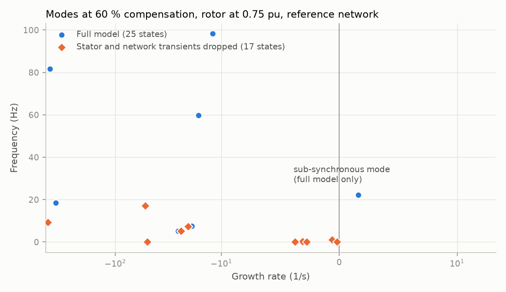
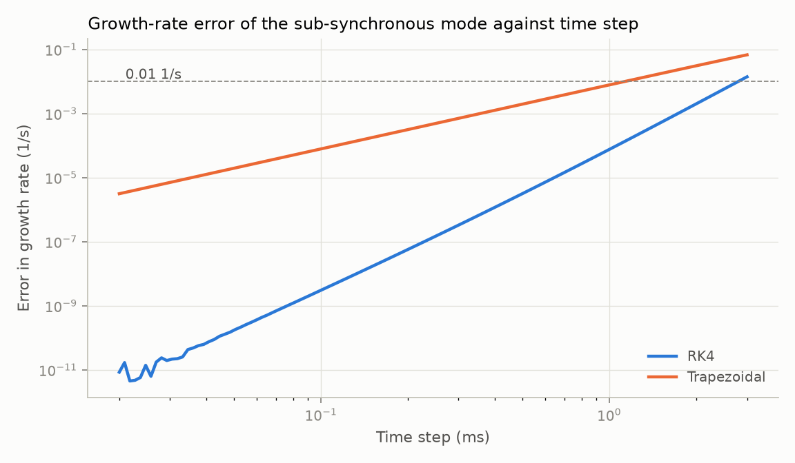

# 06: Dropping network transients, and the time step

Date: 2026-11-11 · Plan phase: 2 (item 5)

## Goal

Two assumption studies from the plan. What does a model see once stator and network transients are dropped, which is how a positive-sequence stability tool works? And how small must the time step be for the growth rate to be right?

## What was done

- `src/sso_sciml/solver/linearize.py`: `quasi_static`, which makes a chosen set of states algebraic in the linearised model.
- `scripts/phase2_assumptions.py`: produces every number and figure below.
- `tests/test_assumptions.py`: 7 tests that pin the numbers.
- `docs/ASSUMPTIONS.md` A2 and A10 updated, A29 added. `docs/VALIDATION.md` updated.

## Commands

```powershell
uv run scripts/phase2_assumptions.py   # writes docs/results/phase2/assumptions.json, fig13 and fig14
uv run pytest
uv run ruff check
```

## Setup of the case

- Models: full controls on the radial network (step 04, 23 states) and on the reference network of step 05 (plant impedance plus an equal parallel path, 25 states).
- Sweep: compensation 10 % to 90 % in steps of 10, rotor at 0.75, 1.00 and 1.20 pu. 27 cases per network.
- Quasi-static model: the derivatives of the two stator-and-network loop fluxes, the capacitor voltage and the parallel-loop flux are set to zero and those states are solved from the rest. Rotor flux, rotor speed and every controller state stay dynamic. This is done on the linearised model, so it is the small-signal form of a positive-sequence model.
- Half measure: only the capacitor voltage is made algebraic, so the capacitor is a fixed reactance at 60 Hz while the inductances keep their dynamics.
- Time step: the case of step 05, 60 % compensation at 0.75 pu speed on the reference network, growth rate 1.616 1/s at 22.19 Hz.

## Results

All numbers are in `docs/results/phase2/assumptions.json`.

### Dropping stator and network transients



| Network | Unstable in the full model | Flagged by the quasi-static model | Largest growth rate missed |
|---|---|---|---|
| Radial | 21 of 27 | 0 | 28.0 1/s |
| Reference | 7 of 27 | 0 | 3.7 1/s |

- **The quasi-static model reports every case stable.** Its least-damped mode sits at −0.20, −0.26 and −0.31 1/s at the three speeds and does not move with compensation.
- **The sub-synchronous mode is absent from it.** It is not shifted or damped; no mode of the reduced model corresponds to it. The resonance needs the line inductance and the capacitor to store energy, and both are algebraic.
- **The slow modes survive.** The full model has 7 to 9 modes below 5 Hz. In stable cases each has a quasi-static counterpart within 0.32 1/s (radial) and 0.41 1/s (reference).
- **In strongly unstable cases even the slow modes move**, by up to 10.3 1/s on the radial network.
- **The reduction buys little speed.** In the example case the state count goes from 25 to 17 and the fastest rate from 658 to 435 1/s. The fast controller states remain.

### The half measure

Treating only the capacitor as a 60 Hz reactance gives an oscillatory mode, but the wrong one.

| Network | Unstable in the full model | Flagged | Frequency error where flagged |
|---|---|---|---|
| Radial | 21 | 11 | 8.9 to 13.5 Hz |
| Reference | 7 | 1 | 9.6 Hz |

Example, radial network, 50 % compensation, 0.75 pu speed: +4.15 1/s at 39.5 Hz against +17.4 1/s at 26.1 Hz in the full model. With the capacitor fixed at its 60 Hz reactance the line looks like a smaller inductor, and the mode appears at `f0 (1 − X_C / X)` in the rotating frame instead of `f0 (1 − √(X_C / X))`.

### Time step



Error in the growth rate of the sub-synchronous mode, from the amplification factor of each method applied to the eigenvalue:

| Time step | RK4 (1/s) | Trapezoidal (1/s) | Trapezoidal frequency error (Hz) |
|---|---|---|---|
| 0.05 ms | below 1e-8 | −2e-5 | −0.0001 |
| 0.1 ms | below 1e-8 | −8e-5 | −0.0004 |
| 0.5 ms | −3.2e-6 | −0.0020 | −0.009 |
| 1 ms | −7.6e-5 | −0.0078 | −0.036 |
| 2 ms | −0.0020 | −0.031 | −0.14 |
| 3 ms | −0.014 | −0.068 | −0.32 |

- Both methods underestimate growth.
- RK4 runs at 0.1, 0.5 and 1 ms give the predicted growth rate to 2e-7 1/s.
- RK4 turns stable modes unstable above 4.0 ms. The fastest eigenvalue, at 658 1/s, sets that limit.
- For an error below 0.01 1/s: 2 ms with RK4, 1 ms with the trapezoidal rule.

### GPU throughput

Batched RK4 on the 25-state model at 0.1 ms, RTX 3070:

| Batch | Wall seconds per simulated second | Trajectory-seconds per wall second |
|---|---|---|
| 1,024 | 276 | 3.7 |
| 8,192 | 291 | 28 |
| 32,768 | 291 | 113 |

Wall time barely depends on batch size up to 32,768, so the cost is per-step overhead, not arithmetic. These timings vary from run to run by a few percent.

## Disagreements

1. **The half measure was expected to be a milder version of the quasi-static model. It is worse in one respect.** It produces an unstable mode in about half the unstable cases, at a frequency 9 to 14 Hz off and with the wrong growth rate. A result that looks like the right phenomenon at the wrong frequency is harder to distrust than no result.
2. **GPU throughput is far below the Phase 1 figure** for the 20-state model. The meshed model solves a 4 × 4 system twice per evaluation, eight times per step, and the batched solve dominates. The matrix depends only on parameters, so it can be inverted once per run. Not done here.
3. **The trapezoidal figures are for the rule applied in the rotating frame.** An electromagnetic-transient tool applies it in phase coordinates, where the same mode appears at 60 Hz minus 22.19 Hz and the fundamental itself is at 60 Hz. Its errors would be larger than this table for the same step. The table is a lower bound, not a statement about those tools.
4. **The quasi-static reduction is linear only.** A nonlinear positive-sequence model was not built. For the question asked here, whether the mode exists, the linear reduction is sufficient.

## Decisions

- Network transients stay in every model used to generate data. A positive-sequence baseline has nothing to offer on this problem, and is recorded as such.
- The quasi-static least-damped mode is not added as a physics feature: it does not vary with compensation.
- Time step for data generation: 0.5 ms with RK4, error 3e-6 1/s, a factor of 8 inside the stability limit. This is five times cheaper than the 0.1 ms used so far.
- Before trajectory generation in Phase 3, the current solve in the meshed model is replaced by a matrix inverted once per run.

## Next

A second time-domain implementation in the stationary frame, the last open item on rung 4 that can be done without outside data. Then Phase 3.
