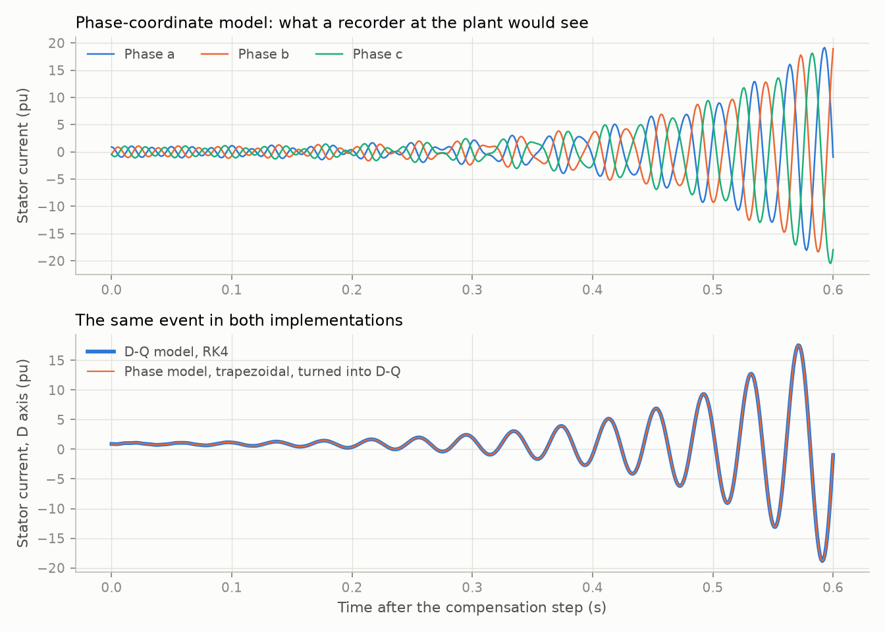

# 07: A second time-domain implementation in phase coordinates

Date: 2026-11-11 · Plan phase: 2 (validation rung 4)

## Goal

Every time-domain result so far comes from one code path: D and Q quantities, PyTorch, RK4. A mistake in the frame equations would pass every internal check. This step writes the model a second time in phase a, b, c quantities with a different integrator, and compares.

## What was done

- `src/sso_sciml/physics/dfig_abc.py`: the current-loop model of step 03 in phase coordinates. NumPy, no automatic differentiation, trapezoidal rule with a linear solve per step. It takes parameter values from the D-Q model and shares no equations with it.
- `scripts/phase2_abc.py`: produces every number and the figure below.
- `tests/test_abc.py`: 4 tests that pin the numbers.
- `docs/EQUATIONS.md` section 18. `docs/VALIDATION.md` and `docs/ASSUMPTIONS.md` updated.

## Commands

```powershell
uv run scripts/phase2_abc.py   # writes docs/results/phase2/abc.json and fig15
uv run pytest
uv run ruff check
```

## Setup of the case

- Model: doubly-fed machine with rotor current control, rotor speed held, radial network. 11 states in phase coordinates against 8 in D-Q.
- Event: compensation stepped from 40 % to 50 % at time zero, starting from the steady state at 40 %. Run for 0.6 s.
- Four cases: rotor at 0.75, 1.00 and 1.20 pu with a 10 Hz current loop (all unstable), and 1.00 pu with a 3 Hz loop (stable).
- Reference: the D-Q model with RK4 at 25 µs.
- The phase model at 25 µs, with phase values turned back into D and Q for the comparison.

## Results

All numbers are in `docs/results/phase2/abc.json`.



| Rotor speed (pu) | Loop (Hz) | Growth rate, eigenvalue (1/s) | Growth rate, phase a current (1/s) | Frequency expected in the phase current (Hz) | Found (Hz) |
|---|---|---|---|---|---|
| 0.75 | 10 | 20.5429 | 20.5427 | 33.021 | 33.021 |
| 1.00 | 10 | 8.6368 | 8.6368 | 34.665 | 34.665 |
| 1.20 | 10 | 3.7517 | 3.7517 | 34.850 | 34.849 |
| 1.00 | 3 | −0.6132 | −0.6132 | 34.879 | 34.879 |

- **Growth rates agree within 0.00014 1/s on all four cases.**
- **The frequency moves as it should.** A mode at `f` in the rotating frame appears at `60 − f` in a phase current. The eigenvalue is from the D-Q model; the waveform is from the phase model.
- **Trajectories agree within 0.094 % of the largest excursion**, and the difference falls at second order with the time step (observed order 2.00), which is the order of the trapezoidal rule.
- **No zero-sequence component appears.** The three phase values sum to below 2e-9 pu throughout.

### Trapezoidal rule in phase coordinates

Rotor at 1.00 pu, 10 Hz loop:

| Time step | Growth-rate error, measured (1/s) | Predicted in the phase frame (1/s) | Predicted in the rotating frame (1/s) |
|---|---|---|---|
| 25 µs | −0.00007 | −0.00006 | −0.00003 |
| 50 µs | −0.00026 | −0.00026 | −0.00014 |
| 0.1 ms | −0.0011 | −0.0010 | −0.0005 |
| 0.2 ms | −0.0042 | −0.0041 | −0.0022 |
| 0.5 ms | −0.026 | −0.026 | −0.014 |

- The error is about 1.9 times the rotating-frame figure, as step 06 expected: in phase coordinates the mode is at 34.7 Hz, not 25.3 Hz.
- For an error below 0.01 1/s the step must be 0.2 ms or less.
- At 50 µs, a common step in electromagnetic-transient studies, the error is 0.0003 1/s.

### Steady state

With no event, the phase model leaves the steady state by 5.3e-4 pu at 50 µs and 1.3e-4 pu at 25 µs. The rule misplaces the 60 Hz forcing by a term in the step squared. The D-Q model holds its steady state to 1e-13.

## Disagreements

1. **None between the two implementations beyond discretisation error.** The frame equations, the sign conventions and the controller transformation in the D-Q model are confirmed by a code path that does not use them.
2. **The phase model covers the current-loop model only.** The phase-locked loop, outer loops, grid-side converter and meshed network exist in one time-domain implementation. They are checked against the impedance model with the loops off (step 05) and against their own eigenvalues, not against a second time-domain code.
3. **Amplitudes in the figure reach 20 pu.** The model has no limits (A26). The comparison is of two linear systems; nothing here says how large a real oscillation gets.
4. **A measurement at 1 ms steps failed.** With the phase model run at 1 ms the mode fit returned a wrong pole. The row was dropped, not explained. The error at that step is predicted at −0.10 1/s.

## Decisions

- The D-Q model stays the production solver. It holds a steady state exactly, takes a step ten times larger for the same growth-rate error, and runs in batches.
- The phase model stays in the repository as a permanent cross-check, and is the source of phase-current waveforms for the measurement task in Phase 8.
- Rung 4 is closed for the current-loop model and stays open for the full controls in the time domain.

## Next

Phase 3: parameter ranges, sampling, the dataset of solver outputs and mechanism quantities, and the splits.
