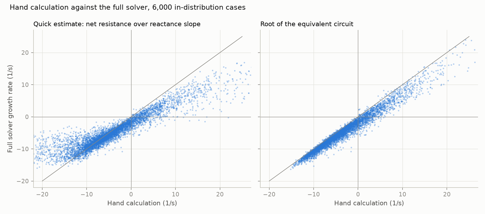
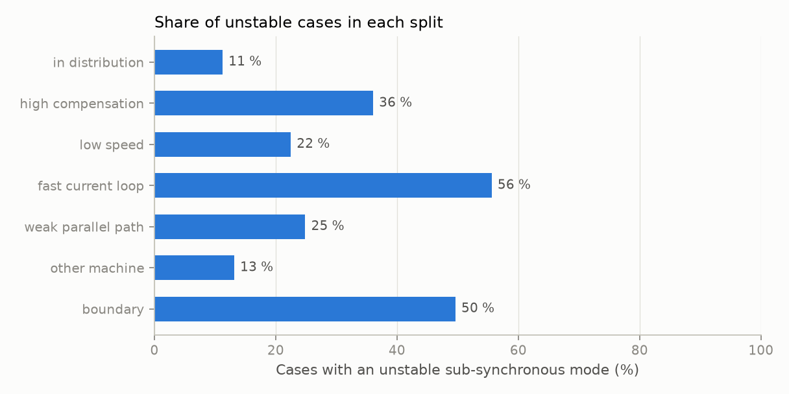

# 08: The T1 dataset

Date: 2026-11-11 · Plan phase: 3 (task T1)

## Goal

Build the dataset for the first learning task: from plant parameters, predict the growth rate of the sub-synchronous mode. Each case carries the full-solver answer and the hand-calculation quantities side by side, so the same file serves models with and without physics in their inputs. Ranges and splits are fixed here, before any training.

## What was done

- `src/sso_sciml/data/t1.py`: the parameter ranges with their sources, sampling, the per-case solver call and hand calculation, the boundary search, and the fold assignment.
- `scripts/phase3_generate_t1.py`: generates the dataset, the manifest, the committed sample and the report.
- `physics/slip.py`: `analyse_loop` now accepts any network impedance, so the hand calculation covers plant impedance and a parallel path.
- `tests/test_data_t1.py`: 7 tests on reproducibility, ranges, splits and the committed sample.
- `data/samples/t1_sample.npz`: the first 1,000 in-distribution rows, committed. The full dataset (23 MB) is not committed; it regenerates from the script.

## Commands

```powershell
uv run scripts/phase3_generate_t1.py           # about 7 minutes on 8 processes
uv run scripts/phase3_generate_t1.py --small   # 1/16 size
uv run pytest tests/test_data_t1.py
```

## Setup of the case

Model: doubly-fed machine with full controls on the meshed network (25 states), the reference case chosen in step 05.

Parameters, 12 in all:

| Parameter | Training range | Sampling |
|---|---|---|
| Series compensation | 10 to 80 % of line reactance | linear |
| Rotor speed | 0.80 to 1.20 pu | linear |
| Rotor current loop bandwidth | 2 to 30 Hz | log |
| Phase-locked loop frequency | 5 to 30 Hz | log |
| Outer loop crossover over current loop bandwidth | 0.03 to 0.15 | log |
| Voltage feed-forward gain | 0 to 1 | linear |
| Line reactance | 0.5 to 1.5 times the reference | linear |
| Line X/R | 10 to 30 | log |
| Plant-side reactance | 0.05 to 0.25 pu | linear |
| Parallel path impedance | 0.5 to 8 times the line's | log |
| Fraction of units online | 0.3 to 1.0 | linear |
| Rotor resistance | 0.004 to 0.008 pu | linear |

- Sampling: scrambled Sobol sequence with a fixed seed.
- Units online: the network impedances are put on the base of the running machines, so fewer units see a proportionally weaker line. The plant-side reactance is not scaled.
- Solver outputs per case: growth rate and frequency of the sub-synchronous mode, and of the least-damped mode of any kind.
- Hand-calculation outputs per case: whether a resonance exists below rotor speed, its frequency, slip there, machine resistance, net resistance, the quick growth estimate, and the root of the equivalent circuit found from that resonance. Also the least-damped sub-synchronous root of the impedance model of step 05, which exists in every case. The hand calculation knows the machine, the current loop and the network. It does not know the phase-locked loop, outer loops or grid-side converter.

Splits:

| Set | Rows | What differs |
|---|---|---|
| In distribution | 131,072 | split 80 / 10 / 10 into train, validation, test |
| Boundary | 4,931 | cases moved along compensation to within 0.6 points of the stability boundary |
| High compensation | 4,096 | 80 to 95 % |
| Low speed | 4,096 | rotor at 0.70 to 0.80 pu |
| Fast current loop | 4,096 | 30 to 60 Hz |
| Weak parallel path | 4,096 | 8 to 64 times the line impedance |
| Other machine | 4,096 | rotor resistance 0.008 to 0.012 pu |

Each extrapolation set moves one parameter outside its range and keeps the other eleven inside.

## Results

All numbers are in `docs/results/phase3/t1_report.json`.

| Set | Unstable (sub-synchronous) | Impedance root: mean error (1/s) | Impedance root: sign agrees | Quick estimate: mean error (1/s) |
|---|---|---|---|---|
| In distribution | 11.2 % | 1.27 | 95.2 % | 3.56 |
| Boundary | 49.6 % | 1.98 | 50.0 % | 2.78 |
| High compensation | 36.0 % | 2.01 | 90.1 % | 6.23 |
| Low speed | 22.5 % | 2.81 | 86.0 % | 7.23 |
| Fast current loop | 55.6 % | 1.90 | 92.6 % | 8.88 |
| Weak parallel path | 24.8 % | 1.98 | 90.6 % | 2.46 |
| Other machine | 13.1 % | 1.26 | 94.6 % | 3.85 |

The impedance root is scored on every solved case. The quick estimate is scored only where a resonance exists.



- **The hand calculation carries most of the answer.** Growth rates span −18 to +32 1/s; the impedance root is off by 1.3 1/s on average and gets the sign right in 95.2 % of cases.
- **It is no better than a coin at the boundary.** On cases within 1 1/s of the boundary it has the sign right 50.0 % of the time. That is where a screening tool earns its keep.
- **It is biased.** For unstable cases it predicts growth 2.4 1/s faster on average than the full solver finds. The controls it does not model add damping on balance.
- **The quick estimate is much worse than a root of the circuit away from the boundary**, as step 03 found: 3.6 against 1.4 1/s on the cases with a resonance.
- **Solver failures:** 16 of 131,072 in distribution, and at most 3 in any extrapolation set. In each the steady state did not converge. They are kept in the files with a flag.
- **Reproducibility:** the first 256 rows, regenerated in a single process, are bit-identical to the 8-process run.
- **Speed:** 515 cases per second on 8 processes; 409 s for everything.



## Disagreements

1. **A second, slow instability showed up.** With the outer loop sampled independently of the current loop, 16 % of a trial sample was unstable through a 0.4 to 1.8 Hz mode between the outer-loop and current-loop integrators. That is a tuning artefact: the outer loop was as fast as the inner one. The outer loop is now sampled as a fraction of the current-loop bandwidth. A residue remains: 3.4 % of in-distribution cases, and 17 % at low speed, have a weakly unstable slow mode. It is not the mechanism this project studies. The target is the sub-synchronous mode; the least-damped mode is stored as well so the slow one can be studied later. Its cause is not established.
2. **A quarter of cases have no resonance below rotor speed** in the hand calculation (24.5 % in distribution). A strong parallel path keeps the loop reactance inductive at every frequency. The solver still finds a sub-synchronous mode in these cases, unstable in 0.04 % of them. The resonance-based columns are zero there, with a flag. The first version of the dataset had only those columns, which left a model built on the hand calculation with nothing to start from in a quarter of cases. Version 2 adds the impedance root, which has no such gap.
3. **The resonance search picked the wrong crossing** at first: with integral action the loop reactance also crosses zero just below 60 Hz. The search now stops 3 Hz below the lower of rotor speed and synchronous speed.
4. **Fewer boundary cases than planned.** Only 30 % of candidates have a boundary inside 10 to 80 % compensation, so 16,384 candidates gave 4,931 cases.
5. **The plan called for a short-circuit-ratio split and a different mechanism (System C).** Neither exists yet. Parallel-path strength stands in for grid strength. System C is not built.
6. **The plan called for about 200,000 cases.** 131,072 were generated. More can be added from the same Sobol sequence if the learning curves in Phase 4 have not flattened.

## Decisions

- Dataset version `t1-v2`, specification hash `bb4ab735373a3947`. Version 1 differed only in lacking the two impedance-root columns; solver outputs are unchanged. Any change to ranges, seed or splits changes the hash, and a test fails.
- The target for T1 is the growth rate of the sub-synchronous mode, not the least-damped mode.
- The boundary set is a test set. No model trains on it in Phase 4, so it measures how well random sampling alone resolves the boundary.
- Input scaling for learned models is fixed by the parameter ranges, not fitted to data.

## Next

Phase 4: gradient-boosted trees and multilayer perceptrons on T1, with the hand calculation absent, as input features, or as the baseline the model corrects.
