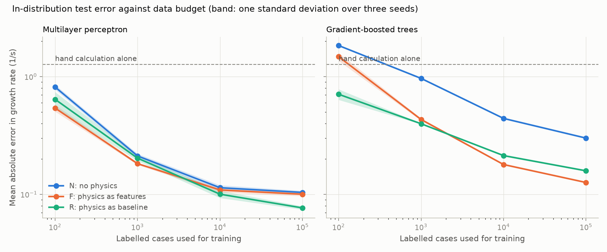
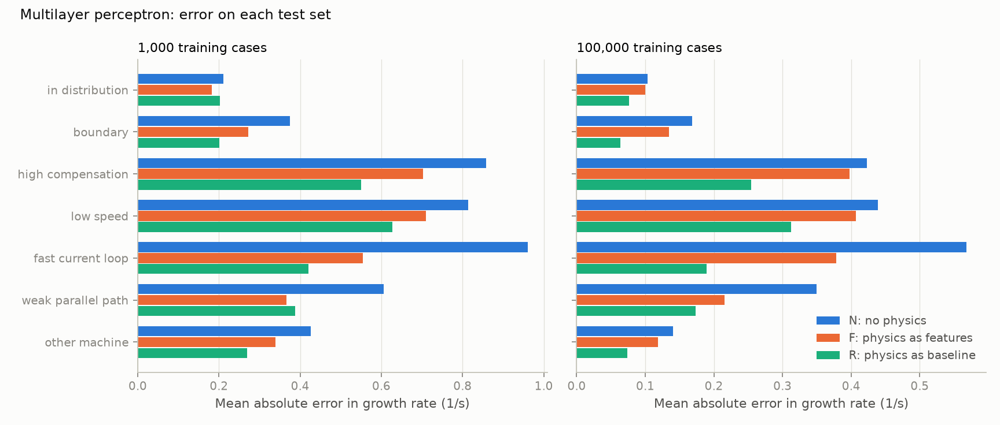

# 09: T1 with the physics absent, as a feature, or as the baseline

Date: 2026-11-11 · Plan phase: 4 (first part)

## Goal

Train models that predict the growth rate of the sub-synchronous mode from plant parameters, with the hand calculation used in three ways and everything else held equal. How much does the hand calculation help, at which data budget, and on which test set?

## What was done

- `src/sso_sciml/models/t1.py`: input scaling, the three arms, a multilayer perceptron with its training loop, and the metrics.
- `scripts/phase4_t1_arms.py`: trains every combination, scores it on every test set, writes the results file and two figures.
- `tests/test_models_t1.py`: 10 tests on scaling, the arm definitions, the metrics and seeded training, run on the committed sample on the CPU.
- The dataset was first extended to version 2 (step 08) so that the hand calculation has an answer in every case. See disagreement 1.

## Commands

```powershell
uv run scripts/phase3_generate_t1.py     # dataset, about 7 minutes
uv run scripts/phase4_t1_arms.py         # 72 training runs, about 6 minutes
uv run pytest tests/test_models_t1.py
```

## Setup of the case

Arms:

| Arm | Inputs | Target |
|---|---|---|
| N | 12 parameters | growth rate |
| F | 12 parameters and 10 hand-calculation quantities | growth rate |
| R | 12 parameters | growth rate minus the impedance root of the hand calculation |

- Models: a multilayer perceptron (4 layers of 256, 4,000 steps, batch 1,024, Huber loss, weights kept at the lowest validation error) and gradient-boosted trees (600 iterations). Same settings for every arm and budget; nothing was tuned per arm.
- Data budgets: 100, 1,000, 10,000 and 100,000 cases drawn from the training fold of 104,845. Three seeds each, which change both the subset and the initial weights.
- The budget counts every label a model sees. The perceptron trains on four fifths of it and uses the last fifth to choose its checkpoint. The trees train on all of it. The validation fold of the dataset is not used.
- Test sets: the in-distribution test fold (13,105 cases), the boundary set (4,931) and the five extrapolation sets (about 4,095 each).
- Baseline that needs no training: the impedance root of the hand calculation on its own.

## Results

All numbers are in `docs/results/phase4/t1_arms.json`. Values are means over three seeds.

Mean absolute error in growth rate on the in-distribution test fold, 1/s. The hand calculation alone gives 1.27.

| Model | Arm | 100 cases | 1,000 | 10,000 | 100,000 |
|---|---|---|---|---|---|
| Perceptron | N | 0.81 | 0.21 | 0.11 | 0.10 |
| Perceptron | F | 0.54 | 0.18 | 0.11 | 0.10 |
| Perceptron | R | 0.64 | 0.20 | 0.10 | 0.08 |
| Trees | N | 1.83 | 0.96 | 0.44 | 0.30 |
| Trees | F | 1.47 | 0.43 | 0.18 | 0.13 |
| Trees | R | 0.71 | 0.40 | 0.21 | 0.16 |



Share of unstable cases predicted stable, in-distribution test fold. The hand calculation alone misses 0.3 % and raises a false alarm on 5.4 % of stable cases.

| Model | Arm | 100 cases | 1,000 | 10,000 | 100,000 |
|---|---|---|---|---|---|
| Perceptron | N | 13.4 % | 4.2 % | 2.3 % | 2.1 % |
| Perceptron | F | 4.3 % | 2.7 % | 1.7 % | 1.3 % |
| Perceptron | R | 5.3 % | 1.7 % | 1.2 % | 0.7 % |
| Trees | N | 39.1 % | 20.9 % | 9.2 % | 5.5 % |
| Trees | F | 3.0 % | 5.1 % | 3.3 % | 2.0 % |
| Trees | R | 4.7 % | 2.7 % | 2.1 % | 1.9 % |

Perceptron on each test set at 100,000 cases: mean absolute error in 1/s, with the share of unstable cases missed in brackets.

| Test set | Hand calculation alone | N | F | R |
|---|---|---|---|---|
| In distribution | 1.27 (0.3 %) | 0.10 (2.1 %) | 0.10 (1.3 %) | 0.08 (0.7 %) |
| Boundary | 1.98 (3.3 %) | 0.17 (40.5 %) | 0.14 (33.6 %) | 0.06 (21.7 %) |
| High compensation | 2.01 (1.7 %) | 0.42 (3.3 %) | 0.40 (3.4 %) | 0.25 (2.3 %) |
| Low speed | 2.81 (1.1 %) | 0.44 (4.1 %) | 0.41 (5.1 %) | 0.31 (2.3 %) |
| Fast current loop | 1.90 (1.0 %) | 0.57 (0.4 %) | 0.38 (1.0 %) | 0.19 (0.6 %) |
| Weak parallel path | 1.98 (0.1 %) | 0.35 (4.7 %) | 0.22 (1.9 %) | 0.17 (0.6 %) |
| Other machine | 1.26 (0.0 %) | 0.14 (1.1 %) | 0.12 (0.8 %) | 0.07 (0.4 %) |



- **Every trained perceptron beats the hand calculation on error**, from 100 cases up: 0.54 to 0.81 against 1.27 1/s.
- **For the perceptron, the hand calculation helps at 100 cases and little after that.** At 100 cases arm F has 0.54 and arm R 0.64 1/s against 0.81 for arm N, with seed spreads of 0.04, 0.10 and 0.04. At 1,000 cases the three are within 0.03 1/s of each other. The gain in screening is larger: arm N misses 13.4 % of unstable cases at 100 cases, arms F and R 4.3 % and 5.3 %.
- **For trees, it changes a great deal.** At 100 cases arm R has 0.71 1/s against 1.83 for arm N, and arm N still misses 5.5 % of unstable cases at 100,000.
- **Arm R is the best perceptron once there are 10,000 cases or more**, and the gap does not close: 0.077 against 0.104 1/s at 100,000, with a seed spread of 0.003 on each.
- **Arm R is the best perceptron on every extrapolation set at 100,000 cases**, by a factor of 1.4 to 3 over arm N. Arm F sits between them, and close to arm N at high compensation and low speed.
- **The boundary set stays hard.** Its cases sit within 1 1/s of zero growth, so a small error flips the sign. The best model, arm R at 100,000 cases, is off by 0.06 1/s and still calls 21.7 % of unstable cases stable. The hand calculation misses few only because it calls 96 % of the stable cases unstable.
- **The hand calculation is the safer screen on its own terms**: it misses 0.3 % of unstable cases in distribution, fewer than any trained model here. It pays with false alarms on 5.4 % of stable cases against 0.08 to 0.20 % for the perceptrons at 100,000 cases.
- **Cost:** about 9 s per perceptron on the GPU and under 2 s per tree model on the CPU; 320 s and 36 s for all 36 runs of each.

## Hypotheses

Verdicts so far on the two hypotheses of the plan that this phase addresses. Both are provisional until the remaining parts of the phase are done.

1. *With little data, F and R beat N by a wide margin.* Holds for trees at every budget. For the perceptron it holds at 100 cases (error lower by a factor of 1.3 to 1.5, missed unstable cases by a factor of 2.5 to 3) and is gone by 1,000.
2. *F and R degrade where the hand calculation is invalid, and R degrades more than F.* Not supported by the extrapolation sets: R degrades least on all five. This is not yet the test the plan describes, which splits cases by the validity range of the hand calculation.

Hypothesis 5 said the arms converge in distribution with abundant data. Arms N and F do. Arm R stays 25 % lower.

## Disagreements

1. **The first run used the root found from the resonance search as the baseline for arm R, and arm R was the worst perceptron in distribution** at every budget. That results file was overwritten by the repeat, so its numbers are not quoted here. A quarter of cases have no resonance, so the baseline was zero there and the correction had a jump to learn. The dataset was extended with the impedance root, which exists in every case, and the run repeated. The numbers above are from the repeat. Arm N is unchanged between the two runs, as it should be.
2. **Checkpoint selection first used more labels than the small budgets.** The perceptron chose its checkpoint on the full validation fold of 13,106 cases at every budget, which at 100 and 1,000 cases is more labelled data than the training set. The run was repeated with the held-out cases taken from inside the budget. Arm N at 100 cases had looked better than it is, and the gain from the hand calculation at that budget smaller than it is. The numbers above are from the repeat.
3. **The perceptron beats the trees in every arm and budget.** Expected for a smooth target on 12 inputs; noted because the plan lists trees as the baseline to beat.
4. **Arm F for trees at 100 cases misses fewer unstable cases (3.0 %) than at 1,000 (5.1 %).** At 100 cases it has not moved far from the hand calculation, which errs toward unstable: its false-alarm rate is 7.2 % against 0.8 % at 1,000.
5. **Parts of plan phase 4 are not done:** Gaussian process baseline, deep ensemble, feature ablation, feature corruption test, uncertainty estimates, the mechanism-consistency rate, inference time, and the MLflow store. Results go to a JSON file instead.

## Decisions

- Arm R uses the impedance root as its baseline, clipped to ±40 1/s.
- Growth rates are scaled by 10 1/s for training; the mechanism inputs use fixed transforms, not statistics fitted to data.
- One architecture and one training schedule for every arm and budget.

## Next

Step 10: the feature ablation, the feature corruption test, cases split by the validity of the hand calculation, and uncertainty estimates.
