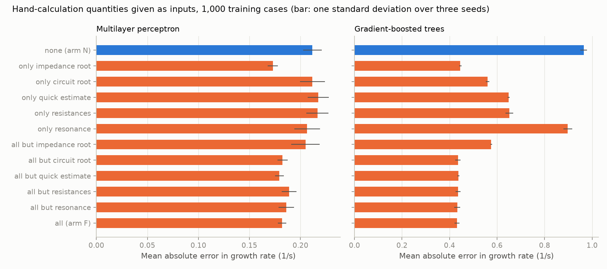
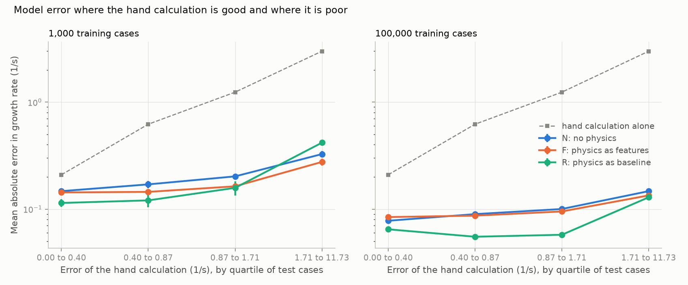

# 10: What the hand calculation contributes, and what its errors cost

Date: 2026-11-11 · Plan phase: 4 (second part)

## Goal

Step 09 showed that the hand calculation helps. This step asks which of its quantities does the work, whether a model that uses it is worse where the hand calculation is poor, and what happens when the hand calculation itself is wrong.

## What was done

- `scripts/phase4_t1_studies.py`: four studies with the perceptron and settings of step 09, three seeds each.
- `src/sso_sciml/models/t1.py`: arm F can be given a subset of the hand-calculation quantities.
- `tests/test_models_t1.py`: two more tests, on the subset of quantities and on the budget subset.

## Commands

```powershell
uv run scripts/phase4_t1_studies.py     # 702 s
uv run pytest tests/test_models_t1.py
```

## Setup of the case

- **Ablation.** Arm F with one group of quantities only, and with all but one group, at 1,000 cases. Perceptron and trees. Groups: impedance root (growth rate and frequency), circuit root (the same from the resonance search), quick estimate, resistances (machine and net), resonance (flag, frequency, slip).
- **Validity.** The in-distribution test fold cut into quarters by the size of the hand calculation's own error. Arms N, F and R at 1,000 and 100,000 cases.
- **Wrong data.** The same trained models, given at test time a hand calculation done with one parameter wrong: current-loop bandwidth 25 % high, rotor resistance 25 % high, or line reactance 10 % high. The parameters given to the model directly stay correct. First 2,048 cases of the test fold.
- **Noise.** A random error with standard deviation 1 or 3 1/s added to the impedance root in training and in test, so the model can learn how far to trust it. Arm F here has the impedance root as its only hand-calculation input. 10,000 cases.

## Results

All numbers are in `docs/results/phase4/t1_studies.json`. Errors are mean absolute errors in growth rate, 1/s, averaged over three seeds.

### Ablation

| Hand-calculation inputs | Perceptron | Trees |
|---|---|---|
| None (arm N) | 0.212 | 0.964 |
| Only impedance root | 0.173 | 0.445 |
| Only circuit root | 0.212 | 0.560 |
| Only quick estimate | 0.217 | 0.648 |
| Only resistances | 0.217 | 0.652 |
| Only resonance | 0.206 | 0.897 |
| All but impedance root | 0.205 | 0.575 |
| All (arm F) | 0.182 | 0.432 |



- **The impedance root carries the gain.** On its own it does as well as all ten quantities together: 0.173 against 0.182 1/s for the perceptron (seed spreads 0.005 and 0.004), 0.445 against 0.432 for trees.
- **For the perceptron nothing else helps.** Every other group alone is within the seed spread of arm N, and removing the impedance root from the full set brings the error back to 0.205.
- **Trees can use any of the growth estimates.** The circuit root, the quick estimate and the resistances each cut the error by about a third or more. The resonance frequency and slip alone do not.
- **Removing any one group other than the impedance root changes nothing**, for either model.
- **On the extrapolation sets the pattern is the same.** Averaged over the five, the perceptron has 0.73 1/s with no physics, 0.51 with the impedance root alone and 0.54 with everything.

### Validity

The quarters of the test fold, by error of the hand calculation: below 0.40, 0.40 to 0.87, 0.87 to 1.71, and above 1.71 1/s.

| Arm, cases | Quarter 1 | Quarter 2 | Quarter 3 | Quarter 4 |
|---|---|---|---|---|
| Hand calculation alone | 0.21 | 0.62 | 1.24 | 2.99 |
| N, 1,000 | 0.147 | 0.170 | 0.202 | 0.327 |
| F, 1,000 | 0.143 | 0.145 | 0.163 | 0.276 |
| R, 1,000 | 0.114 | 0.121 | 0.158 | 0.418 |
| N, 100,000 | 0.078 | 0.090 | 0.100 | 0.147 |
| F, 100,000 | 0.084 | 0.087 | 0.095 | 0.134 |
| R, 100,000 | 0.065 | 0.055 | 0.058 | 0.129 |



- **The cases where the hand calculation is poor are hard for every arm, including the one that never sees it.** Arm N's error doubles from the first quarter to the last. Those cases are hard in themselves.
- **At 1,000 cases arm R is the best arm where the hand calculation is good and the worst where it is poor**: 0.114 against 0.147 for arm N in the first quarter, 0.418 against 0.327 in the last. Arm F is at or below arm N in every quarter.
- **At 100,000 cases arm R is best in every quarter**, and by the widest margin in the middle two.
- **Where no resonance is found** (24.5 % of the test fold) the order reverses: arm N has 0.080 1/s at 100,000 cases, arm R 0.104 and arm F 0.114. Where one is found, arm R has 0.068 against 0.112 for arm N.

### Wrong data

Models trained on 100,000 cases with a correct hand calculation. Share of unstable cases missed in brackets.

| Hand calculation done with | Hand calculation alone | Arm F | Arm R |
|---|---|---|---|
| Correct data | 1.26 (0.5 %) | 0.108 (1.1 %) | 0.089 (0.7 %) |
| Current-loop bandwidth 25 % high | 2.10 (0.5 %) | 0.549 (0.0 %) | 0.936 (0.0 %) |
| Rotor resistance 25 % high | 1.46 (0.5 %) | 0.169 (0.0 %) | 0.273 (0.0 %) |
| Line reactance 10 % high | 1.42 (0.0 %) | 0.161 (0.0 %) | 0.230 (0.0 %) |

- **Both arms inherit the error, and arm R inherits more.** A bandwidth 25 % high raises the hand calculation's error by 0.85 1/s, arm R's by the same 0.85, and arm F's by 0.44.
- **Either arm is then worse than arm N**, which has 0.10 1/s on the full test fold and does not depend on the hand calculation.
- **All three errors push toward faster growth**, so no unstable case is missed. The cost is in false alarms and in the size of the error.

### Noise

Models trained on 10,000 cases, with the same random error in training and in test.

| Random error in the impedance root | Hand calculation alone | Arm N | Arm F | Arm R |
|---|---|---|---|---|
| None | 1.27 | 0.114 | 0.099 | 0.100 |
| 1 1/s | 1.53 | 0.114 | 0.110 | 0.846 |
| 3 1/s | 2.76 | 0.114 | 0.107 | 2.435 |

- **Arm F learns to discount an unreliable input.** With a random error of 3 1/s it falls back to the error of arm N and no further.
- **Arm R cannot.** The error passes straight into the prediction: 0.85 and 2.44 1/s are what a random error of 1 and 3 1/s gives on its own (0.80 and 2.39). Its share of missed unstable cases rises from 1.2 % to 17.2 %.

## Hypotheses

2. *F and R degrade where the hand calculation is invalid, and R degrades more than F.* Supported, with a condition. Arm R is worse than arm F where the hand calculation is poor when data is short (1,000 cases), when the hand calculation is fed wrong data, and when its error is random. With 100,000 cases and a hand calculation that is wrong in a repeatable way, arm R learns the correction and is the best arm even in the worst quarter. Arm R is safe when the error of the baseline is a function of the inputs, and not otherwise.

The feature corruption question of the plan, whether a model inherits the error or learns to discount it: arm F discounts an error it has seen in training and inherits a third to a half of one it has not.

## Disagreements

1. **The circuit root does not help the perceptron, though it is the same physics as the impedance root.** It comes from the resonance search, which finds nothing in a quarter of cases and returns zero. That is the likely cause: trees can split the zeros off, and a perceptron at 1,000 cases has a jump to fit. It has not been tested.
2. **Arm F is worse than arm N where no resonance is found, at 100,000 cases** (0.114 against 0.080 1/s). Seven of its ten inputs are zero there. Arm F with the impedance root alone has not been run at that budget.
3. **The wrong-data test covers three parameters and one size of error each.** It shows the direction, not a sensitivity curve.
4. **The noise test adds error to one quantity only**, with arm F cut down to that quantity. With all ten inputs the model could recover the growth rate from the others.

## Decisions

- The impedance root is the hand-calculation quantity to carry forward. Later arms that take one physics input take that one.
- Arm R is used only with a baseline computed from the same parameters the model sees.

## Next

Rest of phase 4: uncertainty (deep ensemble, MC dropout, conformal intervals), the Gaussian process baseline, the mechanism-consistency rate and inference time.
