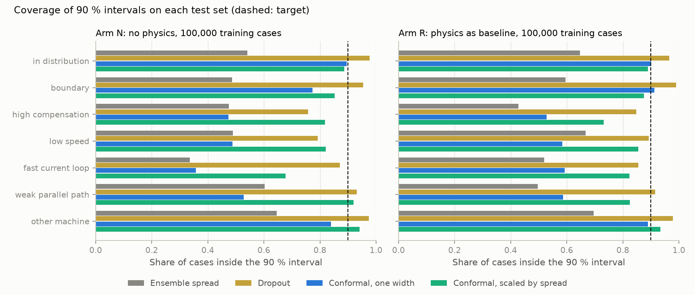
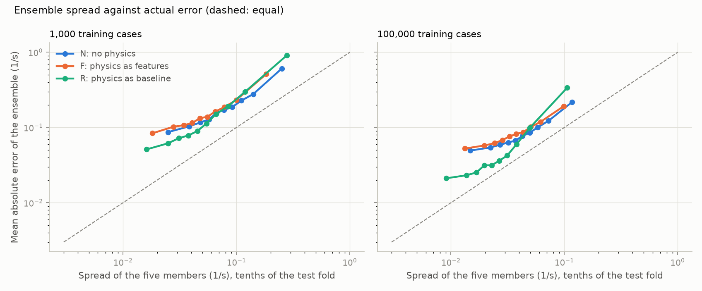
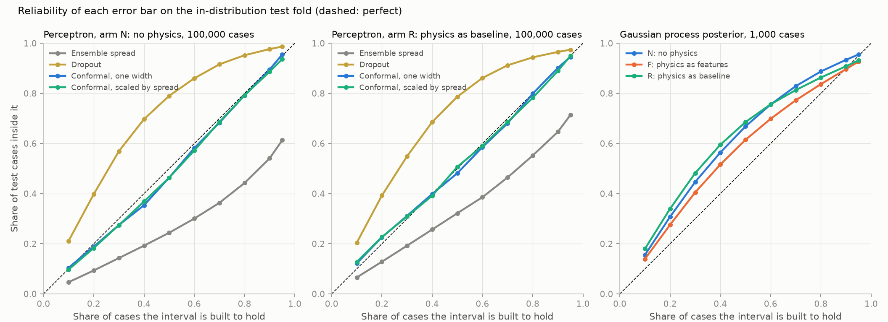

# 11: Error bars, a Gaussian process, trends and speed for T1

Date: 2026-11-11 · Plan phase: 4 (third part)

## Goal

A screening tool has to say when it does not know. This step asks which error bar on the growth rate can be trusted, in and out of the training range, and what it buys as a screen. It also adds the Gaussian process baseline, checks that the models follow the solver when compensation is swept, and times everything.

## What was done

- `scripts/phase4_t1_uncertainty.py`: ensembles, dropout, conformal intervals, the Gaussian process, compensation sweeps and timing.
- `src/sso_sciml/models/t1.py`: optional dropout in the perceptron, prediction with dropout left on, the split-conformal quantile, and interval scores.
- `tests/test_models_t1.py`: 4 more tests, on the conformal quantile, interval scores and dropout.

## Commands

```powershell
uv run scripts/phase4_t1_uncertainty.py     # about 14 minutes
uv run pytest tests/test_models_t1.py
```

## Setup of the case

- **Ensemble.** Five perceptrons of step 09 with different initial weights and batch order, on the same cases. Prediction is their mean; the error bar is 1.645 times their standard deviation.
- **Dropout.** One perceptron with dropout of 0.1 after each hidden layer, 30 passes with dropout left on.
- **Conformal.** The ensemble mean with an interval sized on 1,000 cases of the validation fold, which no model has trained on. Two forms: one width for every case, and a width proportional to the ensemble spread.
- **Gaussian process.** Matern 5/2 kernel with one length scale per input, at 100 and 1,000 cases, three seeds. Its error bar is 1.645 times the posterior standard deviation.
- All intervals aim at 90 %. Arms N, F and R at 1,000 and 100,000 cases. One ensemble per arm and budget, so there is no seed spread on those numbers.
- **Interval as a screen.** A case whose interval contains zero is flagged for the full solver. An unstable case is missed only if its whole interval is below zero.
- **Trends.** 256 test cases, each solved at 8 compensation levels from 10 to 80 %. Between adjacent levels, does the model's growth rate move the same way as the solver's? Counted where the solver moves by more than 0.2 1/s.

## Results

All numbers are in `docs/results/phase4/t1_uncertainty.json`.

### Coverage

Share of cases inside the 90 % interval, perceptron at 100,000 cases. The extrapolation column is the range over the five extrapolation sets.

| Arm | Interval | In distribution | Boundary | Extrapolation | Mean width in distribution (1/s) |
|---|---|---|---|---|---|
| N | Ensemble spread | 54.1 % | 48.7 % | 33.6 to 64.6 % | 0.16 |
| N | Dropout | 97.7 % | 95.4 % | 75.8 to 97.5 % | 1.17 |
| N | Conformal, one width | 89.5 % | 77.3 % | 35.7 to 83.9 % | 0.38 |
| N | Conformal, scaled | 88.7 % | 85.2 % | 67.7 to 94.2 % | 0.40 |
| R | Ensemble spread | 64.6 % | 59.6 % | 42.8 to 69.5 % | 0.11 |
| R | Dropout | 96.5 % | 99.0 % | 84.7 to 97.9 % | 0.43 |
| R | Conformal, one width | 90.2 % | 91.2 % | 52.8 to 88.9 % | 0.24 |
| R | Conformal, scaled | 88.9 % | 87.5 % | 73.2 to 93.4 % | 0.24 |



- **The raw ensemble spread is far too narrow.** Its 90 % interval holds 41 to 65 % of in-distribution cases across the six ensembles. The conformal step has to widen it by a factor of 2.2 to 4.2 to reach 90 %.
- **The spread does rank cases.** Its rank correlation with the actual error is 0.29 to 0.53 in distribution, and cases in the top tenth of spread have several times the error of the bottom tenth.
- **Conformal intervals hold in distribution and fail outside it.** One width gives 89.5 to 90.5 % in distribution, as the method guarantees, and as little as 35.7 % on the fast-current-loop set. Scaling by the spread recovers much of that (67.7 % on the same set) and still falls short of 90 % on most extrapolation sets.
- **Dropout is the most conservative and the least sharp.** For arm N its intervals are three times as wide as the conformal ones, and the model itself is worse: 0.160 against 0.101 1/s for the same perceptron without dropout. It still drops to 75.8 % at high compensation.
- **No method keeps 90 % on every extrapolation set.** An error bar from any of them is a statement about cases like the training data.



The same check at every level from 10 to 95 %, on the in-distribution test fold:



- **Both conformal forms are within 5 points of the target at every level.**
- **The ensemble spread is too narrow at every level**: its 50 % interval holds 24 % of cases for arm N.
- **Dropout is too wide at every level for arm N**: its 50 % interval holds 79 %.
- **The Gaussian process is right at 90 % and too wide in the middle**: at 1,000 cases its 50 % interval holds 61 to 69 % of cases. Its errors are more peaked than the normal distribution its error bar assumes, so the agreement at 90 % does not carry to other levels.

### The ensemble as a model

Mean absolute error in distribution, 1/s: single perceptron against the mean of five.

| Arm | 1,000 cases | 100,000 cases |
|---|---|---|
| N | 0.212 → 0.206 | 0.101 → 0.090 |
| F | 0.186 → 0.177 | 0.095 → 0.090 |
| R | 0.207 → 0.201 | 0.075 → 0.071 |

Averaging five members gains 3 to 11 %. The share of missed unstable cases does not change beyond noise.

### The interval as a screen

Ensemble with the scaled conformal interval, 100,000 cases.

| Arm | Test set | Missed by the sign of the prediction | Flagged for the solver | Missed after flagging |
|---|---|---|---|---|
| N | In distribution | 2.0 % | 1.2 % | 0.15 % |
| R | In distribution | 0.7 % | 0.5 % | 0.00 % |
| N | Boundary | 40.4 % | 82.1 % | 4.7 % |
| R | Boundary | 21.3 % | 68.5 % | 2.2 % |
| N | High compensation | 3.1 % | 5.8 % | 0.5 % |
| R | High compensation | 2.5 % | 2.1 % | 1.1 % |
| N | Low speed | 2.8 % | 5.2 % | 0.8 % |
| R | Low speed | 2.4 % | 2.9 % | 0.9 % |

- **Sending about 1 % of cases to the full solver removes most of the missed unstable cases in distribution**: from 2.0 % to 0.15 % for arm N, and from 0.7 % to none of the unstable test cases for arm R.
- **On the boundary set the screen does what it should**: it flags most cases and does not guess. What it still misses, 2.2 to 4.7 %, is not zero.
- **Outside the training range it helps less**, because the intervals are too narrow there: arm R still misses 1.1 % at high compensation.

### Gaussian process

Mean absolute error in distribution, 1/s, with the single perceptron of step 09 for comparison (both means of three seeds).

| Arm | Gaussian process, 100 | Perceptron, 100 | Gaussian process, 1,000 | Perceptron, 1,000 |
|---|---|---|---|---|
| N | 0.72 | 0.81 | 0.197 | 0.212 |
| F | 0.47 | 0.54 | 0.113 | 0.182 |
| R | 0.55 | 0.64 | 0.268 | 0.203 |

- **With the hand calculation as an input, the Gaussian process at 1,000 cases matches the perceptron at 10,000** (0.113 against 0.109 1/s). It is the best small-data model here.
- **It is better than the perceptron for arms N and F at both budgets, and worse for arm R at 1,000.**
- **Its own error bar is close to right in distribution with no calibration set**: 89 to 93 % of cases inside the 90 % interval at 1,000 cases, 76 to 87 % at 100. On the extrapolation sets it ranges from 66 to 97 %.
- **Cost:** 22 to 111 s to fit 1,000 cases on the CPU, growing with the cube of the number of cases. It was not run beyond 1,000.

### Trends

Share of the 1,605 compensation steps where the model moves the same way as the solver.

| | 1,000 cases | 100,000 cases |
|---|---|---|
| Hand calculation alone | 97.4 % | 97.4 % |
| Arm N | 99.9 % | 99.9 % |
| Arm F | 99.4 % | 99.9 % |
| Arm R | 98.6 % | 99.3 % |

All arms follow the solver more closely than the hand calculation does. Arm R is the least consistent of the three: where the baseline moves the wrong way, the correction has to undo it.

### Speed

Time per case on this machine. The solver and hand calculation run one case at a time on one CPU core.

| Method | Time per case |
|---|---|
| Full solver (steady state and eigenvalues) | 10.2 ms |
| Hand calculation (all ten quantities) | 1.7 ms |
| Perceptron, one case at a time, CPU | 0.20 ms |
| Perceptron, one case at a time, GPU | 0.67 ms |
| Perceptron, 13,105 cases at once, CPU | 1.4 µs |
| Perceptron, 13,105 cases at once, GPU | 1.3 µs |
| Trees, 13,105 cases at once, CPU | 3.5 µs |

- **In batches the perceptron is about 7,500 times faster than the solver**, and the GPU adds nothing over the CPU at this model size. These timings move by 10 to 40 % from run to run.
- **One case at a time the gain is 50 times on the CPU**, and the GPU is slower than the CPU.
- **Arms F and R need the hand calculation first**, at 1.7 ms per case. That is a thousand times the cost of the network and leaves them 6 times faster than the solver, not 7,500. Only arm N gets the full speed.
- An ensemble of five costs five times the single model.
- The whole script takes 838 s.

## Disagreements

1. **The plan expected ensemble spread to be usable as an error bar.** It is too narrow by a factor of 2 to 4. The members share their training cases and differ only in initial weights, so they agree with each other where they are all wrong.
2. **The conformal guarantee is for cases drawn like the calibration set.** The extrapolation sets break that by construction, and coverage falls to between 36 and 94 %. This is the expected behaviour, recorded because it limits what the tool can promise.
3. **Dropout costs accuracy for arms N and F** (0.160 against 0.101 1/s for arm N at 100,000 cases) and not for arm R (0.081 against 0.075). Only one dropout rate was tried.
4. **The Gaussian process is worse under arm R than under arm N at 1,000 cases** (0.268 against 0.197 1/s), the reverse of the perceptron at large budgets. Not investigated.
5. **Calibration uses 1,000 labelled cases beyond the training budget.** At a budget of 1,000 that doubles the labels used.
6. **The mechanism check of the plan was a sign test against net resistance.** That belongs to the induction machine of step 02. For this system the check is the trend in compensation. The trend in rotor speed was not run.
7. **No MLflow store.** Results go to one JSON file per script, committed with figures of training, performance and metrics drawn by `src/sso_sciml/report.py`.

8. **The hand calculation dominates the cost of arms F and R.** The plan treated it as free. The impedance root alone needs one polynomial root-finding and would be cheaper than the full set of ten quantities timed here; that was not timed separately.

## Decisions

- Error bars reported from here on are conformal intervals scaled by ensemble spread, calibrated on held-out cases, and stated as valid inside the training range only.
- A screening result is one of three: stable, unstable, or run the full solver.
- The Gaussian process with the impedance root as an input is the reference model below 1,000 cases.

## Next

Phase 4 exit check, then phase 5: the eigen-residual loss (arm L), which needs no solver labels.
