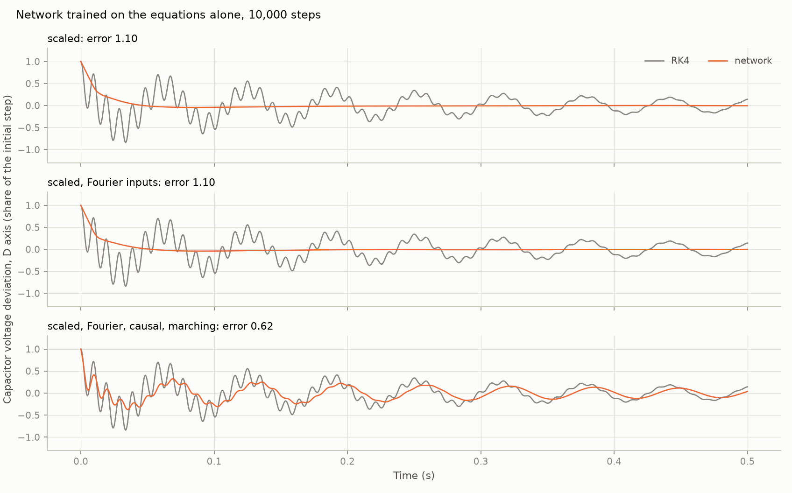
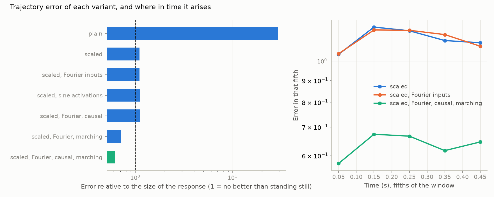
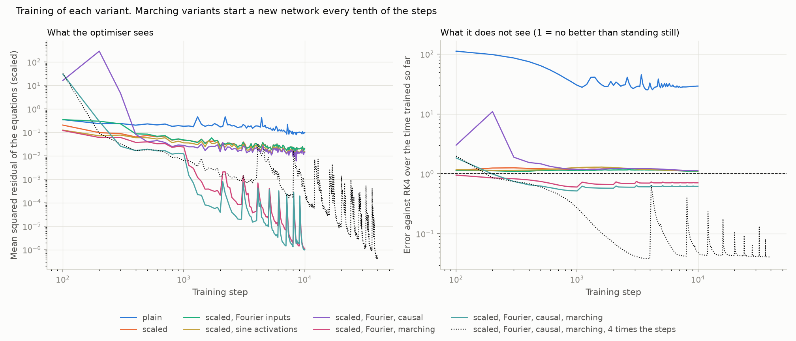

# 12: A network trained on the equations alone, one case

Date: 2026-11-11 · Plan phase: 5 (item 1, System B1)

## Goal

Find out what it takes to train a physics-informed network on this kind of system at all. One case, no solver data: a network `x̂(t)` is trained only to satisfy the differential equations, and is then compared with RK4. It replaces nothing useful, since RK4 solves the case in seconds. The point is to learn which of the known remedies matter here before trying a network over a range of parameters.

## What was done

- `src/sso_sciml/models/pinn.py`: the network, the exact initial condition, the residual loss, and the remedies as switches.
- `scripts/phase5_forward_pinn.py`: the experiment, its results file and three figures.
- `src/sso_sciml/report.py`: shared plots of training, performance and metrics, used from this step on.
- `tests/test_pinn.py`: 9 tests. The time derivative matches automatic differentiation; the initial condition is exact; an exponential decay is learned from its equation alone.

## Commands

```powershell
uv run scripts/phase5_forward_pinn.py            # 1,607 s on the GPU
uv run scripts/phase5_forward_pinn.py --quick    # a tenth of the steps
uv run scripts/phase5_forward_pinn.py --replot   # redraw the training figure
uv run pytest tests/test_pinn.py
```

## Setup of the case

- System B1 of step 02: induction generator on a series-compensated line, 7 states, 80 % compensation, 0.9 pu power.
- Disturbance: the D-axis capacitor voltage starts 0.01 pu off its steady value.
- Modes it excites, in the synchronous frame: 15.8 Hz decaying at 2.44 1/s (the sub-synchronous mode), 104.0 Hz decaying at 7.74 1/s, 2.1 Hz decaying at 4.21 1/s.
- Window: 0.5 s, which is 8 cycles of the slow oscillation and 52 of the fast one.
- Network: 4 layers of 128, `x̂(t) = x0 + t/T · scale · net(t)`, so the initial condition holds exactly. Trained with Adam for 10,000 steps on 2,048 fresh collocation points per step. One seed.
- Error: root-mean-square difference from RK4 over time and states, each state in its own scale, divided by the root-mean-square size of the response. A value of 1 is what a network gets by staying at the steady state.

Remedies, switched on one at a time:

| Name | What it does |
|---|---|
| scaled | Each state's output and each equation's residual are divided by the size expected for that state. Capacitor voltage moves by 0.01 pu and speed by 0.00003 pu; unscaled, the speed equation is invisible |
| Fourier inputs | sin and cos of 16 fixed frequencies from 8 to 128 Hz given as inputs |
| sine activations | sin in place of tanh |
| causal | Later times count in the loss only once earlier times have a small residual |
| marching | Ten windows of 0.05 s, each a new network starting where the last one ended, 1,000 steps each |

## Results

All numbers are in `docs/results/phase5/forward_pinn.json`.

| Variant | Error | Final residual | Sub-synchronous mode recovered (1/s, Hz) | Training time (s) |
|---|---|---|---|---|
| RK4, time step 0.1 ms | reference | | −2.44, 15.83 | 4.7 |
| plain | 29.2 | 9.9e-2 | not found | 87 |
| scaled | 1.10 | 2.0e-2 | not found | 85 |
| scaled, Fourier inputs | 1.10 | 2.0e-2 | not found | 88 |
| scaled, sine activations | 1.12 | 1.5e-2 | not found | 90 |
| scaled, Fourier, causal | 1.13 | 1.4e-2 | not found | 91 |
| scaled, Fourier, marching | 0.71 | 1.2e-6 | −2.57, 15.79 | 87 |
| scaled, Fourier, causal, marching | 0.62 | 1.0e-6 | −2.43, 15.81 | 91 |
| the same, 40,000 steps | 0.041 | 4.8e-7 | −2.444, 15.827 | 365 |

"Not found" means the mode fitted to the network's output is more than 1 1/s or 1 Hz from the eigenvalue.



- **Without scaling the network fails outright**: an error of 29, far worse than standing still.
- **With scaling and nothing else it settles onto the steady state.** It follows the first few milliseconds, then decays smoothly to the equilibrium and stays there. The equilibrium satisfies the equations exactly, so the residual is small everywhere except near the start, and the optimiser has no reason to leave. Imposing the initial condition exactly does not prevent this.
- **Fourier inputs, sine activations and causal weighting do not help on a 0.5 s window.** All three end between 1.10 and 1.13.
- **Marching is the remedy that works.** Ten short windows bring the error to 0.71, and with causal weighting inside each window to 0.62. At this budget the network has the slow oscillation right (15.81 Hz decaying at 2.43 1/s, against 15.83 and 2.44) and has lost the fast one.
- **Four times the steps brings the error to 4 %**, with both oscillations followed and the mode recovered to 0.005 1/s and 0.001 Hz.
- **The error does not build up from window to window.** Over the time trained so far it is 0.038 after the first window and between 0.041 and 0.044 after each later one.



### Training



- **The residual is a poor guide to the error.** The four single-window variants bring the residual down by a factor of ten while the error sits at 1.1 throughout. A small residual here means "close to some solution of the equations", and the steady state is one.
- **Each new window starts with a spike in residual and error and recovers within its share of the steps.** The spikes in the right-hand panel are the new window being added to the average before it is trained.

### How far in time one network reaches

Single window, 10,000 steps.

| Window | scaled | scaled, Fourier inputs |
|---|---|---|
| 0.05 s | 0.39 | 0.006 |
| 0.1 s | 0.67 | 0.20 |
| 0.2 s | 0.90 | 0.92 |
| 0.5 s | 1.10 | 1.10 |

- **Fourier inputs matter a great deal on a short window and not at all on a long one.** At 0.05 s they cut the error from 0.39 to 0.006. At 0.2 s both networks have collapsed.
- This is why marching works: it keeps every network inside the range where the inputs can do their job. The window of 0.05 s is 5 cycles of the fast oscillation.

### A growing oscillation

With rotor resistance raised to 0.010 pu the sub-synchronous mode grows at 1.24 1/s. The best variant at 10,000 steps has an error of 0.19 and recovers the mode as +1.23 1/s at 15.88 Hz (eigenvalue: +1.24, 15.88).

### Cost

RK4 solves the case in 4.7 s on one CPU core. Step 06 found RK4 accurate to 3e-6 1/s in growth rate at a time step five times longer, on the doubly-fed machine. The network needs 365 s on the GPU to reach 4 % error. For one case it is 78 times slower and far less accurate, as the plan expected.

## Disagreements

1. **The plan starts with System A.** This step uses System B1, which is smaller (7 states against the benchmark's shaft and machine model). System A is not done.
2. **Causal weighting alone was expected to stop the collapse.** It did not (1.13). Only one strength was tried.
3. **The growing case is easier than the decaying one at the same budget** (0.19 against 0.62). The plan lists unstable cases as a difficulty. Not explained. The state scales for the growing case include the growth over the window, which may make the late part of each window easier to fit; that was not tested.
4. **The Fourier frequencies sit almost on the modes.** The grid of 8 to 128 Hz in steps of 8 Hz contains 16 and 104 Hz, and the modes are at 15.8 and 104.0 Hz. That was not intended. A grid that misses the modes may do worse, and feeding the known mode frequencies on purpose is a form of physics input worth testing in its own right.
5. **The state scales come from the eigenvectors of the linearised system.** That is knowledge of the solution's size taken from the physics, not from solver data, but a network with no such analysis would not have it.
6. **Not tried:** gradient-norm loss balancing, the log-envelope and phase representation, and more than one seed.

## Decisions

- Every later network of this kind is scaled per state and per equation.
- Time is covered by marching in windows of a few cycles of the fastest oscillation. A single network over the whole window is not used.
- Progress is judged by error against a reference on a few cases, never by the residual alone.

## Next

A network over a range of parameters (plan phase 5, items 2 and 3): the eigen-residual loss for T1 first, since it has no time axis and so avoids the collapse seen here.
