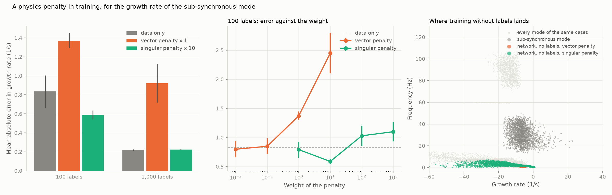
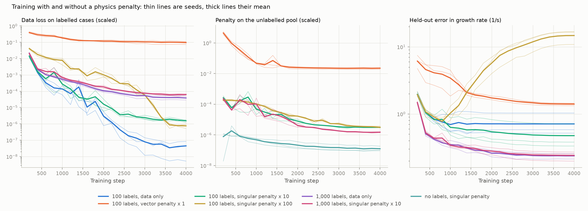

# 13: The physics as a training penalty, for the growth rate

Date: 2026-11-11 · Plan phase: 5 (item 2, arm L for task T1)

## Goal

Steps 09 to 11 put the hand calculation into the inputs or the output of a model. This step puts the full model's own equations into the loss. The network predicts an eigenvalue; a penalty measures how far that number is from being an eigenvalue of the state matrix `A(θ)`. The penalty needs `A(θ)` but no solver label. How far does it get with no labels, with few, and what does it cost?

## What was done

- `src/sso_sciml/models/eigen.py`: a network for the eigenvalue and eigenvector, two forms of the penalty, training on a data loss, a penalty, or both.
- `src/sso_sciml/data/t1.py`: `state_matrix(θ)`, the solver without its last step. `solve` now calls it; the dataset regenerates unchanged.
- `scripts/phase5_eigen_residual.py`: the experiment, its results file and two figures.
- `tests/test_eigen.py`: 6 tests. Both penalties are zero at a true eigenpair; each finds an eigenvalue of a fixed matrix; the state matrix carries the mode stored in the dataset.

## Commands

```powershell
uv run scripts/phase3_generate_t1.py        # dataset, about 7 minutes
uv run scripts/phase5_eigen_residual.py     # 1,582 s
uv run pytest tests/test_eigen.py
```

## Setup of the case

- Task T1 of step 08: 12 parameters in, growth rate and frequency of the sub-synchronous mode out. Model of 25 states.
- Network: the perceptron of step 09 (4 layers of 256, 4,000 steps) with two outputs, growth rate and frequency.
- Labelled cases: 0, 100 or 1,000, a fifth of them held out to choose the checkpoint.
- Unlabelled pool: 10,000 training cases with their state matrices, used only by the penalty.
- Three seeds. Error is on the in-distribution test fold of 13,105 cases.

Two forms of the penalty:

| Name | Penalty | The network also predicts |
|---|---|---|
| vector | `‖A v − λ v‖²` with `‖v‖ = 1` | the eigenvector `v`, 25 complex numbers |
| singular | smallest singular value of `A − λ I`, squared | nothing more |

The second is the first already minimised over `v`. Both are zero at every one of the 25 eigenvalues of `A`, not only at the sub-synchronous one.

The weight multiplies the penalty before it is added to the data loss. The two forms are on different scales, so their weights are not comparable with each other.

## Results

All numbers are in `docs/results/phase5/eigen_residual.json`. Mean and standard deviation over three seeds.

| Labels | Penalty | Error in growth rate (1/s) | Error in frequency (Hz) | Unstable cases missed | Nearest eigenvalue is the sub-synchronous one |
|---|---|---|---|---|---|
| 100 | none | 0.83 ± 0.17 | 0.96 | 17.2 % | 100 % |
| 100 | vector × 0.01 | 0.80 ± 0.14 | 0.93 | 17.5 % | 100 % |
| 100 | vector × 0.1 | 0.85 ± 0.14 | 1.42 | 16.7 % | 100 % |
| 100 | vector × 1 | 1.37 ± 0.08 | 25.4 | 25.8 % | 0 % |
| 100 | vector × 10 | 2.45 ± 0.35 | 30.3 | 89.6 % | 0 % |
| 100 | singular × 1 | 0.79 ± 0.14 | 0.33 | 17.0 % | 100 % |
| 100 | singular × 10 | 0.59 ± 0.05 | 0.12 | 11.5 % | 100 % |
| 100 | singular × 100 | 1.03 ± 0.17 | 15.7 | 18.0 % | 36.5 % |
| 100 | singular × 1,000 | 1.10 ± 0.17 | 21.0 | 29.7 % | 7.7 % |
| 1,000 | none | 0.219 ± 0.007 | 0.20 | 5.6 % | 100 % |
| 1,000 | vector × 1 | 0.92 ± 0.21 | 25.5 | 12.5 % | 0 % |
| 1,000 | singular × 10 | 0.223 ± 0.006 | 0.11 | 5.5 % | 100 % |
| 1,000 | singular × 100 | 0.348 ± 0.010 | 6.7 | 6.9 % | 80.0 % |
| 0 | vector | 4.04 ± 0.04 | 30.4 | 100 % | 0 % |
| 0 | singular | 11.7 ± 0.8 | 27.7 | 100 % | 0 % |

The last column is measured on 2,000 test cases: is the eigenvalue of `A` closest to the prediction the one the task asks for?



- **With no labels the network finds an eigenvalue, but the wrong one.** Both forms settle on slow, well-damped modes below 3 Hz. Nothing in the penalty says which of the 25 eigenvalues is wanted, and the slow ones vary least with the parameters and are easiest to fit. Every unstable case is called stable.
- **With 100 labels the singular penalty helps at one weight.** At a weight of 10 the error in growth rate falls from 0.83 to 0.59 1/s and the error in frequency from 0.96 to 0.12 Hz. The labels put the prediction near the right eigenvalue and the penalty pulls it the rest of the way: the typical distance to the nearest eigenvalue falls from 5.0 to 0.8 1/s.
- **At ten times that weight it fails.** The penalty outweighs the labels, the prediction slides to whichever eigenvalue is easiest to reach, and in 63.5 % of cases that is no longer the sub-synchronous one. The error is then worse than with no penalty at all.
- **With 1,000 labels it changes nothing in growth rate** (0.223 against 0.219 1/s). Frequency still improves, from 0.20 to 0.11 Hz.
- **Predicting the eigenvector as well is worse at every weight above 0.1.** The network cannot fit 25 complex components across the parameter range in 4,000 steps; the penalty stays four orders of magnitude above the singular form's, and what gradient it gives drags the eigenvalue off.

### Training



- **Mode-hopping is visible as it happens.** For 100 labels and the singular penalty at a weight of 100, the penalty falls steadily while held-out error in growth rate turns upward after about 800 steps and ends above 10 1/s. Only the checkpoint rule, which keeps the weights from before the turn, holds the reported error at 1.03.
- **A falling penalty is not evidence of a better model.** The label-free runs reach the lowest penalty of all and are the worst models.
- **The vector penalty plateaus at about 2e-2** in scaled units and holds the data loss at 0.1, more than a thousand times higher than without it.

### Cost

| | Time per case, one CPU core |
|---|---|
| State matrix `A(θ)` | 9.9 ms |
| Full solve (state matrix and eigenvalues) | 10.3 ms |

- **An unlabelled case costs 96 % of a labelled one.** Almost all of the solver's time goes into the steady state and the linearisation; the eigenvalue step that the penalty avoids is the cheap part.
- For the cost of the 10,000 state matrices used here, 9,600 cases could have been labelled. Step 09 reaches 0.11 1/s with 10,000 labels and no penalty. The penalty with 100 labels reaches 0.59.
- Training takes 47 s with the singular penalty against 11 s without.

## Hypotheses

3. *L extrapolates better than N in parameter directions the residual covers, at several times the training cost.* Not tested: the extrapolation sets were not scored here, because the penalty did not earn its place in distribution. Training cost is 4 times arm N's, as expected.

The label-free test of the plan, how far the physics loss gets with no solver labels: nowhere, for this target. The network finds an eigenvalue of the right matrix and it is the wrong eigenvalue.

## Disagreements

1. **The plan expected the eigen-residual to work with zero labels.** It cannot identify which eigenvalue is meant. Extra terms could try to say so (a frequency band, a participation condition on the eigenvector), but they would have to encode what the solver's own mode selection does.
2. **The plan specified the vector form.** It is the worse of the two here. The singular form was added after the first run showed the eigenvector could not be fitted.
3. **The gain at 100 labels holds at one weight of four tried.** One step up in weight makes the model worse than no penalty, and the right weight was found by looking at test error. A user without labels to tune on would not know where to stop. The held-out curve does show the failure, so a held-out set can guard against it.
4. **Arm N is slightly worse here than in step 09** at 100 labels (17.2 % of unstable cases missed against 13.4 %). The network here also predicts frequency, and the labelled subsets are drawn differently.
5. **The weights of the two forms are on different scales**, by a factor that depends on how well the eigenvector is fitted. The sweep covers four values each and is not a search.
6. **Not tried:** a penalty weight that rises during training, a penalty only on cases near a labelled one, and warm-starting the penalty from a trained arm N.

## Decisions

- Arm L in this form is not carried forward for T1. It needs nearly the full solver per case, and for that price the labels are better.
- If a physics penalty is used again for an eigenvalue, it is the singular form, at a weight chosen on held-out error, and never without labels.
- The comparison of phase 6 for T1 is between arms N, F and R. Arm L enters phase 6 only for the time-domain task, where the residual is cheap compared with a simulation.

## Next

A network over a range of parameters for the time-domain task (plan phase 5, item 3), using the scaling and time-marching of step 12.
