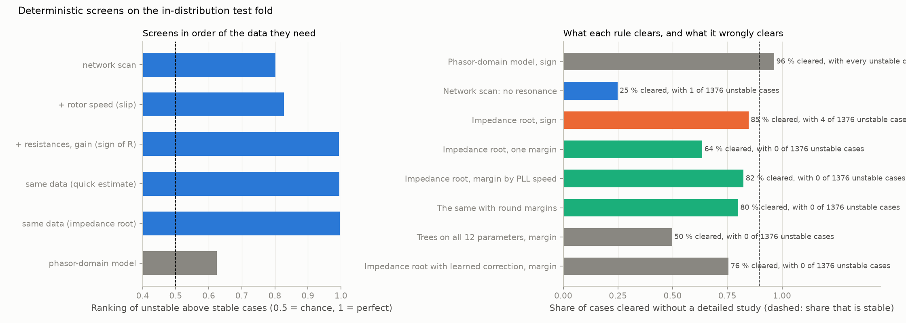
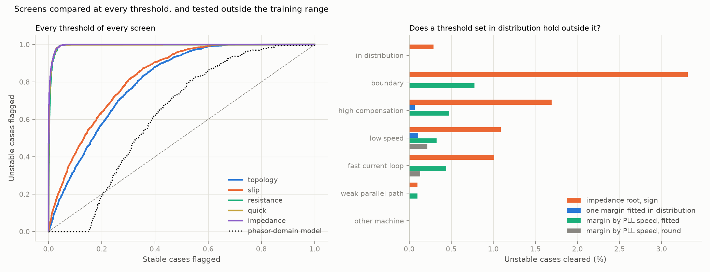
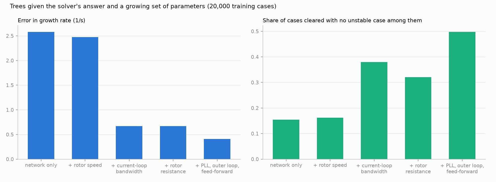
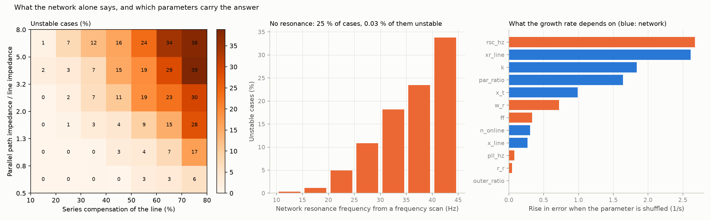

# 14: How little information decides stability

Date: 2026-11-12 · Plan phase: cross-cutting (uses the T1 dataset of step 08)

## Goal

A detailed time-domain study is slow and needs data that is hard to get. This step asks what cheaper information already decides the answer. Deterministic screens are lined up by the data each needs, from the network alone to the full plant model, and each is scored on the 150,000 solved cases of step 08 by one measure: how many cases can it clear without clearing an unstable one?

Four questions:

1. What is the most robust deterministic screen?
2. How little information does it need?
3. What does the network topology say on its own?
4. What can a phasor-domain model give?

## What was done

- `src/sso_sciml/screening.py`: the network frequency scan, the slip score, the phasor-domain reduction, and the scoring of a screen.
- `scripts/screening_ladder.py`: every screen on every test set, the results file and four figures. CPU only.
- `tests/test_screening.py`: 6 tests. A radial line resonates where its reactances cancel; a strong resistive parallel path removes the resonance; the phasor-domain model does not see an unstable sub-synchronous mode.

## Commands

```powershell
uv run scripts/phase3_generate_t1.py     # dataset, about 7 minutes
uv run scripts/screening_ladder.py       # 24 s
uv run pytest tests/test_screening.py
```

## Setup of the case

The screens, with what each needs:

| Screen | Data needed | Rule |
|---|---|---|
| Network scan | Network R, X and C, units online, a generic machine leakage reactance | Scale reactances to frequency `f` (`X_L · f/f0`, `X_C · f0/f`) and look for the frequency below 60 Hz where the loop reactance passes from capacitive to inductive. No such frequency: clear |
| Slip | + rotor speed | Slip of the rotor at that frequency |
| Sign of resistance | + machine resistances, current-loop gains | Loop resistance at the resonance, with the rotor resistance divided by slip. Positive: clear |
| Quick estimate | same | Resistance over reactance slope |
| Impedance root | same | Least-damped root of the loop impedance. Negative growth rate: clear |
| Phasor-domain model | Every plant and control parameter | Full model with stator and network transients made algebraic, as in a positive-sequence stability tool. No unstable eigenvalue: clear |
| Full model | Every plant and control parameter | The reference: eigenvalues of the 25-state model |

- Every screen but the last two uses only quantities found in power-flow and short-circuit data, plus two or three numbers from the plant.
- **Margin.** A rule "clear if the score is below a threshold" can be made conservative by lowering the threshold. The threshold with no unstable case cleared is found on the training fold (104,845 cases) and then applied, unchanged, to the test fold and to the sets outside the training range.
- Test sets as in step 08. The in-distribution test fold has 13,105 cases, 1,376 of them unstable.

## Results

All numbers are in `docs/results/screening/ladder.json`.



### 1. The most robust deterministic screen

| Rule | Cases cleared | Unstable cases cleared, in distribution | Outside the training range |
|---|---|---|---|
| Phasor-domain model | 96.4 % | all of them | not run |
| Network scan: no resonance | 24.8 % | 1 of 1,376 | 0 to 0.8 % |
| Impedance root, sign | 84.7 % | 4 of 1,376 | 0 to 3.3 % |
| Impedance root below −4.5 1/s | 63.5 % | 0 | 0 to 0.11 % |
| Impedance root, margin by PLL speed (fitted: −0.31 or −4.47 1/s) | 82.4 % | 0 | 0 to 0.8 % |
| Impedance root, margin by PLL speed (round: −1 or −5 1/s) | 79.9 % | 0 | 5 of 8,673 |
| Trees on all 12 parameters, with a margin | 49.8 % | 0 | 0 to 0.4 % |
| Impedance root with a learned correction, with a margin | 75.5 % | 0 | 0 to 0.8 % |

89.5 % of cases are stable, so that is the most any rule could clear.

- **The impedance root with a margin is the most robust rule here.** With one margin of 4.5 1/s it clears 63.5 % of cases, none of them unstable, and outside the training range it clears one unstable case in 1,476 at high compensation and one in 920 at low speed.
- **Its errors have a pattern, and the pattern gives a better rule.** The impedance model has no phase-locked loop. Where the PLL is slower than the mode the impedance model finds, the root is almost never on the wrong side: the lowest root of any unstable training case is −0.31 1/s. Where the PLL is faster than the mode, an unstable case can have a root as low as −4.47 1/s.

  | PLL natural frequency / mode frequency | Share of cases | Unstable cases | Of those, root says stable | Lowest root of an unstable case (1/s) |
  |---|---|---|---|---|
  | below 0.25 | 21.8 % | 1,815 | 0 | +0.16 |
  | 0.25 to 0.5 | 36.8 % | 4,358 | 1 | −0.12 |
  | 0.5 to 0.75 | 21.4 % | 2,580 | 3 | −0.27 |
  | 0.75 to 1 | 10.7 % | 1,824 | 5 | −0.31 |
  | 1 to 1.5 | 6.1 % | 1,219 | 20 | −4.47 |
  | above 1.5 | 3.2 % | 74 | 3 | −0.36 |

- **A margin that depends on PLL speed clears 80 % of cases.** With round margins, 1 1/s where the PLL is slower than the mode and 5 1/s where it is not, 79.9 % of in-distribution cases are cleared with no unstable case among them. Outside the training range it clears 5 unstable cases of 8,673: two at low speed and three with a fast current loop.
- **Margins fitted exactly to the training cases do not hold outside it.** The fitted margin of 0.31 1/s clears 0.3 to 0.8 % of unstable cases on four of the six other sets. A fitted threshold is the worst training case, and the next case can be worse.
- **A learned model does not beat the physics rule on this measure.** Trees given all 12 parameters and 20,000 solved cases clear 49.8 % at their own zero-miss margin, less than the plain impedance root. Their error is small on average (0.41 1/s) but their worst case is not, and the margin is set by the worst case. Using the trees to correct the impedance root clears 75.5 %, still below the two-margin rule that needs no training.



### 2. How little information



Trees trained on the solver's answer with a growing set of parameters show what each piece of data is worth:

| Parameters given | Error in growth rate (1/s) | Ranking (1 = perfect) | Cleared at zero-miss margin |
|---|---|---|---|
| Network only (6) | 2.58 | 0.860 | 15.4 % |
| + rotor speed | 2.47 | 0.881 | 16.2 % |
| + current-loop bandwidth | 0.67 | 0.995 | 38.0 % |
| + rotor resistance | 0.67 | 0.995 | 32.0 % |
| + PLL, outer loop, feed-forward (all 12) | 0.41 | 0.998 | 49.8 % |

Rise in error when one parameter is shuffled, 1/s: current-loop bandwidth 2.67, line X/R 2.61, compensation 1.84, parallel path 1.64, plant-side reactance 0.99, rotor speed 0.72, feed-forward 0.34, units online 0.30, line length 0.27, PLL 0.08, rotor resistance 0.05, outer loop 0.004.

- **One controller number carries most of the plant's part of the answer: the current-loop bandwidth.** Adding it to the network data and rotor speed cuts the error from 2.47 to 0.67 1/s. It enters the slip mechanism as added rotor resistance (step 03).
- **Rotor resistance, the outer loops and the exact PLL tuning hardly matter.** The controller's gain swamps the rotor's own resistance. The PLL matters as a yes-or-no question, whether it is faster than the mode, not as a number.
- **Network resistance matters as much as any reactance.** Line X/R ranks second. A screen built on reactances alone misses it.
- **The data the best rule needs:** network R, X and C; units online; rotor speed; machine reactances and resistances; current-loop gains; PLL bandwidth to choose the margin. Not needed: outer-loop tuning, grid-side converter details, DC link, a time-domain model.

### 3. What the topology says



- **A frequency scan of the network clears a quarter of cases with no plant data.** In 24.8 % of cases the loop reactance never turns from capacitive to inductive below 60 Hz. Of those, 0.03 % are unstable: one case in the test fold. Where a resonance exists, 13.9 % are unstable.
- **The scan must include resistance.** With the network resistances dropped, every one of the 13,105 cases shows a resonance. The parallel path removes the resonance only through its damping.
- **The resonance frequency ranks the risk.** Unstable cases are 0.3 % of those with a resonance at 10 to 15 Hz, 10.8 % at 25 to 30 Hz and 33.8 % at 40 to 45 Hz. The closer the resonance to rotor speed, the smaller the slip and the larger the negative resistance.
- **Two network numbers explain most of the map:** compensation level and the strength of the parallel path. With a parallel path of 0.5 to 0.8 times the line impedance and compensation below 40 %, no case in the test fold is unstable. With a path 5 to 8 times the line impedance and 70 to 80 % compensation, 38 % are.
- **The network alone cannot rank well enough to decide.** Its ranking score is 0.80, against 0.996 for the impedance root. It says where to look, not what will happen.
- **The scan fails where its premise fails.** On the weak-parallel-path set it clears nothing, correctly. At high compensation it clears 13.9 % of cases and 0.8 % of the unstable ones.

### 4. What a phasor-domain model gives

- **As a dynamic model, nothing.** With stator and network transients made algebraic, the model reports every one of the 311 unstable cases in a sample of 3,000 as stable. Its ranking score is 0.62. The 4.1 % of stable cases it flags are the slow outer-loop mode of step 08, which is a different problem. This confirms step 06 across the whole parameter range.
- **As a source of data, everything the screen needs.** The network scan and the impedance root use the same R, X and C as a power-flow case, scaled in frequency, and the operating point a power flow gives: units online and rotor speed. The phasor-domain database is enough. The phasor-domain equations are not.
- So the route from a planning model to a screen is: take the network data, scan it in frequency from the plant terminals, add the machine and its current loop as an impedance, and find the root. That costs 1.7 ms per case (step 11) against 10 ms for the full linear model, and needs no time-domain run.

### What the full model adds

- **The impedance root errs on the safe side.** On average it predicts growth 1.25 1/s faster than the full model. It underestimates by more than 1.23 1/s in one case in a thousand, and by 8.0 1/s at worst.
- **The grid-side converter's feed-forward sets the size of that bias.** With feed-forward below 0.25 the root overstates growth by 1.96 1/s on average; above 0.75, by 0.53. Of the 32 unstable training cases the root calls stable, 25 have feed-forward above 0.75.
- **The error is a smooth function of the parameters.** Trees explain 91 % of its variance from the 12 parameters, 55 % from the nine the impedance model already uses, and 21 % from the three controls it leaves out. Most of what the full model adds is an interaction between those controls and the network, not a separate effect.

## Disagreements

Note added in step 18: every figure here is for the sub-synchronous mode. Scored on any mode of the full model, the reference rule clears 478 unstable cases of the test fold. All are unstable in a slow mode of the outer loops, 0.4 to 0.7 Hz, which the impedance formula does not contain. See `18-one-screen-two-plants.md`.

1. **The plan expected learned surrogates to be the screen.** On the measure that matters for a screen, cases cleared with none missed, the physics rule with a margin is ahead of trees trained on 20,000 solved cases. The learned models are better on average error and worse in the tail.
2. **The resistance and quick-estimate screens cannot be given a zero-miss margin.** They have no value where no resonance is found, and a few such cases are unstable.
3. **The rule by PLL speed was found by looking at the training cases the impedance root gets wrong.** Its form has a physical reading: a PLL faster than the mode follows the oscillation and feeds it back through the converter. But the threshold ratio of 1 and the margins of 1 and 5 1/s are read from this dataset. They are not derived.
4. **"No unstable case cleared" is a statement about these cases.** The round-margin rule clears 5 unstable cases of 8,673 outside the training range. A screen of this kind lowers the number of detailed studies; it does not replace the judgement of when the plant is outside what was tested.
5. **One plant model.** Every case is the same doubly-fed machine structure with different numbers. A full-converter plant, a grid-forming control or a different PLL structure may move the pattern. System C of the plan, a different mechanism, is not built.
6. **The slow outer-loop mode is not screened here.** It is what the phasor-domain model does see.

## Decisions

- The reference screen from here on is the impedance root with a margin chosen by PLL speed. Learned models are compared with it on cases cleared at zero misses, in and out of distribution, not only on mean error.
- Every later step reports which inputs carry its result and what a deterministic rule would have done.
- A network scan with resistance is the first step of any screen, since it needs no plant data.

## Next

The T2 trajectory dataset (plan phase 3, item 5), then a network over a range of parameters for the time-domain task. For T2 the same question applies: which features of a trajectory, growth rate, frequency and the amplitude at which limits act, need a time-domain run at all, and which follow from the impedance root.
