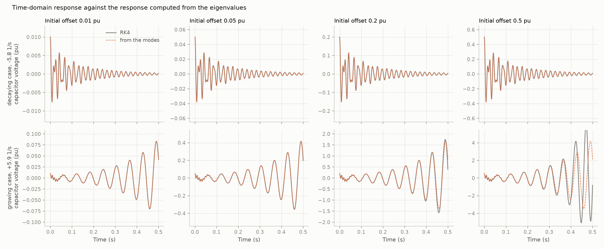
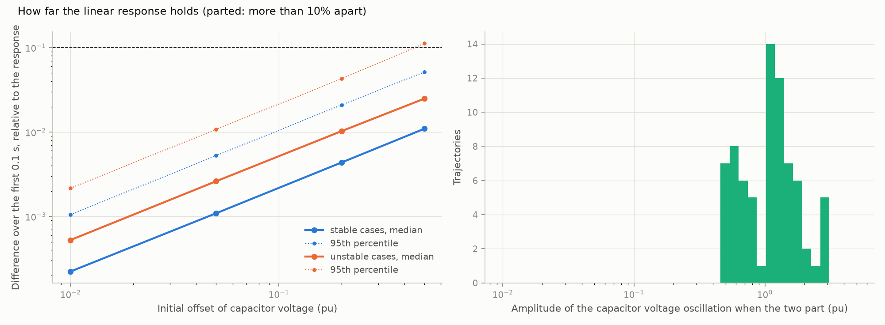

# 15: What a time-domain run adds to the eigenvalues

Date: 2026-11-12 · Plan phase: 3 (before the T2 dataset)

## Goal

Before building a dataset of trajectories and training models on it: how much of a trajectory is already fixed by the state matrix? If the response is the sum of the modes, no time stepping and no learned surrogate is needed for it.

## What was done

- `src/sso_sciml/solver/modal.py`: `linear_response`, the response from the modes with no time stepping.
- `src/sso_sciml/data/t1.py`: `operating_point(θ)`, the model, steady state and parameters of one case.
- `scripts/phase3_linear_vs_time_domain.py`: the comparison, its results file and two figures.

## Commands

```powershell
uv run scripts/phase3_generate_t1.py              # dataset, about 7 minutes
uv run scripts/phase3_linear_vs_time_domain.py    # 72 s
```

## Setup of the case

- 512 cases of the T1 test fold, 52 of them unstable. Full 25-state model.
- Disturbance: the D-axis capacitor voltage starts 0.01, 0.05, 0.2 or 0.5 pu off its steady value.
- Reference: RK4, 0.25 ms step, 0.5 s, all 2,048 trajectories in one batch on the GPU.
- Compared with `dx(t) = V exp(Λt) V⁻¹ dx(0)` from the eigen-decomposition of the state matrix.
- Two errors, each the difference accumulated so far over the response so far: one for the oscillation itself (fluxes, capacitor voltage, in per unit), one for the other states (speed, PLL, controller integrators, DC link), each in units of its own linear response.
- "Parted": the oscillation differs by more than 10 %.

## Results

All numbers are in `docs/results/phase3/linear_vs_time_domain.json`.

Median difference over the first 0.1 s:

| Initial offset (pu) | Oscillation, stable cases | Oscillation, unstable cases | Other states, stable cases |
|---|---|---|---|
| 0.01 | 0.02 % | 0.05 % | 2.2 % |
| 0.05 | 0.11 % | 0.26 % | 11 % |
| 0.2 | 0.44 % | 1.0 % | 44 % |
| 0.5 | 1.1 % | 2.5 % | 110 % |



- **The oscillation is the sum of the modes up to very large amplitude.** After a 0.2 pu offset the time-domain run and the modal response differ by 0.44 % for stable cases. No stable case parts from the modal response at any offset up to 0.2 pu, and 98.9 % do not at 0.5 pu.
- **A growing oscillation parts from it only near 1 pu.** Of the trajectories that part, the capacitor voltage oscillation has reached 1.14 pu at the median when they do, and 0.55 pu for the lowest tenth. No plant would still be connected at that size.
- **What the modes miss is second order and sits in the DC link and grid-side converter.** The states that differ most at 0.2 pu are the DC-voltage integrator, the grid-side current integrators and the DC voltage. They hardly respond in the linear model, so a small drift driven by the square of the oscillation is large by comparison. It doubles when the offset doubles.



Cost per trajectory:

| | Time |
|---|---|
| Steady state and state matrix | 13.8 ms |
| Modal response, 501 points | 0.75 ms |
| RK4, one case on the CPU | 9.2 s |
| RK4, 2,048 cases at once on the GPU | 26 ms each |

The modal response is about 630 times cheaper than a single RK4 run and 1.8 times cheaper than a batched one.

## What this says about screening

- **For this model, growth rate, frequency and the waveform of a sub-synchronous oscillation need no time-domain run.** They follow from the state matrix, and to a useful margin from the impedance root of step 14.
- **The time domain earns its place only for what the model does not yet contain: limits.** The model has no converter current or voltage limits, so an unstable oscillation grows without bound and never settles into a limit cycle. Whether an oscillation is damaging depends on where the limits stop it, and that is the question a time-domain run can answer and an eigenvalue cannot.

## Disagreements

1. **The plan's T2 task, trajectories "including growth and the limit cycle once limits act", cannot be built on this model.** There are no limits in it. A dataset of trajectories from it would be a dataset of modal sums, and a network trained on it would learn the eigen-decomposition.
2. **One disturbance type.** An initial offset leaves the steady state unchanged. A voltage dip or a change of compensation moves it, and the response then starts from a different operating point. Not tested.
3. **The first version of this comparison mixed the two errors** and reported the oscillation as parting at once. The slow states dominated it.

## Decisions

- T2 as planned is postponed until converter limits are in the model. The trajectory dataset is not built on the present model.
- For small-signal questions the modal response is the reference, and is used in place of time stepping.

## Next

Add rotor-side current and voltage limits to the plant model, then ask the screening question again: can the amplitude at which an unstable oscillation settles be estimated without a time-domain run, for example by a describing function on the limit?
