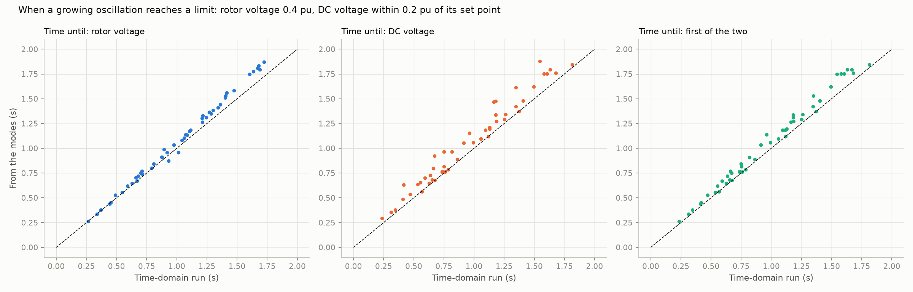
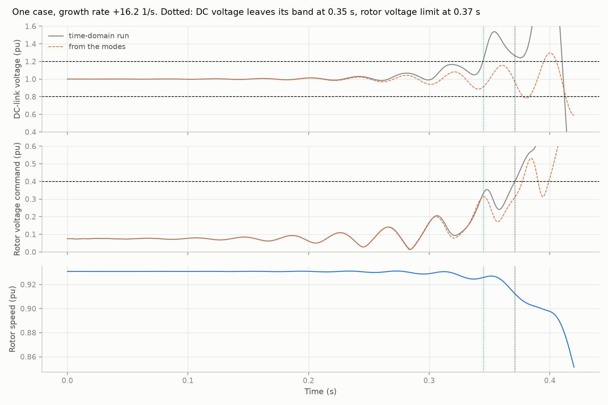

# 16: Which limit a growing oscillation reaches first, and when

Date: 2026-11-12 · Plan phase: 3 (before the T2 dataset)

## Goal

Step 15 found that the waveform of an oscillation follows from the modes until it is very large. What ends that is a limit in the plant. This step adds the first limit to the model and asks two things. Which limit does a growing oscillation reach first? Can the time it takes be found without a time-domain run?

## What was done

- `src/sso_sciml/physics/dfig_full.py`: a voltage limit on the rotor-side converter. The command keeps its direction and its magnitude is held at `vr_max`. The default is far above any command, so every earlier result is unchanged.
- `scripts/phase3_limits.py`: the study, its results file and two figures.
- `tests/test_dfig_full.py`: 2 more tests, on the limiter.

## Commands

```powershell
uv run scripts/phase3_generate_t1.py     # dataset, about 7 minutes
uv run scripts/phase3_limits.py          # 105 s on the GPU
uv run pytest tests/test_dfig_full.py
```

## Setup of the case

- 96 unstable and 32 stable cases of the T1 test fold. Full 25-state model.
- Disturbance: capacitor voltage 0.01 pu off its steady value. RK4, 0.5 ms step, 2 s.
- Two limits are watched:
  - the rotor voltage command reaching 0.4 pu (it is 0.11 pu at the median steady state and 0.21 pu at most);
  - the DC-link voltage leaving a band of 0.2 pu around its set point, which stands for the over- and under-voltage protection of the DC link.
- The same two times are found from the modal response of step 15, with no time stepping.
- A hand estimate of the DC time is also tried: exponential growth at the eigenvalue's rate, from the size of the DC voltage swing in the first 0.2 s to the edge of the band.

## Results

All numbers are in `docs/results/phase3/limits.json`.

| | Rotor voltage limit | DC voltage band | First of the two |
|---|---|---|---|
| Unstable cases reaching it within 2 s | 51 of 96 | 56 of 96 | 56 of 96 |
| Median time (s) | 1.06 | 1.03 | 1.03 |
| Modes: median error (s) | +0.053 | +0.078 | +0.066 |
| Modes: median error, relative | 5.9 % | 8.6 % | 7.7 % |
| Modes: 95th percentile of error (s) | 0.14 | 0.28 | 0.18 |



- **The DC link gives way first.** In 96 % of the cases that reach a limit, the DC voltage leaves its band before the rotor voltage command reaches its ceiling, by 0.06 s at the median. The oscillation passes power back and forth through the converters, and the DC capacitor is the smallest energy store in its path.
- **The modes give the time to within 8 %, and they give it late.** The median error for the first limit is +0.066 s on a median time of 1.03 s. Nearly every point in the figure lies on or above the diagonal. As the oscillation grows, the second-order terms that step 15 found in the DC link add to the swing, and the real plant gets there sooner than the linear response says.
- **A one-line estimate does as well.** Growth at the eigenvalue's rate from the early DC swing to the band is off by 0.076 s at the median, 8.8 %, against 0.078 s for the full modal response.
- **No stable case reaches either limit.**
- **The remaining 40 unstable cases grow too slowly to reach a limit in 2 s** from a 0.01 pu disturbance.



### After the limit

Of the 56 cases that reach a limit, in 47 the rotor speed has moved by more than 0.1 pu or the integration has failed by the end of the run. With the rotor voltage limited and nothing else, the oscillation does not settle into a steady limit cycle. The controller loses its hold on the rotor current, the integrators wind up, and speed and DC voltage run away.

That part of the result says more about the model than about a plant. A real converter has a DC chopper, a crowbar, anti-windup on its controllers, and protection that trips it. None of those is in the model, so what it does after the first limit is not to be trusted.

### Cost

The 128 time-domain runs take 101 s in one batch on the GPU. The modal responses for all of them take 0.45 s.

## What this says about screening

- **Up to the first limit, nothing needs a time-domain run.** Whether a case is unstable, how fast it grows, at what frequency, which limit it meets and roughly when: all follow from the state matrix, and the first three from the impedance root of step 14 with a margin.
- **The useful output of a screen is a time, not an amplitude.** There is no limit cycle to predict in this model. What a planner can use is how long protection has to act: about `ln(band / initial swing) / growth rate`. Since the estimate runs late by up to a few tenths of a second, it should be shortened, not taken at face value.
- **The DC link, not the converter voltage, is the quantity to watch.** Its capacitance sets how soon the band is left, and it is one more plant number worth asking for.
- **A time-domain model is needed for what comes after the first limit:** chopper and crowbar action, ride-through, whether the plant trips or recovers. That is where a detailed study earns its cost, and it needs the protection modelled, which this model does not have.

## Disagreements

1. **The plan expected a limit cycle once limits act.** With a voltage limit alone there is none; control is lost.
2. **The rotor voltage limit was expected to be the first limit reached.** The DC link is, in 96 % of cases. The first version of this study treated a DC excursion as a consequence of saturation and found it happening before saturation.
3. **The DC band of 0.2 pu and the limit of 0.4 pu are round figures, not a manufacturer's.** So is the DC capacitance (0.02 pu·s, from step 04). The ordering of the two limits depends on all three.
4. **The modal estimate errs in the unsafe direction.** It says protection has more time than it has. The size of the bias is known here (7.7 % at the median, 0.18 s at the 95th percentile) but only for this disturbance.
5. **One disturbance size.** A larger disturbance shortens the time and starts closer to the nonlinear range.

## Decisions

- The time-domain task of the plan (T2) is redefined: the target is which limit is reached first and when, not a waveform or a limit cycle. For the present model that target follows from the modes, so no trajectory dataset or learned operator is built for it.
- Behaviour after the first limit is out of scope until protection (DC chopper, crowbar, anti-windup, trip logic) is modelled.

## Next

A choice for the project owner, since it sets the rest of the plan: either model the protection and study what happens after the first limit, or leave the time domain there and take the screening question to a second plant type (a full-converter plant), where the mechanism is different and the rules of step 14 may not hold.
