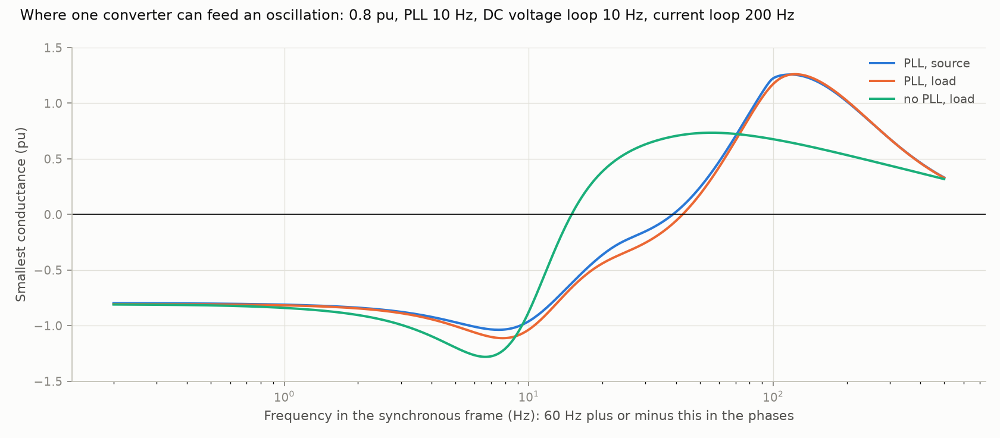
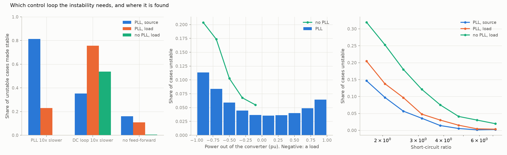
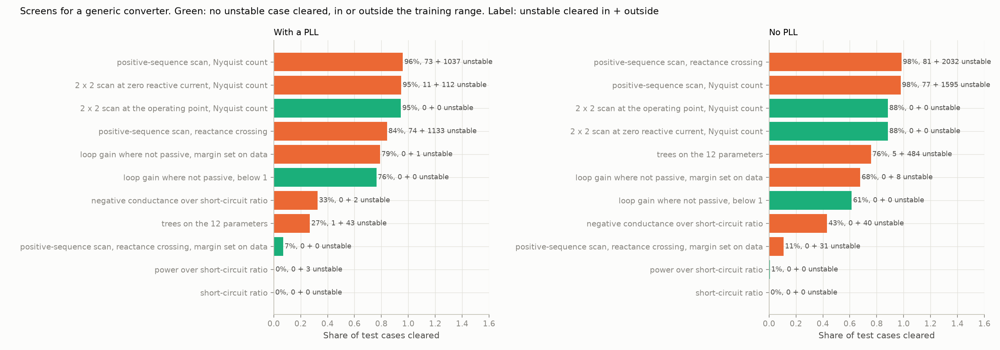

# 17: A second plant type: any converter, source or load

Date: 2026-11-12 · Plan phase: 9 (System C, brought forward) and the standing screening question

## Goal

Step 14 found a screen for the doubly-fed plant: the root of the loop impedance of network, machine and current loop, with a margin. This step asks whether that carries over to a plant with no machine, and widens "plant" on the project owner's instruction: the converter may be a source or a load (wind, solar, storage, drive, UPS, power supply), and the phase-locked loop is not the only control loop to look at. What is the most robust deterministic screen for any converter, and how little does it need to know?

## What was done

- `src/sso_sciml/physics/converter.py`: one converter model. Filter reactor, current loop, voltage feed-forward, DC-link voltage loop on a constant power source or sink. Power may flow either way. Synchronised by a phase-locked loop, or with no loop at all and a current reference that follows the voltage waveform, as in a power-factor-correcting supply. Same network as dataset T1. 14 states. Equations in `docs/EQUATIONS.md` section 19.
- `src/sso_sciml/admittance.py`: the converter alone as a 2 × 2 admittance scan, the network as a 2 × 2 impedance scan, and the screens built on the two.
- `src/sso_sciml/data/c1.py`, `scripts/phase3_generate_c1.py`: dataset C1. 12 parameters, two families (with and without a phase-locked loop), three sets outside the training range.
- `scripts/converter_screens.py`: the comparison, its results file and three figures.
- `tests/test_converter.py`: 13 tests.

## Commands

```powershell
uv run scripts/phase3_generate_c1.py     # 61,440 cases, about 7 minutes on 8 processes
uv run scripts/converter_screens.py
uv run pytest tests/test_converter.py
```

## Setup of the study

- **Parameters:** power from −1 to 1 pu, short-circuit ratio 1.5 to 8, series compensation 0 to 80 %, line X/R, parallel path, bandwidths of the current loop (50 to 500 Hz), the phase-locked loop (2 to 50 Hz) and the DC voltage loop (2 to 30 Hz), feed-forward gain and filter, filter reactance, DC capacitance.
- **Families:** 32,768 cases with a phase-locked loop; 8,192 without one, loads only (−1 to −0.1 pu).
- **Outside the range:** phase-locked loop 50 to 100 Hz; DC voltage loop 30 to 60 Hz; short-circuit ratio 1.2 to 1.5. 4,096 cases each.
- **Truth:** the largest real part of the modes of the full model. A case is unstable if it is positive.
- **Scoring:** as in step 14. A screen clears cases. It is scored on the share of the test fold it clears and on the unstable cases among those, in the range and outside it. A threshold is fixed by theory, or set on the training and validation folds as the largest that clears no unstable case there.

## Results

All numbers are in `docs/results/converter/screens.json` and `c1_report.json`.

### Two formulations agree

The model was built twice: as one state matrix, and as the converter's admittance against the network's impedance. Counting unstable modes from the two scans alone (the generalised Nyquist count) gives the same verdict as the eigenvalues in all 60,124 cases that have a steady state.

### Where the instability comes from



- **A current loop alone cannot feed an oscillation.** With the other loops frozen the converter is a resistor and a reactor behind a voltage: passive at every frequency (a test). The step 14 screen, which knows the current loop and nothing else, would clear every case here and every unstable one with them.
- **Every converter in the dataset has a band of negative conductance.** In no case is the admittance passive at all frequencies. The band ends at a median of 20 Hz with a phase-locked loop and 12 Hz without (synchronous frame, so 60 Hz plus or minus that in the phases).
- **At low frequency the negative conductance is the power over the voltage squared, whatever the direction of power.** A load holds its power constant through its DC voltage loop: voltage falls, current rises. A source does the same thing through its phase-locked loop, on the other axis. The figure shows −0.8 pu for a 0.8 pu converter in all three roles.



| | With PLL, source | With PLL, load | No PLL, load |
|---|---|---|---|
| Cases unstable | 4.5 % | 6.8 % | 12.6 % |
| Made stable by a PLL ten times slower | 81 % | 23 % | n/a |
| Made stable by a DC voltage loop ten times slower | 35 % | 76 % | 54 % |
| Made stable by removing voltage feed-forward | 16 % | 11 % | 0.5 % |
| Frequency of the unstable mode, median (Hz) | 25.8 | 5.6 | 1.8 |

- **For a source the phase-locked loop is the loop to slow down. For a load it is the DC voltage loop.** The owner's point holds: a load with a phase-locked loop is unstable more often than a source, and three quarters of those cases are cured by the DC loop, not the phase-locked loop.
- **A load with no phase-locked loop is the least stable of the three.** It gives no reactive support, so its terminal voltage sags (168 of 8,192 cases have no steady state at all, 1,067 of 4,096 on the very weak network), and constant power on a sagging voltage is the classic voltage instability. Slowing the DC loop cures only half.

### The screens



Test fold: 3,277 cases with a phase-locked loop (180 unstable) and 802 without (94 unstable). Outside the range: 12,288 cases (2,118 unstable) and 7,044 (2,330 unstable).

| Screen | Data it needs | With PLL: cleared | unstable cleared, in / outside | No PLL: cleared | unstable cleared, in / outside |
|---|---|---|---|---|---|
| Short-circuit ratio | network at 60 Hz | 0.1 % | 0 / 0 | 0.1 % | 0 / 0 |
| Power over short-circuit ratio | the above and loading | 0.4 % | 0 / 3 | 0.6 % | 0 / 0 |
| Largest negative conductance over short-circuit ratio | one number from the converter | 32.6 % | 0 / 2 | 43.2 % | 0 / 40 |
| Trees on the 12 parameters | the solved cases of the training fold | 26.9 % | 1 / 43 | 75.7 % | 5 / 484 |
| Positive-sequence scans, reactance crossing | converter and network scans, one sequence | 84.2 % | 74 / 1,133 | 98.4 % | 81 / 2,032 |
| Positive-sequence scans, Nyquist count | the same | 96.0 % | 73 / 1,037 | 97.8 % | 77 / 1,595 |
| **Loop gain below 1 wherever the converter is not passive** | 2 × 2 scans; nothing fitted | **76.3 %** | **0 / 0** | **61.4 %** | **0 / 0** |
| The same, threshold set on data (1.10 and 1.24) | 2 × 2 scans | 79.0 % | 0 / 1 | 67.8 % | 0 / 8 |
| 2 × 2 scans at zero reactive current, Nyquist count | 2 × 2 scans, wrong operating point | 94.8 % | 11 / 112 | 88.3 % | 0 / 0 |
| 2 × 2 scans at the operating point, Nyquist count | 2 × 2 scans and a power-flow solution | 94.5 % | 0 / 0 | 88.3 % | 0 / 0 |

- **The short-circuit ratio alone clears nothing once no unstable case may pass.** Some converter in the dataset is unstable at a ratio of 8. Used the usual way, as a rule of thumb with a round threshold, it would clear unstable cases.
- **Positive-sequence scans miss 40 % of the unstable cases with a phase-locked loop and over 80 % of those without one.** This is the common way to run a frequency scan on a black-box model. The loops that cause the instability act differently on the two axes, which couples each frequency to its mirror image about 60 Hz, and a one-sequence scan leaves that out.
- **The passivity and loop-gain screen is the robust one.** It clears a case if, at every frequency where the converter's conductance is negative, the gain of the loop of converter admittance and network impedance is below 1. The threshold of 1 comes from a theorem, not from the data. It clears 76 % and 61 % of cases and not one unstable case among the 60,124, including all three sets outside the range. Fitting the threshold gains 3 to 6 points and then lets unstable cases through outside the range.
- **The 2 × 2 scan with a Nyquist count is exact,** provided the admittance is taken at the operating point of the case. Taken at zero reactive current instead, it clears 11 unstable cases of 180.
- **Trees do worse here than in step 14** with a phase-locked loop (26.9 % cleared, one unstable case among them) and clear 5 unstable cases of 94 without one.

### What the trees say matters

Permutation importance (1/s), with a phase-locked loop: short-circuit ratio 0.62, power 0.48, current-loop bandwidth 0.40, filter reactance 0.37, DC loop 0.32, phase-locked loop 0.29, compensation 0.22. Line X/R (0.07), parallel path (0.05), feed-forward (0.08) and DC capacitance (0.00) hardly matter. Network resistance, second in step 14, is near the bottom here.

## What this says about screening

- **The step 14 rule is a rule for one mechanism.** There the machine's slip turns the current loop into negative resistance and the network resonance picks the frequency. Here the current loop is harmless, there need be no network resonance, and the negative conductance comes from whichever loop holds power constant.
- **The screen that carries over is the method, not the formula:** converter admittance against network impedance. In step 14 the admittance could be written by hand from three numbers. Here it cannot, but it can be scanned from a black-box model without knowing what is inside.
- **How little information:** a 2 × 2 admittance scan of the converter at the operating point, and the network's R, X and C. No controller parameters, no model structure. A positive-sequence scan is too little. So is the short-circuit ratio.
- **What the phasor-domain model gives:** the operating point. The admittance depends on voltage, power and reactive current, and using the wrong reactive current turns an exact test into one with misses. A power-flow solution is the input the scan needs, as it was the source of R, X and C in step 14.
- **What the topology gives:** much less than in step 14. With no slip there is no simple map from resonance frequency to risk. The network enters as the size of its impedance across the band where the converter is not passive, which is about the first 20 Hz either side of 60 Hz.
- **A two-step screen follows.** First the loop-gain test, which is safe by construction and clears two thirds to three quarters of cases. Then the Nyquist count on the same scans for the rest, which leaves nothing for a time-domain run to decide about small-signal stability.

## Disagreements

1. **The plan had System C as a grid-following inverter on a weak grid, with the phase-locked loop as the mechanism.** For loads the DC voltage loop is the main one, and a load with no phase-locked loop is the least stable.
2. **The first version of the converter without a phase-locked loop was unstable on an ideal voltage.** Its voltage measurement filter, at the 0.5 to 5 ms used with a phase-locked loop, put the current tens of degrees behind the voltage. The filter is now ten times faster for that family (A32), and no converter in either family is then unstable alone.
3. **The steady-state solver's own convergence flag rejected good operating points.** It is no longer used; the residual is checked instead. Every case with a phase-locked loop now has a steady state.
4. **The converter model has no control delay, no filter capacitor and no limits (A30).** A delay makes the current loop itself non-passive at a few hundred hertz. That band is outside the scope of the project and outside this result.
5. **The DC side is an ideal constant power (A31), and there is no AC voltage loop (A33).** Both change the low-frequency admittance. The method is unaffected; the shares cleared are not.
6. **One aggregate converter (A34).** A source and a load on the same bus are not studied.
7. **The scans here come from the linearised model, exact at every frequency.** A scan of a real black-box model has noise and a finite number of points. The Nyquist count needs fine points near sharp network resonances (4,001 were used).

## Decisions

- The reference screen for any converter is the loop-gain test on 2 × 2 scans, followed by the Nyquist count. The step 14 impedance root stays the reference for the doubly-fed plant, as the hand-written special case of the same method.
- Learned models are not pursued for this plant type. The exact answer costs two scans.
- Positive-sequence-only scans are recorded as unsafe for screening converters.

## Next

Open, in the order they bear on the result: redo the doubly-fed plant of step 14 with the loop-gain test, to see how much of its 80 % a theory-fixed threshold keeps; scans with a finite number of points and noise; a source and a load together on one bus; control delay and a filter capacitor.
