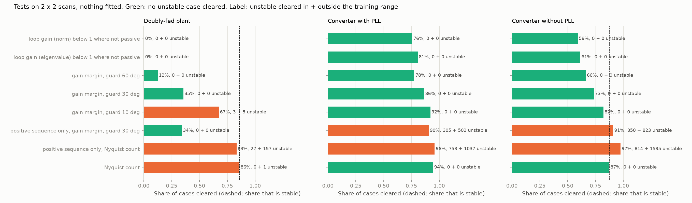
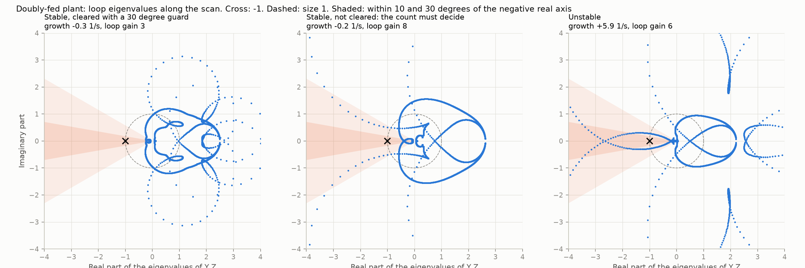
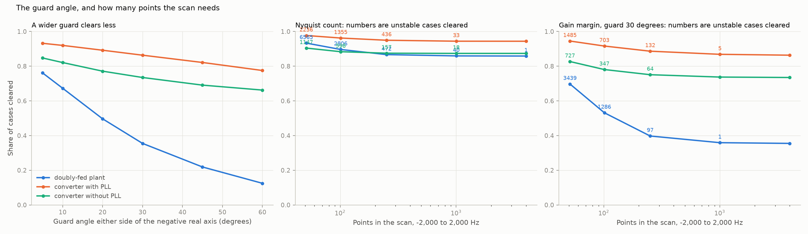

# 18: One screen for both plant types, and how fine the scan must be

Date: 2026-11-12 · Plan phase: the standing screening question

## Goal

Step 17 found a screen for any converter whose threshold comes from theory: loop gain below 1 wherever the converter is not passive. Step 14 found a different one for the doubly-fed plant, with margins set on data. Does the step 17 test work on the doubly-fed plant, and how much of the 80 % cleared in step 14 does it keep? And what happens to scan-based screens when the scan has few points or noise?

## What was done

- `src/sso_sciml/admittance.py`: `DFIGScan`, the doubly-fed plant with full controls cut from its network and scanned as a 2 × 2 admittance. `loop_scores` and `screen_scores`: tests on the eigenvalues of the loop matrix, on the full scan, on thinned scans and on scans with noise.
- `src/sso_sciml/data/t1.py`: `scan`, `scan_pair`, `network`. `scripts/phase3_scan_t1.py` scans the test fold of dataset T1 and every set outside the training range.
- `src/sso_sciml/data/c1.py`: the same scores added to dataset C1, which was regenerated. The step 17 numbers did not change.
- `scripts/scan_screens.py`: the comparison, its results file and three figures.
- `tests/test_scan.py`: 8 tests.

## Commands

```powershell
uv run scripts/phase3_scan_t1.py         # 38,511 cases, about 6 minutes on 8 processes
uv run scripts/phase3_generate_c1.py     # 61,440 cases, about 10 minutes
uv run scripts/scan_screens.py
uv run pytest tests/test_scan.py
```

## Setup of the study

- **Cases:** doubly-fed plant, 13,105 in the test fold, 20,475 outside the training range, 4,931 placed on the stability boundary. Converter with a phase-locked loop, 32,768 and 12,288. Converter without one, 8,024 and 7,044. Nothing is fitted in this step, so all of dataset C1 is used and not only its test fold.
- **Truth:** a case is unstable if any mode of the full model grows. Step 14 asked only about the sub-synchronous mode. That difference matters below.
- **Scan:** 4,001 points from −2,000 to 2,000 Hz in the synchronous frame, spaced by 0.6 % of frequency. Thinned scans keep every 4th, 16th, 40th or 80th point: 1,001, 251, 101 and 51 points, spaced by 2.5 %, 10 %, 28 % and 63 %.
- **Noise:** each entry of the admittance at each frequency is multiplied by 1 + e, with e complex normal of standard deviation 5 % or 20 %, on the 251-point scan.

### The tests

All work on the loop matrix `Y Z`: plant admittance times network impedance, a 2 × 2 matrix at each frequency. The system is stable if the plant alone is stable and no eigenvalue of `Y Z` crosses the real axis to the left of −1.

| Test | Clears a case if | Standing |
|---|---|---|
| Loop gain, norm | the largest singular value of `Y Z` is below 1 wherever the plant is not passive | Theorem (step 17) |
| Loop gain, eigenvalue | the largest eigenvalue of `Y Z` is below 1 in size wherever the plant is not passive | Theorem, and weaker than the norm |
| Gain margin with a guard | every eigenvalue within a set angle of the negative real axis is below 1 in size | Exact for a guard of zero and a continuous scan. The guard pays for the gaps between points |
| Nyquist count | the eigenvalues do not turn about −1 | Exact on a continuous scan |

## Results

All numbers are in `docs/results/scan/scan_screens.json` and `t1_scan_report.json`.

### The scan of the doubly-fed plant is right

The Nyquist count from the scans gives the same verdict as the eigenvalues of the 25-state model in 33,579 of 33,580 cases. The exception grows at 0.001 1/s. On the boundary set, built to sit at zero growth, 39 of 4,931 differ, all with growth below 0.01 1/s.

### What each test clears



Share of cases cleared in the range, then unstable cases cleared in the range and outside it.

| Test | Doubly-fed plant | Converter with PLL | Converter without PLL |
|---|---|---|---|
| Loop gain, norm, below 1 where not passive | 0.2 %, 0 / 0 | 75.7 %, 0 / 0 | 59.0 %, 0 / 0 |
| Loop gain, eigenvalue, below 1 where not passive | 0.2 %, 0 / 0 | 80.6 %, 0 / 0 | 61.4 %, 0 / 0 |
| Gain margin, guard 60° | 12.5 %, 0 / 0 | 77.5 %, 0 / 0 | 66.2 %, 0 / 0 |
| **Gain margin, guard 30°** | **35.5 %, 0 / 0** | **86.3 %, 0 / 0** | **73.5 %, 0 / 0** |
| Gain margin, guard 10° | 67.3 %, 3 / 5 | 92.0 %, 0 / 0 | 82.1 %, 0 / 0 |
| Gain margin, guard 5° | 76.1 %, 7 / 14 | 93.2 %, 0 / 4 | 84.7 %, 0 / 0 |
| Positive sequence only, gain margin, guard 30° | 34.1 %, 0 / 0 | 90.5 %, 305 / 502 | 90.9 %, 350 / 823 |
| Positive sequence only, Nyquist count | 83.2 %, 27 / 157 | 95.8 %, 753 / 1,037 | 97.4 %, 814 / 1,595 |
| **Nyquist count** | **85.9 %, 0 / 1** | **94.4 %, 0 / 0** | **87.4 %, 0 / 0** |
| Share of cases that is stable | 85.9 % | 94.4 % | 87.4 % |

- **The step 17 test clears nothing on the doubly-fed plant.** It is still safe, but the loop gain is above 1 in 99.8 % of cases, with a median of 8.6. The plant is not passive up to a median of 50 Hz in the synchronous frame, and its most negative conductance has a median of −5.3 pu, against −1.0 pu for the converter.
- **The reason is the kind of instability.** A converter on a weak grid is a loop whose gain is too high, and a small loop gain rules it out. Sub-synchronous resonance is a series resonance. At the frequency where the reactances of plant and network cancel, `Y Z` is close to −1 whether the case is stable or not, and what decides is the resistance left over. A test on the size of the loop gain cannot see that. The step 14 root can, because it is a test on the sum of the impedances.



- **A gain margin with a 30° guard clears no unstable case in 98,635,** boundary set included. It clears 35.5 % of doubly-fed cases and 86.3 % and 73.5 % of converter cases. On the converters it clears over 10 points more than the step 17 test from the same data.
- **The Nyquist count is the only test that keeps the step 14 share on the doubly-fed plant.** It clears every stable case, 85.9 %, against 79.9 % for the step 14 rule, and it has no fitted margin. What it lacks is any margin at all.
- **The positive-sequence part is nearly enough for the doubly-fed plant and far from enough for a converter.** With a 30° guard it clears 34.1 % and no unstable case on the doubly-fed plant. On the converters it clears 305 and 350 unstable cases in the range. This is why step 14 could work with a one-sequence formula and step 17 could not.

### What step 14 did not score

The step 14 rule was scored on the sub-synchronous mode. Scored on any mode:

| | In the range | Outside |
|---|---|---|
| Cases unstable | 1,854 | 7,227 |
| of which in the sub-synchronous mode | 1,376 | 6,227 |
| of which in another mode only | 478 | 1,000 |
| Unstable cases the step 14 rule clears | 478 | 882 |
| of which in the sub-synchronous mode | 0 | 5 |

- **The step 14 rule clears every one of the 478 cases that are unstable in another mode.** That mode is slow: 0.4 to 0.7 Hz in the synchronous frame, with a median growth of 0.18 1/s. It belongs to the outer loops, which the impedance formula does not contain.
- **The scans catch it,** because they are scans of the whole plant.
- **Whether that slow mode is real is a separate question.** It comes from the sampled tuning of the outer loops and the phase-locked loop, not from the network resonance. The step 14 result stands for what it claimed, the sub-synchronous mode.

### How fine the scan must be



Unstable cases cleared, in the range plus outside it, as the scan is thinned.

| Points (spacing) | Doubly-fed: count | guard 30° | guard 60° | Converter with PLL: count | guard 30° | guard 60° |
|---|---|---|---|---|---|---|
| 4,001 (0.6 %) | 0 + 1 | 0 + 0 | 0 + 0 | 0 + 0 | 0 + 0 | 0 + 0 |
| 1,001 (2.5 %) | 10 + 30 | 1 + 0 | 0 + 0 | 10 + 23 | 1 + 4 | 0 + 1 |
| 251 (10 %) | 108 + 364 | 14 + 83 | 1 + 8 | 188 + 248 | 54 + 78 | 19 + 21 |
| 101 (28 %) | 524 + 2,282 | 168 + 1,118 | 66 + 489 | 611 + 744 | 336 + 367 | 142 + 107 |
| 51 (63 %) | 1,355 + 5,210 | 725 + 2,714 | 475 + 1,885 | 1,089 + 1,147 | 744 + 741 | 343 + 285 |

- **A thin scan errs on the unsafe side.** A resonance that falls between two points is not seen, and the case is cleared. Fewer points clear more cases, and the extra ones are the unstable ones.
- **The count fails first on slow growth.** At 1,001 points the doubly-fed cases it wrongly clears grow at 0.11 1/s or less. At 251 points they reach 4.9 1/s, and 38 1/s on the converter with a phase-locked loop.
- **A guard buys robustness to spacing.** At 1,001 points, over the 93,704 cases in and outside the range, a 60° guard wrongly clears 1, a 30° guard 6 and the count 91. At 251 points no test is safe.
- **Noise costs cleared cases more than it adds misses.** On the 251-point scan of the doubly-fed plant in the range, the count clears 86.7 % with 108 unstable among them. With 5 % noise it clears 84.1 % with 83. With 20 % noise it clears 62.1 % with 170. For the converter with a phase-locked loop the three figures are 188, 163 and 196 unstable cases cleared.

## What this says about screening

- **One method, two regimes.** Plant admittance against network impedance covers both plant types. What differs is which sufficient test has any power. For a loop whose gain is too high (a converter on a weak grid) a small loop gain clears most cases. For a series resonance (a machine on a compensated line) it clears none, and the test has to be on the resistance at the reactance crossing.
- **The most robust deterministic screen is two steps on the same scans.** First the gain margin with a 30° guard: no unstable case cleared in 98,635, no fitted number, and 6 wrongly cleared in 93,704 on a scan four times thinner. Then the Nyquist count for the rest, which is exact but has no margin and needs the finest scan.
- **How little information:** unchanged from step 17. A 2 × 2 scan of the plant at the power-flow operating point and the network's R, X and C. For the doubly-fed plant the positive-sequence part of the scan is nearly enough. For a converter it is not.
- **The scan has to be fine.** Points no more than 2.5 % apart in frequency for a guarded test, 0.6 % for the count. On the usual grid of one point per hertz that is met above 40 Hz and not below it, and below it is where the slow modes are, close to 60 Hz in the phases.
- **A hand formula knows only the mechanism it was written for.** The step 14 root was right about the resonance and blind to a slow control mode in 478 cases. A scan of the whole plant has no such gap.

## Disagreements

1. **The step 17 test was expected to keep part of the 80 % of step 14. It keeps 0.2 %.** The cause is the series resonance, as above. It remains safe.
2. **Step 14 reported no unstable case cleared in the range. Scored on any mode, it clears 478.** Step 14 scored the sub-synchronous mode, and on that its figure holds (0 in the range, 5 outside). A note is added to step 14.
3. **The Nyquist count on the full scan differs from the eigenvalues in 1 case of 33,580 on the doubly-fed plant and in 39 of 4,931 on the boundary set.** All grow at less than 0.01 1/s. The scan does not resolve a resonance that narrow.
4. **A guard of 10° or less wrongly clears cases on the full scan** (3 + 5 at 10° on the doubly-fed plant). The eigenvalue passes through the sector between two points.
5. **The thinned scans are logarithmic, not the linear grid of a usual frequency scan.** The spacing figures carry over as percentages of frequency. A linear grid was not run.
6. **The noise is independent from point to point and from entry to entry.** Real scan error is partly systematic. Not tested.
7. **64 of 38,511 doubly-fed plants are unstable alone on an ideal voltage** (53 of them at low rotor speed). The guarded tests do not clear them. The count handles them, given the number of unstable poles, which a scan alone does not supply.
8. **An estimate of the growth rate from the scan was tried and dropped.** One Newton step off the axis at each dip of `|det(I + Y Z)|` missed 5 of 98 unstable converter cases on the full scan in a trial of 400. It is not in the repository.

## Decisions

- The reference screen for both plant types is the gain margin with a 30° guard on 2 × 2 scans, followed by the Nyquist count. It replaces the loop-gain test of step 17 as the first step, since it clears more on every plant and is as safe on these 98,635 cases. The loop-gain test stays as the one with a theorem behind its threshold.
- The step 14 impedance root stays as the fast hand check for the sub-synchronous mode of the doubly-fed plant. It is not a test of overall stability.
- Stability is scored on any mode from here on.

## Next

In the order they bear on the result: fit a rational model to a coarse or noisy scan and test the roots, which is how the gap between points should be closed; a margin in 1/s from the scans, to replace the missing margin of the count; a source and a load on one bus; control delay and a filter capacitor. Still open from before: the protection model, and whether the slow outer-loop mode of the doubly-fed plant survives a realistic tuning.
