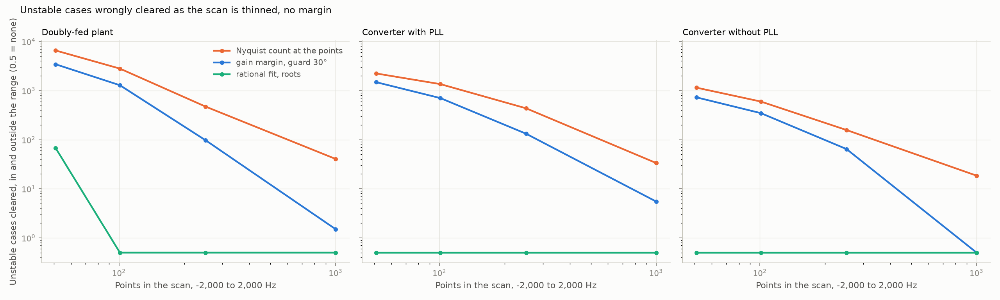
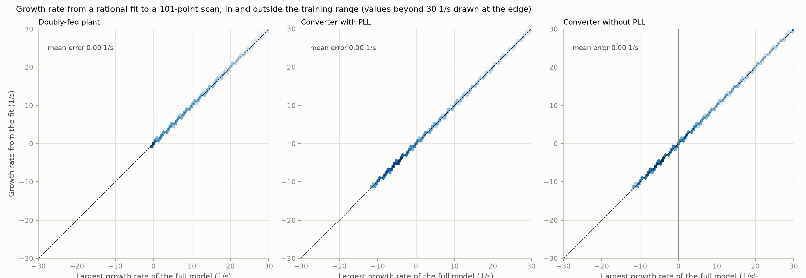
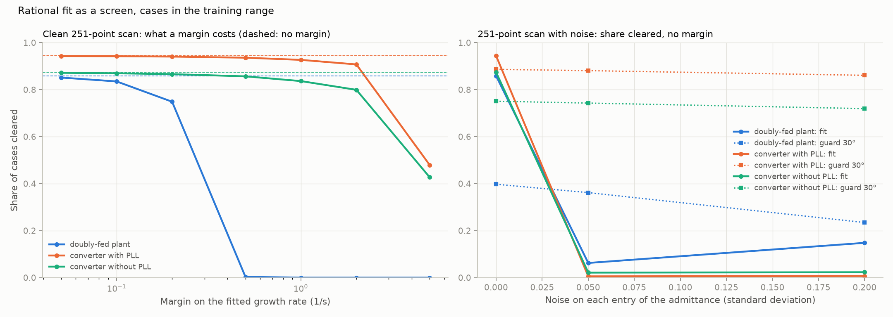

# 19: A rational fit to the scan: fewer points, and a margin in 1/s

Date: 2026-11-12 · Plan phase: the standing screening question

## Goal

Step 18 left two gaps. Tests at the scan points clear unstable cases when the scan is thin, because a resonance between two points is not seen. And the Nyquist count, the only test that clears every stable case, has no margin. Does fitting a rational function to the scan and reading its roots close both?

## What was done

- `src/sso_sciml/admittance.py`: `fit_growth`. The determinant `D(s) = det(I + Y Z)` is sampled at the scan points, the AAA algorithm (`scipy.interpolate.AAA`) builds a ratio of polynomials through them, and the root with the largest real part is the growth rate of the least-damped mode. `fit_scores` does this on thinned and on noisy scans.
- `src/sso_sciml/data/t1.py`, `c1.py`: `fit`, `fits`, `scan_pair`. `scripts/phase3_fit_scans.py` runs the fits on every case of both plant types.
- `scripts/fit_screens.py`: the comparison with the tests of step 18, its results file and three figures.
- `tests/test_scan.py`: 2 more tests.

## Commands

```powershell
uv run scripts/phase3_fit_scans.py     # 100,000 cases, about 30 minutes on 8 processes
uv run scripts/fit_screens.py
uv run pytest tests/test_scan.py
```

## Setup of the study

- **Cases, truth and scans:** as in step 18. 98,635 solved cases: the doubly-fed plant (13,105 in the range, 20,475 outside, 4,931 on the boundary) and the converter with and without a phase-locked loop. Scans thinned to 1,001, 251, 101 and 51 points over −2,000 to 2,000 Hz.
- **The screen:** a case is cleared if the fitted growth rate is below minus a margin. With no margin that is the sign of the growth rate.
- **Nothing is chosen by hand.** The fit adds terms until it reproduces the scan points to 1 part in 10⁹. With noise it stops at the noise level.

## Results

All numbers are in `docs/results/scan/fit_screens.json`.

### Clean scans



Over all 98,635 cases:

| Points | Wrong verdicts | Unstable cases cleared | The same, Nyquist count at the points | Gain margin, guard 30° |
|---|---|---|---|---|
| 1,001 | 0 | 0 | 577 | 6 |
| 251 | 0 | 0 | 3,256 | 318 |
| 101 | 2 | 0 | 7,171 | 2,732 |
| 51 | 7,169 | 359 | 11,954 | 6,704 |

- **With 251 points the fit gives the right verdict in every case,** including the 4,931 placed on the stability boundary, where the count on the full 4,001-point scan got 39 wrong.
- **With 101 points it is wrong twice in 98,635, both times on the safe side.** No unstable case is cleared.
- **With 51 points it fails on the doubly-fed plant** (all 359 unstable cases cleared are doubly-fed) and still holds on the converters: no unstable case cleared and 8 stable ones flagged, in 60,124.
- **What sets the number of points is the order of the system, not the sharpness of its resonances.** The fit uses a median of 23 terms for the doubly-fed plant and 13 to 15 for the converters. It needs a few points per term. A resonance between two points is found from its skirts.



- **The growth rate itself is recovered, not only its sign.** From 251 points, 99.9 % or more of the cases in the range are within 0.01 1/s of the eigenvalue, on each plant type. Near the boundary (within 3 1/s) the 99th percentile of the error is below 0.001 1/s on the doubly-fed plant and below 10⁻⁸ 1/s on the converters.

### A margin in 1/s



Share of cases in the range cleared, 251-point scan. No unstable case is cleared at any margin.

| Margin (1/s) | Doubly-fed plant | Converter with PLL | Converter without PLL |
|---|---|---|---|
| 0 | 85.9 % | 94.4 % | 87.4 % |
| 0.1 | 83.5 % | 94.2 % | 87.0 % |
| 0.2 | 74.9 % | 94.1 % | 86.6 % |
| 0.5 | 0.4 % | 93.6 % | 85.7 % |
| 1 | 0.0 % | 92.7 % | 83.6 % |
| 2 | 0.0 % | 90.7 % | 79.9 % |
| 5 | 0.0 % | 47.9 % | 42.7 % |

- **For the converters a margin is cheap.** Asking for decay at 1 1/s costs 2 to 4 points of cleared cases.
- **For the doubly-fed plant no margin above 0.2 1/s is affordable,** and not because of the resonance. Every case has a slow mode that decays at 0.2 to 0.4 1/s. It is the same slow mode that step 18 found unstable in 478 cases. A margin on the largest growth rate is a margin on that mode.
- **The margin of step 14 (1 and 5 1/s) was on the sub-synchronous mode alone.** The fit returns one number, the least-damped root. To put separate margins on separate modes the roots would have to be sorted by frequency, which the fit allows but this step did not do.

### Noisy scans

Cases in the range, 251 points, no margin. Share cleared, then unstable cases cleared.

| | Doubly-fed plant | Converter with PLL | Converter without PLL |
|---|---|---|---|
| Fit, clean | 85.9 %, 0 | 94.4 %, 0 | 87.4 %, 0 |
| Fit, 5 % noise | 6.2 %, 38 | 0.5 %, 12 | 2.1 %, 1 |
| Fit, 20 % noise | 14.8 %, 175 | 0.7 %, 22 | 2.3 %, 11 |
| Gain margin, guard 30°, 5 % noise | 36.2 %, 11 | 88.1 %, 49 | 74.3 %, 0 |
| Gain margin, guard 30°, 20 % noise | 23.4 %, 4 | 86.1 %, 41 | 71.9 %, 0 |

- **With noise this fit is useless.** It passes through the points, so it fits the noise, and the roots it adds for that land on both sides of the axis. It flags nearly every case and still clears some unstable ones.
- **The pointwise tests degrade gently instead.** They do not depend on any one point being exact.
- **So the two kinds of test fail in opposite ways.** Tests at the points need a dense scan and tolerate noise. The fit needs few points and tolerates none.

## What this says about screening

- **How little information, revised.** A 2 × 2 scan of the plant at about 250 frequencies, if it is clean, decides small-signal stability of both plant types exactly and returns the growth rate. Step 18 needed 4,001 points for the same verdict. A scan from a simulation model can be made that clean. A measured one cannot.
- **The screen for scans from a model:** rational fit, sign of the largest root. One step, no threshold, no theory-specific test, 98,635 right of 98,635 at 251 points.
- **The screen for noisy scans stays that of step 18:** gain margin with a guard on a dense scan.
- **A margin in 1/s needs to know which mode it is on.** One margin on everything is set by the slowest harmless mode of the plant.
- **A check comes free.** The fit and the pointwise count are independent readings of the same scan. Where they disagree the scan is too thin or too noisy.

## Disagreements

1. **At 101 points the fit is wrong in 2 cases of 98,635** (both doubly-fed, both flagged though stable) and at 51 points in 7,169. Below about four points per term the fit is not determined.
2. **The fit on noisy scans is worse than no fit.** Expected of a function made to pass through its points. A least-squares fit of fixed order is the usual answer.
3. **A least-squares fit was tried and not adopted.** Vector fitting of the four admittance entries with common poles, then the roots of the determinant with the exact network impedance, on 150 doubly-fed cases with 5 % noise. The fit matched the scan to the noise level, but the growth rate of the slow mode was not resolved and unstable cases were cleared. The trial is not in the repository and no number from it is quoted.
4. **The clean scans are exact to rounding, which no simulation tool delivers.** How clean is clean enough was not mapped between rounding error and 5 %.
5. **The scan runs from 0.01 to 2,000 Hz.** The slow mode of the doubly-fed plant sits near 0.5 Hz in the synchronous frame. A scan that starts at 1 Hz would not contain it. Not tested.
6. **Step 18 said the scan must be fine: points 0.6 % apart for the count.** That holds for tests at the points. It is not a property of the problem.

## Decisions

- For scans taken from a model, the reference screen is the sign of the largest root of a rational fit to `det(I + Y Z)`, on a scan of 251 points or more. The pointwise count on the same scan is kept as a cross-check.
- For scans with noise, the reference stays the gain margin with a 30° guard on a dense scan (step 18).
- No single margin in 1/s is adopted. Margins by mode are left open.

## Next

In the order they bear on the result: the noise level at which the fit starts to fail, and a least-squares fit that holds beyond it; margins by mode, with the roots sorted by frequency; a source and a load on one bus; control delay and a filter capacitor. Still open from before: the protection model, and whether the slow outer-loop mode of the doubly-fed plant survives a realistic tuning.
