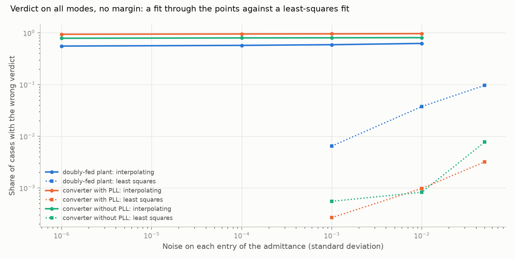
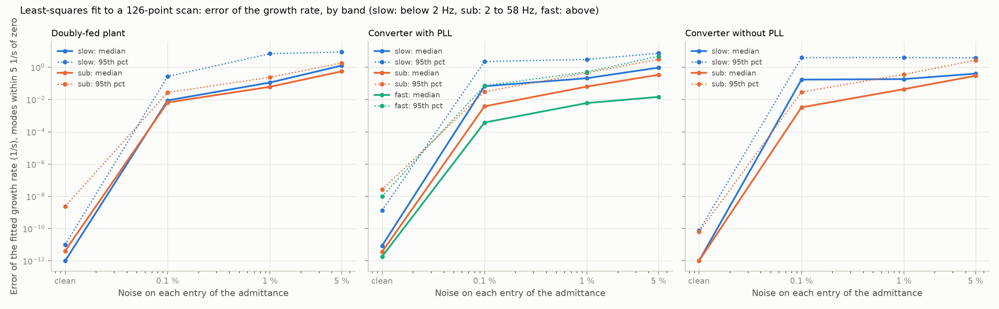
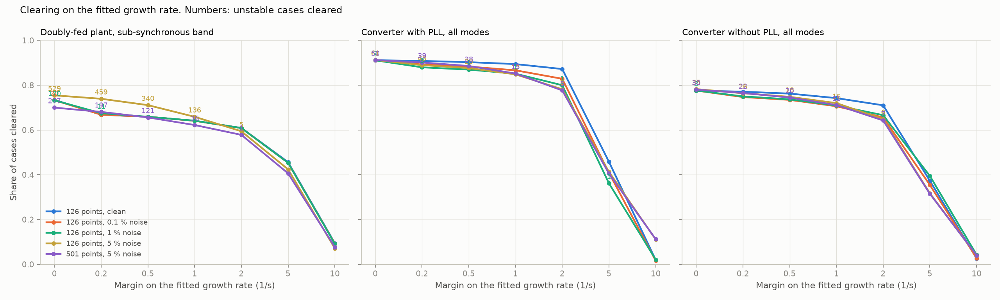

# 20: Noisy scans: a least-squares fit, and margins by mode

Date: 2026-11-12 · Plan phase: the standing screening question

## Goal

Step 19 showed that a rational fit through the points of a clean scan recovers the modes exactly, and fails with 5 % noise. Two things were left open. At what noise does that fit fail, and does a least-squares fit hold beyond it? And can a margin in 1/s be put on one mode at a time, so that the slow mode of the doubly-fed plant does not set the margin for the resonance?

## What was done

- `src/sso_sciml/vectorfit.py`: `vector_fit`, a least-squares rational fit with one set of poles for the four entries of the admittance. `fit_admittance` picks the order from the noise level and cuts the model to the states the scan supports. `closed_loop_modes` closes any plant model on the known network exactly.
- `src/sso_sciml/scanfit.py`: one case as a noisy scan, fitted, with its modes sorted into three frequency bands and set beside those of the full model.
- `scripts/phase3_noise_fits.py` runs every fourth case of both datasets. `scripts/noise_screens.py` makes the comparison, its results file and three figures.
- `tests/test_vectorfit.py`: 6 tests.

## Commands

```powershell
uv run scripts/phase3_noise_fits.py     # 24,526 cases, about 37 minutes on 8 processes
uv run scripts/noise_screens.py
uv run pytest tests/test_vectorfit.py
```

## Setup of the study

- **Cases:** every fourth case of steps 18 and 19, in and outside the training range together. 9,630 doubly-fed (boundary set included), 11,264 converters with a phase-locked loop, 3,632 without.
- **Scan:** the plant admittance at 126 frequencies from 0 to 2,000 Hz in the synchronous frame, or at 501. Each entry at each frequency is multiplied by 1 + e, with e complex normal of standard deviation 0.1 %, 1 % or 5 %. The network is taken as known, with no error.
- **Fit:** 4, 8 or 12 pole pairs, the fewest that reach 1.5 times the noise level. A state of the fitted model is kept only if, at some scan point, it supplies more than 3 times the noise level of the admittance there.
- **Bands:** slow, below 2 Hz in the synchronous frame; sub-synchronous, 2 to 58 Hz; fast, above 58 Hz. A band is unstable if a mode of the full model in it grows.
- **Screen:** a case is cleared in a band if the largest fitted growth rate in it is below minus a margin.

## Results

All numbers are in `docs/results/scan/noise_screens.json`.

### The fit through the points fails at one part in a million



Share of cases given the wrong verdict by the interpolating fit of step 19, 251 points:

| Noise | Doubly-fed plant | Converter with PLL | Converter without PLL |
|---|---|---|---|
| 0.0001 % | 55 % | 94 % | 79 % |
| 0.01 % | 57 % | 95 % | 80 % |
| 1 % | 62 % | 97 % | 81 % |

- **The step 19 result holds only for scans exact to rounding.** At a noise of 10⁻⁶ the fit already flags most stable cases. Step 19 said a scan from a simulation model can be made clean enough. A time-domain simulation tool does not deliver six digits, so that claim is withdrawn.
- **The errors are false alarms, not misses.** At 10⁻⁶ it clears no unstable case on any plant.

### The least-squares fit, clean

On a clean 126-point scan the least-squares fit gives the growth rate in every band to better than 10⁻⁶ 1/s at the 99th percentile, and clears no unstable case on any plant at any margin. It keeps a median of 19 states for the doubly-fed plant, 10 and 8 for the converters. The plants have 21, 10 and 8.

### Error of the growth rate under noise



Modes within 5 1/s of zero. Median error, then 95th percentile, in 1/s.

| Band, noise | Doubly-fed plant | Converter with PLL | Converter without PLL |
|---|---|---|---|
| Sub-synchronous, 0.1 % | 0.007, 0.03 | 0.003, 0.02 | 0.003, 0.02 |
| Sub-synchronous, 1 % | 0.06, 0.24 | 0.06, 0.50 | 0.04, 0.23 |
| Sub-synchronous, 5 % | 0.57, 1.8 | 0.29, 3.2 | 0.20, 1.3 |
| Slow, 0.1 % | 0.009, 0.26 | 0.04, 2.3 | 0.16, 3.8 |
| Slow, 1 % | 0.11, 7.2 | 0.15, 2.9 | 0.16, 3.8 |
| Slow, 5 % | 1.2, 9.1 | 0.72, 4.3 | 0.28, 3.6 |

- **In the sub-synchronous band the error grows in proportion to the noise:** about 0.06 1/s per percent in the median, on all three plants.
- **Below 2 Hz the tail is ten times worse.** The 95th percentile is several 1/s at any noise level. A slow mode is narrow, so few scan points see it.
- **The slow mode of the doubly-fed plant drops out of the fit.** With 5 % noise 195 of 9,630 fitted models have no mode below 2 Hz at all, where the full model always has one. Its share of the admittance is below the noise.

### Margins by mode



Share cleared and unstable cases cleared. Doubly-fed plant: the sub-synchronous band, 2,659 unstable of 9,630. Converters: all modes, 271 unstable of 11,264 and 627 of 3,632.

| Scan | Margin (1/s) | Doubly-fed, sub-synchronous band | Converter with PLL | Converter without PLL |
|---|---|---|---|---|
| Clean | 0 | 72.4 %, 0 | 97.6 %, 0 | 82.7 %, 0 |
| 0.1 % | 0 | 72.2 %, 20 | 97.6 %, 0 | 82.7 %, 0 |
| 0.1 % | 0.5 | 64.3 %, 0 | 95.0 %, 0 | 77.6 %, 0 |
| 1 % | 0 | 71.8 %, 153 | 97.5 %, 2 | 82.8 %, 2 |
| 1 % | 0.5 | 64.3 %, 0 | 93.8 %, 0 | 77.8 %, 0 |
| 5 % | 0 | 74.1 %, 502 | 97.5 %, 10 | 82.8 %, 16 |
| 5 % | 2 | 58.3 %, 7 | 86.6 %, 2 | 70.3 %, 1 |
| 5 % | 5 | 42.3 %, 0 | 46.2 %, 0 | 36.5 %, 0 |
| 5 %, 501 points | 2 | 56.4 %, 0 | 87.5 %, 2 | 70.3 %, 3 |

- **Up to 1 % noise a margin of 0.5 1/s is enough.** No unstable case is cleared on any plant, and the margin costs 8 points of cleared cases on the doubly-fed plant and 4 to 5 on the converters.
- **At 5 % the margin has to be 5 1/s,** and the screen then clears about 40 %. With a margin of 2 1/s it clears 58 % to 87 % and lets through 10 unstable cases of 3,557.
- **Four times as many points buys little.** On the doubly-fed plant the safe margin at 5 % falls from 5 to 2 1/s. On the converters nothing changes.
- **Sorting by band does what was asked of it.** On the doubly-fed plant a margin of 1 1/s on the sub-synchronous band clears 62.7 % from a clean scan. The same margin on all modes clears nothing, because the slow mode decays at 0.2 to 0.4 1/s.
- **The slow band of the doubly-fed plant cannot be given a margin at all.** It is stable in 97 % of cases and decays too slowly in nearly all of them. With no margin the fit clears 10 of its 285 unstable cases at 5 % noise and none at 1 % or below.

### Against the pointwise test of step 18

With 5 % noise the gain margin with a 30° guard cleared 36 %, 88 % and 74 % of cases in the range and let unstable cases through on two of the three plants (11 and 49). The least-squares fit with a 2 1/s margin clears 58 %, 87 % and 70 % of the cases here and lets through 7, 2 and 1. The case sets differ (step 18 scored the range alone, this step pools it with the sets outside), so the comparison is of kind, not of decimal places.

## What this says about screening

- **How good the scan must be is now a number.** For the resonance, the growth rate is uncertain by about 0.06 1/s per percent of scan error in the median and four to eight times that in the tail. A margin of 0.5 1/s covers 1 %. A margin of 5 1/s covers 5 %.
- **Scan accuracy matters more than scan density.** A hundred points at 1 % decide more cases than five hundred at 5 %.
- **A slow mode weakly seen at the terminals cannot be screened from a noisy terminal scan,** whatever the method. It has to come from the plant model itself, on an ideal voltage, where it is a mode of the plant alone or nearly so.
- **The reference screen, revised.** From a 2 × 2 scan with known error: a least-squares fit, the fitted plant closed on the network, modes sorted by band, and a margin on each band sized to the scan error. The pointwise gain margin of step 18 needs no fit and stays as the cross-check. The interpolating fit of step 19 is for exact scans only, which in practice means scans of a linearised model.

## Disagreements

Note added in step 21: the decision below to check slow modes on the plant alone was wrong. On an ideal voltage the slow mode of the doubly-fed plant decays in 96 % of the cases where it is unstable on its network. The phasor-domain model reproduces it to 0.006 1/s. See `21-slow-mode.md`.

1. **Step 19 called the interpolating fit the reference screen for scans from a model.** It fails at a noise of 10⁻⁶. Withdrawn above. A note is added to step 19.
2. **The first version of the fit put false modes just left of the axis below 2 Hz.** Surplus poles fitted to noise were kept because a pole close to the axis looks large at its own frequency. Judging each state by its share at the scan points, not at its own frequency, removed them. With the first rule a margin of 0.5 1/s cleared almost nothing in the slow band of the converters; with the second it clears 96 % at 1 % noise on the converter with a phase-locked loop.
3. **A few unstable cases are cleared whatever the margin.** With 5 % noise 1 or 2 unstable sub-synchronous cases of the converters are still cleared at a margin of 5 1/s. The fit has no mode near the true one. The all-modes screen catches them through another band in this dataset, which is luck, not design.
4. **More points did not shrink the error as least squares should.** The order is capped at 12 pole pairs and chosen by a fixed rule. A fit whose order grows with the data was not tried.
5. **The noise level is given to the fit.** In practice it has to be estimated, from repeat scans or from the residual.
6. **The network is exact.** Error in R, X and C is not studied here.
7. **Every fourth case, not every case.** The fit costs about 0.7 s per case over five scans.

## Decisions

- The least-squares fit with margins by band replaces the interpolating fit as the reference for any scan that is not exact.
- Margins: 0.5 1/s for scan error up to 1 %, 5 1/s at 5 %, on the sub-synchronous band and on the fast band. No margin is set for the band below 2 Hz.
- The slow modes of a plant are to be checked on the plant alone.

## Next

In the order they bear on the result: the slow mode of the doubly-fed plant on the plant alone, and whether it survives a realistic tuning of the outer loops; error in the network data; a source and a load on one bus; control delay and a filter capacitor. Still open from before: the protection model.
