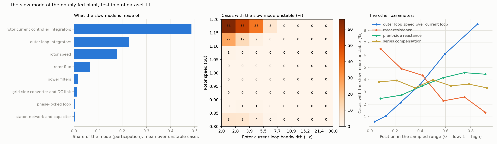
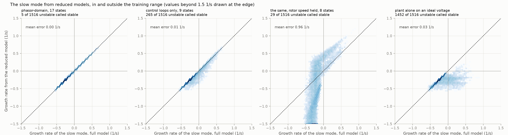
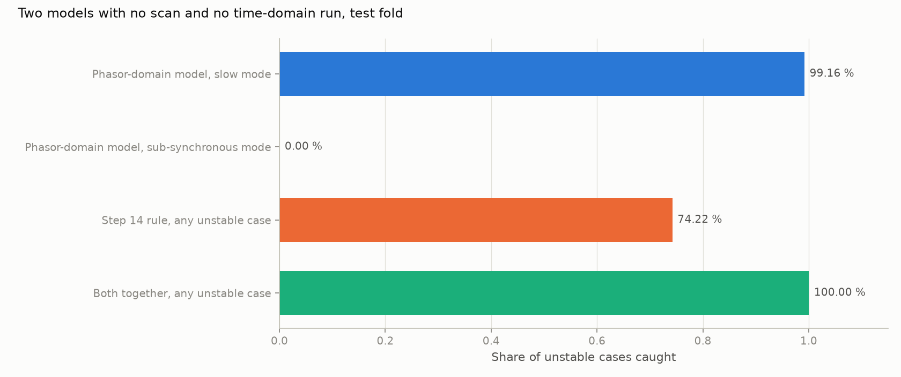

# 21: The slow mode of the doubly-fed plant, and what the phasor-domain model is for

Date: 2026-11-12 · Plan phase: the standing screening question

## Goal

Steps 18 to 20 kept meeting a slow mode of the doubly-fed plant, near 0.5 Hz in the synchronous frame. It is unstable in 478 test cases that the step 14 rule clears, it sets the margin of any all-modes screen, and a noisy scan cannot see it. Step 20 decided it should be checked on the plant alone. What is this mode, is it an artefact of the sampled tuning, and which is the smallest model that gets it right?

## What was done

- `src/sso_sciml/slowmode.py`: for one case, the slow mode of the full model with its participation factors, and the same mode from four reduced models: the phasor-domain model of step 06, a 9-state model of the control loops, that model with rotor speed held, and the plant alone on an ideal voltage. Also the full model with the outer loops at half speed and with the current loop twice as fast.
- `scripts/slow_mode.py`: the pass over the 38,511 cases of step 18, the results file and three figures.
- `tests/test_slowmode.py`: 5 tests.

## Commands

```powershell
uv run scripts/slow_mode.py            # 38,511 cases, about 10 minutes on 8 processes
uv run scripts/slow_mode.py --reuse    # numbers and figures from the saved pass
uv run pytest tests/test_slowmode.py
```

## Results

All numbers are in `docs/results/slow/slow_mode.json`.

### What the mode is



- **It is a mode of the rotor-side control and the shaft.** In the unstable cases the rotor current controller integrators carry 49 % of it, the outer-loop integrators 23 %, rotor speed 18 % and rotor flux 7 %. The stator, the network and the capacitor together carry 0.3 %, and the phase-locked loop 0.3 %.
- **It is there in every case.** Its growth rate has quartiles of −0.30, −0.27 and −0.23 1/s. It is unstable in 478 of 13,105 test cases (3.6 %), at 0.45 to 0.66 Hz.
- **It is never unstable together with the resonance in the range.** 1,376 cases are unstable in the sub-synchronous band, 478 in the slow band, none in both. Outside the range 40 are unstable in both.

### What drives it

- **A slow current loop and a high rotor speed.** With the current loop below 2.8 Hz and the speed above 1.15 pu, 66 % of cases are unstable. Above 7.7 Hz none is in the range. Over all 38,511 cases the fastest current loop with an unstable slow mode is 10.7 Hz, and 0.01 % of cases above 10 Hz are unstable.
- **Fast outer loops.** The share unstable rises from 0.6 % to 8.5 % as the outer loops go from 3 % to 15 % of the current-loop bandwidth.
- **Low rotor resistance.** 6.5 % at the bottom of the range, 1.3 % at the top.
- **Not the series capacitor.** Compensation from 10 % to 80 % leaves the share between 3.3 % and 4.0 %. The plant-side reactance matters a little: 2.5 % to 4.6 %.
- **Two changes to the controls cure most cases.** Outer loops at half speed: 76 % of the unstable cases in the range become stable. Current loop twice as fast: 79 %.

### Is it an artefact of the tuning?

Partly. The current-loop range of 2 to 30 Hz was chosen in step 08 because the stability limit of the resonance lies inside it. Its slow end, with outer loops at up to 15 % of that, is a cascade with little separation between inner loop, outer loop and shaft, and the slow mode is what that produces. A plant tuned with a current loop above 10 Hz does not have the problem in this model. The mode itself is real and is always present; its instability belongs to the slow corner of the sampled range. No comparison with a commissioned plant was made.

### Which model gets it right



Slow mode, all 38,511 cases, 1,516 of them unstable.

| Model | States | Error, 99th percentile (1/s) | Unstable called stable | Stable called unstable |
|---|---|---|---|---|
| Phasor-domain: network and stator transients dropped | 17 | 0.006 | 5 | 2 |
| Control loops only: rotor flux, grid-side converter and DC link dropped too | 9 | 0.15 | 265 | 0 |
| The same with rotor speed held | 8 | 13 | 29 | 1,840 |
| Plant alone on an ideal voltage | 21 | 0.57 | 1,452 | 0 |

- **The phasor-domain model reproduces the slow mode.** Its growth rate is within 0.006 1/s at the 99th percentile. Its 7 wrong calls are all within its largest error, 0.13 1/s, of the boundary.
- **The plant alone does not.** It calls 1,452 of 1,516 unstable cases stable. On an ideal voltage the mode decays; it is the network's reactance at 60 Hz that tips it. Step 20 decided to check slow modes on the plant alone. That was wrong.
- **Rotor speed has to be a state.** With speed held the model is wrong in both directions.
- **Rotor flux cannot be dropped either** without calling 265 unstable cases stable.

### What the phasor-domain model is for



Step 14 found that the phasor-domain model reports every unstable case as stable. That was about the resonance, and it still holds: of 1,376 test cases unstable in the sub-synchronous band the phasor-domain model sees none. Below 2 Hz the position is reversed.

Test fold, 1,854 unstable cases in any mode:

| Screen | Cleared | Unstable cleared |
|---|---|---|
| Step 14 rule alone (hand formula for the resonance) | 79.9 % | 478 |
| Phasor-domain model alone, slow mode stable | 96.4 % | 1,380 |
| Both | 76.3 % | 4 |
| Both, with a margin of 0.05 1/s on the phasor-domain model | 75.6 % | 0 |

- **The two models are blind in opposite bands and together cover both.** Neither needs a scan, an electromagnetic-transient model or a time-domain run. The hand formula needs three numbers of the machine and the network's R, X and C. The phasor-domain model is what a planning study already has.
- **Outside the range** the pair clears 49.6 % and 4 unstable cases of 7,227. With no margin it lets through 5. The step 14 rule alone lets 5 through on the resonance there (step 18).
- **A margin of 0.05 1/s on the slow mode costs 0.7 points,** because the mode decays at 0.2 to 0.4 1/s where it is stable.

## What this says about screening

- **Each model is a screen for the band it resolves.** The phasor-domain model has no network transients, so it has no resonance, and it is exact below 2 Hz. A terminal scan resolves the resonance and cannot see a slow mode that barely reaches the terminals. The hand formula of step 14 is the resonance alone.
- **The question "what can we get out of phasor-domain models" has a specific answer.** The slow control modes, which depend on the network only through its 60 Hz reactance, to within 0.006 1/s. Nothing between 2 and 58 Hz.
- **The cheapest complete screen for the doubly-fed plant uses no detailed model.** Hand formula with its margin for the resonance, phasor-domain model for the slow band: 75.6 % cleared, no unstable case among them in the range. The scan-based screens of steps 18 to 20 are for plants whose formula cannot be written by hand.
- **Topology says nothing about the slow mode.** Compensation, parallel path and line length do not move it. The strength of the connection at 60 Hz does, mildly.

## Disagreements

1. **Step 20 decided that slow modes are to be checked on the plant alone.** The plant alone misses 96 % of the unstable cases. Replaced by the phasor-domain model. A note is added to step 20.
2. **Step 14 recorded the phasor-domain model as useless for screening.** It is useless for the resonance and exact for the slow mode. The step 14 statement stands for the band it was tested in.
3. **The phasor-domain model calls 5 unstable cases stable and 2 stable cases unstable in 38,511.** All within its error of the boundary. A margin of 0.05 1/s removes the 4 in the range.
4. **The 9-state model was expected to be enough,** since the nine states carry over 90 % of the participation. It calls 265 unstable cases stable. Participation says which states move, not which can be made algebraic.
5. **The phasor-domain model here is the linearised full model with states made algebraic (A29),** not a commercial positive-sequence model with its own simplified converter. A planning model whose converter representation drops the current-controller integrators would not show this mode.
6. **Whether a current loop of 2 to 7 Hz is realistic was judged from the structure of the cascade, not from a source.**

## Decisions

- Slow modes of a plant are screened with the phasor-domain model, with a margin of 0.05 1/s.
- For the doubly-fed plant the reference screen with no scan is the step 14 rule and the phasor-domain model together.
- The slow mode is kept in the dataset as it is. Results that depend on it are to say so.

## Next

In the order they bear on the result: error in the network data, for the scan-based and the two-model screens alike; a source and a load on one bus; control delay and a filter capacitor in the converter. Still open from before: the protection model; a fit whose order grows with the data.
