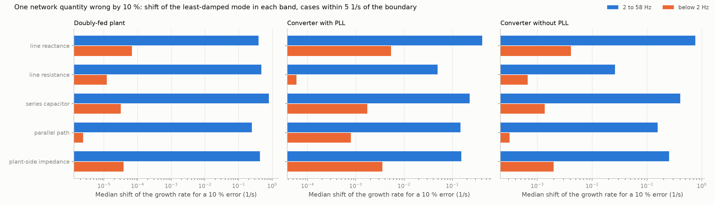
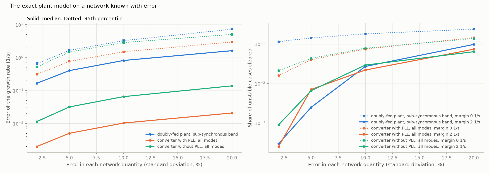
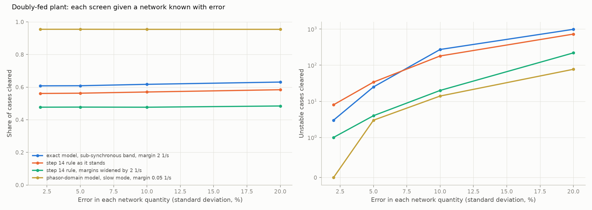

# 22: Error in the network data

Date: 2026-11-12 · Plan phase: the standing screening question

## Goal

Every screen so far was given the network's R, X and C exactly. Network data are not exact: resistance moves with temperature, the equivalent of the rest of the system moves with outages, and a capacitor bank may have segments out. How much error can each screen stand, which network quantity matters, and is this a bigger or smaller problem than noise on the scan?

## What was done

- `src/sso_sciml/neterror.py`: one case with the plant known exactly and the screen handed a wrong network. Five quantities are each wrong by an independent factor: line reactance, line resistance, series capacitor, parallel path, plant-side impedance. Three screens are evaluated on the wrong network: the plant model closed on it exactly (what a clean scan and fit give), the step 14 hand formula, and the slow mode of the phasor-domain model with its operating point also taken from the wrong network.
- `src/sso_sciml/data/t1.py`: `impedance_root` and `operating_point` now accept a network in place of the one of the case.
- `scripts/network_error.py`: the pass over all 98,635 cases of both plant types, the results file and three figures.
- `tests/test_neterror.py`: 5 tests.

## Commands

```powershell
uv run scripts/network_error.py            # 98,635 cases, about 25 minutes on 8 processes
uv run scripts/network_error.py --reuse    # numbers and figures from the saved pass
uv run pytest tests/test_neterror.py
```

## Setup of the study

- **Cases:** every solved case of steps 18 and 19, in and outside the training range together: 38,511 doubly-fed, 45,056 converters with a phase-locked loop, 15,068 without.
- **Error:** each of the five factors is the exponential of a normal number with standard deviation 2 %, 5 %, 10 % or 20 %. Separately, each quantity alone is moved 10 % up and 10 % down.
- **Truth:** the modes of the full model on the right network, by band as in step 20.
- **The plant is exact.** Its admittance is taken at the true operating point. Only the phasor-domain screen takes its operating point from the wrong network, as a planning model would.

## Results

All numbers are in `docs/results/network/network_error.json`.

### Which network quantity matters



Median shift of the growth rate of the least-damped mode between 2 and 58 Hz when one quantity is wrong by 10 %, in 1/s, for cases within 5 1/s of the boundary. The sign is that of the shift when the quantity is 10 % too large.

| Quantity | Doubly-fed plant | Converter with PLL | Converter without PLL |
|---|---|---|---|
| Series capacitor | 0.80, less stable | 0.23 | 0.40 |
| Line resistance | 0.48, more stable | 0.05 | 0.03 |
| Plant-side impedance | 0.43, more stable | 0.16, less stable | 0.25, less stable |
| Line reactance | 0.39, more stable | 0.42, less stable | 0.76, less stable |
| Parallel path | 0.25, less stable | 0.15, less stable | 0.16, less stable |

- **For the doubly-fed plant the capacitor matters most and resistance second.** A capacitor 10 % larger than assumed moves the mode 0.8 1/s toward instability. More resistance and more reactance both help.
- **For a converter the reactance matters most and resistance not at all.** More reactance hurts, the opposite of the doubly-fed plant: there it lowers the resonance frequency, here it weakens the grid.
- **The slow modes do not care.** Below 2 Hz the same 10 % errors move the growth rate by less than 0.001 1/s on the doubly-fed plant and by 0.005 1/s or less on the converters.

### The exact plant model on a wrong network



Sub-synchronous band of the doubly-fed plant, 10,051 unstable of 38,511. Error of the growth rate near the boundary, then share cleared and unstable cases cleared at four margins.

| Error in the data | Error, median and 95th percentile (1/s) | Margin 0 | 1 1/s | 2 1/s | 5 1/s |
|---|---|---|---|---|---|
| 2 % | 0.17, 0.66 | 73.8 %, 1,155 | 64.3 %, 15 | 60.8 %, 3 | 45.4 %, 0 |
| 5 % | 0.40, 1.65 | 73.6 %, 1,436 | 65.4 %, 241 | 60.9 %, 25 | 45.4 %, 3 |
| 10 % | 0.82, 3.27 | 73.7 %, 1,824 | 67.3 %, 790 | 61.7 %, 272 | 45.0 %, 10 |
| 20 % | 1.62, 7.29 | 73.1 %, 2,397 | 68.2 %, 1,622 | 63.1 %, 984 | 44.8 %, 154 |

- **The error of the growth rate is about 0.08 1/s per percent of error in the data,** in the median, and four times that at the 95th percentile.
- **A perfect plant model does not help if the network is wrong.** With 5 % error and no margin 1,436 unstable cases are cleared, one in seven.
- **Margins have to be several 1/s.** With 2 % error a margin of 2 1/s lets through 3 of 10,051. With 5 % it takes 5 1/s to get down to 3. With 10 % only a margin of 10 1/s clears none, and it clears 9 % of cases.

Converters, all modes, 3,960 and 3,343 unstable. Unstable cases cleared at a margin of 2 1/s: 1 and 3 at 2 % error, 28 and 22 at 5 %, 87 and 98 at 10 %. The share cleared stays at 87 % and 71 %.

- **The converters have a tail that no margin removes.** In the band between 2 and 58 Hz alone, a few unstable cases are still cleared at a margin of 10 1/s with 2 % error (4 and 14). The wrong network moves the mode across 2 Hz or changes which mode is least damped. Screening on all modes together catches most of them.

### Against noise on the scan

Step 20 gave 0.06 1/s per percent of scan noise for the same band. Network data error costs 0.08 1/s per percent. The two are of the same size, percent for percent. Network data are rarely known to better than a few percent, and a scan from a simulation model can be much better than that. So for a scan taken from a model the network data, not the scan, set the margin.

### The screens of the doubly-fed plant



Unstable cases cleared, of 10,051 unstable in the sub-synchronous band for the first two rows and 1,516 in the slow band for the last two.

| Screen | No error | 2 % | 5 % | 10 % | 20 % |
|---|---|---|---|---|---|
| Step 14 rule as it stands (margins 1 and 5 1/s), clears 56 % | 5 | 8 | 34 | 180 | 725 |
| Step 14 rule, margins widened by 5 1/s, clears 30 % | | 0 | 0 | 2 | 28 |
| Phasor-domain model, slow mode, margin 0.05 1/s, clears 95 % | | 0 | 3 | 14 | 77 |
| Phasor-domain model, slow mode, margin 0.2 1/s, clears 84 % | | 0 | 0 | 1 | 13 |

The "no error" entry is from step 18.

- **The step 14 rule already has margins and they absorb 2 % of error.** Beyond that it lets cases through in proportion.
- **The phasor-domain screen is the robust one.** The slow mode hardly depends on the network, so even with 10 % error and the operating point from the wrong network it lets through 14 of 1,516 at its small margin and 1 at a margin of 0.2 1/s.
- **The pair of step 21,** hand formula and phasor-domain model together, lets through 6, 33, 186 and 763 unstable cases of 11,527 at the four error levels, clearing 52 % to 54 %. Most of them are the hand formula's.

## What this says about screening

- **How little information, completed.** A screen needs the plant (a scan or a formula) and the network. The first can be made nearly exact from a model. The second cannot, and it now sets the accuracy: 0.08 1/s of growth rate per percent.
- **Which network number to pin down depends on the plant.** For a machine on a compensated line: the capacitance in service, then the resistance. For a converter: the reactance, which is to say the short-circuit level. Resistance is irrelevant to the converter and second for the machine.
- **The direction of the error is known for the doubly-fed plant.** More capacitor, less resistance, less line reactance and a weaker parallel path all push toward instability. A screen run at the unfavourable end of each range would bound the error from one side instead of padding the margin. Not tested here.
- **The band below 2 Hz needs no care about network data.** The phasor-domain screen is robust for the same reason it is cheap: the mode it sees depends on the network through one number, the 60 Hz reactance, and weakly.
- **Topology, again.** What the network contributes to the resonance is carried by four numbers, and an error in any of them moves the answer by a fraction of 1/s per 10 %. Topology tells where the resonance is; it does not tell the margin to better than the data allow.

## Disagreements

1. **The trial on one case in sixteen suggested margins of 2, 5 and 10 1/s were safe at 2 %, 5 % and 10 % error.** On all cases they are not: 3, 3 and 0 unstable cases are cleared at those settings on the doubly-fed plant. The tail is longer than a small sample shows.
2. **The converters have unstable cases that are cleared at any margin in one band.** Sorting modes into bands at fixed frequencies is fragile when an error moves a mode across the edge. The all-modes screen is the safe one for a converter.
3. **The errors are independent and log-normal.** Real errors are structured: one outage changes the parallel path by a large factor and leaves the rest alone. Not studied.
4. **The plant admittance is taken at the true operating point.** With a wrong network the power-flow solution is wrong too, and step 17 showed the operating point matters for a converter. Only the phasor-domain screen includes that here.
5. **With 20 % error 40 of 38,511 doubly-fed cases have no steady state on the wrong network.** They are counted as not cleared.

## Decisions

- Margins for the sub-synchronous band are to be sized to the larger of the scan error and the network data error, at 0.08 1/s per percent in the median and about four times that for safety.
- For a converter the screen is on all modes together, not by band.
- The phasor-domain screen for the slow band keeps its margin of 0.05 1/s up to 5 % network error and takes 0.2 1/s beyond.

## Next

In the order they bear on the result: the screen at the unfavourable end of each network range instead of a wider margin; structured network error (one outage); a source and a load on one bus; control delay and a filter capacitor in the converter. Still open from before: the protection model; a fit whose order grows with the data.
