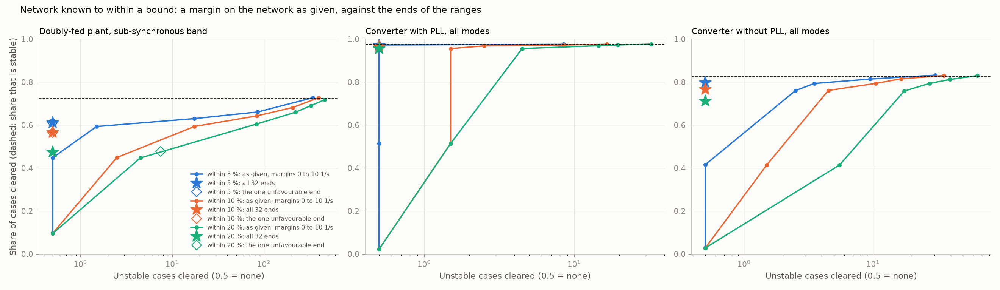
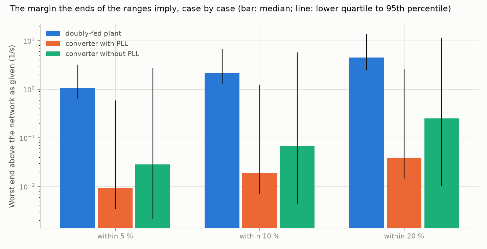

# 23: Network data with error: the ends of the ranges, not a wider margin

Date: 2026-11-12 · Plan phase: the standing screening question

## Goal

Step 22 found that network data error has to be covered by a margin of several 1/s, and that at 10 % error the margin needed clears almost nothing. It also found that the direction of the error is known for the doubly-fed plant. If each network quantity is known to within a bound, does running the screen at the ends of the ranges do better than a margin on the network as given?

## What was done

- `src/sso_sciml/neterror.py`: `corner_case`. The screen is given a network wrong by up to a bound in each of five quantities and is told the bound. It closes the exact plant model on the network as given, on all 32 ends of the five ranges, and on the one end that step 22 found unfavourable for the doubly-fed plant. The step 14 hand formula is evaluated as given and at that end.
- `scripts/network_corners.py`: the pass, the results file and two figures.
- `tests/test_neterror.py`: 1 more test.

## Commands

```powershell
uv run scripts/network_corners.py            # 24,526 cases, under half an hour on 8 processes
uv run scripts/network_corners.py --reuse    # numbers and figures from the saved pass
uv run pytest tests/test_neterror.py
```

## Setup of the study

- **Cases:** every fourth case of both plant types, in and outside the training range together: 9,630 doubly-fed, 11,264 converters with a phase-locked loop, 3,632 without.
- **Error:** each of the five network quantities is wrong by a factor drawn evenly, on a logarithmic scale, between 1/(1 + b) and 1 + b, with b = 5 %, 10 % or 20 %. Unlike step 22 the error is bounded, and the screen knows b.
- **Screens:** the network as given with a margin from 0 to 10 1/s; the largest growth rate over the 32 ends, no margin; for the doubly-fed plant, the one end with less line reactance, less line resistance, more capacitor, a weaker parallel path and less plant-side impedance.
- **Band:** the sub-synchronous band for the doubly-fed plant, whose slow mode goes to the phasor-domain model (step 21). All modes for the converters (step 22).

## Results

All numbers are in `docs/results/network/network_corners.json`.



Share of cases cleared, with the unstable cases cleared in brackets. "Margin as safe" is the smallest margin on the network as given that clears no more unstable cases than the 32 ends do.

| Plant, bound | Share stable | All 32 ends | Margin as safe | Network as given, that margin | Network as given, 2 1/s |
|---|---|---|---|---|---|
| Doubly-fed, 5 % | 72.4 % | 61.0 % (0) | 5 1/s | 44.8 % (0) | 59.3 % (1) |
| Doubly-fed, 10 % | | 56.4 % (0) | 10 1/s | 9.6 % (0) | 59.3 % (17) |
| Doubly-fed, 20 % | | 47.4 % (0) | 10 1/s | 9.6 % (0) | 60.4 % (82) |
| Converter with PLL, 5 % | 97.6 % | 97.1 % (0) | 0.5 1/s | 97.2 % (0) | 95.7 % (0) |
| Converter with PLL, 10 % | | 96.5 % (0) | 10 1/s | 2.2 % (0) | 95.6 % (1) |
| Converter with PLL, 20 % | | 95.4 % (0) | 10 1/s | 2.2 % (0) | 95.6 % (4) |
| Converter without PLL, 5 % | 82.7 % | 79.7 % (0) | 5 1/s | 41.5 % (0) | 76.0 % (2) |
| Converter without PLL, 10 % | | 76.5 % (0) | 10 1/s | 2.8 % (0) | 76.1 % (4) |
| Converter without PLL, 20 % | | 71.1 % (0) | 10 1/s | 2.8 % (0) | 75.8 % (17) |

- **The 32 ends clear no unstable case** on any plant at any bound: 24,526 cases, three bounds each.
- **They clear far more than a margin of the same safety.** With the network known to within 10 %, the ends clear 56 %, 97 % and 77 % of cases. The margin that is as safe, 10 1/s, clears 10 %, 2 % and 3 %.
- **Even 20 % of error costs little for a converter.** The ends clear 95.4 % of converters with a phase-locked loop against 97.6 % that are stable.

### Why the ends do better



A margin is one number for every case. The ends give each case its own. How far the worst end lies above the network as given, at a bound of 10 %:

| | Median (1/s) | 95th percentile (1/s) |
|---|---|---|
| Doubly-fed plant | 2.2 | 6.7 |
| Converter with PLL | 0.02 | 1.3 |
| Converter without PLL | 0.07 | 5.8 |

- **Most converter cases are insensitive to the network and a few are very sensitive.** A margin sized for the few throws away the many. The ends find which is which.
- **For the doubly-fed plant the sensitivity is more even,** so the gain is smaller but still large: 56 % against 10 %.

### One end or all 32

For the doubly-fed plant the one unfavourable end clears 61.0 %, 56.5 % and 47.7 % at the three bounds, the same as all 32 to within 0.3 points.

- **It is safe to within 10 % and not at 20 %.** It clears no unstable case at 5 % and 10 %, and 7 of 2,659 at 20 %.
- **It is the worst of the 32 in only 57 % to 66 % of cases.** The directions of step 22 are medians. In the rest another end is worse, usually by little.
- **All 32 cost 32 small eigenvalue problems,** so there is no reason to rely on the one.

### The hand formula at the unfavourable end

| Bound | Step 14 rule as given | Step 14 rule at the unfavourable end |
|---|---|---|
| 5 % | 55.2 % (1) | 50.5 % (1) |
| 10 % | 55.2 % (9) | 45.6 % (4) |
| 20 % | 55.9 % (46) | 37.9 % (10) |

- **Moving the hand formula to the unfavourable end helps and does not make it safe.** Its remaining misses are its own: the loops it leaves out, which step 14 covered with fitted margins. Those margins were set with exact network data.

### Is the worst end a bound?

Not strictly. The true growth rate exceeds the worst of the 32 ends in 1, 2 and 4 doubly-fed cases of 9,630 at the three bounds, and in no converter case. The growth rate is not monotone in every quantity, so the worst point of the box can lie inside it. None of those 7 cases led to an unstable case being cleared.

## What this says about screening

- **Uncertain network data call for the ends of the ranges, not a margin.** With the network known to within 10 % the screen clears 56 % to 97 % of cases and no unstable one, against 2 % to 10 % for a margin as safe.
- **How little information, again.** The screen needs each network number only as a range. Ten percent either way is enough to keep most of the cases an exact network would clear: 56 of 72 points for the doubly-fed plant, 96.5 of 97.6 and 76.5 of 82.7 for the converters.
- **This is the frequency-scan practice of sweeping outages, given a reason.** Running the study on a set of network conditions is a search over the ends of a range. What the result adds is that it replaces a margin; it does not go on top of one.
- **The complete screen for uncertain data.** For the resonance: plant admittance (a scan and a fit, or the matrices) closed on the network at the 32 ends of its ranges. For the slow band: the phasor-domain model, which hardly depends on the network.

## Disagreements

1. **Step 22 proposed the one unfavourable end.** It is the worst end in about 60 % of cases and clears 7 unstable cases at a bound of 20 %. All 32 ends are used instead.
2. **The worst end is not a strict bound** (7 cases of 9,630, none of them an unstable case cleared). A search inside the box would close this. Not done.
3. **The error is bounded and even here, log-normal in step 22.** A screen at the ends of a range is only as good as the range. An error beyond the stated bound is not covered.
4. **The plant is exact and the scan is clean.** Scan noise and network error together were not run. The margin for scan noise (step 20) goes on top of the ends.
5. **Five quantities, 32 ends.** A real network has more uncertain elements and the count of ends doubles with each. Which few to vary is what step 22's sensitivity table is for: capacitor and resistance for a machine, reactance for a converter.
6. **The plant admittance is at the true operating point,** as in step 22.

## Decisions

- With uncertain network data the reference screen evaluates the ends of the ranges and takes the largest growth rate, with no margin for the network.
- The one unfavourable end is not used alone.
- The step 14 rule is kept for exact data and for data within 2 % (step 22). Beyond that the plant model at the ends replaces it.

## Next

In the order they bear on the result: scan noise and network ranges together; structured network error, one outage at a time; a source and a load on one bus; control delay and a filter capacitor in the converter. Still open from before: the protection model; a fit whose order grows with the data.
