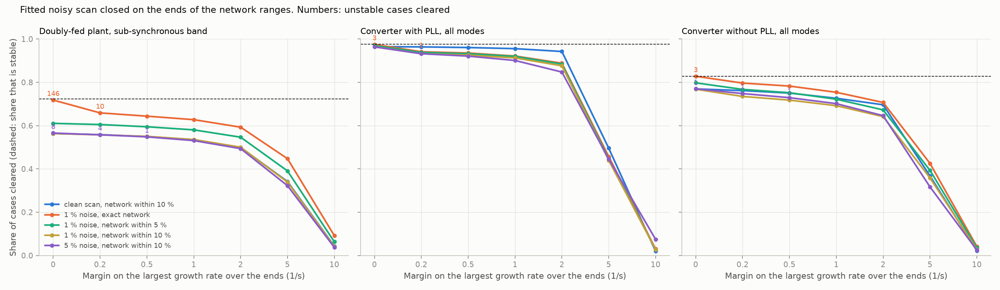

# 24: Scan noise and uncertain network data together

Date: 2026-11-12 · Plan phase: the standing screening question

## Goal

Step 20 sized a margin to the noise on the scan. Step 23 replaced the margin for network data by the ends of the network ranges. A real study has both: a scan with error, and a network known to within a bound. Do the two remedies add, and what does the complete screen clear?

## What was done

- `src/sso_sciml/neterror.py`: `both_case`. A 126-point scan of the plant with noise is fitted by least squares (step 20). The fitted plant is closed on a network that is wrong by up to a bound in each of five quantities, as given and at the 32 ends of the ranges (step 23).
- `scripts/noise_and_ranges.py`: the pass, the results file and one figure.
- `tests/test_neterror.py`: 1 more test.

## Commands

```powershell
uv run scripts/noise_and_ranges.py            # 24,526 cases, about 25 minutes on 8 processes
uv run scripts/noise_and_ranges.py --reuse    # numbers and figure from the saved pass
```

## Setup of the study

- **Cases:** every fourth case of both plant types, as in steps 20 and 23: 9,630 doubly-fed (2,659 unstable in the sub-synchronous band), 11,264 converters with a phase-locked loop (271 unstable), 3,632 without (627 unstable).
- **Five combinations** of scan noise and network bound: clean and 10 %; 1 % and exact; 1 % and 5 %; 1 % and 10 %; 5 % and 10 %.
- **Screen:** the largest growth rate over the 32 ends, less a margin from 0 to 10 1/s. Sub-synchronous band for the doubly-fed plant, all modes for the converters.

## Results

All numbers are in `docs/results/network/noise_and_ranges.json`.



Share of cases cleared at the ends of the ranges, with the unstable cases cleared in brackets.

| Scan noise, network bound | Margin (1/s) | Doubly-fed plant | Converter with PLL | Converter without PLL |
|---|---|---|---|---|
| Share that is stable | | 72.4 % | 97.6 % | 82.7 % |
| Clean, 10 % | 0 | 56.3 % (0) | 96.5 % (0) | 77.0 % (0) |
| 1 %, exact | 0 | 71.8 % (146) | 97.5 % (3) | 82.8 % (3) |
| 1 %, exact | 0.5 | 64.4 % (0) | 93.5 % (0) | 78.3 % (0) |
| 1 %, 5 % | 0 | 61.0 % (0) | 97.0 % (0) | 79.8 % (0) |
| 1 %, 10 % | 0 | 56.4 % (0) | 96.4 % (0) | 76.8 % (0) |
| 5 %, 10 % | 0 | 56.6 % (8) | 96.4 % (0) | 77.0 % (1) |
| 5 %, 10 % | 1 | 53.1 % (0) | 90.1 % (0) | 70.2 % (0) |

- **With 1 % noise the ends of the ranges need no margin on top.** No unstable case is cleared on any plant with the network known to within 5 % or 10 %. The spread over the ends is wider than the error the noise makes, so it covers both.
- **With an exact network the same scan does need a margin:** 146, 3 and 3 unstable cases are cleared without one, none with 0.5 1/s. This is step 20 again.
- **With 5 % noise a margin of 1 1/s on top of the ends is enough.** Step 20 needed 5 1/s for the same noise with an exact network, because it had no other allowance.
- **Noise costs nothing in cleared cases once the ranges are in.** At a bound of 10 % the clean scan clears 56.3 %, 96.5 % and 77.0 %; the scan with 1 % noise clears 56.4 %, 96.4 % and 76.8 %.

### Without the ends

On the network as given, the smallest margin that clears no unstable case is 5 to 10 1/s on every plant in every combination with a network bound, and at that margin 3 % to 51 % of cases are cleared. A margin has to cover the worst case in the whole set; the ends cover each case by its own sensitivity.

## What this says about screening

- **The complete screen, as it now stands.** A 2 × 2 scan of the plant at about a hundred frequencies, good to 1 %. A least-squares fit. The fitted plant closed on the network at the 32 ends of the ranges of its data. The largest growth rate decides, with no margin. For a plant with slow control modes, the phasor-domain model beside it.
- **What it clears with a 1 % scan and a network known to within 10 %:** 56 % of doubly-fed cases against 72 % that are stable in the band, 96.4 % of converters with a phase-locked loop against 97.6 %, and 76.8 % of those without against 82.7 %. No unstable case in 24,526.
- **How little information, in one line.** The plant to 1 % at a hundred frequencies, the network to 10 %. The second is the binding one for the machine, neither is for a converter with a phase-locked loop.
- **Allowances do not stack.** A margin for noise and a spread for network data are both allowances for error in the growth rate. The larger one covers the smaller unless the smaller is of the same size, as at 5 % noise.

## Disagreements

1. **Step 23 said the margin for scan noise goes on top of the ends.** At 1 % noise it is not needed. At 5 % it is, at 1 1/s and not the 5 1/s of step 20.
2. **With 5 % noise and no margin 8 unstable doubly-fed cases and 1 converter case are cleared at the ends.** The fit is off by more than the spread of the ends in those cases.
3. **The ends are safe here because the network error is inside its bound.** As in step 23.
4. **Every fourth case, one noise draw and one network draw per case and combination.**

## Decisions

- The reference screen for a scan with error and a network with ranges is the least-squares fit closed on the 32 ends, with no margin for scan error up to 1 % and 1 1/s at 5 %.
- Margins from steps 20 and 22 apply only where one of the two error sources is absent.

## Next

Structured network error, one outage at a time, which is step 25. Then a source and a load on one bus; control delay and a filter capacitor in the converter. Still open from before: the protection model; a fit whose order grows with the data.
