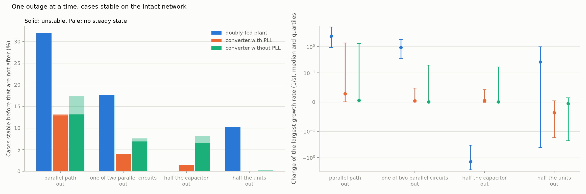
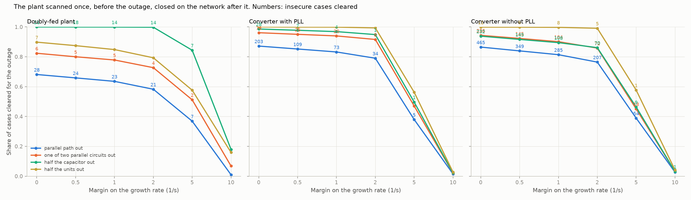

# 25: One outage at a time

Date: 2026-11-12 · Plan phase: the standing screening question

## Goal

Steps 22 to 24 treated the network as known to within a few percent. An outage is not that: a line out changes one quantity by a factor of two or more. Which outage matters for which plant, does a margin on the intact network say anything about the network after an outage, and can one scan of the plant, taken before the outage, serve the network after it?

## What was done

- `src/sso_sciml/outage.py`: for one case and four outages, the modes of the full model at its new steady state after the outage, and the modes of the plant model taken before the outage closed on the network after it.
- `src/sso_sciml/data/c1.py`: `operating_point` accepts a network in place of the one of the case.
- `scripts/outages.py`: the pass over all 98,635 cases, the results file and two figures.
- `tests/test_outage.py`: 4 tests.

## Commands

```powershell
uv run scripts/outages.py            # 98,635 cases, about 20 minutes on 8 processes
uv run scripts/outages.py --reuse    # numbers and figures from the saved pass
uv run pytest tests/test_outage.py
```

## Setup of the study

- **Outages:** the parallel path out (its impedance times 100); one of two parallel circuits out (times 2); half the series capacitor out; half the units of the plant out. Impedances are on the base of the plant in service, so with half the units out every network impedance halves.
- **Cases:** those stable on the intact network: 28,460 of 38,511 doubly-fed (in the sub-synchronous band), 41,096 of 45,056 converters with a phase-locked loop and 11,725 of 15,068 without (all modes).
- **Insecure after an outage:** unstable, or no steady state at all.
- **One scan:** the plant's small-signal model at the steady state before the outage, closed exactly on the network after it. This is what reusing a single admittance scan for every network condition amounts to.

## Results

All numbers are in `docs/results/network/outages.json`.

### Which outage matters



Share of the cases stable before that are insecure after, and the median change of the growth rate in 1/s.

| Outage | Doubly-fed plant | Converter with PLL | Converter without PLL |
|---|---|---|---|
| Parallel path out | 32.0 %, +2.5 | 13.3 %, +0.03 | 17.3 %, +0.01 |
| One of two parallel circuits out | 17.7 %, +0.9 | 4.0 %, 0.00 | 7.6 %, 0.00 |
| Half the capacitor out | 0.1 %, −1.4 | 1.4 %, +0.01 | 8.2 %, 0.00 |
| Half the units out | 10.2 %, +0.3 | 0.0 %, −0.04 | 0.2 %, 0.00 |
| Any of the four | 33.4 % | 13.9 % | 21.5 % |

- **Losing the parallel path is the worst outage for every plant.** A third of doubly-fed cases that are stable with it are unstable without it. The plant is then radial through the compensated line.
- **Half the units out hurts the doubly-fed plant and helps a converter.** With fewer machines the same network is a smaller impedance on their base. For the machine that moves the resonance to where slip is small; for a converter it is a stronger grid.
- **Half the capacitor out cures the doubly-fed plant and can break a converter without a phase-locked loop.** Of the doubly-fed cases unstable on the intact network, 72 % become stable. For the converter the capacitor was holding the voltage up: 8.2 % become insecure, including 1.6 % with no steady state.
- **For the doubly-fed plant every outage shifts every case.** The median shift for the lost path is 2.5 1/s with quartiles of 0.9 and 5.6. For the converters the median shift is near zero and the upper quartile is over 1 1/s: most cases do not notice and some change completely.

### Does a margin before the outage help after it?

Share of cases insecure after losing the parallel path, among those with at least a given margin on the intact network.

| Margin intact (1/s) | Doubly-fed plant | Converter with PLL | Converter without PLL |
|---|---|---|---|
| 0 | 32.0 % | 13.3 % | 17.3 % |
| 2 | 19.1 % | 11.4 % | 13.6 % |
| 5 | 11.8 % | 10.1 % | 10.8 % |
| 10 | 9.2 % | 11.5 % | 8.5 % |

- **No.** A case that decays at 10 1/s on the intact network is insecure after the outage about one time in ten, on every plant. For the converter with a phase-locked loop the margin makes no difference at all.
- **For the smaller outage it helps the doubly-fed plant** (one circuit of two: 17.7 % with no margin, 0.6 % with 5 1/s) and hardly the converters (7.6 % to 2.9 % without a phase-locked loop).
- **An outage has to be studied as its own case.** It is not inside any range of steps 22 to 24, and no margin on the intact case stands in for it.

### One scan for every network condition



The plant model taken before the outage, closed on the network after it. Error of the growth rate near the boundary, and insecure cases cleared with no margin and with 2 1/s, for the lost parallel path.

| | Doubly-fed plant | Converter with PLL | Converter without PLL |
|---|---|---|---|
| Error, median and 95th percentile (1/s) | 0.001, 0.01 | 0.000, 0.32 | 0.005, 2.1 |
| Cases insecure after the outage | 9,097 | 5,459 | 2,033 |
| Insecure cleared, no margin | 28 | 203 | 465 |
| of which with no steady state | 25 | 0 | 119 |
| Insecure cleared, margin 2 1/s | 21 | 34 | 207 |

- **For the doubly-fed plant one scan is enough.** Its steady state is set by rotor speed and power and hardly moves with the network, so the admittance does not move either. The growth rate after the outage is right to 0.01 1/s. Of the 28 insecure cases it clears, 25 have no steady state after the outage, which a power-flow run shows, and 3 are unstable.
- **For a converter one scan is not enough.** Its admittance depends on terminal voltage and reactive current (step 17), and the outage changes both. With a phase-locked loop 203 insecure cases are cleared; without one, 465.
- **A margin recovers part of it for the converter with a phase-locked loop** (34 at 2 1/s, 5 at 5 1/s) and little for the one without (207 and 54).
- **The scan has to be retaken at the operating point after the outage,** or the admittance has to be known as a function of the operating point.

## What this says about screening

- **What the topology says, most plainly so far.** The outage that leaves the plant radial through the compensated line is the one to study, for every plant type. For the doubly-fed plant it is the 2009 pattern: stable with the parallel path, unstable without. Which lines form the parallel path is a question the one-line diagram answers before any model is run.
- **Outages and data error are different problems.** Data error is covered by the ends of a range (step 23). An outage is a different network and needs its own run. A margin on the intact case covers neither.
- **How little information per outage.** For the doubly-fed plant: nothing new on the plant side. One scan, or the hand formula, and the network after the outage. For a converter: a new operating point from the power flow and a scan at it.
- **The phasor-domain model does more work here than expected.** It supplies the operating point after each outage and says whether there is one at all. For the converter without a phase-locked loop 4.2 % of cases have none after losing the parallel path, and that is a result no small-signal screen gives.
- **Units online is an outage in its own right for a machine.** Half the units out makes 10 % of stable doubly-fed cases unstable. Step 05 found the worst case between 35 % and 65 % online; a screen at full output only would miss it.

## Disagreements

1. **The expectation was that a wide margin on the intact network would cover a single outage.** It does not: about one case in ten with a margin of 10 1/s is insecure after losing the parallel path.
2. **"Parallel path out" is modelled as its impedance times 100, not as an open circuit.** The full model has no switch. The path then carries about 1 % of the current.
3. **Half the capacitor out is taken as half the reactance.** A bypassed segment of a two-segment bank. Bypassing all of it was not run; the full model keeps two idle states at 60 Hz when the capacitor is zero.
4. **The controls do not change with the outage.** A plant controller that switches mode on a weak grid, or a remedial scheme that trips units, is not modelled.
5. **Four outages on one network shape.** A real study lists its own.
6. **The doubly-fed plant is judged on the sub-synchronous band.** Its slow mode is the business of the phasor-domain model (step 21) and was not rerun per outage here.

## Decisions

- Each credible outage is a separate case for the screen. No margin on the intact case replaces it.
- For the doubly-fed plant one scan, or the step 14 formula, is reused across outages. For a converter the scan is retaken at each operating point.
- The outage that leaves the plant radial through the series capacitor is always in the list, and so is reduced units online for a machine.

## Next

In the order they bear on the result: the converter's admittance as a function of the operating point, so that one set of scans can serve every outage; a source and a load on one bus; control delay and a filter capacitor in the converter. Still open from before: the protection model; a fit whose order grows with the data.
