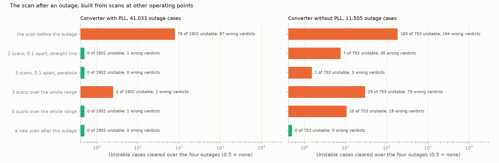
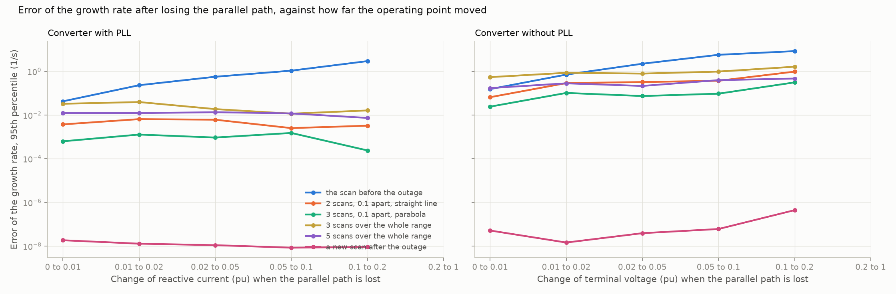

# 26: The converter's admittance as a function of its operating point

> **Restated 2026-11-13 (step 29).** The first pass behind this step took every fourth row of each set, which in a Sobol sequence is a corner of the set and not a sample of it. The pass was rerun on a random quarter (`src/sso_sciml/sampling.py`) and every number below is from the rerun. What changed is listed in `29-restated-with-delay.md`.

Date: 2026-11-12 · Plan phase: the standing screening question

## Goal

Step 25 found that one scan of the doubly-fed plant serves every outage, and one scan of a converter does not: its admittance moves with the operating point, and reusing the scan clears insecure cases. A new scan per outage is the safe answer and the expensive one. How does the admittance depend on the operating point, and how few scans cover the points an outage can reach?

## What was done

- `src/sso_sciml/opscan.py`: the converter scanned at a chosen operating point, and the scan after an outage built from scans at other points in five ways. Each is closed on the network after the outage and compared with the modes of the full model there.
- `scripts/operating_point.py`: the pass over a random quarter of the converter cases with the four outages of step 25, the results file and two figures.
- `tests/test_opscan.py`: 5 tests.

## Commands

```powershell
uv run scripts/operating_point.py            # 15,034 converter cases, about 20 minutes
uv run scripts/operating_point.py --reuse    # numbers and figures from the saved pass
uv run pytest tests/test_opscan.py
```

## Setup of the study

- **The operating point is one number.** At a given power, the admittance of a converter with a phase-locked loop depends on its reactive current, because its terminal voltage is held at 1 pu. Without a phase-locked loop it depends on the terminal voltage, which the network sets. Call the number u.
- **Cases:** a quarter of the converter cases, drawn at random, in and outside the training range together: 11,264 with a phase-locked loop and 3,770 without. Those stable before the outage and with a steady state after it give 41,033 and 11,505 outage cases, 1,902 and 753 of them unstable.
- **Ways to build the scan after the outage:**

| Name | Scans | How |
|---|---|---|
| The scan before the outage | 1 | Used as it is (step 25) |
| Two local scans | 2 | At the u before the outage and 0.1 below; a straight line to the new u |
| Three local scans | 3 | At the u before and 0.1 either side; a parabola |
| Library of 3 | 3 | Evenly over the whole range of u (−0.8 to 0.2 pu of reactive current; 0.65 to 1.0 pu of voltage); straight lines between neighbours |
| Library of 5 | 5 | The same with 5 |
| A new scan | 1 per outage | At the u after the outage |

- **The u after the outage comes from a power-flow solution** on the network after it. The scans are clean, on 251 points.

## Results

All numbers are in `docs/results/network/operating_point.json`.

### One number is enough

A scan taken at the reactive current, or the voltage, that the converter has after the outage gives the growth rate there to better than 10⁻⁶ 1/s at the 95th percentile and no wrong verdict in 52,538 outage cases. So at a given power the admittance is a function of that one number and nothing else about the network.

### How far the operating point moves

Change of u when the parallel path is lost: median, 95th percentile and largest.

| | Median | 95th percentile | Largest |
|---|---|---|---|
| With a phase-locked loop (reactive current, pu) | 0.006 | 0.076 | 0.56 |
| Without (terminal voltage, pu) | 0.006 | 0.073 | 0.27 |

Half the outages barely move the operating point. One in twenty moves it by more than 0.07 pu.

### What each way gets



Over the four outages: unstable cases cleared, and all wrong verdicts.

| | With PLL: unstable cleared of 1,902 | wrong verdicts | Without PLL: unstable cleared of 753 | wrong verdicts |
|---|---|---|---|---|
| The scan before the outage | 78 | 87 | 183 | 194 |
| Two local scans | 0 | 1 | 7 | 30 |
| Three local scans | 0 | 0 | 1 | 3 |
| Library of 3 | 2 | 2 | 29 | 79 |
| Library of 5 | 0 | 1 | 10 | 19 |
| A new scan after each outage | 0 | 0 | 0 | 0 |

- **With a phase-locked loop two scans are enough.** A second scan 0.1 pu of reactive current away, and a straight line, clears no unstable case in 41,033 and flags 1 stable case. Three local scans give no wrong verdict. The library of 3 clears 2 unstable cases.
- **Without a phase-locked loop three local scans come close and do not close it.** They clear 1 unstable case of 753, against 183 for the one scan. The library of 5 is worse than three local scans with more scans, because its points are 0.09 pu apart everywhere and the local ones are where the case is.
- **Error of the growth rate after losing the parallel path, 95th percentile:** with a phase-locked loop 0.33 1/s for one scan, 0.004 for two and 0.0008 for three. Without one 2.0 1/s, 0.21 and 0.06.



- **The error follows the distance moved.** With a phase-locked loop the one scan is off by 0.04 1/s (95th percentile) when the reactive current moves by less than 0.01 pu, by 0.57 between 0.02 and 0.05, and by 3.0 between 0.1 and 0.2. The parabola stays below 0.002 throughout. Without a phase-locked loop the same three figures are 0.16, 2.2 and 8.5 for the one scan and 0.02, 0.07 and 0.31 for the parabola.

## What this says about screening

- **How little information per outage, for a converter.** Not a new scan each time. Two scans of the plant if it has a phase-locked loop, three if it has not, and for each outage one number from the power flow: the reactive current or the terminal voltage afterwards.
- **What the phasor-domain model gives, once more.** That one number. Step 17 said the power-flow solution supplies the operating point; here it is the only thing that has to be recomputed per outage.
- **Why the machine needed none of this.** The doubly-fed plant's steady state is set by rotor speed and power. The converter without a phase-locked loop takes its voltage from the network, so the network reaches into its admittance. The converter with a phase-locked loop sits between: its voltage is held, and only the reactive current that holds it moves.
- **A vendor could supply the dependence.** A scan and its derivative with respect to reactive current, or voltage, is a complete small-signal description at one loading. Scans at several loadings would make it complete.

## Disagreements

1. **Three local scans still clear 1 unstable case without a phase-locked loop,** after the loss of the parallel path. The case was not looked at on its own.
2. **The library was expected to beat local scans, being independent of the case.** It does not at 3 or 5 points. Its spacing is set by the widest case.
3. **Power is fixed in each case.** The admittance also depends on power (step 17: the negative conductance is the power over the voltage squared). A plant that changes its output after an outage needs scans along that axis too.
4. **A new scan after the outage is exact near the boundary and not everywhere.** For a few well-damped modes far from the axis the growth rate read from the scan is off by a few hundredths of 1/s. No verdict is affected.
5. **Scans are clean and the network after the outage is exact.** Steps 20 to 24 apply on top.
6. **This is the generic converter of step 17.** A converter with an AC voltage loop, or one that changes control mode at low voltage, has more than one number in its operating point.

## Decisions

- For a converter the reference across outages is scans at the operating point before the outage and 0.1 pu either side in reactive current or terminal voltage, a parabola to the value from the power flow after each outage, and then the screen of step 24.
- For the doubly-fed plant one scan stays enough (step 25).

## Next

In the order they bear on the result: a source and a load on one bus; control delay and a filter capacitor in the converter; the admittance along the power axis. Still open from before: the protection model; a fit whose order grows with the data.
