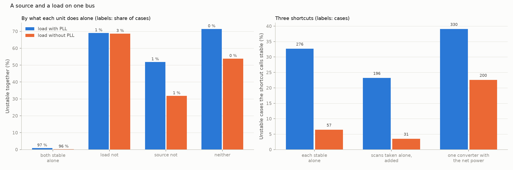
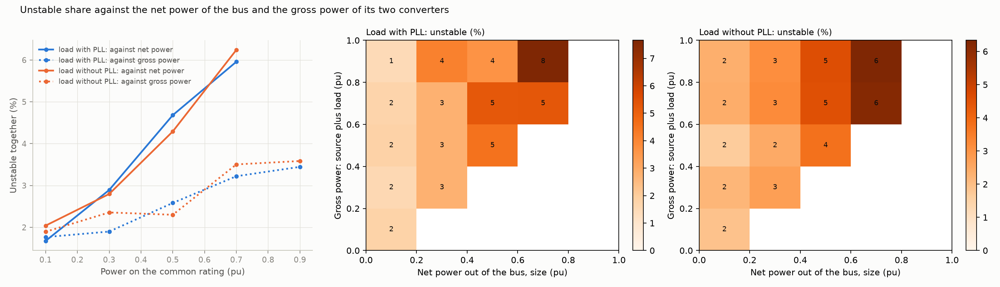

# 27: A source and a load on one bus

Date: 2026-11-12 · Plan phase: the standing screening question

## Goal

Every case so far had one plant on the network (A34). A real bus has several: a wind or solar plant beside a data centre, a drive beside a battery. Does a source next to a load help or hurt, can the pair be judged from what each does alone, and is the net power of the bus the number that matters?

## What was done

- `src/sso_sciml/multi.py`: any number of generic converters on one bus. Each has its own controls, power and share of the common rating. The steady state is solved for the bus, each unit is linearised there, and the units side by side are closed on the network exactly. One unit with a phase-locked loop regulates the bus voltage; the others run at zero reactive current or follow the voltage waveform.
- `scripts/two_converters.py`: 65,536 cases of a source and a load, three shortcuts scored against the pair, the results file and two figures.
- `tests/test_multi.py`: 6 tests.

## Commands

```powershell
uv run scripts/two_converters.py            # 65,536 cases, about 5 minutes on 8 processes
uv run scripts/two_converters.py --reuse    # numbers and figures from the saved pass
uv run pytest tests/test_multi.py
```

## Setup of the study

- **The pair:** a source with a phase-locked loop, which holds the bus at 1 pu, and a load. Two families of 32,768 cases: the load has a phase-locked loop and runs at zero reactive current, or it has none and follows the voltage waveform.
- **Sampling:** two independent draws from the parameter space of dataset C1. The source takes controls, the size of its power and the network from the first. The load takes controls and the size of its power from the second. The source's share of the common rating is between 0.2 and 0.8.
- **Truth:** the largest growth rate of the modes of the two together.
- **Shortcuts:** each unit by itself on the same network is stable; each unit scanned by itself on the network and the two scans added; one converter carrying the net power of the bus, with the controls of whichever unit is larger in power.

## Results

All numbers are in `docs/results/multi/two_converters.json`.

Every case has a steady state. 844 of 32,768 are unstable with a load that has a phase-locked loop (2.6 %) and 885 with one that has not (2.7 %).

### Alone against together



| What each does alone on the same network | Share of cases | Unstable together |
|---|---|---|
| Load with PLL: both stable | 97.2 % | 0.87 % |
| source stable, load not | 1.5 % | 69 % |
| source not, load stable | 1.3 % | 52 % |
| Load without PLL: both stable | 95.6 % | 0.18 % |
| source stable, load not | 3.1 % | 69 % |
| source not, load stable | 1.2 % | 32 % |

- **Two units that are each stable alone can be unstable together.** 276 cases with a load that has a phase-locked loop, 57 with one that has not. Each unit alone sees the whole network; together they share it, and the source has to supply the reactive current that holds the voltage for both.
- **A unit that is unstable alone is often cured by the other.** A source unstable by itself is stable beside the load in 48 % and 68 % of cases. A load unstable by itself is stable beside the source in 31 %.
- **For most pairs the other unit changes little.** Among pairs stable alone, the growth rate together differs from the worse of the two alone by less than 0.01 1/s in half the cases. The 5th and 95th percentiles are −0.14 and +0.05 1/s with a phase-locked loop on the load, −0.51 and +0.09 without.

### The three shortcuts

Unstable cases the shortcut calls stable, of 844 and 885, and stable cases it flags.

| Shortcut | Load with PLL | Load without PLL |
|---|---|---|
| Each stable alone | 276 (33 %), 362 flagged | 57 (6 %), 599 flagged |
| Scans taken alone, added | 196 (23 %), 150 flagged | 31 (4 %), 177 flagged |
| One converter with the net power | 330 (39 %), 850 flagged | 200 (23 %), 933 flagged |

- **None of the three is safe.**
- **Adding scans is right in principle and wrong in practice if the scans are taken alone.** The admittance of the bus is exactly the sum of the units' admittances at the operating point they have together. Scanned alone, the source is at a different reactive current: the difference has a median of 0.03 pu and a 95th percentile of 0.33 pu with a phase-locked loop on the load, 0.06 and 0.51 without. This is step 26 again: the admittance moves with the operating point.
- **The net power of the bus is not a plant.** A single converter carrying the net power misses a quarter to two fifths of the unstable cases and flags more stable ones than any other shortcut.

### Net power and gross power



Share unstable by the size of the net power of the bus: 1.7 %, 2.9 %, 4.7 % and 6.0 % in steps of 0.2 pu with a phase-locked loop on the load; 2.0 %, 2.8 %, 4.3 % and 6.2 % without. By the gross power, source plus load: 1.8 % to 3.4 %, and 1.9 % to 3.6 %.

- **Net power matters more than gross power.** At a given net power the share unstable hardly moves with the gross power. A source and a load do offset each other.
- **They do not cancel.** With a net power below 0.1 pu, where the bus exchanges almost nothing with the network, 1.5 % and 2.0 % of cases are unstable, with a median gross power of 0.36 pu. A screen on net injection would pass all of them.

### Modes between the units

Two identical units at the same operating point have the modes of the one converter they add up to, and a second set: the poles of one unit alone on an ideal voltage (a test). In that second set the units move against each other, draw no net current, and the bus does not move. Those modes do not depend on the network at all. No converter in dataset C1 is unstable alone on an ideal voltage (step 17), so they are stable here. With unlike units the two sets mix.

## What this says about screening

- **The method carries over unchanged, and the shortcuts do not.** Admittance of the bus against impedance of the network: the admittances add. What has to be right is the operating point at which each is taken, and that is the power-flow solution with every unit present.
- **How little information for a bus with several plants.** A scan of each unit, taken or interpolated at its operating point in the joint power flow (step 26), added with their ratings, then the screen of step 24. Nothing about the other units' controls is needed to scan one unit.
- **Screening unit by unit is unsafe in both directions.** It clears pairs that are unstable together and flags units that the neighbour would have steadied.
- **Net injection is a poor proxy.** It ranks the risk and it cannot clear a case: a bus with no net exchange can be unstable.
- **A second kind of mode appears with more than one unit.** The modes between units are invisible from the network side. A scan at the bus terminals would not show them; a scan of each unit would.

## Disagreements

1. **The expectation was that source and load add their negative conductance and that gross power would rank the risk** (step 17: both show −P/V² at low frequency). It does not. Net power ranks it better. A likely reason, not tested: the two negative conductances sit on different axes and in different bands, and the reactive current that the weak-grid instability depends on follows the net flow.
2. **The source regulates the voltage and the load does not.** That is one choice. With the load regulating, or both sharing, the reactive currents and the results would differ. Not tested.
3. **The load alone, when it has a phase-locked loop, is given the regulating role,** as in dataset C1, and loses it beside the source. So "alone" and "together" differ in more than the neighbour for that family.
4. **Both units are at one bus with no impedance between them.** A collector or a transformer between them would loosen the coupling. Not tested.
5. **Two units.** The module takes any number; only pairs were run.
6. **No doubly-fed plant in the pair.** Its admittance could be added in the same way; not run.

## Decisions

- A bus with several plants is screened on the sum of their admittances, each taken at its operating point in the joint power flow. Unit-by-unit screening and net-injection equivalents are recorded as unsafe.
- Assumption A34 (one aggregate converter) is lifted for converters on a common bus.

## Next

In the order they bear on the result: control delay and a filter capacitor in the converter; the admittance along the power axis; impedance between the units, and a doubly-fed plant beside a converter. Still open from before: the protection model; a fit whose order grows with the data.
