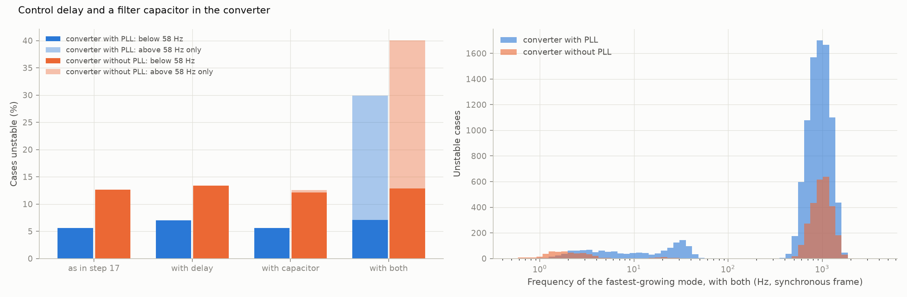
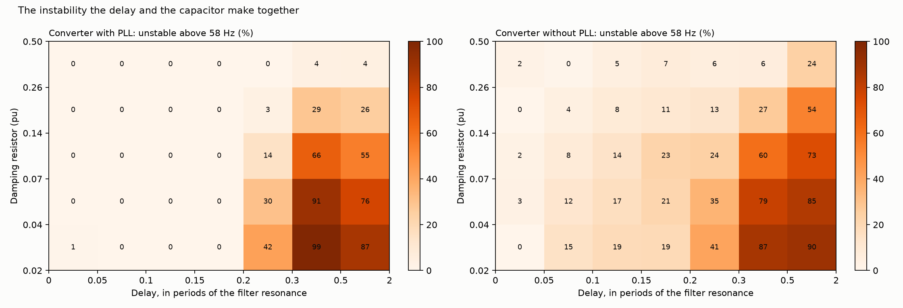
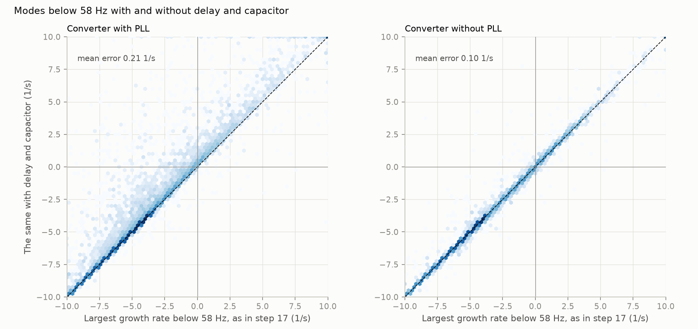

# 28: Control delay and a filter capacitor in the converter

Date: 2026-11-12 · Plan phase: the standing screening question

## Goal

The generic converter of step 17 has no control delay and no filter capacitor (A30). Both are in every real converter. Do they change the results of steps 17 to 27, which are about modes below 58 Hz in the synchronous frame, and what do they add above it? Does the screen built in those steps still work?

## What was done

- `src/sso_sciml/hf.py`: the converter alone with a delay between voltage command and voltage (a second-order Padé approximant per axis, four more states), and a shunt branch at the terminal: a capacitor in series with a damping resistor. With the filter reactor and the network the capacitor forms an LCL filter. Converter and branch side by side are closed on the network exactly.
- `src/sso_sciml/vectorfit.py`: `closed_loop_modes` no longer returns eigenvalues at infinity as finite numbers. See Disagreements.
- `scripts/delay_and_capacitor.py`: every in-range case of dataset C1 as it is, with a delay, with a capacitor, and with both; the results file and three figures.
- `tests/test_hf.py`: 6 tests.

## Commands

```powershell
uv run scripts/delay_and_capacitor.py            # 40,960 cases, about 8 minutes on 8 processes
uv run scripts/delay_and_capacitor.py --reuse    # numbers and figures from the saved pass
uv run pytest tests/test_hf.py
```

## Setup of the study

- **Cases:** the in-range cases of dataset C1: 32,768 with a phase-locked loop, and 8,024 without that have a steady state in every variant.
- **Delay:** the delay times the current-loop bandwidth is drawn between 0.02 and 0.10, so a faster loop has a shorter delay. That gives 0.04 to 2 ms.
- **Capacitor:** 0.02 to 0.10 pu, with a damping resistor of 0.02 to 0.5 pu in series. All three are drawn evenly on a logarithmic scale.
- **Variants:** as in step 17 (which reproduces the dataset to rounding), delay only, capacitor only, both.
- **Bands:** below 58 Hz in the synchronous frame, where steps 17 to 27 worked, and above it.

## Results

All numbers are in `docs/results/hf/delay_and_capacitor.json`.

### Each alone does little. Together they make a new instability



Share of cases unstable, and the part of it that is unstable above 58 Hz.

| | With PLL | above 58 Hz | Without PLL | above 58 Hz |
|---|---|---|---|---|
| As in step 17 | 5.6 % | 0.0 % | 12.6 % | 0.0 % |
| With delay | 7.0 % | 0.0 % | 13.4 % | 0.0 % |
| With capacitor | 5.6 % | 0.0 % | 12.6 % | 0.6 % |
| With both | 29.9 % | 25.7 % | 40.1 % | 33.8 % |

- **Delay alone adds 1.4 points, capacitor alone nothing.** Together they add 24 and 28 points. (Step 30: this is so on an inductive network. With shunt capacitance in the network a delay alone makes 44.5 % and 49.1 % unstable.)
- **The new modes are at the filter resonance.** Their frequency has a median of 930 and 990 Hz, with 90 % between 590 and 1,440 Hz, and it is within about 10 % of the resonance of the capacitor with the filter reactor and the network reactance in half the cases. They grow fast: a median of 127 and 210 1/s.
- **The converter alone is stable in every case, in every variant.** On an ideal voltage the capacitor is shorted and there is no resonance. The instability exists only with the network attached, which is the situation of every result since step 17.

### What decides it



Share unstable above 58 Hz, with a phase-locked loop.

| Delay, in periods of the filter resonance | Below 0.2 | 0.2 to 0.3 | 0.3 to 0.5 | Above 0.5 |
|---|---|---|---|---|
| Share unstable | 0.0 % | 18 % | 58 % | 50 % |

| Damping resistor (pu) | 0.02 to 0.04 | 0.04 to 0.07 | 0.07 to 0.14 | 0.14 to 0.26 | 0.26 to 0.5 |
|---|---|---|---|---|---|
| Share unstable | 46 % | 41 % | 28 % | 12 % | 1.6 % |

- **With a phase-locked loop there is a sharp limit.** If the delay is under a fifth of a period of the filter resonance, 2 of 13,195 cases are unstable. Above it the share climbs to a half. With a delay of one and a half sampling periods, a quarter of a period is a resonance at a sixth of the sampling frequency, the limit known from the design of LCL filters with converter-current feedback.
- **Damping removes it.** With a resistor above 0.26 pu, 1.6 % are unstable.
- **The network sets the resonance and matters second.** 31 % at a short-circuit ratio below 2.1, 19 % above 5.7. A smaller capacitor is worse: 33 % at 0.02 to 0.03 pu, 19 % at 0.07 to 0.10.
- **Without a phase-locked loop there is no sharp limit:** 1.5 % below 0.05 of a period, rising steadily to 65 % above 0.5.

### Do the results below 58 Hz stand?



| | With PLL | Without PLL |
|---|---|---|
| Shift of the largest growth rate below 58 Hz, median (1/s) | 0.001 | 0.005 |
| 95th percentile (1/s) | 1.4 | 0.48 |
| Cases whose verdict below 58 Hz changes | 517 of 32,768 | 66 of 8,024 |
| stable to unstable | 494 | 41 |
| unstable to stable | 23 | 25 |

- **For most cases, yes.** The median shift is a few thousandths of 1/s.
- **For a tail, no, and the delay is why.** Delay alone gives the same 95th percentile, 1.4 1/s; the capacitor alone gives 0.16. With a phase-locked loop 494 cases that step 17 calls stable are unstable below 58 Hz with the delay in: 1.5 % of all cases, and the share unstable there rises from 5.6 % to 7.1 %.
- **So the earlier results were optimistic by about a quarter in the count of unstable cases with a phase-locked loop.** The method is not affected, since a scan of the real converter contains its delay. The numbers of steps 17 to 27 are for a converter with none.

### Does the screen still work?

The rational fit of step 19 on a clean 251-point scan of converter and capacitor together, against the modes with both in.

| | Unstable | Called stable | Stable called unstable |
|---|---|---|---|
| With PLL, scan to 2 kHz | 9,798 | 0 | 81 |
| With PLL, scan to 10 kHz | | 0 | 3 |
| Without PLL, scan to 2 kHz | 3,216 | 0 | 22 |
| Without PLL, scan to 10 kHz | | 0 | 1 |

- **Yes. No unstable case is missed.** The same scan, the same fit and the same closing on the network find the filter-resonance modes with the rest.
- **The scan has to reach past the resonance.** Stopping at 2 kHz flags 81 and 22 stable cases; reaching 10 kHz leaves 3 and 1. No unstable mode in the dataset is above 2 kHz.
- **The converter is no longer passive above the sub-synchronous band.** With both in, 45 % and 48 % of cases have a band of negative conductance above 58 Hz, where step 17 found none above about 20 Hz.

## What this says about screening

- **The screen carries over, with a wider scan.** Admittance of the plant against impedance of the network needs nothing new. The scan must cover the filter resonance, here up to about 1.5 kHz in the synchronous frame.
- **A second thing that cannot be seen from the plant alone.** The slow mode of the doubly-fed plant needed the network's 60 Hz reactance (step 21). The filter resonance needs the network's reactance at a kilohertz. A converter that is stable on a test bench with a stiff source says nothing about either.
- **How little information for the high band.** Three numbers rank it before any scan: the delay, the filter resonance frequency (capacitor, reactor, and network reactance) and the damping. Delay under a fifth of a period of the resonance, or a damping resistor above a quarter per unit, and the high band is nearly always clear.
- **Network data matter here in a different way.** The resonance frequency goes as the square root of the network reactance, and the network model has to be right at a kilohertz, where lines have capacitance and transformers have their own resonances. The network of this project is R, X and a series capacitor. See Disagreements.

## Disagreements

1. **A bug in `closed_loop_modes` was found by this step and fixed.** The base variant here gave 6.3 % unstable where dataset C1 has 5.6 %. The routine solves a generalised eigenvalue problem with algebraic equations, whose eigenvalues at infinity came back in about 0.7 % of cases as finite numbers near 1e18, of either sign. Steps 20 to 26 sorted modes into frequency bands with a bound and were not affected. Step 27 took the largest real part with no bound and was: its numbers are corrected there. The routine now drops anything faster than 1e7 1/s, and a test compares 32 cases with the dataset.
2. **The delay is a second-order Padé approximant.** It is good to about a third of a period of delay. For the longest delays here the resonance is beyond that, so the two right-hand columns of the table of delay against share unstable are less certain than the rest. An exact delay needs the scan or a frequency-domain model.
3. **The network has no shunt capacitance.** Above a few hundred hertz a real line is not a series R and X. The filter-resonance results are for an inductive network and show the mechanism, not the numbers for a real one.
4. **The capacitor has a series damping resistor and the control has no active damping.** Active damping through the capacitor current or a notch filter is the usual cure and is not modelled. Capacitor-voltage feed-forward is in the model; its part in the sharp limit was not separated out.
5. **The delay raised the count of unstable cases below 58 Hz by a quarter.** Not expected: the delays are short against a 20 Hz mode. Which cases change, and why, was not analysed.
6. **The rotation of the frame during the delay is taken as compensated.**
7. **Limits are still left out (A30).**
8. **Corrected in step 30.** `closed_loop_modes` lost accuracy on a plant with a delay, in the second or third decimal place of 1/s. It now rescales the plant states. The pass was rerun: no count changed, and the median shift below 58 Hz is 0.001 and 0.005 1/s where this entry first said 0.003 and 0.013.

## Decisions

- The scan for the screen reaches 10 kHz in the synchronous frame for any converter with a filter capacitor.
- Results of steps 17 to 27 are for a converter without delay. Where a count of unstable cases is quoted from them, it is low by up to a quarter for the family with a phase-locked loop.
- `closed_loop_modes` is bounded at 1e7 1/s. Any new use of it is checked against a model with the same modes.

## Next

In the order they bear on the result: the delay in the main dataset, so that steps 17 to 27 can be restated with it; a network with shunt capacitance for the band above 58 Hz; the admittance along the power axis; impedance between units and a doubly-fed plant beside a converter. Still open from before: the protection model; a fit whose order grows with the data.
