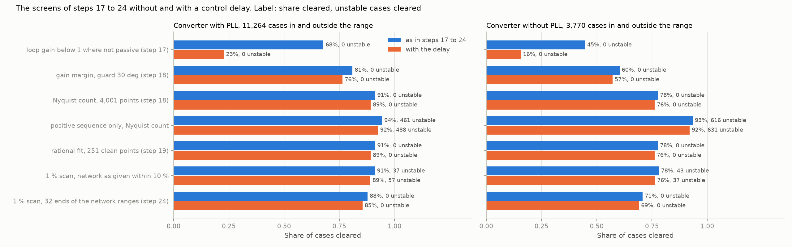

# 29: The converter screens restated with a control delay, and a sampling fault

Date: 2026-11-13 · Plan phase: the standing screening question

## Goal

Step 28 found that a control delay raises the count of unstable converter cases below 58 Hz by about a quarter, and that steps 17 to 27 were run on a converter with none. Do the screens of steps 17 to 24 still clear no unstable case when the delay is in, and what do they clear?

## What was done

- `src/sso_sciml/restate.py`: each converter case evaluated twice, as it is and with the delay step 28 drew for it, no filter capacitor. Seven screens on each: the loop-gain test of step 17, the guarded gain margin and the Nyquist count of step 18, the count on the positive sequence alone, the rational fit of step 19, and the reference screen of step 24 (a 126-point scan with 1 % noise, fitted, closed on a network within 10 %) on the network as given and at its 32 ends.
- `scripts/restate_with_delay.py`: the pass, the results file and one figure.
- `src/sso_sciml/sampling.py`: `part`, a seeded random part of a dataset. See Disagreements 1.
- Every script that took a stride through a dataset now calls `part`. The passes of steps 20, 23, 24 and 26 were rerun and their step entries restated.
- `tests/test_sampling.py`: 2 tests for this step (2 more belong to step 31).

## Commands

```powershell
uv run scripts/restate_with_delay.py            # 15,034 cases on 8 processes
uv run scripts/restate_with_delay.py --reuse    # numbers and figure from the saved pass
uv run pytest tests/test_sampling.py
# the reruns of the earlier steps
uv run scripts/phase3_noise_fits.py; uv run scripts/noise_screens.py     # step 20
uv run scripts/network_corners.py                                        # step 23
uv run scripts/noise_and_ranges.py                                       # step 24
uv run scripts/operating_point.py                                        # step 26
```

## Setup of the study

- **Cases:** a quarter of the converter cases of dataset C1, drawn at random: 11,264 with a phase-locked loop (8,192 in the training range, 3,072 outside) and 3,770 without (2,012 and 1,758) that have a steady state both ways.
- **Delay:** the draw of step 28. Its quartiles are 0.16, 0.28 and 0.52 ms.
- **Stability** is scored on any mode of the full model. With no capacitor there is no filter resonance, so this is the band the earlier steps worked in.
- **A case is cleared** by a screen if the screen calls it stable and the converter alone has no unstable pole.

## Results

All numbers are in `docs/results/hf/restate_with_delay.json`.

### What the delay does to the cases

| | With PLL | Without PLL |
|---|---|---|
| Unstable without the delay | 997 of 11,264 (8.9 %) | 844 of 3,770 (22.4 %) |
| Unstable with it | 1,221 (10.8 %) | 894 (23.7 %) |
| In the training range, without and with | 5.9 %, 7.3 % | 12.9 %, 13.4 % |
| Stable to unstable | 239 | 50 |
| Unstable to stable | 15 | 0 |
| Shift of the largest growth rate within 5 1/s of zero: median, 95th percentile (1/s) | below 0.0001, 2.1 | 0.001, 1.3 |

- **The delay makes cases unstable and almost never cures one.** With a phase-locked loop the count of unstable cases rises by 22 %, without by 6 %.
- **This agrees with step 28,** which found 5.6 % and 7.1 % in the range on all 32,768 cases.
- **Most cases do not move.** The median shift is under 0.01 1/s. One case in twenty near the boundary moves by more than 1 1/s.

### The screens without and with the delay



Share of cases cleared, in and outside the range together, with the unstable cases cleared in brackets.

| Screen | With PLL, no delay | With PLL, delay | Without PLL, no delay | Without PLL, delay |
|---|---|---|---|---|
| Share that is stable | 91.1 % | 89.2 % | 77.6 % | 76.3 % |
| Loop gain below 1 where not passive (step 17) | 67.8 % (0) | 22.7 % (0) | 44.7 % (0) | 15.6 % (0) |
| Gain margin, 30° guard (step 18) | 80.9 % (0) | 76.4 % (0) | 60.3 % (0) | 57.1 % (0) |
| Nyquist count, 4,001 points (step 18) | 91.1 % (0) | 89.2 % (0) | 77.6 % (0) | 76.2 % (0) |
| Nyquist count, positive sequence only | 94.3 % (461) | 92.5 % (488) | 93.4 % (616) | 92.0 % (631) |
| Rational fit, 251 clean points (step 19) | 91.1 % (0) | 89.1 % (0) | 77.6 % (0) | 76.2 % (0) |
| 1 % scan, network as given within 10 % | 91.0 % (37) | 89.0 % (57) | 78.1 % (43) | 76.3 % (37) |
| 1 % scan, 32 ends of the network ranges (step 24) | 87.7 % (0) | 85.5 % (0) | 70.7 % (0) | 69.1 % (0) |

- **Every screen that was safe without the delay is safe with it.** The loop-gain test, the guarded gain margin, the Nyquist count, the rational fit and the reference screen of step 24 clear no unstable case in 15,034, in the range or outside it, either way.
- **The loop-gain test of step 17 loses two thirds of what it cleared.** From 67.8 % to 22.7 % and from 44.7 % to 15.6 %. It asks for a loop gain below 1 wherever the converter is not passive. The likely reason is that the delay takes passivity away over a wide band: step 28 found negative conductance above 58 Hz in nearly half the cases with delay and capacitor. That was not checked here. The test stays safe and stops being useful.
- **The others lose 2 to 5 points,** about what the delay takes from the share that is stable.
- **The reference screen of step 24 holds.** With a 1 % scan and the network within 10 %, the 32 ends clear 85.5 % and 69.1 % with the delay in, against 89.2 % and 76.3 % that are stable. On the network as given the same scan clears 57 and 37 unstable cases.
- **The Nyquist count still agrees with the modes:** in all 11,264 cases with a phase-locked loop, and in all but 2 of 3,770 without, both with the delay.
- **The rational fit flags a few stable cases with the delay:** 0.02 % and 0.17 % of the stable ones. Without the delay it flags none.
- **The positive sequence alone still misses 40 % to 73 % of the unstable cases.**

### In the range and outside it

With the delay the reference screen clears 89.5 % in the range and 74.7 % outside with a phase-locked loop, and 81.9 % and 54.4 % without. It clears no unstable case in either. The share unstable outside the range is 20 % and 36 %.

## What this says about screening

- **The method did not depend on the delay.** A screen that works on the measured admittance needs nothing to be told about what is inside the converter. This was argued in step 28 and is now counted.
- **A passivity argument does.** The cheapest converter screen, loop gain below 1 where the converter is not passive, rests on the converter being passive over most of the band. A real converter with a delay is not. The guarded gain margin is the cheapest screen that survives.
- **The reference screen is unchanged:** plant to 1 % at a hundred frequencies, network to 10 %, 32 ends, no margin.

## Disagreements

1. **A stride through a Sobol dataset is not a sample of it. Steps 20, 23, 24 and 26 were run on a corner of the converter dataset.** Every fourth row of the converter sets with a phase-locked loop has 271 unstable cases in 11,264 (2.4 %, step 20 as first written); a random quarter has 997 (8.9 %). The datasets are scrambled Sobol sequences, in which the low bits of the row index set the high bits of every coordinate. Every fourth row of the set with a phase-locked loop keeps only sources at a short-circuit ratio above 3.46; of the set without, only loads under 0.55 pu at a ratio below 3.46 (`tests/test_sampling.py`). The four steps took every fourth row. Steps that took every row (17 to 19, 21, 22, 25, 27, 28) are not affected. The passes were rerun on a random quarter and the four entries restated; what changed is listed below.
2. **What the rerun changed in the earlier steps.**
   - Converter case counts: 997 unstable of 11,264 with a phase-locked loop, where the corner had 271; 844 of 3,770 without, where it had 627 of 3,632. The doubly-fed numbers move by a point or two (the sets outside the range were affected, the range itself was not).
   - Step 20: at 1 % noise a margin of 0.5 1/s still clears no unstable case on the doubly-fed plant or the converter without a phase-locked loop. With a phase-locked loop it clears 1 of 997, at every margin up to 5 1/s: the fit has no mode where the true one is.
   - Step 23: unchanged in kind. The 32 ends clear no unstable case at any bound. They clear 58 %, 88 % and 70 % at a bound of 10 %, where the corner gave 56 %, 97 % and 77 %.
   - Step 24: at 1 % noise the ends still need no margin at a bound of 10 %. At a bound of 5 % one doubly-fed case of 2,556 is cleared. At 5 % noise the margin on top is 1 1/s for the doubly-fed plant and the converter without a phase-locked loop, and 5 1/s with one, where the corner gave 1 1/s for all.
   - Step 26: unchanged in kind. Two local scans with a phase-locked loop clear no unstable case of 1,902; three without one clear 1 of 753, where one reused scan clears 183.
3. **The loop-gain test of step 17 was the reference screen of that step and clears 23 % and 16 % on a converter with a delay.** Step 18 had already replaced it by the guarded gain margin for other reasons.
4. **Why the delay destabilises a mode near 20 Hz was not analysed.** Still open from step 28.
5. **The delay is a second-order Padé approximant** (step 28). The delays here are short against the band, so the approximant is good.
6. **A quarter of the cases, one noise draw and one network draw per case.**
7. **Corrected in step 30.** `closed_loop_modes` lost accuracy on a plant with a delay and now rescales the plant states. The pass was rerun: no count changed; the median shifts in the first table were 0.0005 and 0.006 1/s before.

## Decisions

- Any part of a dataset is taken with `sampling.part`. No strides.
- The loop-gain test of step 17 is dropped as a screen for converters. The guarded gain margin of step 18 is the pointwise screen.
- The reference screen of step 24 stands for a converter with a delay.
- Counts of unstable converter cases in steps 20, 23, 24 and 26 are the restated ones.

## Next

In the order they bear on the result: a network with shunt capacitance for the band above 58 Hz; the admittance along the power axis; impedance between units and a doubly-fed plant beside a converter. Still open from before: the protection model; a fit whose order grows with the data.
