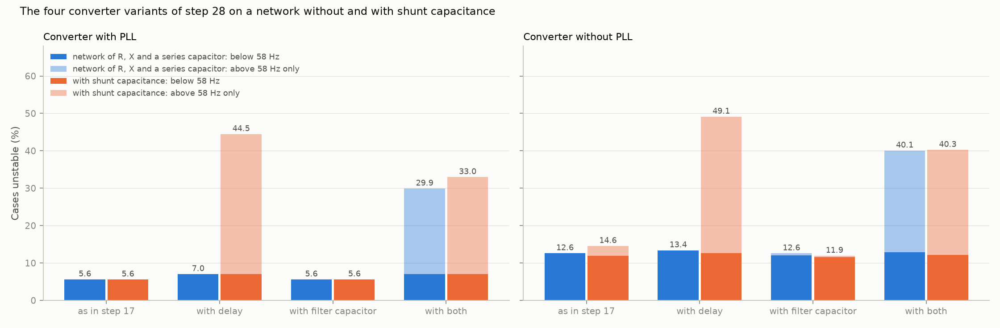
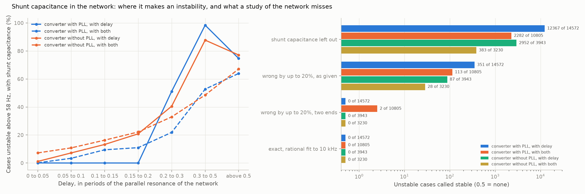

# 30: A network with shunt capacitance

Date: 2026-11-13 · Plan phase: the standing screening question

Written after step 31, which was ready first.

## Goal

Step 28 found an instability at the filter resonance of the converter, on a network that is a series R and X with a series capacitor. Above a few hundred hertz a real network is not that: lines have charging capacitance and collector systems have cables. Does shunt capacitance in the network change the result of step 28 or the results below 58 Hz, and what must a study know about it?

## What was done

- `src/sso_sciml/shunt.py`: a lossless shunt capacitor on the plant bus, between the transformer and the two paths to the infinite bus. Steady state, network impedance and the modes of plant and network together, each with the capacitor in. The four converter variants of step 28 on the network without and with it, and four ways a study might treat it.
- `src/sso_sciml/vectorfit.py`: `closed_loop_modes` now rescales the plant states before the eigenvalue solve. See Disagreements 1.
- `scripts/shunt_capacitance.py`: the pass, the results file and two figures.
- `tests/test_shunt.py`: 4 tests. `tests/test_hf.py`: 1 more.
- Steps 28 and 29 rerun with the corrected routine.

## Commands

```powershell
uv run scripts/shunt_capacitance.py            # 40,960 cases, about 15 minutes on 8 processes
uv run scripts/shunt_capacitance.py --reuse    # numbers and figures from the saved pass
uv run pytest tests/test_shunt.py tests/test_hf.py
uv run scripts/delay_and_capacitor.py; uv run scripts/restate_with_delay.py    # the reruns
```

## Setup of the study

- **Cases:** the in-range cases of dataset C1, as in step 28: 32,768 with a phase-locked loop and 8,024 without that have a steady state in every variant.
- **Shunt capacitor:** a susceptance of 0.01 to 0.30 pu on the plant base, drawn evenly on a logarithmic scale (A38). With the inductances on the plant bus (line and parallel path one way, transformer and filter reactor the other) it makes a parallel resonance at 330 to 2,080 Hz in 90 % of cases, median 814 Hz.
- **Converter variants:** as in step 17, with a delay, with a filter capacitor, with both. Delay, filter capacitor and damping resistor are the draws of step 28.
- **Ways a study might treat the capacitance,** for the two variants with a delay. The plant is exact in all four.

| Name | Network model |
|---|---|
| Left out | R, X and series capacitor only, as in every step before this |
| Wrong by up to 20 %, as given | The susceptance off by a factor drawn within 20 % either way |
| Wrong by up to 20 %, two ends | The same, evaluated at both ends of its range; the larger growth rate decides |
| Exact, rational fit | The fit of step 19 on a 251-point scan to 10 kHz |

## Results

All numbers are in `docs/results/hf/shunt_capacitance.json`.

### A delay alone is enough once the network has capacitance



Share of cases unstable, network without and with shunt capacitance, and in brackets the share unstable above 58 Hz with it.

| | With PLL: without | with | Without PLL: without | with |
|---|---|---|---|---|
| As in step 17 | 5.6 % | 5.6 % (0.0 %) | 12.6 % | 14.6 % (3.1 %) |
| With delay | 7.0 % | 44.5 % (41.8 %) | 13.4 % | 49.1 % (44.4 %) |
| With filter capacitor | 5.6 % | 5.6 % (0.0 %) | 12.6 % | 11.9 % (0.4 %) |
| With both | 29.9 % | 33.0 % (29.9 %) | 40.1 % | 40.3 % (35.3 %) |

- **Step 28 said a delay alone does little. That was true of the network, not of the converter.** On a network with shunt capacitance a converter with a delay and no filter capacitor is unstable in 44.5 % and 49.1 % of cases, where it was in 7.0 % and 13.4 %.
- **The new modes sit at the parallel resonance of the network.** Their frequency has a median of 1,035 and 1,104 Hz, and it is within 10 % of the resonance of the shunt capacitor with the inductances on the plant bus in half the cases.
- **The delay supplies the negative damping and any capacitance supplies the resonance.** In step 28 the capacitance was the converter's own filter. Here it is the network's.
- **With a filter capacitor already in, the network's capacitance moves the instability more than it adds to it.** With a phase-locked loop it makes 2,710 cases unstable above 58 Hz and cures 1,355; without one 515 and 392. The share goes from 29.9 % to 33.0 % and from 40.1 % to 40.3 %.
- **The converter alone is stable in every case, in every variant,** as in step 28.
- **Without a phase-locked loop 3.1 % of cases are unstable above 58 Hz with no delay at all,** at a median of 1,546 Hz and only with the smallest capacitances (10 % of cases at 0.01 to 0.02 pu, none above 0.08 pu).

### What decides it



Share unstable above 58 Hz, converter with a delay and no filter capacitor.

| Delay, in periods of the parallel resonance | Below 0.2 | 0.2 to 0.3 | 0.3 to 0.5 | Above 0.5 |
|---|---|---|---|---|
| With PLL | 0.0 % | 51 % | 98 % | 75 % |
| Without PLL | 1 % to 21 % | 41 % | 88 % | 77 % |

| Shunt susceptance (pu) | 0.01 to 0.02 | 0.02 to 0.04 | 0.04 to 0.08 | 0.08 to 0.15 | 0.15 to 0.30 |
|---|---|---|---|---|---|
| With PLL | 60 % | 53 % | 44 % | 32 % | 21 % |
| Without PLL | 67 % | 62 % | 45 % | 31 % | 19 % |

- **The limit of step 28 holds with the network's resonance in place of the filter's.** With a phase-locked loop no case is unstable while the delay is under a fifth of a period of the parallel resonance, and nearly every case is between 0.3 and 0.5 of a period.
- **Less capacitance is worse.** It puts the resonance higher, where the same delay is a larger part of a period.
- **Network strength matters little** (38 % at a short-circuit ratio below 2.1, 44 % above 5.7, with a phase-locked loop). The damping resistor of the filter does not enter, since there is no filter capacitor in this variant.
- **Without a phase-locked loop there is again no sharp limit.**

### Below 58 Hz

| | With PLL | Without PLL |
|---|---|---|
| Shift of the largest growth rate below 58 Hz, median (1/s) | 0.0005 | 0.005 |
| 95th percentile (1/s) | 0.2 | 0.6 |
| Cases whose verdict below 58 Hz changes, by variant | 49 to 73 of 32,768 | 53 to 64 of 8,024 |

- **The results of steps 17 to 29 below 58 Hz stand.** Shunt capacitance changes the verdict there in 0.2 % of cases with a phase-locked loop and under 1 % without, in both directions.

### What a study must know about the capacitance

Unstable cases called stable, then stable cases called unstable.

| Network model | With PLL, delay (14,572 unstable) | With PLL, both (10,805) | Without PLL, delay (3,943) | Without PLL, both (3,230) |
|---|---|---|---|---|
| Shunt capacitance left out | 12,367, 4 | 2,282, 1,228 | 2,952, 4 | 383, 304 |
| Wrong by up to 20 %, as given | 351, 352 | 113, 150 | 87, 88 | 28, 24 |
| Wrong by up to 20 %, two ends | 0, 1,385 | 2, 491 | 0, 345 | 0, 121 |
| Exact, rational fit to 10 kHz | 0, 0 | 0, 1 | 0, 0 | 0, 1 |

- **A network model without shunt capacitance misses 85 % and 75 % of the unstable cases** of a converter with a delay, and 21 % and 12 % when the converter has a filter capacitor of its own.
- **A value within 20 % misses 1 % to 2 %.** Taking the two ends of its range misses none in three of the four columns and 2 of 10,805 in the fourth, and flags 2 % to 8 % of the stable cases.
- **With the capacitance known the screen works as before.** The rational fit on a scan to 10 kHz misses no unstable case in 32,550 and flags 2 stable ones.

## What this says about screening

- **Above 58 Hz the network's capacitance is not a refinement. It is the case.** A study on an inductive network model finds most converters with a delay stable that are not. Every result of this project above 58 Hz before this step is conditional on the network having no capacitance there.
- **The screen needs no new method, only one more network quantity.** Plant admittance against network impedance, with the shunt capacitance in the impedance and its range among the ends. The 32 ends of step 23 become 64.
- **Three numbers still rank it before any scan:** the delay, the lowest parallel resonance the plant sees (the network's or the filter's), and the damping there. With a phase-locked loop, a delay under a fifth of a period of every such resonance clears the band above 58 Hz. A delay of 0.3 ms meets that up to 670 Hz.
- **What the topology says alone.** The frequency of the parallel resonance is a property of the network and the reactors, with no control data. It tells where to look. Whether it is unstable needs the delay.
- **Below 58 Hz none of this matters,** which is why the earlier steps could do without it.

## Disagreements

1. **`closed_loop_modes` lost accuracy on a plant with a delay. Found by the tests of this step and fixed.** The delay states carry coefficients up to 1e10 beside states of order 1, and the generalised eigenvalue solve returned the least-damped mode wrong in the second or third decimal place of 1/s. The routine now rescales the plant states first and agrees with the zeros of the loop determinant to 1e-6 (a test). Steps 28 and 29 were rerun. No count of stable or unstable cases changed in either. The median shift of the growth rate that a delay makes below 58 Hz is smaller than first reported: 0.001 and 0.005 1/s in step 28, where it said 0.003 and 0.013. Both entries are corrected. Plants without a delay (steps 20 to 27 and 31) were right to 1e-9 before and are not affected.
2. **Step 28 concluded that a delay alone changes little.** It holds only on an inductive network. Corrected here and noted there.
3. **The two ends of the range are not a strict bound:** 2 unstable cases of 10,805 are stable at both ends and unstable between. The same was found for the 32 ends in step 23.
4. **The capacitor is one lumped, lossless element on the plant bus.** A real line is distributed and has several resonances; a cable has losses that rise with frequency. The range of 0.01 to 0.30 pu is a choice, not data (A38). The shares of unstable cases are for this choice. The mechanism and the failure of the inductive model do not depend on it.
5. **The delay is a second-order Padé approximant** (step 28). Above about a third of a period it is no longer accurate, so the two right-hand columns of the delay table are less certain.
6. **3.1 % of cases without a phase-locked loop are unstable near 1.5 kHz with no delay.** Not expected of a converter with no delay. The fast voltage measurement of that family (A32) is the likely cause. Not analysed.
7. **No active damping in the converter,** as in step 28. A converter designed for a network with cables would have it.
8. **The plant is exact and the scan is clean.** Steps 20 to 24 apply on top; scan noise at a kilohertz was not studied.

## Decisions

- Above 58 Hz the network model includes its shunt capacitance, and the capacitance is one of the uncertain quantities whose ends are evaluated.
- A result above 58 Hz from an inductive network model is not used.
- `closed_loop_modes` rescales the plant. Any plant with states of very different size is checked against the loop determinant.

## Next

In the order they bear on the result: impedance between units and a doubly-fed plant beside a converter (step 32, since done); the protection model. Still open from before: a fit whose order grows with the data; why a short delay destabilises a mode near 20 Hz; an exact delay and a distributed line above 58 Hz.
