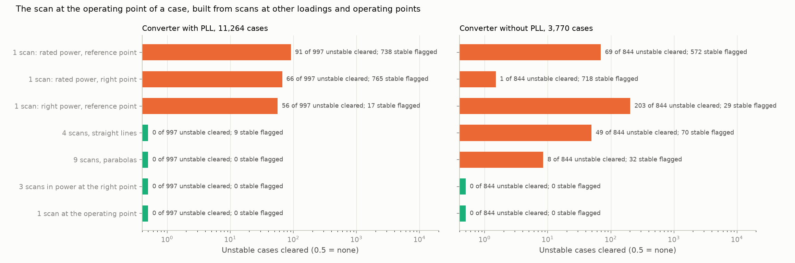
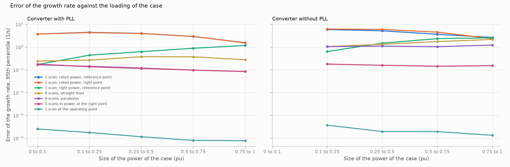

# 31: The converter's admittance along the power axis

Date: 2026-11-13 · Plan phase: the standing screening question

Step 30 (a network with shunt capacitance) has not been done. This step was ready first.

## Goal

Step 26 fixed the power of each case and found that the admittance of a converter then depends on one number u: the reactive current with a phase-locked loop, the terminal voltage without. A plant does not run at one power. How does the admittance move with power, and how few scans cover every loading and operating point?

## What was done

- `src/sso_sciml/poweraxis.py`: the converter alone scanned at a chosen power and u, and the scan at the operating point of a case built from scans elsewhere in seven ways. Each is closed on the network of the case with the rational fit of step 19 and compared with the modes of the full model.
- `scripts/power_axis.py`: the pass, the results file and two figures.
- `tests/test_sampling.py`: 2 tests (Lagrange weights; the scan at the case gives its growth rate).

## Commands

```powershell
uv run scripts/power_axis.py            # 15,034 cases, about 6 minutes on 8 processes
uv run scripts/power_axis.py --reuse    # numbers and figures from the saved pass
uv run pytest tests/test_sampling.py
```

## Setup of the study

- **Cases:** a random quarter of the converter cases of dataset C1, in and outside the training range together: 11,264 with a phase-locked loop (997 unstable) and 3,770 without (844 unstable). No outage; the question is the operating point of the case itself.
- **Where the cases are.** With a phase-locked loop the power is from −1 to 1 pu and 9.9 % of cases are below 0.1 pu in size; the reactive current is between −0.39 and 0.11 pu in 98 % of cases. Without one the cases are loads of 0.1 to 1 pu at a terminal voltage between 0.73 and 1.00 pu in 98 % of cases.
- **Scans** are clean, on 251 points, of the converter alone. Power keeps its sign: a source is built from source scans, a load from load scans.
- **Ways to build the scan at the case:**

| Name | Scans | Where |
|---|---|---|
| Rated power, reference point | 1 | 1 pu, zero reactive current or 1 pu voltage: the usual single scan |
| Rated power, right point | 1 | 1 pu, the u of the case |
| Right power, reference point | 1 | The power of the case, the reference u |
| 4 scans, straight lines | 4 | 0.1 and 1 pu of power, the two ends of the range of u (−0.5 and 0.2 pu of reactive current; 0.7 and 1.0 pu of voltage) |
| 9 scans, parabolas | 9 | 0.1, 0.55 and 1 pu, three values of u |
| 3 scans in power at the right point | 3 | 0.1, 0.55 and 1 pu at the u of the case; a parabola in power |
| 1 scan at the operating point | 1 | The power and u of the case |

## Results

All numbers are in `docs/results/network/power_axis.json`.



Error of the growth rate for modes within 5 1/s of zero (median, 95th percentile, in 1/s), unstable cases cleared and stable cases flagged.

| | With PLL: error | cleared of 997 | flagged | Without PLL: error | cleared of 844 | flagged |
|---|---|---|---|---|---|---|
| Rated power, reference point | 0.17, 10 | 91 | 738 | 0.81, 19 | 69 | 572 |
| Rated power, right point | 0.17, 10 | 66 | 765 | 1.2, 26 | 1 | 718 |
| Right power, reference point | 0.0003, 0.63 | 56 | 17 | 0.07, 4.5 | 203 | 29 |
| 4 scans, straight lines | 0.0009, 0.11 | 0 | 9 | 0.09, 2.7 | 49 | 70 |
| 9 scans, parabolas | 0.00006, 0.013 | 0 | 0 | 0.03, 1.3 | 8 | 32 |
| 3 scans in power at the right point | 0.00005, 0.014 | 0 | 0 | 0.00006, 0.025 | 0 | 0 |
| 1 scan at the operating point | below 10⁻⁷ | 0 | 0 | below 10⁻⁷ | 0 | 0 |

- **The scan at rated power is wrong about one case in fourteen with a phase-locked loop and one in six without.** It clears 91 and 69 unstable cases and flags 738 and 572 stable ones. Its error at the 95th percentile is 10 and 19 1/s.
- **Power matters more than u with a phase-locked loop, and both matter without.** With one, the right power at the reference u brings the 95th percentile from 10 to 0.63 1/s; the right u at rated power changes nothing. Without one, neither alone is enough: the right power at 1 pu of voltage clears 203 unstable cases, more than the rated scan.
- **The admittance is smooth in power. Three scans cover the axis.** A parabola through scans at 0.1, 0.55 and 1 pu, taken at the u of the case, gives no wrong verdict in 15,034 cases and the growth rate to 0.014 and 0.025 1/s at the 95th percentile.
- **It holds below the lowest scan.** A tenth of the cases with a phase-locked loop are below 0.1 pu, where the parabola is carried beyond its points. The error there is 0.03 1/s.
- **With a phase-locked loop a fixed grid works:** 9 scans give no wrong verdict in 11,264 cases, 4 scans clear no unstable case and flag 9 stable ones.
- **Without one a fixed grid in voltage does not.** 9 scans, with voltages 0.15 pu apart, clear 8 unstable cases and flag 32. The same three powers at the right voltage give none. The voltage axis is the hard one, as in step 26, where scans 0.1 pu apart left 1 unstable case cleared.



- **The rated scan is worst at light load.** With a phase-locked loop its error at the 95th percentile is 14 to 20 1/s below 0.5 pu and 2.4 1/s above 0.75 pu. A study at rated power says least about the plant at low output.
- **The right power at the reference u is worst at heavy load:** 0.03 1/s below 0.1 pu and 1.4 1/s above 0.75 pu with a phase-locked loop. The reactive current matters in proportion to the loading.

## What this says about screening

- **How little information covers every operating point of a converter.** With a phase-locked loop: 9 scans (three loadings, three reactive currents) for sources and 9 for loads, taken once, and for each case two numbers from the power flow. Without one: three loadings, and at each a set of voltages closer than 0.1 pu, or scans retaken at the voltage of the case.
- **What the phasor-domain model gives, again.** The power and the reactive current or voltage. They select the admittance; they say nothing of stability themselves.
- **One scan at rated power is not a conservative choice.** It errs both ways, and mostly at light load. Practice that scans at rated output and applies the result across the operating range has no margin that covers this: the error is 10 1/s at the 95th percentile.
- **A vendor description that is complete, for this converter:** admittance on a grid of power and one more number, smooth enough for parabolas in power.

## Disagreements

1. **The fixed grid in voltage fails for the converter without a phase-locked loop** (8 unstable cases cleared with 9 scans). Step 26 found the same axis hard at a spacing of 0.1 pu. A finer grid in voltage was not run, so the count of scans that would do is not known.
2. **"Rated power, right point" is no better than the reference point with a phase-locked loop and clears far fewer unstable cases without one (1 against 69) while flagging more stable ones.** Not analysed.
3. **Scans are clean and the network is exact.** Steps 20 to 24 apply on top. An error of 0.014 to 0.025 1/s from the parabola is small against the 0.06 1/s per percent of scan noise.
4. **No delay and no filter capacitor.** Step 29 found the screens unchanged in kind by the delay; the smoothness in power was not checked with it.
5. **Source and load scans are kept apart.** A parabola through zero power, joining the two, was not tried.
6. **This is the generic converter of step 17,** with one number besides power in its operating point. A converter with an AC voltage loop or a mode change at low voltage has more.
7. **A quarter of the cases.**

## Decisions

- For a converter the reference across loadings is scans at 0.1, 0.55 and 1 pu of power with a parabola between, at the reactive current or voltage of the case. With a phase-locked loop a 3 × 3 grid taken once serves; without one the voltage is handled as in step 26.
- A single scan at rated power is not used for any other loading.

## Next

In the order they bear on the result: a network with shunt capacitance for the band above 58 Hz (step 30); impedance between units and a doubly-fed plant beside a converter. Still open from before: the protection model; a fit whose order grows with the data; why a short delay destabilises a mode near 20 Hz.
