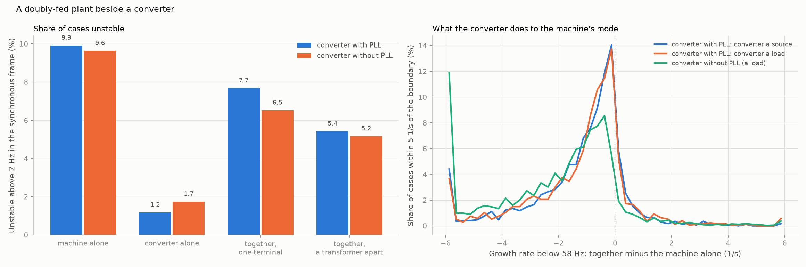
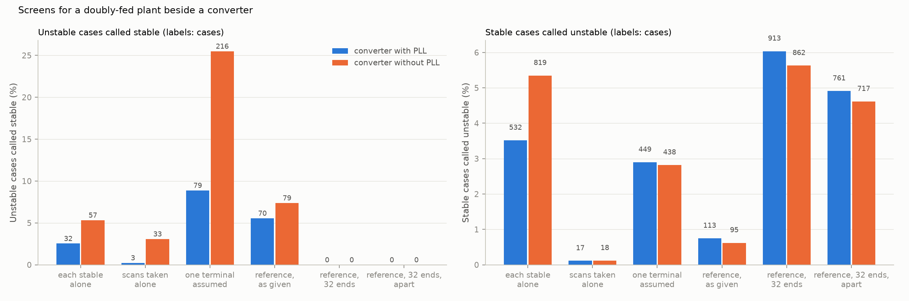

# 32: A doubly-fed plant beside a converter

Date: 2026-11-13 · Plan phase: the standing screening question

## Goal

Step 27 put two converters on one bus. Two things were left: a doubly-fed plant in the pair, and impedance between the units. Does a converter next to a doubly-fed plant help or hurt its sub-synchronous mode, does the reference screen of step 24 hold for the pair, and does it matter whether the two share a terminal?

## What was done

- `src/sso_sciml/beside.py`: a doubly-fed plant (System B2, full controls) and a generic converter on one network. The plant is linearised at any terminal voltage and turned into the common frame. The joint steady state is solved, and any number of units, each behind its own impedance, are closed on the network exactly (`modes`).
- `scripts/machine_beside_converter.py`: 32,768 pairs in two layouts, four shortcuts and the reference screen scored against the pair, the results file and two figures.
- `tests/test_beside.py`: 6 tests. The plant alone through this route has the modes of the full model of dataset T1; the converter alone those of dataset C1; two converters at one terminal those of step 27.

## Commands

```powershell
uv run scripts/machine_beside_converter.py            # 32,768 cases, about 20 minutes on 8 processes
uv run scripts/machine_beside_converter.py --reuse    # numbers and figures from the saved pass
uv run pytest tests/test_beside.py
```

## Setup of the study

- **The pair:** a doubly-fed plant holding zero reactive power at its terminal, and a converter. Two families of 16,384 cases: the converter has a phase-locked loop, is a source or a load in equal parts and holds its terminal at 1 pu; or it has none, is a load and follows the voltage waveform.
- **Sampling:** machine, controls and rotor speed of the plant from the parameter space of dataset T1. Converter controls, power and the network from an independent draw of dataset C1. The plant's share of the common rating is between 0.2 and 0.8.
- **Two layouts.** At one terminal: both units on one bus behind one transformer of 0.10 pu, as in step 27. A transformer apart: each unit behind its own transformer of 0.10 pu on its own rating, meeting at the plant bus. The two transformers in parallel are again 0.10 pu on the common rating.
- **Truth:** the largest growth rate of the modes of the two together above 2 Hz in the synchronous frame. The slow mode below 2 Hz is reported separately (step 21).
- **Reference screen:** each unit scanned at the joint steady state, 126 points with 1 % noise, fitted, the fits closed on a network within 10 %, as given and at its 32 ends. A transformer apart, the fifth network quantity is the two transformers.

## Results

All numbers are in `docs/results/multi/machine_beside_converter.json`. One case of 32,768 has no steady state.

### The converter steadies the machine more often than not



| Share of cases unstable above 2 Hz | Converter with PLL | Converter without PLL |
|---|---|---|
| The plant alone on the network | 9.9 % | 9.6 % |
| The converter alone | 1.2 % | 1.7 % |
| Together, at one terminal | 7.7 % (1,259 cases) | 6.5 % (1,069) |
| Together, a transformer apart | 5.4 % | 5.2 % |

| What each does alone | Share of cases | Unstable together |
|---|---|---|
| Converter with PLL: both stable | 89.3 % | 0.22 % (32 cases) |
| plant stable, converter not | 0.8 % | 42 % |
| plant not, converter stable | 9.6 % | 71 % |
| Converter without PLL: both stable | 88.8 % | 0.39 % (57 cases) |
| plant stable, converter not | 1.5 % | 43 % |
| plant not, converter stable | 9.4 % | 57 % |

- **Every unstable case is below 58 Hz.** The unstable mode is the plant's sub-synchronous one, at a median of 25 and 24 Hz in the synchronous frame. No case is unstable above 58 Hz.
- **A plant unstable alone is stable beside the converter in 28 % and 43 % of cases.** A plant stable alone is unstable beside it in 0.6 % and 1.1 %.
- **The converter lowers the growth rate of the plant's mode in 86 % and 91 % of cases near the boundary.** The median shift is −0.75 and −1.5 1/s. The 5th and 95th percentiles are −5.2 and +0.8, and −8.6 and +0.6 1/s.
- **It does not matter whether the converter is a source or a load.** The median shift is −0.76 and −0.74 1/s.
- **It matters how large the converter is.** With the plant at 20 % to 40 % of the rating the median shift is −1.6 and −3.3 1/s; at 60 % to 80 % it is −0.4 and −0.8.
- **A slower current loop steadies more.** Median shift −0.95 1/s in the lowest third of current-loop bandwidth and −0.49 in the highest, with a phase-locked loop; −2.0 and −1.2 without.
- **The slow mode is another matter.** It is unstable in 1.8 % of cases for the plant alone. Beside a converter with a phase-locked loop that stays 1.8 %. Beside one without it is 3.5 %.

### The shortcuts and the reference screen



Unstable cases called stable, of 1,259 and 1,069, then stable cases flagged. Both units at one terminal.

| Screen | Converter with PLL | Converter without PLL |
|---|---|---|
| Each stable alone | 32 (2.5 %), 532 flagged | 57 (5.3 %), 819 flagged |
| Scans taken alone, set side by side | 3 (0.2 %), 17 flagged | 33 (3.1 %), 18 flagged |
| Reference, network as given | 70 (5.6 %), 113 flagged | 79 (7.4 %), 95 flagged |
| Reference, 32 ends | 0, 913 flagged (6.0 %) | 0, 862 flagged (5.6 %) |

- **The reference screen holds for the pair.** At the 32 ends it clears no unstable case in 32,767. It clears 86.7 % and 88.2 % of cases, where 92.3 % and 93.5 % are stable.
- **The network as given is not enough,** as in steps 23 and 24: 70 and 79 unstable cases cleared.
- **Unit by unit is unsafe both ways,** as in step 27, and mostly on the cautious side here: it flags 532 and 819 pairs that are stable together.
- **Scans taken alone are nearly right with a phase-locked loop on the converter and not without.** The converter with a phase-locked loop holds 1 pu in both, so the plant's steady state hardly moves. Without one the voltage is what the network gives, and it differs.
- **The slow band.** The fits at the ends call no case stable whose slow mode is unstable (293 and 578 cases), and flag 77 and 182 whose slow mode is stable. Step 21 found the fit unreliable there for the plant alone; here it erred only on the cautious side.

### One terminal or a transformer apart

| | Converter with PLL | Converter without PLL |
|---|---|---|
| Stable at one terminal, unstable apart | 79 | 216 |
| Unstable at one terminal, stable apart | 449 | 438 |
| Shift of the growth rate near the boundary, median (1/s) | −1.3 | −1.4 |
| Size of the shift: median, 95th percentile (1/s) | 1.4, 4.8 | 1.9, 8.0 |
| Taken to be at one terminal: unstable called stable | 79 (8.9 %) | 216 (25.5 %) |
| Reference, as given: unstable called stable | 61 (6.9 %) | 70 (8.3 %) |
| Reference, 32 ends: unstable called stable, stable flagged | 0, 761 | 0, 717 |

- **The layout moves the growth rate by more than the neighbour does.** A median of 1.4 and 1.9 1/s, against 0.75 and 1.5 for the converter being there at all.
- **Apart is steadier on balance and not always.** With its own transformer the plant has 0.10 pu on its own rating in its path, which is 0.10 pu divided by its share on the common rating. At one terminal the 0.10 pu is shared. More reactance in the plant's path lowers the resonance frequency. That is the same direction as fewer units online in steps 05 and 25, and like there it is not monotonic.
- **A study that puts both at one terminal when they are not misses 9 % and 26 % of the unstable cases.**
- **The reference screen needs the layout and nothing else new.** With each unit scanned at its own terminal and the transformers among the uncertain network quantities, the 32 ends clear no unstable case and clear 89.9 % and 90.5 %, where 94.6 % and 94.8 % are stable.

## What this says about screening

- **The method carries over to a machine beside a converter.** Scans of each unit at the joint steady state, the fits closed on the network at the ends of its ranges. No unstable case cleared in 32,767 pairs in either layout.
- **The instability is still the plant's.** A converter on the bus is a shunt branch across the series resonance. In most cases it damps it, more so when it is large and its current loop is slow. That fits a converter that looks like a resistance below its current-loop bandwidth; the resistance was not computed here.
- **Screening the plant alone is cautious more often than unsafe,** and still unsafe: 32 and 57 pairs are unstable where both units are stable alone.
- **What the topology says alone.** Whether units share a terminal is one line of a single-line diagram and it decides more than the neighbour's controls do. The plant's own series reactance up to the first common bus belongs in the network model.
- **Net power of the bus does not enter.** Source or load makes no difference to the plant's mode.

## Disagreements

1. **The expectation was that a converter beside the plant would add negative damping** (steps 17 and 27: both families show negative conductance at low frequency). On the plant's sub-synchronous mode it mostly does the opposite. The negative conductance of a converter is near 0 Hz in the synchronous frame; the plant's mode is 20 to 30 Hz from there.
2. **The two layouts are not the same network for the plant.** They have the same short-circuit strength at the common rating, and the plant's own path has more reactance when apart. So the comparison shows what a study gets wrong by merging terminals, and does not separate the effect of unequal terminal voltages from the effect of reactance.
3. **Why the converter damps the mode was not derived.** The dependence on share and on current-loop bandwidth supports the resistance reading and does not prove it.
4. **The slow mode beside a converter without a phase-locked loop is unstable twice as often.** Not analysed. Without a regulating unit the bus voltage is not held, and the plant's outer loops see a weaker network.
5. **Nine cases in each family have a unit with an unstable pole on an ideal voltage.** They are counted like the others.
6. **The plant holds zero reactive power and the converter with a phase-locked loop holds the voltage.** One choice, as in step 27.
7. **One doubly-fed plant as one aggregate machine (A16), no control delay in the converter, an inductive network.** Steps 29 and 30 apply on top.
8. **One noise draw and one network draw per case.**

## Decisions

- A bus with a doubly-fed plant and a converter is screened as in step 27: each unit scanned at the joint steady state, closed on the network at the ends of its ranges.
- Units that do not share a terminal are not merged. The impedance from each unit to the first common bus is part of the network model and one of its uncertain quantities.
- Assumption A34 is lifted for a machine beside a converter and for units a transformer apart.

## Next

The protection model (step 33, since done). Still open from before: a fit whose order grows with the data; why a short delay destabilises a mode near 20 Hz; an exact delay and a distributed line above 58 Hz; why a converter damps the plant's sub-synchronous mode and what it does to the slow mode. After that the branch closes and Phase 6 starts.
