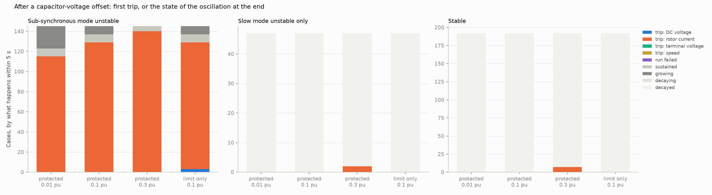
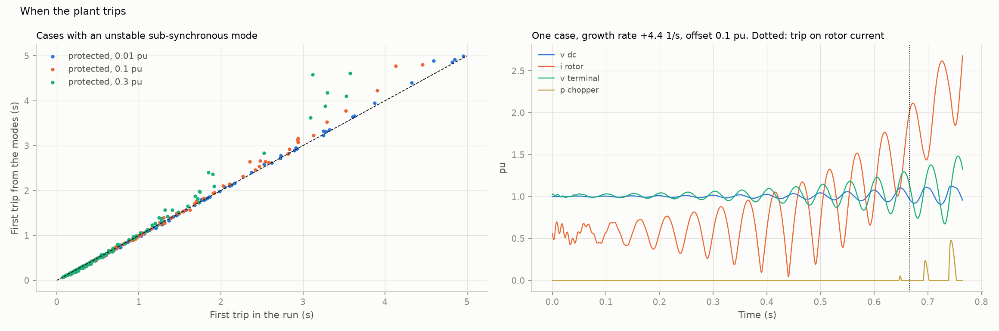

# 33: Protection, and what happens after the first limit

Date: 2026-11-13 · Plan phase: the standing screening question

## Goal

Step 16 limited the rotor voltage of the doubly-fed plant and nothing else. Once the limit acted the plant ran away, and the step left open what a plant with real protection does. With a current limit, anti-windup and a DC chopper in the model: does a growing oscillation settle into a limit cycle, or does the plant trip, on what, and when? Does a case that is stable by its modes stay stable after a large disturbance?

## What was done

- `src/sso_sciml/physics/dfig_full.py`: a limit on the rotor current reference, anti-windup on the current and outer integrators, and a DC chopper. Each is off by default and then leaves the equations exactly as they were.
- `src/sso_sciml/protection.py`: the settings, a time-domain run that records eight quantities and keeps going when one case of the batch fails, and the trip conditions read off a run.
- `scripts/protection.py`: four runs, the same from the modes, the results file and two figures.
- `tests/test_protection.py`: 6 tests.

## Commands

```powershell
uv run scripts/protection.py            # four runs of 5 s on 384 cases, 5 minutes each on the GPU
uv run scripts/protection.py --reuse    # numbers and figures from the saved runs
uv run pytest tests/test_protection.py tests/test_dfig_full.py
```

## Setup of the study

- **Cases:** 384 of the T1 test fold, full 25-state model. 145 have an unstable sub-synchronous mode (growth rate 0.2 to 14 1/s, median 3.4). 47 are unstable only in the slow mode of step 21 (median 0.2 1/s). 192 are stable.
- **Disturbance:** the series capacitor voltage 0.01, 0.1 and 0.3 pu off its steady value. RK4, 0.5 ms step, 5 s.
- **Protection in the model (A39):** rotor voltage command limited to 0.4 pu (step 16); rotor current reference limited to 1.5 pu (0.92 pu at most in steady state); integrators held back while a limit acts; a chopper that starts to conduct at a DC voltage of 1.10 pu and carries rated power at 1.15 pu.
- **Trips, read off the run:** DC voltage outside 0.75 to 1.25 pu; rotor current above 2 pu, where a crowbar would fire; terminal voltage outside 0.8 to 1.2 pu for 0.1 s; speed outside 0.65 to 1.35 pu. The plant is not disconnected in the model, so nothing after the first trip is used.
- **A fourth run** at 0.1 pu has the rotor voltage limit only, which is the model of step 16.
- **From the modes:** the linear response to the same offset, with no time stepping, read for the same trips.

## Results

All numbers are in `docs/results/phase3/protection.json`.

### There is no limit cycle. The plant trips



Cases with an unstable sub-synchronous mode, 145.

| Offset | Tripped within 5 s | First trip | Time of the trip: median, 95th percentile (s) | Still connected |
|---|---|---|---|---|
| 0.01 pu | 115 | rotor current, all | 1.07, 3.7 | 22 growing, 8 changing by under 10 % in half a second |
| 0.1 pu | 129 | rotor current, all | 0.67, 2.9 | 8 and 8 |
| 0.3 pu | 140 | rotor current, all | 0.41, 3.3 | 0 and 5 |

- **No case with an unstable sub-synchronous mode settles.** It trips, or it is still growing at 5 s. The few that change slowly at the end are near the boundary: their swing in line current is 0.03, 0.32 and 0.61 pu at the three offsets, so it follows the size of the disturbance and is not set by a limit.
- **The first trip is rotor overcurrent in every case.** The oscillation is in the rotor current itself, which the current controller cannot hold at that frequency. A limit on the reference does not limit the current.
- **In half the cases the trip comes before any limit acts** (50, 66 and 69 of those that trip). In the rest a limit acts first, by 0.03 to 0.05 s at the median.
- **Protection in the converter does not change when the plant trips.** With the rotor voltage limit only, the same 129 cases trip at 0.1 pu, at a median of 0.67 s and a 95th percentile of 2.9 s.
- **The chopper buys little.** With the rotor current trip left out, the DC voltage trips 126 cases at a median of 0.85 s with the chopper and 128 at 0.78 s without it.
- **The slow mode does nothing in 5 s.** None of the 47 cases trips at 0.01 or 0.1 pu; the sub-synchronous swing decays and the slow mode has not had time to grow.

### The modes give the time of the trip



| Offset | Trips in the run, also from the modes | Error of the time: median, 95th percentile (s) | Median, relative | Modes late by more than 0.1 s |
|---|---|---|---|---|
| 0.01 pu | 115, 115 | 0.003, 0.05 | 0.5 % | 1 |
| 0.1 pu | 129, 129 | 0.004, 0.21 | 1.0 % | 11 |
| 0.3 pu | 140, 136 | 0.005, 0.48 | 2.1 % | 17 |

- **The time of the trip follows from the modes to 1 % or 2 % at the median.** That is closer than the 8 % of step 16, because rotor current reaches its trip level while the response is still nearly linear, and the DC voltage of step 16 did not.
- **The error is one-sided where it is large.** The modes are early by 2 ms at the median and late in 17 % to 29 % of cases. For slowly growing cases after a large offset they are late by up to half a second, and 4 cases at 0.3 pu trip in the run and not from the modes within 5 s.
- **The level of the trip matters to this.** At 1.5 pu the median error is 0.002 s and the modes are late in 3 % to 9 % of cases. At 3 pu it is 0.02 to 0.03 s and they are late in half. With no rotor current trip at all, the DC voltage trips and the modes are late in three quarters of cases, by 0.05 to 0.07 s at the median.

### Stable cases stay stable

| Offset | Stable cases tripped, of 192 | The rest |
|---|---|---|
| 0.01 pu | 0 | all decay |
| 0.1 pu | 0 | all decay |
| 0.3 pu | 7, in the first 9 ms | all decay |

- **No stable case turns into a growing oscillation,** at any offset. No limit acts in any of them at 0.01 or 0.1 pu.
- **The 7 trips at 0.3 pu are the disturbance, not an instability.** The first swing of rotor current after an offset that large passes 2 pu. The modes give the same 7 cases at the same time.

## What this says about screening

- **The small-signal verdict is the verdict.** Unstable by the modes means the plant trips. Stable by the modes means it rides through any disturbance that does not trip it in the first cycle. In 384 cases and three sizes of disturbance nothing nonlinear changed which side a case was on.
- **Protection decides how an unstable case ends, not whether it is one.** No limit, anti-windup or chopper turned an unstable case into a tolerable one. A screen has no reason to model them.
- **The quantity a planner can use is still a time,** and it is the time to rotor overcurrent: the growth rate, the size of the first swing of rotor current and the trip level. Shorten it for slow cases after a large disturbance, where the estimate runs late.
- **Two more plant numbers are worth asking for:** the rotor overcurrent level and whether it trips or fires a crowbar. Step 16 named the DC capacitance; with a chopper in, the DC link is no longer first.
- **A time-domain model is still needed for what follows a crowbar firing or a trip:** ride-through, reconnection, what the rest of the network does when the plant is gone. That is outside a screen.

## Disagreements

1. **Step 16 found the DC link giving way first.** It did not watch the rotor current. With a trip at 2 pu the rotor current is first in every case here, and in 126 of 129 even without a chopper. At 3 pu and no chopper the DC voltage is first in 37 of 129. The order depends on the levels.
2. **The plan expected a limit cycle once protection was modelled.** There is none in this model. A crowbar that fires and releases could make one; it is not modelled.
3. **All levels are round figures, not a manufacturer's (A39).** The result that the trip time follows from the modes weakens as the trip level rises.
4. **The crowbar and the trip are not acted on.** The run goes on past the first trip and that part is not used. What a crowbar does to the oscillation is not known from this step.
5. **The slow mode was not followed to its end.** At 0.2 1/s it needs tens of seconds. Step 21 holds that it is a phasor-domain question.
6. **One kind of disturbance.** An offset of capacitor voltage excites the sub-synchronous mode directly. A fault and its clearing would also move the operating point.
7. **The doubly-fed plant only.** The generic converter of step 17 has no limits in its model.
8. **The grid-side converter has no current limit.** Whether its current stays within a rating before the trip was not checked.

## Decisions

- The screen stays small-signal. Limits and protection are not part of it.
- The time a planner is given is the time to rotor overcurrent from the modes, shortened for slow cases.
- Behaviour after a crowbar fires or the plant trips stays out of scope.
- The standing screening question is closed here. Its open items are listed below and are not on the plan's path.

## Next

Phase 6, the loss-against-feature comparison. Left open on this branch: a fit whose order grows with the data; why a short delay destabilises a mode near 20 Hz; an exact delay and a distributed line above 58 Hz; why a converter damps the plant's sub-synchronous mode and what it does to the slow mode; a crowbar in the model.
