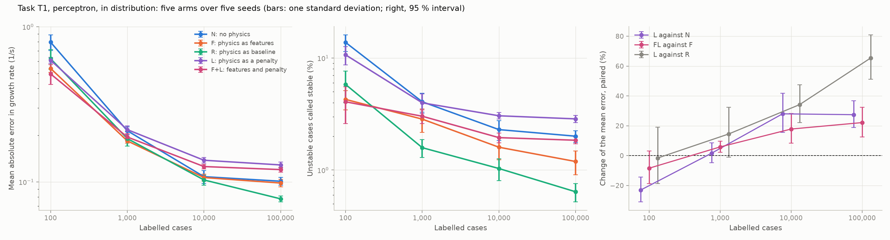
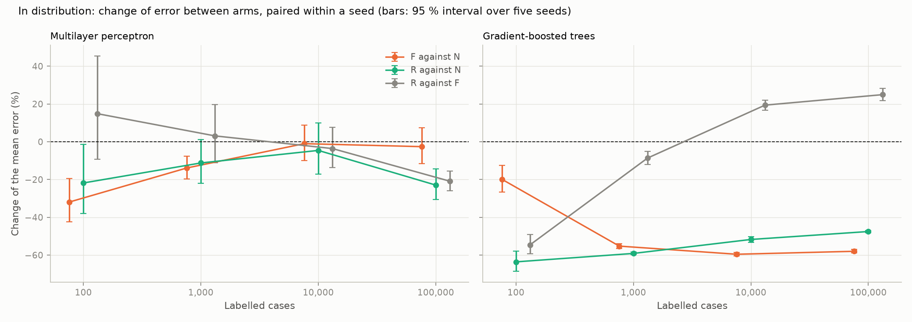
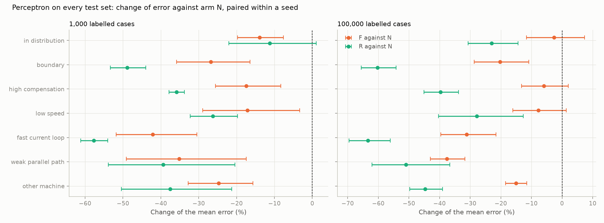
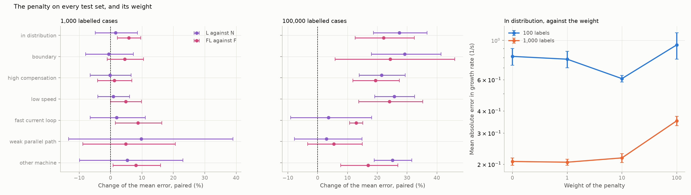
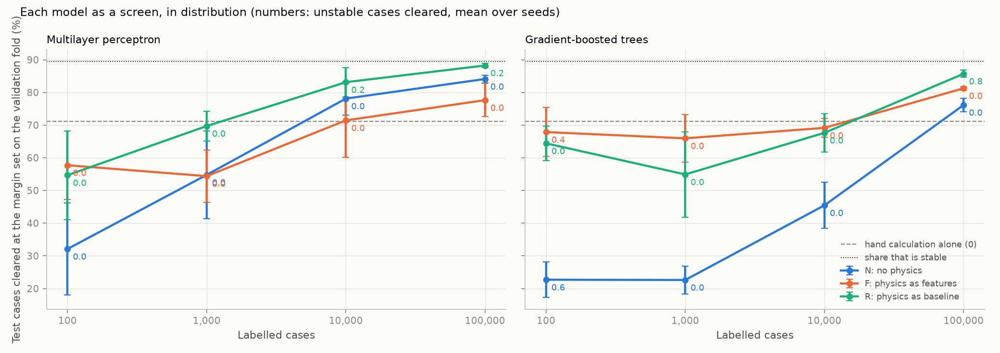

# 34: Phase 6 on task T1: five arms, five seeds, paired

Date: 2026-11-13 · Plan phase: 6 (first part)

## Goal

The plan's central comparison on task T1: the same physical knowledge used nowhere (N), as inputs (F), as the baseline (R), as a penalty in training (L), and as inputs and penalty together (F+L). Which use helps, at which data budget and on which test set, and is the difference larger than the spread between seeds?

Arm A of the plan is a neural ODE and has no form for T1, which has no time in it. It is run on T2 (step 36).

## What was done

- `src/sso_sciml/models/compare.py`: data loading shared by the Phase 6 scripts, a model scored as a screen, and paired intervals over seeds.
- `scripts/phase6_compare.py`: arms N, F and R, perceptron and trees, four budgets, five seeds.
- `scripts/phase6_loss_arms.py`: arms L and F+L, the same network with the penalty off, the penalty at two other weights, and arm L with no labels.
- `tests/test_compare.py`: 3 tests.

## Commands

```powershell
uv run scripts/phase6_compare.py       # 120 training runs, 10 minutes
uv run scripts/phase6_loss_arms.py     # 105 training runs, 56 minutes
uv run pytest tests/test_compare.py tests/test_models_t1.py
```

## Setup of the study

- **Task, data and models** are those of step 09: dataset T1, a perceptron of 4 layers of 256 trained for 4,000 steps, gradient-boosted trees of 600 iterations, nothing tuned per arm.
- **Arm L** is the network of step 13 with two outputs, growth rate and frequency. Its penalty is the squared smallest singular value of `A(θ) − λ̂ I` on 10,000 training cases whose state matrix is known and whose eigenvalues are not. Weight 10, the best of step 13.
- **Arm F+L** has the inputs of arm F and the same penalty.
- **Budgets** of 100, 1,000, 10,000 and 100,000 labelled cases. **Five seeds.** A seed fixes the labelled subset and the initial weights and is shared by every arm.
- **Statistics.** Every difference between two arms is taken within a seed. The change of the error is the mean of the five log ratios, with a 95 % interval (Student t, 4 degrees of freedom). An interval that excludes zero is marked.
- **A model as a screen.** A margin is set on the validation fold (13,106 cases) so that no unstable case there is predicted below minus the margin. The score is the share of test cases predicted below it, and the unstable cases among them. The hand calculation alone is scored the same way.

## Results

Numbers are in `docs/results/phase6/comparison.json` (arms N, F, R) and `docs/results/phase6/loss_arms.json` (arms L and F+L, and every paired difference against them).

### In distribution



Mean absolute error in growth rate, 1/s, perceptron, mean over five seeds. The hand calculation alone gives 1.27.

| Arm | 100 cases | 1,000 | 10,000 | 100,000 |
|---|---|---|---|---|
| N | 0.80 | 0.214 | 0.108 | 0.101 |
| F | 0.54 | 0.184 | 0.107 | 0.098 |
| R | 0.62 | 0.190 | 0.103 | 0.078 |
| L | 0.61 | 0.217 | 0.138 | 0.129 |
| F+L | 0.50 | 0.195 | 0.126 | 0.120 |

Change of the error, paired, with its 95 % interval. Marked where the interval excludes zero.

| | 100 cases | 1,000 | 10,000 | 100,000 |
|---|---|---|---|---|
| F against N | **−32 %** [−42, −19] | **−14 %** [−20, −8] | −1 % [−10, +9] | −3 % [−12, +7] |
| R against N | **−22 %** [−38, −1] | −11 % [−22, +1] | −5 % [−17, +10] | **−23 %** [−31, −14] |
| R against F | +15 % [−9, +45] | +3 % [−11, +20] | −4 % [−14, +8] | **−21 %** [−26, −16] |
| L against N | **−23 %** [−31, −14] | +2 % [−5, +9] | **+28 %** [+16, +42] | **+27 %** [+19, +37] |
| F+L against F | −8 % [−19, +3] | **+6 %** [+2, +10] | **+18 %** [+8, +28] | **+22 %** [+13, +32] |



- **Features help with little data and stop helping at 10,000 cases.** The gain of arm F is 32 % at 100 cases and 14 % at 1,000, both clear of the seed spread, and nothing after.
- **The baseline helps at both ends.** Arm R is 22 % better than arm N at 100 cases and 23 % better at 100,000. In between its interval includes zero.
- **The penalty helps at 100 cases and hurts from 10,000.** Arm L is 23 % better than arm N at 100 labels, level at 1,000, and 27 % to 28 % worse with more. The same holds against its own network with the penalty off (−25 %, +5 %, +20 %, +23 %), so it is the penalty and not the second output.
- **Features and penalty together are no better than features alone.** At 100 cases the difference is inside the seed spread; from 1,000 cases the penalty costs 6 % to 22 %.
- **Arm L costs five times the training time** (45 s against 9 s) and needs 10,000 state matrices, each 96 % of the cost of a label (step 13).
- **With no labels arm L is useless,** as in step 13: 11.8 1/s, every unstable case called stable, on five seeds.
- **For trees the physics matters at every budget.** Arms F and R cut the error by 48 % to 64 % against arm N everywhere except arm F at 100 cases (20 %), every interval clear of zero.

### The weight of the penalty

| Weight | 100 labels | 1,000 labels |
|---|---|---|
| 0 | 0.81 | 0.207 |
| 1 | 0.78 | 0.206 |
| 10 | 0.61 | 0.217 |
| 100 | 0.94 | 0.352 |

Against the weight of 0: a weight of 1 changes nothing (−4 % [−8, +1] and −1 % [−4, +2]); a weight of 100 makes it worse by 15 % [+3, +30] and 70 % [+57, +84]. There is one decade of weight in which the penalty helps, and only at 100 labels.

### Every test set





Mean absolute error at 100,000 cases, 1/s, with the share of unstable cases called stable in brackets.

| Test set | Hand calculation | N | F | R | L | F+L |
|---|---|---|---|---|---|---|
| In distribution | 1.27 | 0.101 (2.0 %) | 0.098 (1.2 %) | 0.078 (0.6 %) | 0.129 (2.9 %) | 0.120 (1.8 %) |
| Boundary | 1.98 | 0.162 (40.5 %) | 0.129 (33.0 %) | 0.064 (21.8 %) | 0.210 (42.0 %) | 0.161 (38.2 %) |
| High compensation | 2.01 | 0.41 (3.0 %) | 0.39 (3.2 %) | 0.25 (2.3 %) | 0.50 (4.4 %) | 0.47 (4.1 %) |
| Low speed | 2.81 | 0.43 (3.7 %) | 0.40 (4.9 %) | 0.32 (2.5 %) | 0.54 (4.8 %) | 0.50 (6.5 %) |
| Fast current loop | 1.90 | 0.55 (0.5 %) | 0.37 (1.0 %) | 0.20 (0.8 %) | 0.56 (0.4 %) | 0.42 (1.0 %) |
| Weak parallel path | 1.98 | 0.36 (5.1 %) | 0.22 (1.7 %) | 0.18 (0.6 %) | 0.37 (3.3 %) | 0.24 (1.6 %) |
| Other machine | 1.26 | 0.136 (1.1 %) | 0.116 (0.7 %) | 0.075 (0.4 %) | 0.171 (2.0 %) | 0.135 (1.3 %) |

- **Arm R is the best arm on every test set at 100,000 cases,** by 23 % to 63 % against arm N, every interval clear of zero. At 1,000 cases it is already ahead on every set outside the distribution (26 % to 58 %), where in distribution it is not yet.
- **Arm F helps outside the distribution where the hand calculation moves with the parameter that left its range:** 31 % for a fast current loop and 38 % for a weak parallel path at 100,000 cases. At high compensation and low speed its interval includes zero.
- **Arm L does not extrapolate better than arm N.** At 100 labels it is better on six of the seven sets, by 10 % to 25 %. At 1,000 labels no set differs. At 100,000 it is 21 % to 29 % worse on five sets and level on two.

### Each model as a screen



Share of test cases cleared at the margin set on the validation fold, with the unstable cases among them (mean over seeds), at 100,000 cases.

| Test set (unstable cases) | Hand calculation, margin 3.3 1/s | N, 1.9 | F, 3.4 | R, 0.5 | L, 4.5 |
|---|---|---|---|---|---|
| In distribution (1,376) | 71.1 %, 0 | 84.1 %, 0.0 | 77.6 %, 0.0 | 88.2 %, 0.2 | 71.2 %, 0.0 |
| High compensation (1,476) | 37.1 %, 2 | 54 %, 6.2 | 46 %, 4.6 | 63 %, 17.6 | 38 %, 3.0 |
| Low speed (920) | 48.2 %, 4 | 71 %, 3.0 | 64 %, 4.4 | 75 %, 11.6 | 55 %, 3.4 |
| Fast current loop (2,276) | 22.5 %, 0 | 32 %, 0.0 | 26 %, 0.0 | 42 %, 1.8 | 20 %, 0.0 |
| Weak parallel path (1,017) | 48.0 %, 0 | 68 %, 0.0 | 58 %, 0.0 | 72 %, 0.4 | 50 %, 0.0 |
| Other machine (538) | 66.3 %, 0 | 81 %, 0.0 | 74 %, 0.0 | 86 %, 0.0 | 67 %, 0.0 |

- **In distribution a trained model clears more than the hand calculation at the same safety.** Arm N clears 84.1 % with no unstable case on any seed, against 71.1 %; 89.5 % of the test fold is stable. Arm R clears 88.2 % and lets one unstable case through on one seed of five.
- **The margin does not carry outside the distribution.** At high compensation and low speed every screen clears unstable cases, the hand calculation among them (2 and 4). Arm R, the most accurate arm, clears the most: 17.6 and 11.6.
- **Arm R needs the smallest margin and is the least safe with it.** Its margin of 0.5 1/s is fitted closely to the validation fold and leaves nothing for a shift.
- **Arm F as a screen is worse than arm N at the large budgets** (77.6 % against 84.1 %), though its mean error is the same. Its margin is larger: one unstable case predicted far below zero sets it.

## Hypotheses

Verdicts for task T1. The report of step 37 sets them beside task T2.

1. *With little data, F and R beat N by a wide margin.* Holds at 100 cases for the perceptron (32 % and 22 %) and at every budget for trees (48 % to 64 %). For the perceptron it is gone by 10,000 cases.
2. *F and R degrade where the hand calculation is invalid, and R more than F.* Rejected. Outside the distribution arm R degrades least on every set, and both keep a larger advantage over arm N there than inside.
3. *L extrapolates better than N in directions the residual covers, at several times the cost.* Rejected for T1. The cost is five times. The gain exists only at 100 labels and is no larger outside the distribution than inside.
5. *With abundant data the arms converge in distribution and differ only outside it.* Half right. Arms N and F converge. Arm R stays 23 % lower and arm L 27 % higher at 100,000 cases, in distribution.

Hypothesis 4 is about the time-domain task.

## Disagreements

1. **The penalty makes the model worse once labels are plentiful.** Step 13 saw no effect at 1,000 labels and did not go further. A likely reason: the penalty is zero at all 25 eigenvalues of the matrix, and where the labels already fix the prediction to within 0.1 1/s the only thing the penalty can add is a pull toward a neighbouring eigenvalue. Not tested.
2. **Arm R's interval at 1,000 and 10,000 cases includes zero** where step 09, on three seeds, read a small advantage. Its seed spread is the largest of the three arms at 1,000 cases (0.020 against 0.013 and 0.006).
3. **The margin is set on 13,106 validation cases,** more labels than the two small budgets. It measures how well a model could screen, not what the budget alone would give.
4. **One weight, chosen in step 13 at 100 labels and three seeds, is used at every budget.** The sweep here covers 100 and 1,000 labels only. A weight tuned per budget could not do better than the penalty off, which is arm N2.
5. **Training is not converged at the large budgets** (step 09, disagreement 6). The comparison is at equal training effort.
6. **Five seeds give wide intervals.** Several differences of 5 % to 15 % are not resolved.
7. **Arm A is not run on T1.**

## Decisions

- For T1 the arm to use is R: the perceptron on the correction to the impedance root. Arm F is the alternative below 1,000 cases.
- Arm L is not used for T1 at any budget above 100 labels.
- A learned screen is trusted only inside the range it was trained on. Outside it the margin set inside does not hold; the deterministic screen of steps 14 to 33 is the one that does.
- Paired intervals over five seeds are the standard for every comparison between arms.

## Next

Step 35: the T2 trajectory dataset (done). Step 36: the six arms on T2. Step 37: the Phase 6 report with a verdict on each hypothesis.
