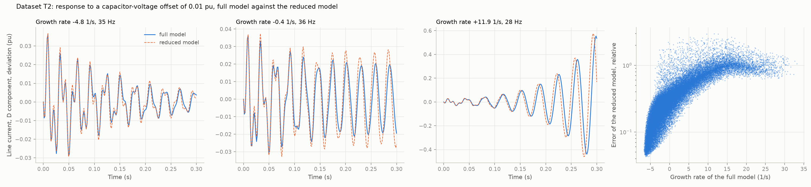

# 35: The T2 dataset: responses in time

Date: 2026-11-13 · Plan phase: 3 (item left open), for Phase 6

## Goal

Phase 6 compares the arms on a time-domain task as well. Step 16 had set the trajectory dataset aside, because on this plant the response follows from the modes. The full scope of Phase 6 needs it, so it is built here: what is the task, what is the physics a model may be given, and how good is that physics alone?

## What was done

- `src/sso_sciml/data/t2.py`: parameter space, splits, the run of the full model, the reduced model and its response in closed form.
- `scripts/phase3_generate_t2.py`: the dataset, its summary and one figure.
- `tests/test_data_t2.py`: 4 tests.

## Commands

```powershell
uv run scripts/phase3_generate_t2.py     # 38,912 runs, about 4 minutes on the GPU
uv run pytest tests/test_data_t2.py
```

## Setup of the dataset

- **Plant:** the doubly-fed machine with its full controls on the reference series line (23 states), with the limits, anti-windup and chopper of step 33 in.
- **Disturbance and window:** the series capacitor voltage 0.01 pu off its steady value, then 0.3 s. RK4 at 0.5 ms, saved every 1.5 ms, 201 times.
- **Parameters, four:**

| Parameter | Range | Sampling |
|---|---|---|
| Series compensation | 5 % to 50 % of line reactance | linear |
| Rotor speed | 0.80 to 1.20 pu | linear |
| Rotor current loop bandwidth | 2 to 30 Hz | logarithmic |
| Phase-locked loop natural frequency | 5 to 30 Hz | logarithmic |

  The outer loop crossover is 0.07 of the current loop bandwidth. Everything else is at its reference value.
- **Targets:** five observed quantities as deviations from the steady state: line current (D, Q), capacitor voltage (D, Q), DC voltage. The deviation of all 23 states is stored as well.
- **Trips.** A run is cut where the rotor current passes 2 pu, the trip level of step 33. Later values are zeroed and never used. A case that trips in the first quarter of the window would be dropped; none does.
- **The physics a model may be given:** the reduced model of step 03. It has the machine, the rotor current loop and the line: 8 states, linear, no phase-locked loop, no outer loops, no grid-side converter, no DC link. Its response to the same offset is written down from its modes with no time stepping. It gives stator current and capacitor voltage, and nothing for the DC voltage. It plays the part for T2 that the hand calculation plays for T1.
- **Sets:** 32,768 cases in distribution, folded 80 / 10 / 10, and three extrapolation sets of 2,048: compensation 50 % to 60 %, speed 0.70 to 0.80 pu, current loop 30 to 60 Hz. Scrambled Sobol points, fixed seed. Specification hash `9822f10af6afc3dd`.

## Results

All numbers are in `docs/results/phase3/t2_dataset.json`.

| Set | Cases | Unstable | Trips within 0.3 s | Growth rate, median (1/s) | Error of the reduced model: median, 95th percentile |
|---|---|---|---|---|---|
| In distribution | 32,768 | 15,398 (47 %) | 1,795 (5 %) | −0.4 | 0.29, 1.05 |
| High compensation | 2,048 | 1,816 | 545 | +7.6 | 0.73, 1.84 |
| Low speed | 2,048 | 1,351 | 332 | +3.1 | 0.58, 2.90 |
| Fast current loop | 2,048 | 2,041 | 1,328 | +19.5 | 0.82, 1.16 |

The error of the reduced model is relative: the root of the summed squared error of its four quantities over the times before any trip, over the same sum of the truth. An error of 1 is as bad as predicting no response.



- **Every case has a steady state and none trips early.** The training fold has 26,214 cases, validation and test 3,277 each.
- **The reduced model is right at first and drifts.** In the first 50 ms it follows the full model closely. After that it is off in growth rate and in phase.
- **Its error rises with the growth rate.** Below −5 1/s it is under 0.1. Above +10 1/s it is near 1: the oscillation is there, with the wrong rate and phase. The median in distribution is 0.29.
- **Outside the distribution it is worse:** 0.58 to 0.82 at the median, because those sets are mostly unstable.
- **The response spans two orders of magnitude.** The largest deviation of line current is 0.05 pu at the median and 1.4 pu at the 95th percentile.
- **The mode is at 26 to 47 Hz in the synchronous frame** (5th to 95th percentile), so the window holds 8 to 14 cycles.
- **Cost:** 178 s for the 32,768 cases on 8 processes and the GPU; the dataset is 0.9 GB on disk.

## Disagreements

1. **Step 16 decided that no trajectory dataset was needed** on this plant. That stands as a statement about screening: the linear response of the full model is within 0.44 % of a run (step 15). The dataset is built for the comparison of arms, and the physics the arms are given is the reduced model, not the full state matrix.
2. **The plan sized T2 at about 30,000 trajectories over the 12 parameters of T1.** This set has 32,768 over 4 parameters on the single line, so that the residual and architecture arms have a chance. The plan's own parametric PINN was over two.
3. **One disturbance of one size.** The plan's T2 takes a disturbance as an input. Step 33 found the response linear in its size up to a trip.
4. **Nearly half the cases are unstable,** against a ninth in dataset T1. The compensation range was chosen to straddle the boundary of the reference line.
5. **The fast-current-loop set is mostly short runs:** 65 % of its cases trip within the window.
6. **The reduced model is the one of step 03 unchanged.** A hand model with the phase-locked loop added would be closer and is not built.

## Decisions

- Dataset version `t2-v1`. Any change to ranges, seed, splits, offset, window or protection settings changes the hash.
- The error measure for T2 is the relative error defined above, over the five observed quantities each divided by a fixed size.
- Nothing after a trip is used for training or scoring.

## Next

Step 36: arms N, F, R, L, F+L and A on this dataset.
