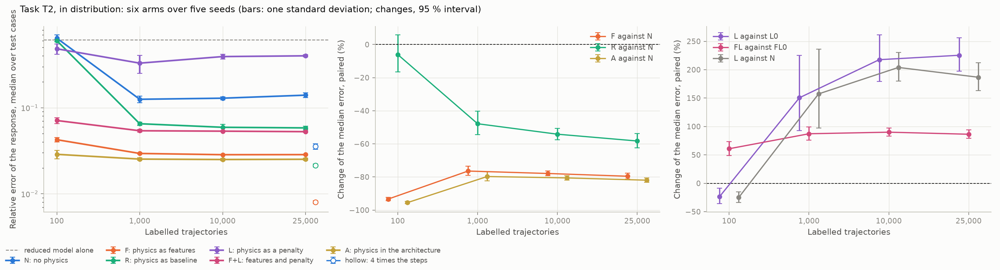
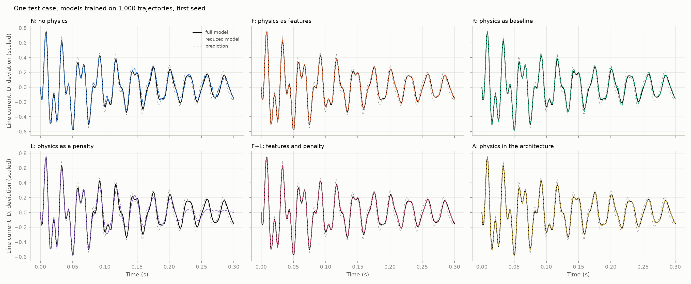
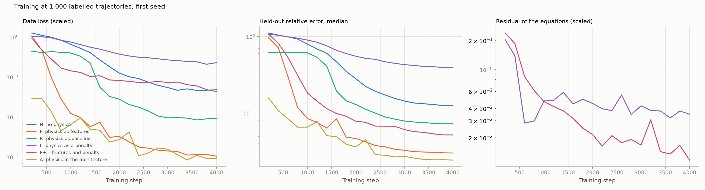
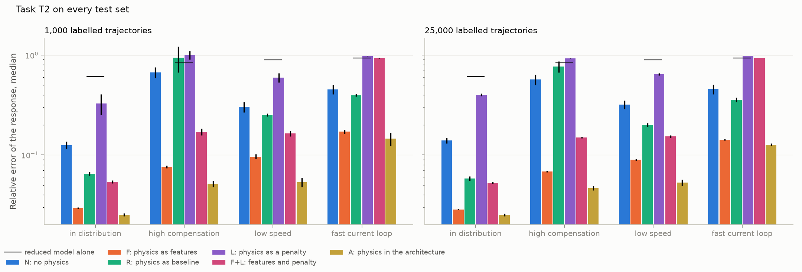

# 36: Phase 6 on task T2: six arms on the response in time

Date: 2026-11-14 · Plan phase: 6 (second part)

## Goal

The comparison of step 34 on the time-domain task. The physics is the reduced model of step 35, used nowhere (N), as inputs (F), as the baseline (R), as a penalty (L), as inputs and penalty (F+L), and built into the model (A). Which use helps, at which budget and on which test set, and does the answer differ from task T1?

## What was done

- `src/sso_sciml/models/t2.py`: the six arms, the error measure and one training loop.
- `scripts/phase6_t2_arms.py`: four budgets, five seeds, the penalty at three weights, and a check with four times the training steps.
- `tests/test_models_t2.py`: 12 tests.

## Commands

```powershell
uv run scripts/phase6_t2_arms.py            # 195 training runs, 4.7 hours of training
uv run scripts/phase6_t2_arms.py --reuse    # statistics and figures from the saved runs
uv run pytest tests/test_models_t2.py
```

A stopped pass goes on from `data/t2-v1/arm_runs_4_5.jsonl` when the first command is run again.

## Setup of the study

- **Task:** from the four parameters of a case, the five observed quantities at the 201 saved times (step 35).
- **Error of a case:** root of the summed squared error of the five quantities, each divided by a fixed size, over the times before any trip, over the same sum of the truth. 1 is as bad as predicting no response. A model is scored by the median over the test cases.
- **Network,** the same for arms N, F, R, L and F+L: parameters and time in, 4 layers of 256, sines and cosines of time at 10 to 50 Hz as further inputs. The output is multiplied by time and by a learned exponential in time, so it is zero at the start and can grow a hundredfold. 4,000 steps of 4,096 points, one learning-rate cycle peaking at 0.002.
- **Arm F** adds the reduced model's response at that time and its sub-synchronous mode to the inputs.
- **Arm R** learns the difference from the reduced model's response.
- **Arm L** predicts all 23 states. Besides the data loss it is penalised by the residual of the full equations, `dx/dt − f(x, θ)`, at random times of 2,048 training cases used without their labels. Weight 1.
- **Arm F+L** is arm L with the inputs of arm F.
- **Arm A** is a linear system of 12 states: the 8 of the reduced model and 4 learned ones. Its matrix is the reduced model's plus a learned correction that depends on the parameters. The initial state is exact. It is stepped with a matrix exponential. Before training it is the reduced model.
- **Budgets** of 100, 1,000, 10,000 and 25,000 labelled trajectories, a fifth of each held out to pick the best step. **Five seeds,** shared by the arms. Differences are paired within a seed as in step 34.
- **Test sets:** the in-distribution test fold (3,277 cases) and the three extrapolation sets of 2,048.

## Results

All numbers are in `docs/results/phase6/t2_arms.json`.

### In distribution



Median relative error, mean over five seeds. The reduced model alone gives 0.61.

| Arm | 100 trajectories | 1,000 | 10,000 | 25,000 | Training time |
|---|---|---|---|---|---|
| N | 0.642 | 0.125 | 0.129 | 0.140 | 18 s |
| F | 0.043 | 0.029 | 0.028 | 0.029 | 18 s |
| R | 0.601 | 0.065 | 0.059 | 0.058 | 18 s |
| L | 0.483 | 0.329 | 0.392 | 0.400 | 144 s |
| F+L | 0.071 | 0.054 | 0.053 | 0.053 | 145 s |
| A | 0.029 | 0.025 | 0.025 | 0.025 | 240 s |

Change of the error, paired, with its 95 % interval. Marked where the interval excludes zero.

| | 100 trajectories | 1,000 | 10,000 | 25,000 |
|---|---|---|---|---|
| F against N | **−93 %** [−94, −92] | **−76 %** [−79, −73] | **−78 %** [−79, −76] | **−80 %** [−81, −78] |
| R against N | −6 % [−17, +6] | **−48 %** [−54, −40] | **−54 %** [−58, −51] | **−58 %** [−62, −54] |
| A against N | **−96 %** [−96, −95] | **−80 %** [−82, −77] | **−81 %** [−82, −79] | **−82 %** [−83, −81] |
| A against F | **−33 %** [−38, −27] | **−14 %** [−18, −10] | **−12 %** [−15, −9] | **−12 %** [−15, −9] |
| L against the same network, penalty off | **−24 %** [−36, −9] | **+151 %** [+93, +225] | **+218 %** [+179, +261] | **+225 %** [+197, +256] |
| F+L against the same network, penalty off | **+61 %** [+49, +74] | **+87 %** [+76, +99] | **+90 %** [+83, +97] | **+86 %** [+79, +94] |

- **Arms F and A need almost no data.** With 100 trajectories they are at 0.043 and 0.029, where arm N is at 0.64, no better than the reduced model alone. Arm A is the better of the two at every budget, by 12 % to 33 %.
- **Arm R needs 1,000 trajectories.** At 100 it is level with arm N. From 1,000 it halves the error of arm N, and stays at twice the error of arm F.
- **The penalty hurts.** Arm L is 24 % better than its own network at 100 trajectories and two to three times worse from 1,000. Arm F+L is worse than arm F at every budget, by 61 % to 90 %.
- **No arm improves from 1,000 to 25,000 trajectories.** The length of training is the limit, not the data (below).
- **Cost.** Arms L and F+L take 8 times the training time of arm N, arm A 13 times.





### Training four times as long

Arms N, F and R at 25,000 trajectories with 16,000 steps in place of 4,000, five seeds.

| Arm | 4,000 steps | 16,000 steps | Change, paired |
|---|---|---|---|
| N | 0.140 | 0.035 | −75 % [−77, −72] |
| F | 0.029 | 0.008 | −72 % [−73, −71] |
| R | 0.058 | 0.021 | −63 % [−67, −60] |

- **Every arm was limited by the steps.** Four times the steps cuts the error by 63 % to 75 %, where 25 times the data cut nothing.
- **The order does not change.** After the longer training arm F is 77 % below arm N [−80, −74] and arm R 40 % below [−46, −32].
- **Arm F trained four times as long beats arm A** (0.008 against 0.025) at 97 s against 242 s. Arm A was not run longer.

### The weight of the penalty

Arm L, median relative error.

| Weight | 100 trajectories | 1,000 |
|---|---|---|
| 0 | 0.632 | 0.129 |
| 0.1 | 0.548 | 0.213 |
| 1 | 0.483 | 0.329 |
| 10 | 0.800 | 0.778 |

Against the weight of 0: a weight of 0.1 gives −13 % [−26, +3] at 100 trajectories and +66 % [+49, +86] at 1,000; a weight of 10 gives +27 % [+12, +45] and +507 % [+445, +574]. No weight helps at 1,000 trajectories.

### Every test set



Median relative error at 25,000 trajectories.

| Test set | Reduced model alone | N | F | R | L | F+L | A |
|---|---|---|---|---|---|---|---|
| In distribution | 0.61 | 0.140 | 0.029 | 0.058 | 0.400 | 0.053 | 0.025 |
| High compensation | 0.84 | 0.570 | 0.068 | 0.769 | 0.931 | 0.150 | 0.047 |
| Low speed | 0.90 | 0.321 | 0.090 | 0.200 | 0.643 | 0.153 | 0.053 |
| Fast current loop | 0.93 | 0.456 | 0.143 | 0.358 | 0.982 | 0.934 | 0.127 |

- **Arms F and A keep their advantage outside the distribution.** Arm F is 69 % to 88 % below arm N on the three sets, arm A 72 % to 92 %. Arm A is the best arm on every set, by 11 % to 41 % against arm F.
- **Arm R is worse than arm N at high compensation,** by 35 % [+8, +69], and by 69 % [+45, +98] after the longer training. There the reduced model is far off (0.84), and the correction it needs is as large as the response.
- **Arm L is worse than arm N on every set** from 1,000 trajectories, by 49 % to 204 %. At 100 trajectories it is 7 % to 31 % better.
- **The penalty ruins arm F+L for a fast current loop:** 0.93, as bad as predicting nothing, where arm F has 0.14.
- **At 100 trajectories arm A has a tail outside the distribution.** Its 90th-percentile error is 2.5 at high compensation and 3.1 for a fast current loop, where its median is 0.10 and 0.34. From 1,000 trajectories the tail is gone (0.16 and 0.43).

## Hypotheses

Verdicts for task T2. The report of step 37 sets them beside task T1.

1. *With little data, F and R beat N by a wide margin.* Holds for arm F (93 % at 100 trajectories) and arm A (96 %). Does not hold for arm R at 100; it holds for arm R from 1,000.
2. *F and R degrade where the hand calculation is invalid, and R more than F.* Holds for arm R at high compensation, where it falls behind arm N. Arm F does not degrade. On T1 the verdict was the opposite.
3. *L extrapolates better than N at several times the cost.* Rejected. The cost is 8 times. From 1,000 trajectories arm L is worse than arm N on every set.
4. *L is harder to make work on the time-domain task than on the eigenvalue task.* Holds. On T1 the penalty cost 27 % at the large budgets. Here it costs 150 % to 225 %, and no weight in two decades helps beyond 100 trajectories.
5. *With abundant data the arms converge in distribution.* Rejected at this training effort. At 25,000 trajectories arm N has 4.9 times the error of arm F, and 4.4 times after training four times as long.

## Disagreements

1. **Arm A trains at a quarter of the learning rate of the other arms.** At the shared rate it steps into a matrix whose response overflows within the window and does not recover: in the first pass its error at 10,000 trajectories was 0.050 with a seed spread of 0.024, against 0.025 and 0.001 now. This breaks "one schedule for every arm". A step whose loss is not finite is also left out; none occurred in the 20 runs reported.
2. **The budgets do not separate, because 4,000 steps do not fit the data.** The budget axis of this step says how little data an arm needs, not what more data buys. The longer-training check covers arms N, F and R at one budget only.
3. **Arm R is no better than arm N at 100 trajectories,** against 22 % better on T1. The reduced model's response has the wrong growth rate and phase (step 35), so the correction is an oscillation as large as the response itself and no easier to learn.
4. **The reduced model alone scores 0.61 here and 0.29 in step 35.** This measure counts the DC voltage, which the reduced model does not predict, and divides each quantity by a fixed size.
5. **Arm L's penalty is on the full 23-state equations,** which are more than the reduced model the other arms are given. It still loses. Its network also has 23 outputs; with the penalty off that costs nothing (0.129 against 0.125 at 1,000 trajectories).
6. **Arm N's error rises from 1,000 to 25,000 trajectories** (0.125 to 0.140). The held-out fifth that picks the best step grows with the budget and the steps do not; not looked into.
7. **The plan's sensitivity of arm F to errors in its features is not run** as a deliberate perturbation. The reduced model is itself 0.84 to 0.93 off on the three outside sets, and arm F holds there.
8. **Five seeds, one network size, one disturbance, one line.** Arm A is the only arm that steps in time; a neural ODE with a nonlinear correction was not built.

## Decisions

- For T2 the arm to use is F: the network with the reduced model's response as inputs, trained long. Arm A is the alternative below 1,000 trajectories and outside the training range, at 13 times the cost per step.
- Arm R is not used where the reduced model is far off. Arms L and F+L are not used for T2.
- Arm A keeps its own learning rate (`A_RATE` in `models/t2.py`).

## Next

Step 37: the Phase 6 report, with a verdict on each hypothesis over both tasks, and one table and one figure per task (done).
