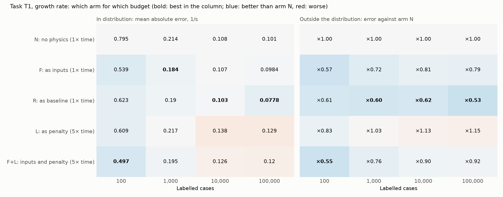
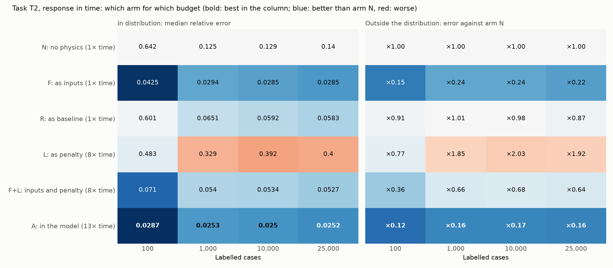

# 37: Phase 6 report: where to put the physics

Date: 2026-11-14 · Plan phase: 6 (report)

## Goal

Steps 34 and 36 ran the arms on tasks T1 and T2. This step sets the two beside each other: a verdict on each of the plan's five hypotheses, and for each task one table and one figure from which an arm can be chosen for a data budget and a need to extrapolate.

## What was done

- `scripts/phase6_report.py`: reads the saved results of steps 34 and 36 and builds the two tables and figures. No training.

## Commands

```powershell
uv run scripts/phase6_report.py
```

## The two tasks

| | T1 (step 34) | T2 (step 36) |
|---|---|---|
| Output | growth rate of the least-damped mode | five quantities over 0.3 s |
| Parameters | 12 | 4 |
| Physics given | impedance root of the hand calculation | response of the 8-state reduced model |
| Error of that physics alone | 1.27 1/s | 0.61 |
| Error measure | mean absolute error, 1/s | median relative error |
| Budgets | 100 to 100,000 cases | 100 to 25,000 trajectories |
| Extrapolation sets | 5 | 3 |
| Arms | N, F, R, L, F+L | N, F, R, L, F+L, A |

Both use a perceptron of 4 layers of 256 trained for 4,000 steps, five seeds shared by the arms, and paired 95 % intervals.

## Results

Numbers are in `docs/results/phase6/report.json`. In each table the left half is the error in distribution. The right half is the error outside the distribution as a multiple of arm N's at the same budget: the geometric mean over the extrapolation sets. Below 1 is better than arm N. The best arm of each column is marked.

### Task T1: growth rate



| Arm | Time | 100 cases | 1,000 | 10,000 | 100,000 | Outside: 100 | 1,000 | 10,000 | 100,000 |
|---|---|---|---|---|---|---|---|---|---|
| N | 1× | 0.80 | 0.214 | 0.108 | 0.101 | 1.00 | 1.00 | 1.00 | 1.00 |
| F | 1× | 0.54 | **0.184** | 0.107 | 0.098 | 0.57 | 0.72 | 0.81 | 0.79 |
| R | 1× | 0.62 | 0.190 | **0.103** | **0.078** | 0.61 | **0.60** | **0.62** | **0.53** |
| L | 5× | 0.61 | 0.217 | 0.138 | 0.129 | 0.83 | 1.03 | 1.13 | 1.15 |
| F+L | 5× | **0.50** | 0.195 | 0.126 | 0.120 | **0.55** | 0.76 | 0.90 | 0.92 |

- **Use arm R.** It is the best arm outside the distribution from 1,000 cases and in distribution from 10,000, at no extra cost.
- **Below 1,000 cases arm F is as good.** F, R and F+L are within the seed spread of each other at 100 cases (step 34: F+L against F is −8 % [−19, +3]).
- **Do not use the penalty above 100 cases.** It costs five times the training time and makes the model worse from 10,000.
- **As a screen, trust a trained model only inside its range** (step 34). Outside it the margin set inside clears unstable cases.

### Task T2: response in time



| Arm | Time | 100 trajectories | 1,000 | 10,000 | 25,000 | Outside: 100 | 1,000 | 10,000 | 25,000 |
|---|---|---|---|---|---|---|---|---|---|
| N | 1× | 0.642 | 0.125 | 0.129 | 0.140 | 1.00 | 1.00 | 1.00 | 1.00 |
| F | 1× | 0.043 | 0.029 | 0.028 | 0.029 | 0.15 | 0.24 | 0.24 | 0.22 |
| R | 1× | 0.601 | 0.065 | 0.059 | 0.058 | 0.91 | 1.01 | 0.98 | 0.87 |
| L | 8× | 0.483 | 0.329 | 0.392 | 0.400 | 0.77 | 1.85 | 2.03 | 1.92 |
| F+L | 8× | 0.071 | 0.054 | 0.053 | 0.053 | 0.36 | 0.66 | 0.68 | 0.64 |
| A | 13× | **0.029** | **0.025** | **0.025** | **0.025** | **0.12** | **0.16** | **0.17** | **0.16** |

- **Use arm F, trained long.** At equal steps arm A is 12 % to 33 % better, at 13 times the training time. Arm F given four times the steps reaches 0.008 at 25,000 trajectories in 97 s, against 0.025 in 242 s for arm A (step 36).
- **Use arm A when extrapolation matters most** or there are 100 trajectories: it is the best arm outside the distribution at every budget.
- **Do not use arm R where the reduced model is far off.** Outside the distribution it is no better than arm N on average, and worse at high compensation.
- **Do not use the penalty.** From 1,000 trajectories arm L has two to three times the error of arm N in distribution and about twice outside.
- **Spend on training steps before data.** From 1,000 to 25,000 trajectories no arm improves at 4,000 steps; four times the steps cuts the error by 63 % to 75 %.

## The five hypotheses

| | Hypothesis | T1 | T2 | Verdict |
|---|---|---|---|---|
| 1 | With little data, F and R beat N by a wide margin | F −32 %, R −22 % at 100 cases; gone by 10,000 | F −93 % at 100 trajectories and −76 % to −80 % after; R nothing at 100, −48 % at 1,000 | Holds for F on both tasks. Holds for R on T1 only at 100 cases, and on T2 only from 1,000 |
| 2 | F and R degrade where the hand calculation is invalid, R more than F | R degrades least on every set | R falls behind N at high compensation (+35 %); F does not degrade | Rejected on T1, holds for R on T2. It turns on how wrong the physics is: the hand calculation is off by 1.3 to 2.8 1/s on the extrapolation sets of T1, the reduced model by 0.84 to 0.93 of the response on those of T2 |
| 3 | L extrapolates better than N, at several times the cost | Cost 5×. Better only at 100 labels, and no more outside than inside | Cost 8×. Worse than N on every set from 1,000 | Rejected on both |
| 4 | L is harder to make work on the time-domain task | Penalty costs 27 % at the large budgets; one decade of weight helps at 100 labels | Penalty costs 150 % to 225 %; no weight in two decades helps past 100 | Holds |
| 5 | With abundant data the arms converge in distribution | N and F converge; R stays 23 % below, L 27 % above | N has 4.9 times the error of F at 25,000, 4.4 times after four times the steps | Half right on T1, rejected on T2 |

- **Inputs are the safe place for the physics.** Arm F never loses to arm N on either task, in or out of distribution, and costs nothing.
- **The baseline is only as good as the physics.** Arm R is the best arm on T1, where the hand calculation is off by an amount, and poor on T2, where the reduced model is off in rate and phase and the correction is as large as the response.
- **The penalty is the worst use on both tasks.** It helps at 100 labels by about a quarter and hurts after, at five to eight times the cost.
- **The structure is the best use where it can be built.** Arm A, a linear system that starts as the reduced model, is the most accurate arm on T2 at equal steps and the best outside the distribution. It has no form for T1.

## Disagreements

1. **The outside-the-distribution column is a ratio of mean errors,** averaged over sets with a geometric mean. It is not paired and has no interval. The paired intervals per set are in steps 34 and 36.
2. **At 100 cases on T1 the marked arm is F+L,** by a margin inside the seed spread. The text recommends F or R.
3. **The two tasks differ in more than the task.** T2 has 4 parameters against 12, a single line, a different error measure and a reduced model in place of a hand calculation. Hypothesis 4 is read from the size of the penalty's harm on each, which those differences also touch.
4. **Training is not converged on either task** at 4,000 steps. On T2 this was measured (step 36). On T1 it was noted in step 09 and not measured in Phase 6.
5. **Arm A trains at a quarter of the learning rate** (step 36), the one departure from a single schedule.
6. **The plan's sensitivity of arm F to errors in its features was not run** as a perturbation on either task. What stands in for it: arm F holds on the extrapolation sets, where the physics is at its worst.
7. **Not covered:** a neural ODE with a nonlinear correction for arm A, a penalty with an adaptive weight, T3, and the gradient-boosted trees of step 34 on T2.

## Decisions

- T1: arm R, the perceptron on the correction to the impedance root. T2: arm F with long training; arm A where extrapolation matters.
- The penalty arms are dropped from later phases.
- A model on T2 is trained for at least 16,000 steps before budgets are compared.
- Phase 6 is closed. Its exit check is met by the two tables and figures above.

## Next

Phase 7 of the plan: operators and sequence models on T2. Arm F with long training is the baseline they have to beat.
