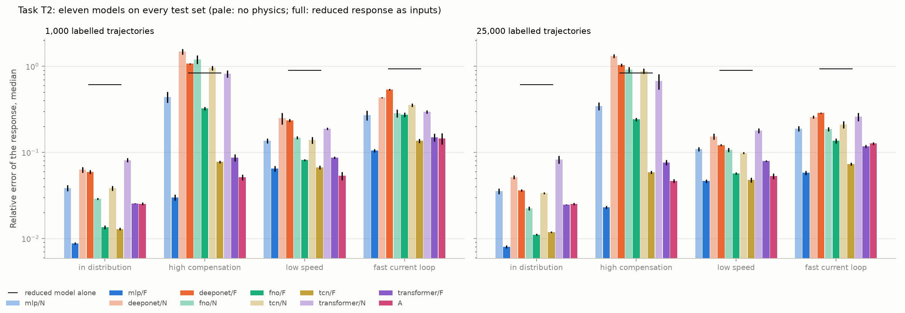
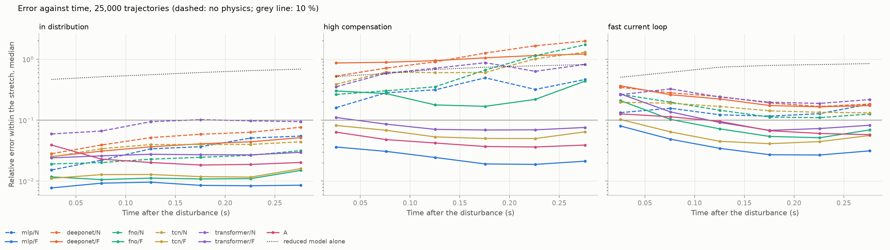
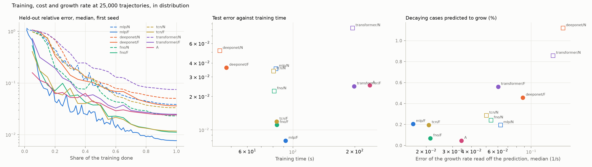
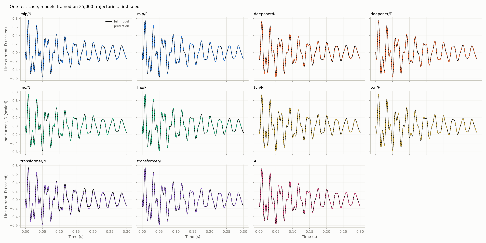

# 38: Operators and sequence models on the response in time

Date: 2026-11-14 · Plan phase: 7

## Goal

Step 37 chose a perceptron with the reduced model's response as inputs, trained long, as the model for task T2. This step asks whether an architecture built for functions or sequences does better: a DeepONet, a Fourier neural operator, a temporal convolutional network and a transformer, each with and without the physics inputs. It also gives each model the time within the window up to which its error stays under 10 %, and its cost on the 8 GB card.

## What was done

- `src/sso_sciml/models/t2_seq.py`: the four architectures at width 64. Each maps the 4 parameters, and for the F variant the reduced model's response as well, to the five quantities at all 201 times at once. All sit behind the envelope of `models/t2.py`, so the output is zero at the instant of the disturbance. Also `horizon_error` (median error in each of six stretches of the window), `growth` (growth rate read off a response) and `growth_scores`.
- `scripts/phase7_t2_models.py`: eleven models (perceptron, DeepONet, FNO, TCN and transformer, each as N and F, and arm A of step 36), budgets of 1,000 and 25,000 trajectories, five seeds, 110 runs. Each run records the fit time, the peak GPU memory and the prediction time. Runs are logged one by one so the script resumes.
- `tests/test_models_t2_seq.py`: 12 tests.

Training: the perceptron takes 16,000 steps of 4,096 points, as step 37 decided. The sequence models take 8,000 steps of 64 whole cases. Arm A takes 4,000 steps, as in step 36.

## Commands

```powershell
uv run pytest tests/test_models_t2_seq.py
uv run scripts/phase7_t2_models.py           # 110 runs, 3.3 hours of training
uv run scripts/phase7_t2_models.py --reuse   # tables and figures from the saved runs
```

## Results

Numbers are in `docs/results/phase7/t2_models.json`. The error is the median relative error of the response, mean of five seeds. The test sets are those of step 35: 3,277 cases in distribution and 2,048 in each set outside it. The reduced model alone has an error of 0.61 in distribution and 0.84, 0.90 and 0.94 on the three outside sets.



### Trained on 25,000 trajectories

| Model | Parameters | In distribution | High compensation | Low speed | Fast current loop |
|---|---|---|---|---|---|
| Perceptron, N | | 0.036 | 0.345 | 0.109 | 0.189 |
| Perceptron, F | | **0.008** | **0.023** | **0.046** | **0.058** |
| DeepONet, N | 469,441 | 0.052 | 1.317 | 0.153 | 0.257 |
| DeepONet, F | 675,905 | 0.036 | 1.035 | 0.122 | 0.287 |
| FNO, N | 686,534 | 0.022 | 0.918 | 0.107 | 0.187 |
| FNO, F | 687,046 | 0.011 | 0.242 | 0.057 | 0.136 |
| TCN, N | 339,494 | 0.034 | 0.880 | 0.098 | 0.211 |
| TCN, F | 340,198 | 0.012 | 0.059 | 0.048 | 0.073 |
| Transformer, N | 305,702 | 0.082 | 0.675 | 0.179 | 0.259 |
| Transformer, F | 306,406 | 0.025 | 0.076 | 0.079 | 0.118 |
| Arm A | | 0.025 | 0.047 | 0.053 | 0.127 |

The script does not record the parameter count of the perceptron or of arm A.

- **No operator or sequence model beats the perceptron with physics inputs.** In distribution the nearest are the FNO (+39 % [+29, +49]) and the TCN (+48 % [+43, +55]). At high compensation the TCN has 2.5 times its error and the FNO 10 times.
- **The physics inputs matter more than the architecture.** They cut the error in distribution by 77 % for the perceptron, 70 % for the transformer, 65 % for the TCN, 50 % for the FNO and 29 % for the DeepONet. The spread between architectures with them is 0.008 to 0.036; the best model without them is at 0.022.
- **Without the physics, the FNO is the best model in distribution:** 37 % [28, 45] below the perceptron. It does not carry outside: at high compensation it has 2.7 times the perceptron's error.
- **Without the physics, every model fails at high compensation.** The perceptron is at 0.35 and the four others at 0.67 to 1.32, against 0.84 for the reduced model alone.
- **The DeepONet gains least from the physics** and is the only model for which the inputs make an outside set worse (fast current loop, +11 % [+6, +17]).
- **Trained long, the perceptron with physics inputs is ahead of arm A** in distribution (0.008 against 0.025) and on all three outside sets. Arm A had 4,000 steps here; see disagreement 5.

### Trained on 1,000 trajectories

| Model | In distribution | High compensation | Low speed | Fast current loop |
|---|---|---|---|---|
| Perceptron, F | **0.009** | **0.030** | 0.065 | **0.105** |
| FNO, F | 0.014 | 0.324 | 0.082 | 0.274 |
| TCN, F | 0.013 | 0.078 | 0.067 | 0.136 |
| Transformer, F | 0.026 | 0.087 | 0.087 | 0.150 |
| DeepONet, F | 0.060 | 1.069 | 0.235 | 0.536 |
| Arm A | 0.025 | 0.052 | **0.053** | 0.145 |

- **25 times the data changes little.** The perceptron with physics inputs goes from 0.0088 to 0.0080 in distribution. The DeepONet gains most, 0.060 to 0.036.
- **Arm A is the best model at low speed with 1,000 trajectories** (−18 % [−21, −14] against the perceptron). With 25,000 the perceptron passes it (+14 % [+1, +28]).

### Error against time, and the time each model can be trusted to



Median error in distribution within each sixth of the window, at 25,000 trajectories:

| Model | 0 to 0.05 s | 0.05 to 0.10 | 0.10 to 0.15 | 0.15 to 0.20 | 0.20 to 0.25 | 0.25 to 0.30 |
|---|---|---|---|---|---|---|
| Perceptron, N | 0.015 | 0.022 | 0.034 | 0.037 | 0.051 | 0.055 |
| Perceptron, F | 0.008 | 0.009 | 0.010 | 0.009 | 0.008 | 0.009 |
| FNO, F | 0.012 | 0.011 | 0.011 | 0.011 | 0.011 | 0.015 |
| TCN, F | 0.011 | 0.013 | 0.013 | 0.012 | 0.012 | 0.016 |
| Transformer, N | 0.059 | 0.066 | 0.094 | 0.102 | 0.098 | 0.095 |
| Arm A | 0.039 | 0.023 | 0.020 | 0.018 | 0.019 | 0.020 |

- **Without the physics the error grows with time,** by a factor of 3.6 over the window for the perceptron. With it the error is flat.
- **Arm A is worst in the first 0.05 s** and flat after. Its linear system cannot follow the fast part of the response as well as it follows the mode.

A model is called trusted up to the start of the first stretch whose median error passes 10 %. At 25,000 trajectories:

| Model | In distribution | High compensation | Low speed | Fast current loop |
|---|---|---|---|---|
| Perceptron, F | whole window | whole window | whole window | whole window |
| TCN, F | whole window | whole window | whole window | not at all |
| Arm A | whole window | whole window | whole window | not at all |
| FNO, F and transformer, F | whole window | not at all | whole window | not at all |
| DeepONet, F | whole window | not at all | not at all | not at all |
| Perceptron, FNO, TCN, DeepONet, N | whole window | not at all | 0.05 to 0.10 s | not at all |
| Transformer, N | 0.15 s | not at all | not at all | not at all |

- **In distribution every model but one holds to the end of the 0.3 s window.**
- **Only the perceptron with physics inputs holds on all three outside sets.**
- **"Not at all" on the fast current loop means the first 0.05 s.** There the error falls with time (third panel of the figure): the fast part of the response is what moves with the current loop.

### Growth rate read off the prediction



In distribution, 25,000 trajectories, cases that do not trip:

| Model | Growth-rate error, median (1/s) | 90th percentile | Decaying cases predicted to grow | Growing cases predicted to decay |
|---|---|---|---|---|
| Perceptron, N | 0.063 | 0.25 | 0.19 % | 0.54 % |
| Perceptron, F | 0.016 | 0.05 | 0.21 % | 0.01 % |
| FNO, F | 0.021 | 0.07 | 0.07 % | 0.07 % |
| TCN, F | 0.021 | 0.06 | 0.19 % | 0.03 % |
| Transformer, F | 0.060 | 0.16 | 0.56 % | 0.22 % |
| DeepONet, N | 0.163 | 0.54 | 1.12 % | 1.25 % |
| Arm A | 0.034 | 0.09 | 0.05 % | 0.21 % |

- **Every model with the physics reads the growth rate to within 0.1 1/s at the median** and gets the sign wrong in under 0.6 % of cases.
- **Arm A calls the fewest decaying cases growing.** Its response is that of a linear system, so its sign is the sign of an eigenvalue.

### Cost

| Model | Fit time (s) | Peak GPU memory (MB) | Prediction, 1,000 cases (s) |
|---|---|---|---|
| Perceptron, N / F | 83 / 92 | 317 / 385 | 0.019 / 0.041 |
| DeepONet, N / F | 44 / 47 | 126 / 198 | 0.005 / 0.027 |
| FNO, N / F | 81 / 84 | 297 / 364 | 0.019 / 0.041 |
| TCN, N / F | 81 / 83 | 277 / 342 | 0.030 / 0.051 |
| Transformer, N / F | 195 / 198 | 427 / 493 | 0.077 / 0.097 |
| Arm A | 237 | 133 | 0.040 |

- **Nothing here strains the card.** The largest run peaks at 493 MB of 8 GB.
- **The reduced model costs about 0.02 s per 1,000 cases,** the difference between each N and F row. It is as large as the network itself.
- **No run skipped a step** for a non-finite loss.



## Disagreements

1. **One disturbance, not three.** The plan lists a compensation step, a voltage dip and a wind ramp. Dataset T2 (step 35) has one disturbance per case. No second dataset was generated.
2. **No limit-cycle amplitude error.** Step 33 found that no case settles into a limit cycle: an unstable case grows until the plant trips. Cases that trip are left out of the growth-rate scores.
3. **"Horizon" is a time within the 0.3 s window.** No model was rolled out past the window it was trained on, so the table says where inside the window a model fails, and says nothing about later times.
4. **The training schedules differ.** The perceptron has 16,000 steps of 4,096 points; the sequence models 8,000 steps of 64 cases, which is 12,864 points a step; arm A 4,000 steps. The fit times of the perceptron, FNO and TCN are within 10 % of each other, so the comparison between those three is at about equal time. The transformer trains at a quarter of the learning rate of the others.
5. **Arm A is not at equal steps with the perceptron.** Step 36 had A ahead of F by 12 % at 4,000 steps each. Here F has four times the steps and A already costs 2.6 times as long. Whether A trained four times longer would pass F was not run.
6. **One width per architecture** and no tuning. A DeepONet or transformer with other settings may do better than here.
7. **The trusted time is read off six stretches of 0.05 s** and a threshold of 10 % on the median. Half the cases in a stretch counted as trusted are above the figure in the table.
8. **The neural ODE of the plan is arm A,** a linear system with learned matrices. No nonlinear correction was added, as in step 37.

## Decisions

- The model for T2 stays the perceptron with the reduced model's response as inputs, trained for 16,000 steps. No operator or sequence model replaces it.
- Step 37's advice to use arm A where extrapolation matters is narrowed: arm A is the choice only when training steps are short or the sign of the growth rate matters most.
- The TCN with physics inputs is kept as the second model for the ensemble disagreement of Phase 9: it is the nearest to the perceptron outside the distribution and differs in kind.
- Phase 7 is closed. Its exit check is met by the results table and the table of trusted times.

## Next

Step 39, Phase 8 of the plan: reading the mode and the plant parameters from a noisy measured current.
