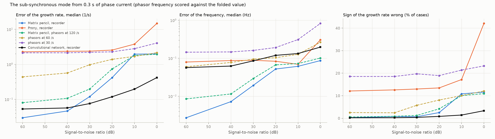
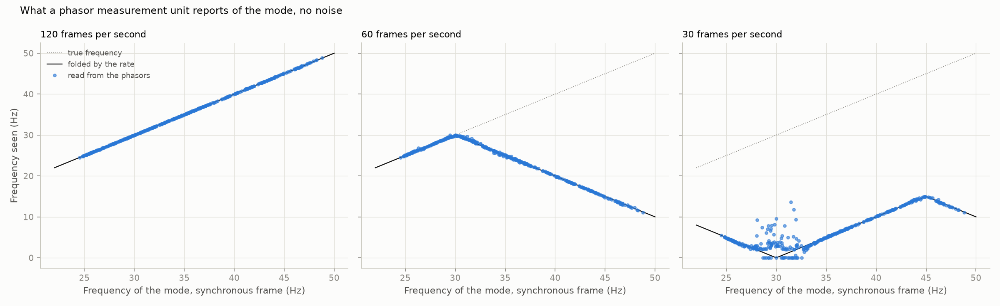
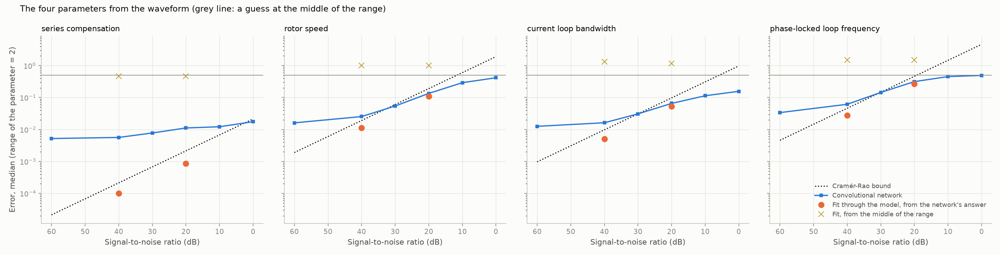

# 39: The mode and the plant parameters from a measured current

Date: 2026-11-14 · Plan phase: 8

## Goal

Until now every model started from the parameters of the plant. This step starts from what an engineer has after an event: 0.3 s of phase current from a fault recorder or a phasor measurement unit, with noise. Three questions. How well can the growth rate and frequency of the sub-synchronous mode be read from it, by which method, at which noise level? What does a phasor unit do to the mode? And which of the plant's parameters does the current pin down?

## What was done

- `src/sso_sciml/measure.py`: the measurement models and the classical estimators. A fault recorder samples the phase current 32 times a cycle (1,920 Hz). A phasor unit takes a one-cycle Fourier coefficient at 120, 60 or 30 frames per second. Matrix pencil and Prony read damped sinusoids from either.
- `src/sso_sciml/models/t3.py`: a one-dimensional convolutional network (372,646 parameters) from the recorder trace to the mode and the four parameters of dataset T2. It is trained on clean traces with fresh noise at every step, 0 to 60 dB.
- `src/sso_sciml/identify.py`: derivatives of the waveform with respect to the parameters by central differences through the full model, the Cramér-Rao bound from them, and a damped Gauss-Newton fit of the parameters to a trace.
- `scripts/phase8_measure.py`: everything below. `tests/test_measure.py` (9 tests), `tests/test_identify.py` (5 tests).

The cases are those of dataset T2 (step 35) that run the whole 0.3 s without a trip: 24,775 for training and 3,095 for the test; 1,795 cases that trip were left out. The signal is the deviation of the phase current from its 60 Hz fundamental, 0.022 pu at the median. The signal-to-noise ratio is against that deviation, not against the fundamental: 20 dB here is noise of 0.2 % of rated current.

## Commands

```powershell
uv run pytest tests/test_measure.py tests/test_identify.py
uv run scripts/phase8_measure.py            # 24 minutes
uv run scripts/phase8_measure.py --reuse    # figures from the saved numbers
```

## Results

Numbers are in `docs/results/phase8/measure.json`. Classical methods are scored on 1,024 test cases, the network on all 3,095 with three seeds.

### The mode against noise



Median error of the growth rate (1/s):

| Method | No noise | 40 dB | 30 dB | 20 dB | 10 dB | 0 dB |
|---|---|---|---|---|---|---|
| Matrix pencil, recorder | 0.030 | 0.047 | 0.12 | 0.42 | 1.96 | 1.99 |
| Prony, recorder | 2.07 | 2.36 | 2.39 | 2.56 | 3.78 | 14.8 |
| Matrix pencil, phasors at 120 /s | 0.081 | 0.11 | 0.20 | 0.74 | 1.79 | 1.95 |
| Phasors at 60 /s | 0.41 | 0.57 | 0.98 | 1.39 | 1.69 | 2.16 |
| Phasors at 30 /s | 2.15 | 2.14 | 2.21 | 2.29 | 2.81 | 4.07 |
| Convolutional network, recorder | | 0.057 | 0.076 | 0.12 | 0.20 | 0.42 |

Share of cases with the sign of the growth rate wrong:

| Method | 40 dB | 20 dB | 10 dB | 0 dB |
|---|---|---|---|---|
| Matrix pencil, recorder | 0.8 % | 2.5 % | 10.8 % | 11.6 % |
| Phasors at 120 /s | 0.9 % | 4.2 % | 10.1 % | 10.9 % |
| Phasors at 60 /s | 2.4 % | 8.1 % | 10.1 % | 12.1 % |
| Phasors at 30 /s | 18.6 % | 18.9 % | 21.4 % | 23.2 % |
| Convolutional network | 0.3 % | 0.8 % | 1.4 % | 3.4 % |

- **With little noise, matrix pencil on the recorder trace is the best method:** 0.03 1/s and 0.002 Hz with none, 0.05 1/s at 40 dB.
- **From 30 dB down the network is better,** by 3.5 times at 20 dB and 10 times at 10 dB. It was trained on this plant's waveforms and knows what a response can look like; matrix pencil knows only that it is a sum of damped sinusoids.
- **Matrix pencil breaks between 20 and 10 dB.** Its error goes from 0.4 to 2.0 1/s and the sign is wrong in one case in nine.
- **The network has a floor of 0.05 1/s** that matrix pencil goes under when the trace is clean.
- **Prony is not usable on 0.3 s:** 2 1/s off with no noise at all, and the sign wrong in 11 % of cases.

### What a phasor unit does to the mode



A mode at f Hz in the synchronous frame is a component of the phase current at 60 − f Hz. A phasor unit reports it at f, but only up to half its frame rate; above that the frequency folds.

| Frame rate | Frames in 0.3 s | Frequency error, read as it is | Against the folded value | Growth-rate error, no noise |
|---|---|---|---|---|
| 120 /s | 35 | 0.009 Hz | 0.009 Hz | 0.08 1/s |
| 60 /s | 18 | 7.8 Hz | 0.06 Hz | 0.41 1/s |
| 30 /s | 9 | 29.9 Hz | 0.15 Hz | 2.15 1/s |

- **At 120 frames per second a phasor unit loses little:** the growth rate is about twice as far off as from the recorder, and equal from 10 dB down.
- **At 60 and 30 frames per second the reported frequency is wrong by 8 Hz and 30 Hz.** The modes here lie at about 24 to 49 Hz in the synchronous frame, above the 30 Hz and 15 Hz that those rates can carry. The frequency is right once it is unfolded, which needs the side of the fold to be known from elsewhere.
- **The growth rate survives folding** at 60 frames per second (0.4 1/s), and not at 30, where 9 frames are too few and modes near 30 Hz fold onto zero.

### The parameters



Parameters are scaled so that the training range of each is 2. A guess at the middle of the range has a median error of 0.5. The Cramér-Rao bound is the smallest standard deviation any unbiased estimate can have; it comes from 256 cases and 26 s of model runs.

| | Series compensation | Rotor speed | Current loop bandwidth | Phase-locked loop |
|---|---|---|---|---|
| Change of the waveform per unit of the parameter, relative | 10.8 | 0.30 | 0.92 | 0.057 |
| Bound at 40 dB | 0.0002 | 0.019 | 0.010 | 0.046 |
| Bound at 20 dB | 0.002 | 0.19 | 0.097 | 0.46 |
| Bound at 0 dB | 0.021 | 1.9 | 0.97 | 4.6 |
| Network at 40 dB, median error | 0.006 | 0.025 | 0.016 | 0.061 |
| Network at 20 dB | 0.011 | 0.14 | 0.065 | 0.32 |
| Fit through the model at 40 dB, from the network's answer | 0.0001 | 0.011 | 0.005 | 0.028 |
| Fit at 20 dB, from the network's answer | 0.0009 | 0.11 | 0.053 | 0.27 |

- **The current pins down the series compensation and little else.** The waveform is 12 times more sensitive to compensation than to the current loop, 36 times more than to speed and 190 times more than to the phase-locked loop.
- **The phase-locked loop cannot be identified below about 20 dB.** There its bound is as large as a guess. Rotor speed is lost at about 10 dB and the current loop at about 5 dB.
- **The weakest direction is the phase-locked loop almost alone** (0.97 of it). Along it the information is 6 × 10⁻⁷ of that along the strongest direction.
- **A fit through the model reaches the bound; the network does not.** At 40 dB the fit is 50 times better than the network on compensation and about twice better on the rest. At 20 dB the two are within 30 % except on compensation.
- **The fit needs the network.** Started from the network's answer it reaches the noise floor in all 64 cases. Started from the middle of the range it does so in 8 % of cases at 40 dB and 9 % at 20 dB and otherwise ends no nearer the truth than it began: the misfit has local minima.
- **Below the bound the network is not wrong.** At 0 dB its error on the phase-locked loop is 0.49, the error of a guess: it has learned to answer with the middle of the range. The bound is for estimates with no such prior.
- **Cost:** matrix pencil 16 ms a case, the network 41 s to train and microseconds to run, the fit 4.3 s a case (54 runs of the full model, batched).

## Parameters that cannot be identified

From 0.3 s of one phase current after a small disturbance, with only the four parameters of T2 unknown:

| Parameter | Identified down to | |
|---|---|---|
| Series compensation | below 0 dB | always |
| Current loop bandwidth | about 5 dB | with a clean record |
| Rotor speed | about 10 dB | with a clean record |
| Phase-locked loop frequency | about 20 dB | only from a recorder trace with noise under 0.2 % of rated current |

## Disagreements

1. **No event waveforms.** The plan applies the methods to digitised waveforms of recorded events from Phase 2. The repository holds none; Phase 2 validated against published numbers, not traces. Everything here is simulated.
2. **No inverse PINN.** The plan compares one from Phase 5. Phase 5 built a forward PINN and an eigenvalue residual (steps 12 and 13) and no inverse form. The comparison that was run is the network against the fit through the model.
3. **"Through the differentiable solver" is by finite differences.** The derivatives are central differences of batched runs, 8 runs per case, not automatic differentiation through the integrator. Step 36 found that backward passes through long integrations stall on this GPU.
4. **Four unknown parameters.** A real plant has more; with more unknowns each is harder to identify than the table says. The table is a best case.
5. **Only cases that do not trip,** and a disturbance of 0.01 pu. A larger disturbance gives a larger signal against the same noise.
6. **White noise only.** No harmonics, no off-nominal frequency, no anti-aliasing filter ahead of the phasor calculation. A real unit's filter would attenuate the sub-synchronous component further at low frame rates.
7. **The bound is a standard deviation and the table gives median errors.** For a Gaussian error the median is 0.67 of the standard deviation, which is why the fit sits a little under the bound.
8. **Prony was run at order 40 and matrix pencil at order 12,** each without tuning.

## Decisions

- To read a mode from a record: matrix pencil when the noise is under about 1 % of the oscillation (40 dB), the network otherwise.
- To read parameters: the network for a start, then the fit through the model.
- A phasor record at 60 frames per second or fewer gives a growth rate and an ambiguous frequency. It is not used for the frequency without a second source.
- Phase 8 is closed. Its exit check is met by the tables of error against noise and the list above.

## Next

Step 40, Phase 9 of the plan: the out-of-distribution study and the fallback rule (done).
