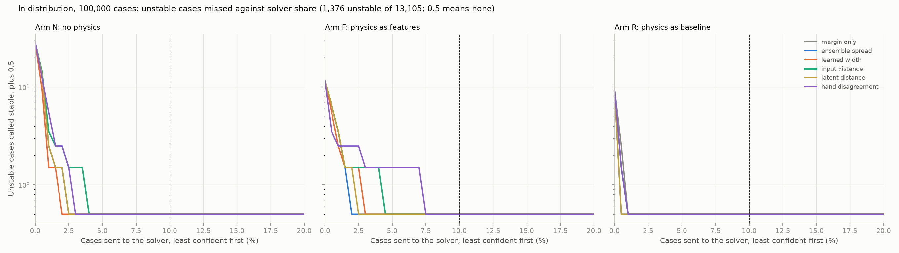
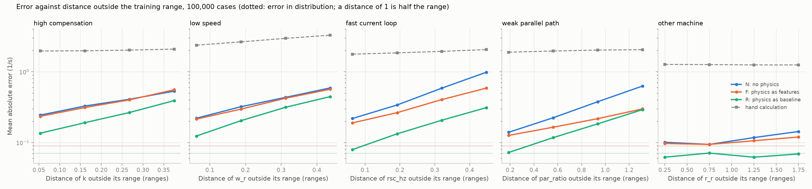
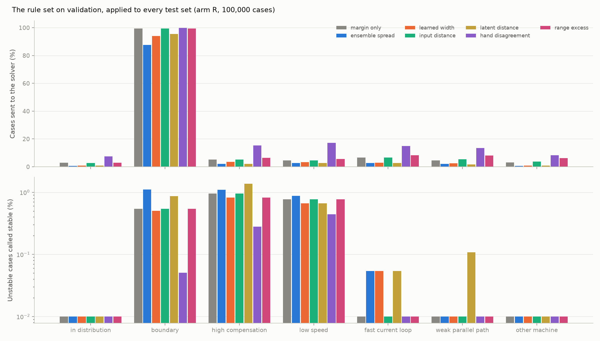
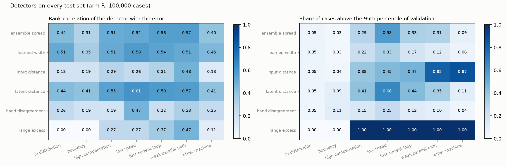
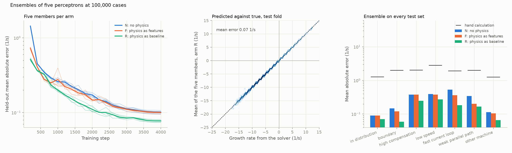

# 40: Outside the training range, and when to call the solver

Date: 2026-11-14 · Plan phase: 9

## Goal

A learned screen answers in microseconds and is sometimes wrong. This step gives it a third answer, "call the solver", and asks three things of the growth-rate task T1. How does the error grow with distance outside the training range? Which signal best tells that a prediction is wrong? And is there a rule that calls no unstable case stable in distribution while sending fewer than 10 % of cases to the solver, which is the plan's target?

## What was done

- `src/sso_sciml/fallback.py`: distance outside the range, distance to the nearest training cases, the rule, its errors and solver share, the trade-off curve, and two rank measures.
- `scripts/phase9_fallback.py`: for arms N, F and R at 1,000 and 100,000 cases, five perceptrons from five initial weights on one training subset; their mean is the model. Seven detectors per case, the rule set on validation, and everything scored on the seven test sets of step 08.
- `tests/test_fallback.py`: 7 tests.

The detectors:

| Detector | What it is |
|---|---|
| margin only | nothing; the rule uses the size of the prediction alone |
| ensemble spread | standard deviation of the five members |
| learned width | gradient-boosted trees fitted to the absolute error on 3,000 validation cases, from the inputs of arm F and the spread |
| input distance | mean distance to the 5 nearest training cases in the scaled parameters |
| latent distance | the same in the last hidden layer of the first member |
| hand disagreement | distance between the prediction and the hand calculation |
| range excess | how far the parameters lie outside the training range; zero inside |

The rule: confidence = |predicted growth rate| / (detector + floor), with the floor the median of the detector on validation. Above a threshold the sign of the prediction is the answer. Below it the solver is called. The threshold is the largest confidence at which any of 7,106 validation cases has the wrong sign, times 1.5. The factor was fixed before the test sets were scored.

## Commands

```powershell
uv run pytest tests/test_fallback.py
uv run scripts/phase9_fallback.py            # 30 training runs, 5 minutes
uv run scripts/phase9_fallback.py --reuse    # figures from the saved numbers
```

## Results

Numbers are in `docs/results/phase9/fallback.json`. The in-distribution test fold has 13,105 cases, 1,376 of them unstable.

### In distribution: the target is met

Share of test cases sent to the solver. No rule in this table calls an unstable case stable or a stable case unstable.

| Detector | N, 100,000 cases | F, 100,000 | R, 100,000 | R, 1,000 |
|---|---|---|---|---|
| margin only | 14.8 % | 26.7 % | 3.0 % | 46.7 % |
| ensemble spread | 4.3 % | 4.1 % | **0.7 %** | 16.3 % |
| learned width | 5.8 % | 3.9 % | 0.9 % | 5.8 % |
| input distance | 13.5 % | 24.1 % | 2.8 % | 42.2 % |
| latent distance | 6.0 % | 7.1 % | 0.9 % | 10.5 % |
| hand disagreement | 17.2 % | 28.5 % | 7.4 % | 24.1 % |

The hand calculation alone under the same rule sends 68.8 % of cases to the solver.



- **Arm R with the ensemble spread sends 0.72 % of cases to the solver and misses none** of 1,376 unstable cases. With none missed in 1,376, the 95 % upper bound on the miss rate is 0.22 % of unstable cases.
- **The baseline does most of the work.** With no detector at all arm R sends 3.0 %, against 14.8 % for arm N. The spread then cuts each by a factor of three to four.
- **A detector is what lets a small model be used.** At 1,000 cases the margin alone sends 46.7 %; the learned width sends 5.8 %.
- **Distance in the inputs is no help in distribution** (2.8 % against 3.0 % with nothing). Distance in the last hidden layer is as good as the spread and needs one network, not five.
- **Disagreement with the hand calculation is the worst detector in distribution.** The hand calculation is off by 1.27 1/s on average; most of that disagreement is the hand calculation's own error.
- **The safety factor costs little.** Without it arm R with the spread sends 0.47 % and still misses none.

### Error against distance outside the range



Mean absolute error (1/s) of arm R at 100,000 cases, in quarters of each outside set. Distance is in units of half the training range of the parameter. In distribution the error is 0.071.

| Direction | Parameter | Nearest quarter | Second | Third | Farthest | Farthest distance |
|---|---|---|---|---|---|---|
| High compensation | k | 0.14 | 0.19 | 0.27 | 0.39 | 0.37 |
| Low speed | w_r | 0.12 | 0.20 | 0.32 | 0.45 | 0.44 |
| Fast current loop | rsc_hz | 0.08 | 0.13 | 0.21 | 0.31 | 0.45 |
| Weak parallel path | par_ratio | 0.07 | 0.12 | 0.18 | 0.29 | 1.31 |
| Other machine | r_r | 0.06 | 0.07 | 0.06 | 0.07 | 1.75 |

- **The error doubles within 0.06 of a range in compensation and speed,** and grows about threefold again by 0.4.
- **Rotor resistance can leave its range by 1.75 half-ranges at no cost.** The growth rate is close to linear in it.
- **Arm R is the best arm in every quarter of every direction.** Arm N is three times worse at the far end of the fast current loop (0.98 against 0.31).
- **The hand calculation does not get worse with distance** (1.3 to 3.3 1/s throughout). It has no training range.

### Outside the range: where the rule fails without warning



The rule set in distribution, applied outside it with no range check. Arm R, 100,000 cases. Each cell: share sent to the solver, unstable cases called stable, stable cases called unstable.

| Detector | High compensation (1,476 unstable) | Low speed (920) | Fast current loop (2,276) | Weak parallel path (1,017) | Other machine (538) |
|---|---|---|---|---|---|
| margin only | 5.1 %, 14, 0 | 4.6 %, 7, 3 | 6.6 %, 0, 0 | 4.7 %, 0, 2 | 3.0 %, 0, 0 |
| ensemble spread | 2.2 %, 16, 0 | 2.6 %, 8, 6 | 2.6 %, 1, 0 | 2.1 %, 0, 6 | 0.7 %, 0, 2 |
| learned width | 3.5 %, 12, 0 | 3.4 %, 6, 4 | 3.0 %, 1, 0 | 2.4 %, 0, 5 | 0.9 %, 0, 0 |
| latent distance | 2.0 %, 20, 0 | 2.6 %, 6, 7 | 2.6 %, 1, 0 | 1.8 %, 1, 6 | 0.8 %, 0, 2 |
| hand disagreement | 15.3 %, 4, 0 | 17.3 %, 4, 0 | 14.9 %, 0, 0 | 13.5 %, 0, 0 | 8.3 %, 0, 0 |

- **High compensation and low speed fail without warning.** Every detector lets unstable cases through there: 4 to 20 at high compensation and 4 to 8 at low speed.
- **The spread rises outside the range, and not by enough.** It is above its 95th validation percentile in 29 % of cases at high compensation and 58 % at low speed. To miss none there, 22 % and 19 % of cases would have to go to the solver; the rule sends 2 % to 3 %.
- **The hand calculation is the best warning outside the range.** It has the fewest misses in both failing directions, at five to seven times the solver share. It is the one signal that does not come from the training data.
- **Fast current loop, weak parallel path and other machine are safe for unstable cases** to within one case. The errors there are stable cases called unstable, which cost a solver call and no more.
- **The check that works is the simplest:** send every case with a parameter outside its training range to the solver. That is all of these five sets.



- **Latent distance and spread rank cases by error about equally** (rank correlation 0.40 to 0.61 on the outside sets), and better than input distance (0.13 to 0.48) or the hand disagreement (0.19 to 0.47).
- **Input distance sees the directions that matter least.** It flags 82 % and 87 % of the weak-parallel-path and other-machine sets, where the error grows least, and 38 % of the high-compensation set.
- **The 90 % interval of the learned width holds 90.1 % of cases in distribution and 74 % to 88 % outside.**

### The boundary set

The boundary set of step 08 holds cases bisected to the stability boundary. Their growth rates are within the model's error of zero, so the sign is not predictable. The rule sends 87.5 % to 99.9 % of them to the solver. With the spread, 27 unstable cases of 2,446 are still called stable. These are the cases the 1.5 factor is for, and it is not enough for them.



## The policy

1. A parameter outside its training range: call the solver.
2. Otherwise predict with arm R, five members, 100,000 training cases. Confidence = |prediction| / (spread + 0.025 1/s).
3. Confidence above 2.77: the sign of the prediction is the answer. Otherwise call the solver.

Operating point on the in-distribution test fold: 0.72 % of cases to the solver, 0 of 1,376 unstable cases called stable, 0 of 11,729 stable cases called unstable.

Directions where the model fails without warning if step 1 is left out: series compensation above 80 % and rotor speed below 0.8 pu.

## Disagreements

1. **No physics-residual detector.** The plan has it "for free in arms L and A". Step 37 dropped arm L, and arm A has no form for T1. A residual of the eigenvalue problem needs the state matrix, which is the solver without its last step.
2. **The "conformal width" is a learned width.** A constant conformal width ranks nothing. The trees give a width per case; the conformal quantile scales it. Its coverage is reported; the rule uses its ranking.
3. **One ensemble per arm and budget,** on one training subset. There are no intervals over seeds on the solver shares. Differences of a few tenths of a percent between detectors are not established.
4. **Zero misses were observed, not guaranteed.** The bound of 0.22 % follows from the count. Near the boundary the rule does miss, as the boundary set shows.
5. **Only T1.** Step 38 kept a second model for the same study on T2. It was not run.
6. **The models are the three arms as perceptrons.** The gradient-boosted trees of step 34 and the Gaussian process of step 11 were not scored here.
7. **The safety factor of 1.5 is a choice.** Results without it are in the results file.
8. **Each outside set moves one parameter.** Two parameters outside at once were not tried.

## Decisions

- The screen is arm R as an ensemble of five with the rule above, and a range check before it.
- The hand calculation stays in the output of the service of Phase 11 as a second opinion: it is the only warning that does not depend on the training data.
- Phase 9 is closed for T1. Its exit check is met by the policy and the two failing directions.

## Next

Step 41, Phase 10 of the plan: the design search.
