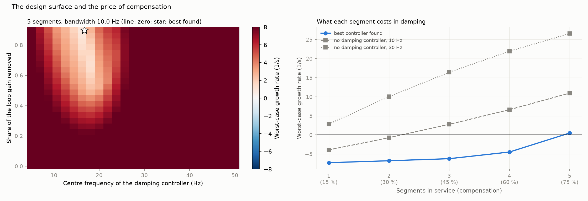
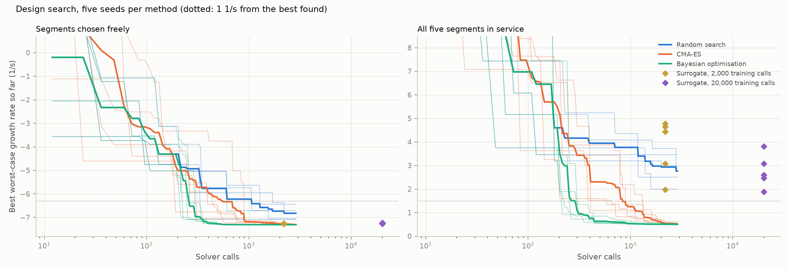
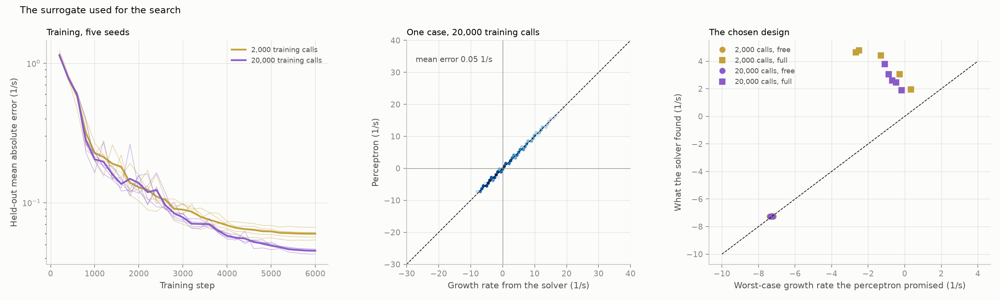
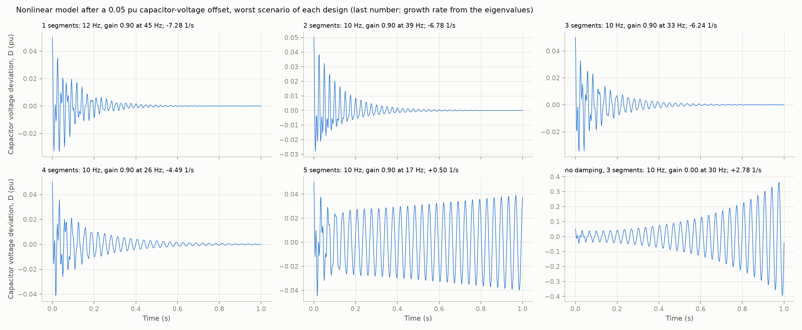

# 41: Design search for damping

Date: 2026-11-14 · Plan phase: 10

## Goal

Everything so far judged a plant as given. This step chooses: the bandwidth of the rotor current loop, the gain and frequency of a damping controller, and how many series-capacitor segments stay in service, so that the worst oscillation over a set of scenarios decays as fast as possible. It compares four ways of searching by the solver calls each needs, and confirms the designs in the nonlinear time-domain model.

## What was done

- `src/sso_sciml/physics/dfig_damped.py`: a sub-synchronous damping controller on the doubly-fed plant of dataset T1. The current loop's proportional gain acts as rotor resistance, divided by a negative slip at the resonance (step 03). The controller takes a share of that gain away in a band around one frequency, through a band-pass filter of quality 1 on the rotor current, and leaves it alone at low frequency where the loop tracks its reference. Four states are added (29 in all). With zero gain the model is that of T1 to 1e-8 1/s, and the steady state does not change (tests).
- `src/sso_sciml/design.py`: the design problem, the scenario set, the score, and nonlinear time-domain runs.
- `src/sso_sciml/search.py`: random search (Sobol), CMA-ES (the `cma` package, population 8), Bayesian optimisation (Gaussian process with expected improvement, 4 points a round).
- `scripts/phase10_design.py`: the study. `tests/test_design.py`: 13 tests.

The problem:

| Quantity | Range |
|---|---|
| Current loop bandwidth | 10 to 30 Hz. The floor of 10 Hz is the control bandwidth constraint |
| Share of the loop gain the damping controller removes at its centre frequency | 0 to 0.9 |
| Centre frequency, in the controller's frame | 5 to 50 Hz |
| Capacitor segments in service | 1 to 5, each 15 % compensation |

A design is scored on 12 scenarios: rotor speed 0.8, 1.0 or 1.2 pu; 40 % or all units online; a parallel path as strong as the line or 8 times weaker. The score is the largest growth rate of any oscillatory mode in any scenario. One design evaluation is 12 solver calls of 1.8 ms each on 8 processes. Each search gets 240 evaluations (2,880 calls) and five seeds.

The surrogate route trains a perceptron on solver calls spread over designs and scenarios, searches 200,000 designs on it, and has the solver confirm its 16 best (192 calls).

## Commands

```powershell
uv run pytest tests/test_design.py
uv run scripts/phase10_design.py            # 26 minutes
uv run scripts/phase10_design.py --reuse    # figures from the saved numbers
```

## Results

Numbers are in `docs/results/phase10/design.json`.

### What the controller buys, and what a segment costs



Worst-case growth rate in 1/s:

| Segments (compensation) | 1 (15 %) | 2 (30 %) | 3 (45 %) | 4 (60 %) | 5 (75 %) |
|---|---|---|---|---|---|
| No damping controller, 30 Hz bandwidth | +2.9 | +10.0 | +16.4 | +22.0 | +26.6 |
| No damping controller, 10 Hz | −3.9 | −0.7 | +2.8 | +6.6 | +11.0 |
| Best controller found | −7.3 | −6.8 | −6.2 | −4.5 | +0.5 |
| Its centre frequency (Hz) | 45.3 | 38.5 | 32.9 | 25.9 | 16.7 |
| Spread of the mode over the scenarios (Hz) | 40.7 to 45.8 | 32.6 to 39.9 | 26.1 to 35.4 | 20.2 to 32.0 | 14.7 to 28.9 |

- **Every optimum sits on two bounds: the bandwidth at its floor and the gain at its ceiling.** Both lower the loop's gain at the resonance. The search has found the mechanism again: the gain is the negative resistance.
- **The controller is worth 3 to 11 1/s.** At three segments it turns +2.8 into −6.2. Without it the plant is stable in every scenario only up to two segments, at the floor bandwidth.
- **Four segments can be kept in service; five cannot.** At 75 % compensation the best design still grows at +0.5 1/s in its worst scenario.
- **What stops it is the spread of the mode, not its size.** The frequency of the mode moves with rotor speed and the network. Over the scenarios it spans 5 Hz at one segment and 14 Hz at five, and falls as compensation rises. One band-pass of fixed width covers the first and not the second.
- **The worst scenario is always the same:** lowest rotor speed, all units online, weak parallel path.
- **The usable region is narrow.** In the left panel only centre frequencies of about 12 to 22 Hz with over half the gain removed come near zero.

### The four searches



Two problems. "Free": all four quantities are chosen, as the plan states it; the best score found is −7.31 1/s. "Full": all five segments stay in; the best found is +0.49 1/s.

| Method | Free: score at the end | Calls to within 1 1/s of the best | Full: score at the end | Calls to within 1 1/s | Calls to within 0.25 1/s | Wall time |
|---|---|---|---|---|---|---|
| Random search | −6.82 ± 0.26 | 336 to 1,704 | +2.76 ± 0.55 | never | never | 5 s |
| CMA-ES | −7.30 ± 0.01 | 192 to 900 | +0.52 ± 0.05 | 408 to 1,308 | 1,116 to 1,836 | 44 s |
| Bayesian optimisation | −7.31 ± 0.00 | 216 to 300 | +0.50 ± 0.03 | 216 to 312 | 264 to 684 | 15 to 19 s |
| Surrogate, 2,000 training calls | −7.27 ± 0.01 | 2,192 | +3.77 ± 1.22 | never | never | 18 s |
| Surrogate, 20,000 training calls | −7.26 ± 0.02 | 20,192 | +2.76 ± 0.72 | never | never | 50 s |

Scores are the mean and spread of five seeds. Calls are the range over the seeds.

- **Bayesian optimisation needs the fewest solver calls on both problems:** about 260 to come within 1 1/s, against 450 and 770 for CMA-ES. It is also the most repeatable.
- **CMA-ES gets to the same place with two to three times the calls.**
- **Random search is enough for the easy problem and not for the hard one.** With the segments free, a design with one segment and any strong controller is already good. With five segments the good region is too small to hit in 240 tries.
- **As the plan states the problem, the answer is to take capacitors out.** Every method puts the optimum at one segment. That is why the second problem was added.
- **Wall time is not the solver's.** 2,880 calls are 5 s. CMA-ES and the Gaussian process spend the rest on their own bookkeeping, eight and four designs at a time.

### The surrogate



- **On the easy problem the surrogate works:** it promises −7.3 and the solver finds −7.3.
- **On the hard problem it fails, and says the opposite of the truth.** It promises a stable design (−0.7 1/s with 20,000 training calls, −1.3 with 2,000) and the solver finds +2.8 and +3.8.
- **Its average error does not show this.** On 4,000 fresh cases it is off by 0.05 1/s. The search goes to the one place where it is off by 3: a narrow valley, at the edge of the range in compensation, with every scenario at a corner of the range it was trained on. A search finds a model's errors because it looks for the smallest value, and a model that is too low somewhere is smallest there. The gap between promise and solver is measured; where in the space the error sits is a reading of it and was not mapped.
- **Ten times the data moved the result by 1 1/s** and did not fix it.
- **The solver's confirmation is what caught it.** Without the 192 confirming calls the surrogate's design would have been reported as stable.

### In the nonlinear model



Each design was run for 1 s in the nonlinear model after a capacitor-voltage offset of 0.05 pu, in all 12 scenarios. Growth rate fitted to the second half of the run, in the design's worst scenario, against the eigenvalue:

| Design | Eigenvalue (1/s) | Fitted to the run (1/s) |
|---|---|---|
| 1 segment, best controller | −7.28 | −7.44 |
| 2 segments | −6.78 | −6.88 |
| 3 segments | −6.24 | −6.21 |
| 4 segments | −4.49 | −4.50 |
| 5 segments | +0.50 | +0.50 |
| 3 segments, no damping controller | +2.78 | +2.83 |

- **The nonlinear model agrees with the eigenvalues** to 0.16 1/s or better in the worst scenario of every design.
- **The designs for one to four segments decay in all 12 scenarios.** The undamped plant at three segments grows in 2 of the 12.

## Disagreements

1. **The damping controller is new in this step.** The plan lists its gain and filter frequency as design variables; no model in the repository had one. Its form, a band-pass on the rotor current that subtracts from the proportional action, was chosen here because it acts on the quantity the mechanism names. It was not taken from a published design and was not compared with one.
2. **A second problem was added.** With the segments free the optimum is one segment, which is a statement about compensation and not about search methods. The plan did not foresee that.
3. **The rotor current loop has one design variable, its bandwidth,** which sets both gains by the tuning rule of step 03. The plan says "gains".
4. **The filter's quality is fixed at 1.** A wider or adaptive filter might hold five segments. It was not tried.
5. **The score counts every oscillatory mode above 2 Hz.** The slow mode of step 21 is below that and is not in the score. It stays stable in every design checked in the time domain (largest real part −0.2 to −0.3 1/s where the resonance is damped).
6. **The scenario set is 12 points,** all at the ends of three ranges, with every other parameter at its reference value. Outages (step 25) are not in it apart from the weak parallel path.
7. **The surrogate was trained once per seed on the whole space** and not refined near its optimum. Retraining on the confirmed points, which is Bayesian optimisation with a different model, was not tried.
8. **The time-domain runs last 1 s.** A growth of 0.5 1/s is visible in the fitted rate and not yet in the amplitude.
9. **Wall times are for this implementation,** where the solver is cheap. With a solver that takes seconds a call, the call counts are what would matter.

## Decisions

- For a design search on this problem: Bayesian optimisation on the solver. A surrogate is used only with solver confirmation of what it proposes.
- The design carried forward: bandwidth at its floor, 0.9 of the loop gain removed, centre frequency set by the compensation (26 Hz at four segments), and no more than four segments in service.
- Phase 10 is closed. Its exit check is met by the tables above.

## Next

Step 42, Phase 11 of the plan: the model registry, the screening service and the model card.
