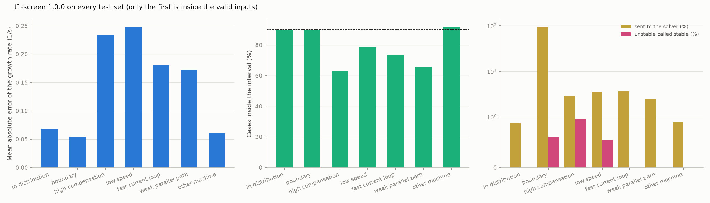
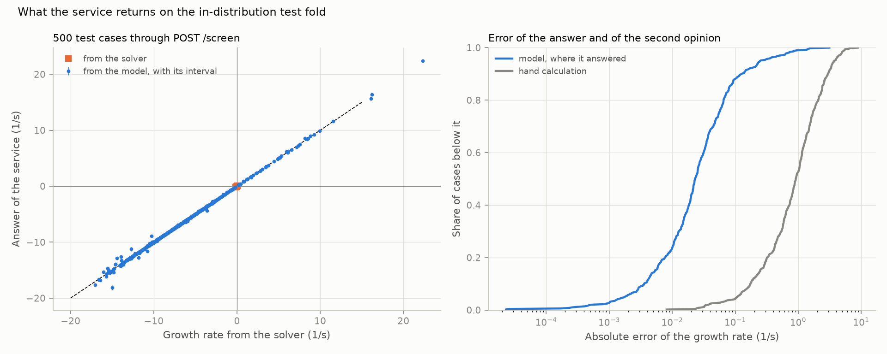

# 42: Model registry, screening service and model card

Date: 2026-11-14 · Plan phase: 11

## Goal

Put the screen of step 40 behind an interface that cannot be used wrongly without saying so: a registered model that records what it was made from, a service that answers from the model only where the model is valid and from the solver elsewhere, tests that fail when a number or a contract changes, and a card that states the limits.

## What was done

- `src/sso_sciml/registry.py`: a registered model is a folder with `weights.pt` and `card.json`. The card holds the version, the dataset version and specification hash, the training commit, the valid range of every input, the constants of the fallback rule, the interval, and the metrics on every test set. Loading checks the weights against their SHA-256 in the card and the card against the dataset specification in the code, and refuses on either mismatch. `registry/` is not committed.
- `src/sso_sciml/service.py`: a FastAPI application.
  - `POST /screen`: 12 parameters in. Out: growth rate and frequency of the sub-synchronous mode, an interval, `stable`, `source` (`surrogate` or `solver`) with the reason, the out-of-range flag and the names of the parameters outside, the mechanism quantities (resonance frequency, slip at resonance, machine and net resistance) with a sentence that reads them, and the hand calculation as a second opinion.
  - `POST /simulate`: 4 parameters in, the response of the plant of dataset T2 over 0.3 s out, with the trip time if it trips.
  - `GET /model` returns the card; `GET /health`.
- `scripts/phase11_build.py`: trains the model (arm R, five members, 100,000 cases, and one more network for the frequency), registers it as `t1-screen 1.0.0`, sends 500 test cases through the service's own code, and writes the card to `docs/model_cards/t1-screen.md`.
- `scripts/serve.py`: one command. It loads the last registered model; if there is none it builds one, from the dataset if present, otherwise from 16,384 cases it generates.
- `tests/test_service.py`: 14 tests on a small model built in the test.

## Commands

```powershell
uv run pytest tests/test_service.py
uv run scripts/phase11_build.py      # 52 s of training on the GPU, then the service check
uv run scripts/serve.py              # http://127.0.0.1:8000, interactive docs at /docs
```

A request, once the service is up:

```powershell
$case = '{"k":0.6,"w_r":1.0,"rsc_hz":15.0,"pll_hz":15.0,"outer_ratio":0.07,"ff":1.0,"x_line":1.0,"xr_line":23.3,"x_t":0.15,"par_ratio":8.0,"n_online":0.4,"r_r":0.00549}'
Invoke-RestMethod http://127.0.0.1:8000/screen -Method Post -Body $case -ContentType "application/json"
```

## Results

Numbers are in `docs/results/phase11/registry.json` and in the card, `docs/model_cards/t1-screen.md`.

### The registered model



| Test set | Growth-rate error (1/s) | Inside the 90 % interval | Sent to the solver | Unstable called stable |
|---|---|---|---|---|
| In distribution | 0.069 | 89.9 % | 0.9 % | 0 of 1,376 |
| Boundary | 0.055 | 90.0 % | 93.8 % | 15 of 2,446 |
| High compensation | 0.233 | 63.2 % | 2.9 % | 14 of 1,476 |
| Low speed | 0.248 | 78.6 % | 3.5 % | 5 of 920 |
| Fast current loop | 0.180 | 73.7 % | 3.7 % | 0 of 2,276 |
| Weak parallel path | 0.172 | 65.7 % | 2.4 % | 0 of 1,017 |
| Other machine | 0.061 | 91.7 % | 0.9 % | 0 of 538 |

- **This is the model of step 40 trained again, and it lands in the same place:** 0.9 % of in-distribution cases to the solver and no unstable case called stable, against 0.7 % there. The rule's level came out at 3.61 against 2.77, from a different half of the validation fold.
- **The last five rows are what the range check prevents.** The service never answers those cases from the model.
- **The frequency is the weaker output:** 0.29 Hz mean error in distribution, with 90 % of validation cases within 0.24 Hz. A few cases are far off; the frequency was not the object of any earlier step and has one network, not five.

### The service



500 cases of the in-distribution test fold, one at a time through the code behind `POST /screen`:

- **The sign of the answer is right in all 500.** Six (1.2 %) were answered by the solver.
- **An answer from the model takes 3.2 ms,** nearly all of it the hand calculation, which is part of every answer. An answer from the solver takes 15 ms.
- **One command starts it.** With the model registered, `uv run scripts/serve.py` answered `/health`, `/screen` and `/simulate`. The case in the request above came back as 3.73 1/s from the model with an interval of 3.64 to 3.82; the solver's value is 3.69. With compensation raised to 0.9 the same request came back from the solver, flagged out of range in `k`.

### What the tests pin

| Kind | Test |
|---|---|
| Contract | An input outside the training range returns `source: solver`, the flag and the parameter names |
| Contract | A prediction too close to zero for its spread returns `source: solver` with that reason |
| Contract | A negative or missing parameter is refused with status 422 |
| Golden numbers | The solver's answer for a pinned case: 3.69227 1/s at 31.55736 Hz |
| Limit | With 2 % compensation the plant is stable |
| Trends | The growth rate rises with compensation, and with the current-loop bandwidth |
| Registry | A saved model gives the same predictions when loaded; changed weights are refused; the card names the dataset hash, commit and input ranges |
| Simulate | 201 times and 5 quantities; the capacitor voltage starts at the offset; a stable case does not trip |

The Phase 1 golden numbers stay pinned in `tests/test_fbm.py` as before.

## Disagreements

1. **The trends are tested on the solver's answers, not the model's.** The cases are placed outside the range so that the service answers from the solver. A learned model is not guaranteed monotonic and no test claims it is.
2. **"Fresh clone, one command" builds a smaller model.** Weights and datasets are not committed. On a fresh clone `serve.py` generates 16,384 cases and trains on those, as version `0.1.0-quick`; the full model needs the dataset of step 08 and `phase11_build.py`. The quick build was not timed on a machine without a GPU.
3. **The card's training commit is the commit checked out when the model was built** (`52ca063`). The registry and service code were not yet committed at that point; the training code they call was.
4. **The service is for one process on one machine.** No authentication, no rate limit, no batching endpoint, no container.
5. **`/simulate` always runs the solver.** No learned model of the response is served; step 38's model was not registered.
6. **The interval of a solver answer has zero width.** The solver's own error against a real plant is not known (`docs/VALIDATION.md`).
7. **The test client warns that `httpx` support in Starlette's test client is deprecated.** The tests pass; the dependency will need changing.

## Decisions

- The service answers from the model only inside the input ranges and above the rule's level; everything else is the solver's.
- The hand calculation and its reading of the mechanism go out with every answer.
- Release `v1.0.0` is tagged on the commit of this step.
- Phase 11 is closed.

## Next

Phase 12: the final report.
