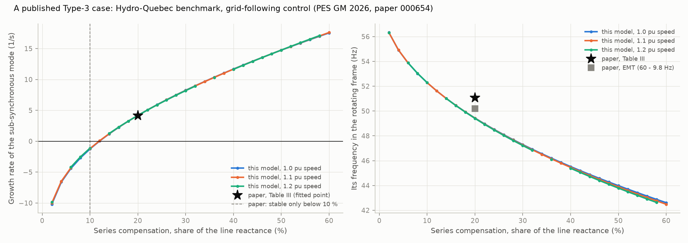

# 43: A published Type-3 case, and what is left of rungs 3 and 5

Date: 2026-11-16 · Plan phase: 13 (closing the gaps of the final report)

## Goal

Rung 3 of the validation ladder asks for the doubly-fed model against a published case with its parameters and eigenvalues. It was open because the papers cited in `docs/VALIDATION.md` could not be read. This step looks again for open sources, runs the one usable case found, and records what remains out of reach for rung 5 (recorded events).

## What was done

- Searched for open copies of published Type-3 series-compensation cases and of records of the October 2009 south Texas event.
- Found one usable case: M. Garcia Arregui, D. Rimorov, R. Gagnon, "Comparative Modal Analysis of Grid-Following and Grid-Forming Control in a Type-3 Wind Power Plant with a Series Compensated Grid", IEEE PES General Meeting 2026, paper 000654 (Hydro-Québec), openly posted. Its Table I gives the grid, line, transformers and collector; Table II the machine; Table III the eigenvalues of the grid-following plant at the nominal 20 % compensation; the text gives the stability boundary in compensation and in the current-loop gain, and the frequency seen in an electromagnetic-transient simulation.
- `scripts/published_type3.py`: puts that case into this repository's full-control model on the meshed network (`DFIGMeshed`), with no parallel path, on a base of 66 × 1.7 MVA at 230 kV.

What the paper does not give, and what was done about it:

| Missing | Handled as |
|---|---|
| Rotor current-loop gains | One bandwidth fitted so the growth rate at 20 % equals the paper's 4.17 1/s. Everything else uses it |
| Phase-locked loop, outer loops, grid-side converter | This repository's defaults: PLL 15 Hz, outer loops at 0.07 of the current loop, voltage feed-forward on |
| Operating point | Rotor speed 1.0, 1.1 and 1.2 pu |
| Shaft | One mass; the paper has several |
| Shunt capacitance | Left out (line 324 µS, collector 7.17 µF) |
| What "compensation level" is a share of | The line reactance, 50.9 Ω |

## Commands

```powershell
uv run scripts/published_type3.py   # about 3 minutes
```

## Results

Numbers are in `docs/results/validation/published_type3.json`.



| | Paper | This model |
|---|---|---|
| Frequency of the mode at 20 %, rotating frame (no fitting) | 51.08 Hz (Table III); 50.2 Hz from the EMT run (9.8 Hz in the phase current) | 49.40 to 49.43 Hz |
| Growth rate at 20 % | 4.17 1/s | fitted to it |
| Current-loop gain that gives it | not stated | Kp = 0.41, 0.47, 0.54 pu at 1.0, 1.1, 1.2 pu speed (bandwidth 81, 93, 107 Hz) |
| Compensation at which the mode becomes unstable | "stable only when the series compensation level is below 10 %" | 11.9 % to 12.0 % |
| Gain at which the plant becomes stable at 20 % | Kp = 0.45 pu | 0.73 of the fitted gain: Kp = 0.30, 0.34, 0.40 pu |
| The paper's Kp = 0.45 applied directly (no fitting) | stable | still unstable: +5.5, +3.6, +1.7 1/s |
| Effect of the PLL on the mode | "no observable impact" | none from 5 to 15 Hz (4.19 to 4.17 1/s); +0.3 at 30 Hz and +1.8 to +2.8 at 60 Hz |

- **The frequency agrees to 1.7 Hz with no fitting.** In the phase current that is 10.6 Hz against the paper's 8.9 Hz eigenvalue and 9.8 Hz EMT reading. This model reaches the paper's frequency at 13.8 % compensation instead of 20 %.
- **With one gain fitted, the boundary in compensation agrees to 2 points** (12 % against "below 10 %"), at every speed.
- **The boundary in gain does not agree.** This model needs the gain cut to 0.30 to 0.40 pu where the paper's plant is stable at 0.45. Read on the same base, the paper's 0.45 still leaves this model growing at 1.7 to 5.5 1/s.
- **The PLL result agrees at the tunings this repository uses.** It departs only at a PLL as fast as the mode.
- **Rotor speed hardly matters** for the mode's frequency or its compensation boundary once the gain is fitted, though the gain that fits it rises with speed.

The disagreements in frequency and gain point the same way. This model sees a little more effective compensation, or a little less loop reactance, than the paper's, and its current loop drives the mode harder at a given Kp. The likely causes are the ones in the table above: the shunt capacitance left out, the multi-mass shaft, and a current loop without the paper's cross-coupling feed-forward. None of these was tested here.

### Rung 5: recorded events

No record of a sub-synchronous event with plant parameters was found that could be read. What is public about the October 2009 south Texas event says a fault on a series-compensated 345 kV line left two wind plants radial on the capacitor, the oscillation grew for about 1.5 s until the capacitor was bypassed, and turbines were damaged. No frequency or growth rate from a record was found in a readable source. Rung 5 stays open.

Sources searched and read: the paper above (read in full); the arXiv paper 2508.11561 (Chatterjee et al., PNNL), which simulates a Texas-like system but gives no event numbers in its text; ERCOT workshop slides, listed by search but not read; Fan et al. 2010 (IEEE Trans. Power Delivery) and Miao 2012 (IEEE Trans. Energy Conversion), which could not be retrieved.

## Disagreements

1. **One number is fitted.** The paper does not give its current-loop gains, so the growth rate at 20 % is matched and not predicted. The frequency, the boundary in compensation, the PLL effect and the paper's own Kp of 0.45 are predictions.
2. **The current loop differs in form.** The paper's has feed-forward decoupling of the cross terms; this repository's sets both gains from one bandwidth (step 03). The gain boundary may differ for that reason alone.
3. **"Compensation level" is read as a share of the line reactance.** Read as a share of line plus grid (75.9 Ω), 20 % gives +8.2 1/s at 47.3 Hz at the fitted gain, which is further from the paper.
4. **The steady-state solve fails at 1 to 2 of 30 compensation levels** at 1.1 and 1.2 pu speed. Those points are skipped and the boundary is interpolated across them.
5. **This is one published case,** and its other controls are not this repository's. It is a partial check of rung 3, not a reproduction.

## Decisions

- Rung 3 is recorded in `docs/VALIDATION.md` as partly met: frequency within 1.7 Hz and compensation boundary within 2 points with one gain fitted; the gain boundary off by about a third.
- Rung 5 stays open. Closing it needs a record and the parameters of the plant that produced it, which is a matter of data access, not of code.

## Next

Step 44: a second implementation of the full controls, for rung 4.
