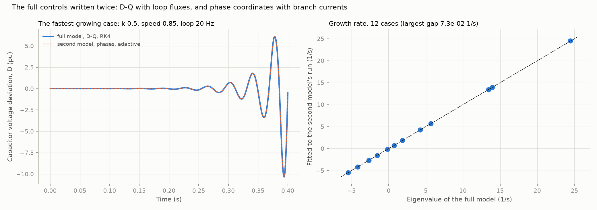

# 44: The full controls written a second time

Date: 2026-11-16 · Plan phase: 13

## Goal

Rung 4 of the validation ladder had a second implementation only of the current-loop model (step 07). The full-control model of step 04, which every dataset from T2 on uses, had been checked against itself: its eigenvalues against its own time-domain runs, and against the impedance model with the added loops switched off. This step writes the full controls again, independently, and compares.

## What was done

- `src/sso_sciml/physics/dfig_full_abc.py`: the equations of `docs/EQUATIONS.md` section 15 written again. It takes the parameter values of `dfig_full.DFIGFull` and shares nothing else with it:
  - phase a, b, c quantities in the stationary frame, not D and Q;
  - different states: the machine's own stator flux, the grid-side filter current and the capacitor voltage, where the first model uses two loop fluxes. The terminal voltage is solved for at each evaluation from the three branches that meet at the terminal;
  - the phase-locked loop carries the absolute angle of its frame, not the angle relative to the infinite bus;
  - plain NumPy with no automatic differentiation, integrated by SciPy's adaptive 8th-order Runge-Kutta (DOP853) instead of fixed-step RK4.
- `scripts/second_full_model.py`: 12 cases on a grid over the parameters of dataset T2 (compensation 0.1, 0.3, 0.5; speed 0.85, 1.15 pu; current loop 5, 20 Hz; PLL 15 Hz). Both nonlinear models start from the same capacitor-voltage offset of 0.001 pu and run for 0.4 s.
- `tests/test_dfig_full_abc.py`: 3 tests. The first model's steady state is a steady 60 Hz rotation of the second, and the two trajectories agree after an offset.

## Commands

```powershell
uv run pytest tests/test_dfig_full_abc.py
uv run scripts/second_full_model.py   # about 7 minutes, most of it the first model's RK4 on the CPU
```

## Results

Numbers are in `docs/results/validation/second_full_model.json`.



| | Result over 12 cases (7 unstable) |
|---|---|
| Steady state | The first model's steady state, mapped into the second's states, has every derivative equal to the 60 Hz rotation it should have, to 1e-7 relative |
| Capacitor voltage over the run, largest difference as a share of the largest deviation | 5e-8 at worst |
| Rotor speed, largest difference | 2e-9 pu at worst |
| DC voltage, largest difference | 2e-8 pu at worst |
| Growth rate fitted to the second model's run, against the first model's eigenvalue | within 5e-5 1/s in 11 cases; 0.07 1/s in the fastest (+24.4 1/s) |
| Frequency | within 0.008 Hz |
| Stable or unstable | the same in all 12 |

- **The two agree to the integrators' accuracy.** A difference of 5e-8 is what two integrators of different order and step produce on the same equations. A sign error, a missing term or a wrong frame in either would show at the size of the response.
- **The 0.07 1/s in the fastest case is the fit, not the model.** That case grows from 0.001 pu to 10 pu within the run, where it is no longer linear (left panel); the trajectories still agree to 7e-9. Matrix pencil fits damped sinusoids, and this run is not one.
- **The comparison is without the protection of step 33.** The first run kept it in and the fastest case reached the converter limits, which the second model does not have; its trajectories then differed by 1.5 times the response. With protection off in both, they agree.

## Disagreements

1. **The parameter values are shared.** The second model takes the gains, reactances and steady-state power of the first. An error in a value, as opposed to in an equation, is not caught here. Step 43 is the check on values.
2. **The starting state comes from the first model's steady-state solution.** It is mapped through the second model's own flux equations, and the second model then holds it at rest, so the steady-state equations are checked too. The steady-state solver itself is not written twice.
3. **Radial network only** (section 15). The meshed network of section 17, used by dataset T1, is not written twice. It was checked against the impedance model with the added loops off (step 05).
4. **No protection** in the second model: no current limit, anti-windup or chopper.
5. **This is not an electromagnetic-transient tool.** Both models are averaged (no switching) and written from the same equations document. A comparison with a commercial or open EMT program remains open.

## Decisions

- Rung 4 is recorded as met for the full controls on the radial network.

## Next

Step 45: three more disturbances on task T2 (done).
