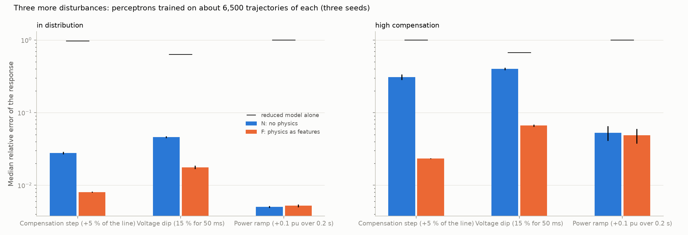
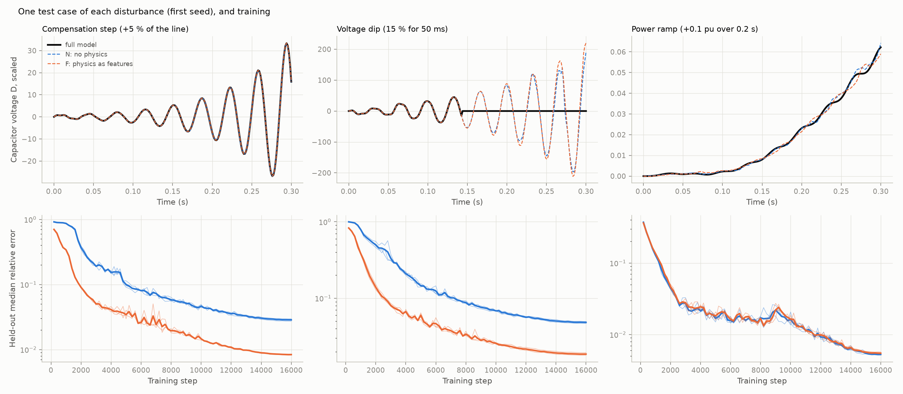

# 45: Task T2 with three more disturbances

Date: 2026-11-16 · Plan phase: 13

## Goal

Dataset T2 had one disturbance: a capacitor-voltage offset. The report listed three more as not done. This step builds a dataset for each and scores the T2 perceptrons on it, with and without the reduced model's response as inputs.

## What was done

- `src/sso_sciml/data/t2_events.py`: same cases, plant, protection, window and observed quantities as `t2`. The plant starts at rest and at t = 0 one of:
  - **compensation step:** the series capacitor's reactance rises by 5 % of the line reactance and stays (one more segment in service);
  - **voltage dip:** the infinite bus drops by 15 % for 50 ms;
  - **power ramp:** the mechanical power rises by 0.1 pu over 0.2 s and stays (a gust).
- The reduced model (machine, rotor current loop, line) is driven by the same change where it has the input. It has no mechanical power and no outer loops, so its response to the ramp is zero. That is all the physics arm F gets about a gust.
- `scripts/phase13_t2_events.py`: 8,192 cases in distribution and 1,024 at high compensation for each disturbance. Arms N (no physics) and F (reduced response as inputs) are trained as in step 38, for 16,000 steps on about 6,550 trajectories, three seeds each.

## Commands

```powershell
uv run scripts/phase13_t2_events.py           # about 20 minutes on the RTX 3070
uv run scripts/phase13_t2_events.py --reuse   # figures from the saved numbers
```

## Results

Numbers are in `docs/results/phase13/t2_events.json`. Error is the median relative error of the response, mean ± standard deviation over three seeds.



| Disturbance | Tripped | Reduced model alone, in distribution / high comp. | N in distribution | F in distribution | N high comp. | F high comp. |
|---|---|---|---|---|---|---|
| Compensation step | 11.9 % | 0.97 / 1.00 | 0.0278 ± 0.0012 | **0.0080 ± 0.0001** | 0.309 ± 0.026 | **0.0233 ± 0.0002** |
| Voltage dip | 23.7 % | 0.64 / 0.67 | 0.0461 ± 0.0013 | **0.0177 ± 0.0009** | 0.401 ± 0.014 | **0.0663 ± 0.0024** |
| Power ramp | 0 % | 1.00 / 1.00 (zero) | 0.0050 ± 0.0001 | 0.0052 ± 0.0002 | 0.053 ± 0.012 | 0.049 ± 0.011 |
| Capacitor offset (step 38, 1,000 trajectories) | | | 0.0386 | 0.0088 | 0.441 | 0.0301 |



- **The physics inputs carry over to the new disturbances.** Where the reduced model sees the event, arm F has 2.6 to 3.5 times less error in distribution and 6 to 13 times less at high compensation. That is the same pattern as for the capacitor offset in step 38.
- **The reduced model on its own is poor** (0.64 to 1.00), as for the offset. It is useful as an input, not as an answer.
- **For the gust there is nothing to add, and nothing is added.** With a zero input, arm F equals arm N to within the seeds. The ramp excites mostly the slow outer loops and the shaft, which both arms learn from data. It is the easiest event (0.5 % error) because it barely touches the sub-synchronous mode.
- **The voltage dip is the hardest** of the four: it trips the rotor-current limit in 23.7 % of cases, and the response after the limit is the part neither the reduced model nor arm N predicts well.

## Disagreements

1. **One size per disturbance.** Step 5 % of the line, 15 % dip, 0.1 pu ramp. The response to a larger step or a deeper dip is more nonlinear, and the advantage of arm F is likely to shrink as the limits engage more.
2. **About 6,550 trajectories per disturbance**, against 1,000 and 25,000 in step 38. The table's offset row is at 1,000; it is there for the pattern, not as a paired comparison.

## Decisions

- Recorded in `docs/REPORT.md` section 8 as done.

## Next

Step 46: a neural ODE with a nonlinear correction for arm A.
