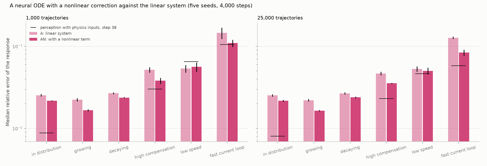

# 46: A neural ODE with a nonlinear correction for arm A

Date: 2026-11-16 · Plan phase: 13

## Goal

Arm A of task T2 (step 36) is a linear system: the reduced model's state matrix plus a learned linear correction, stepped exactly with the matrix exponential. It cannot represent the limits, saturation or the outer loops' nonlinearity. This step adds a nonlinear correction (a neural ODE) and measures what it buys, paired against arm A and compared with the perceptron with physics inputs (arm F of step 38).

## What was done

- `src/sso_sciml/models/t2.py`: arm **AN**. Each step is split into two parts (Lie splitting):
  - a nonlinear part, z ← z + h · rate · offset · (g([z / offset, θ]) − g(0, θ)), with g a perceptron of two layers of 64;
  - then the exact linear step of arm A.
  - g's last layer starts at zero, so arm AN before training is arm A (`test_arm_an_before_training_is_arm_a`). Subtracting g(0, θ) keeps the steady state where the reduced model puts it.
- `src/sso_sciml/models/t2.py` also gained `Config.data`, the weight on the data loss (used by step 47), and the value every prediction starts from at t = 0 is now taken from the data (the capacitor offset for T2, zero for a disturbance from rest), which step 45 needs. For T2 it is the same value as before.
- `scripts/phase13_neural_ode.py`: arms A and AN at 1,000 and 25,000 trajectories, five seeds each, 4,000 steps. Scored on the T2 test sets of step 36, with the in-distribution test split into growing and decaying cases. Both arms are trained for 4,000 steps at a quarter of the learning rate, as in steps 36 and 38. Paired differences use the same seeds and subsets; brackets are the 95 % interval of the paired change over the five seeds (`compare.change`).

## Commands

```powershell
uv run pytest tests/test_models_t2.py
uv run scripts/phase13_neural_ode.py           # about 3.5 hours on the RTX 3070; resumable
uv run scripts/phase13_neural_ode.py --reuse
```

## Results

Numbers are in `docs/results/phase13/neural_ode.json`. Median relative error of the response, mean ± standard deviation over five seeds.



| Test set | A @ 1,000 | AN @ 1,000 | AN − A (%) | A @ 25,000 | AN @ 25,000 | AN − A (%) | F @ 1,000 (step 38) | F @ 25,000 (step 38) |
|---|---|---|---|---|---|---|---|---|
| In distribution | 0.0253 ± 0.0008 | 0.0217 ± 0.0003 | −14 [−18, −10] | 0.0252 | 0.0217 | −14 [−19, −9] | **0.0088** | **0.0080** |
| growing | 0.0223 | 0.0166 | −26 [−32, −19] | 0.0220 | 0.0164 | −26 [−30, −21] | | |
| decaying | 0.0268 | 0.0237 | −12 [−15, −8] | 0.0267 | 0.0239 | −11 [−15, −6] | | |
| High compensation | 0.0515 | 0.0381 | −26 [−36, −15] | 0.0467 | 0.0353 | −24 [−29, −19] | **0.0301** | **0.0230** |
| Low speed | 0.0534 | 0.0561 | +5 [−15, +29] | 0.0528 | 0.0501 | −5 [−12, +2] | 0.0649 | **0.0464** |
| Fast current loop | 0.1454 | 0.1093 | −24 [−45, +3] | 0.1267 | 0.0836 | −34 [−41, −27] | **0.1048** | **0.0579** |

Training time: 238 s for arm A, 1,038 s for arm AN (4,000 steps).

- **The nonlinear correction helps, by 11 % to 34 %,** significant everywhere except at low speed and, at 1,000 trajectories, with a fast current loop. The gain is largest on growing cases (−26 %), where the response leaves the linear range within the window.
- **It does not catch up with the perceptron with physics inputs.** Arm F has less than half arm AN's error in distribution and less at high compensation and with a fast current loop. Only at low speed, at 1,000 trajectories, is arm AN ahead (0.056 against 0.065).
- **Neither arm A nor AN gains from 25 times the data** in distribution. Both are held to the structure of the reduced model's state space, and what limits them is that structure, not the data. The perceptron, which has no such structure, improves with data, most outside the range (fast current loop 0.105 to 0.058).
- **Arm AN costs four times arm A to train**: every time step adds a network call that arm A does not make.

## Disagreements

1. **Arm F is quoted, not rerun.** Its numbers are step 38's, on the same test sets and budgets but not the same seeds, so the comparison with F is not paired.
2. **The correction is small by construction** (a two-layer network on the deviation, zero at start). A larger correction network was not tried.

## Decisions

- Arm AN is kept in `models.t2` as an option. The recommended T2 surrogate stays arm F.

## Next

Step 47: a parametric PINN and an inverse PINN.
