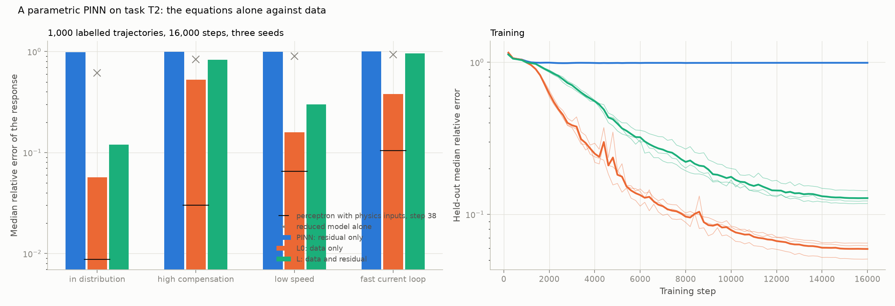
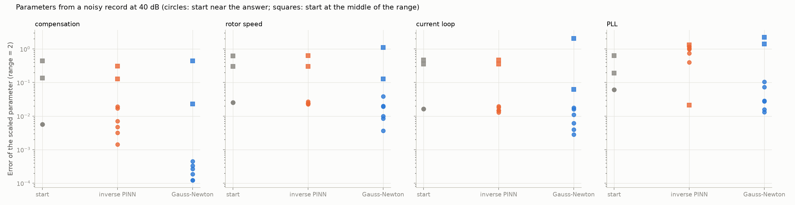

# 47: A parametric PINN and an inverse PINN

Date: 2026-11-16 · Plan phase: 13

## Goal

Phase 5 built the forward PINN for one case and the eigenvalue residual. The report listed the two other forms as not done: a **parametric** PINN, which learns the response over the whole parameter range from the equations alone, and an **inverse** PINN, which finds the parameters of one recorded response. This step builds both on task T2 and scores them against what already exists: the data-trained networks for the first, and the Gauss-Newton fit through the solver (step 39) for the second.

## What was done

- **Parametric.** Arm L of step 36 (a network x̂(t; θ) of all 23 states, trained on data and the residual of the full equations) with its data loss switched off (`Config.data = 0`), so it learns from the residual alone at 8,192 unlabelled cases (arm P). Against it, at the same 16,000 steps and on the same 1,000 labelled trajectories: arm L0 (the same network, data only) and arm L (data and residual). Three seeds. The held-out labels pick the best step for every arm, the PINN included; that is its only contact with solver data.
- **Inverse.** `src/sso_sciml/inverse_pinn.py`: a network x̂(t) of one trajectory, with Fourier features of 10 to 60 Hz, trained on the residual of the full equations at 1,024 collocation points and on the measured line current. The unknowns are trainable: compensation, rotor speed, current-loop and PLL bandwidths (in scaled units, ±1 over the range), the mechanical power and the steady state. 8,000 steps.
- `scripts/phase13_pinns.py`: 6 test cases, line current over 0.3 s with white noise at 40 dB. Started (a) from the truth moved by the convolutional network's median error at 40 dB (step 39), with random signs, and (b) for 2 of the cases from the middle of the range. The Gauss-Newton fit gets the same records and starts.
- `tests/test_inverse_pinn.py`: 3 tests. The scaling and the parameters written in Torch match the NumPy versions and the plant's, and the parameters are differentiable in the unknowns.

## Commands

```powershell
uv run pytest tests/test_inverse_pinn.py
uv run scripts/phase13_pinns.py           # about 2.5 hours on the RTX 3070
uv run scripts/phase13_pinns.py --reuse
```

## Results

Numbers are in `docs/results/phase13/pinns.json`.

### Parametric

Median relative error of the response, mean of three seeds.



| Arm | In distribution | High compensation | Low speed | Fast current loop | Training |
|---|---|---|---|---|---|
| P: residual only (parametric PINN) | 0.987 | 0.999 | 0.998 | 1.000 | 577 s |
| L0: data only | 0.057 | 0.526 | 0.159 | 0.381 | 73 s |
| L: data and residual | 0.120 | 0.833 | 0.300 | 0.960 | 578 s |
| Perceptron with physics inputs (step 38, same 1,000 trajectories) | **0.0088** | **0.030** | **0.065** | **0.105** | |
| Reduced model alone | 0.613 | 0.836 | 0.897 | 0.935 | |

- **The parametric PINN learns nothing usable.** An error of 0.99 is the error of predicting no response. The steady state satisfies the equations everywhere except near t = 0, and the residual loss settles on it. The forward PINN of step 12 collapsed the same way over a 0.5 s window; here there is one network for every case, and no marching.
- **The residual makes the data-trained network worse,** by a factor of 2 in distribution and 2.5 with a fast current loop, at eight times the training time. Step 36 found the same from 1,000 trajectories.

### Inverse

Median absolute error over the cases, in scaled units (1 = half the range).



| Start | Fit | Compensation | Rotor speed | Current loop | PLL |
|---|---|---|---|---|---|
| Truth ± the network's error (6 cases) | start | 0.0056 | 0.025 | 0.016 | 0.061 |
| | inverse PINN | 0.0059 | 0.024 | 0.015 | 0.996 |
| | Gauss-Newton through the solver | **0.0002** | **0.015** | **0.0085** | **0.028** |
| Middle of the range (2 cases) | inverse PINN | 0.22 | 0.47 | 0.41 | 0.67 |
| | Gauss-Newton | 0.23 | 0.62 | 1.06 | 1.82 |

One inverse-PINN fit takes 462 s.

- **From a good start, the inverse PINN does not improve on where it starts** for the three parameters the record determines, and it drives the PLL bandwidth below the bottom of the range in five of six cases (to −0.79 in the sixth). Gauss-Newton cuts the network's error by 40 % to 55 % on rotor speed, current loop and PLL, and 28 times on compensation.
- **From the middle of the range neither works.** Gauss-Newton goes off to the bounds on two parameters. The PINN moves the compensation part of the way (0.29 to 0.22), leaves speed and current loop where they start, and moves the PLL the wrong way. The record does not contain enough to find the parameters from nothing; the network of step 39 is what gives the start.
- **The PLL is the parameter the line current says least about** (its bound at 40 dB is 0.046, the largest of the four, step 39). My reading, not tested: with so little pull from the data, its gradient comes mostly from the network's fit to the equations, and it drifts.

## Disagreements

1. **Six cases for the inverse PINN** at 462 s each. Enough to show that it does not improve on its start; not enough for a distribution.
2. **One residual weighting** (residual 1, steady state 10) and one learning rate per group. Step 12 tried Fourier inputs, sine activations and causal weighting on the forward form, and only marching in time helped; none of these were tried here.

## Decisions

- Neither PINN is recommended. For T2 the data-trained perceptron with physics inputs stays the surrogate, and the convolutional network followed by Gauss-Newton stays the identifier (step 39).

## Next

Step 48: the out-of-distribution study on T2, and a physics-residual detector (done).
